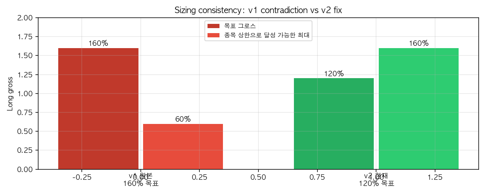
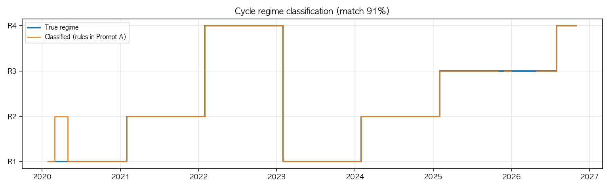
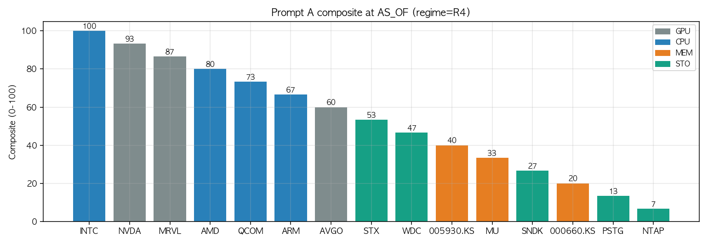
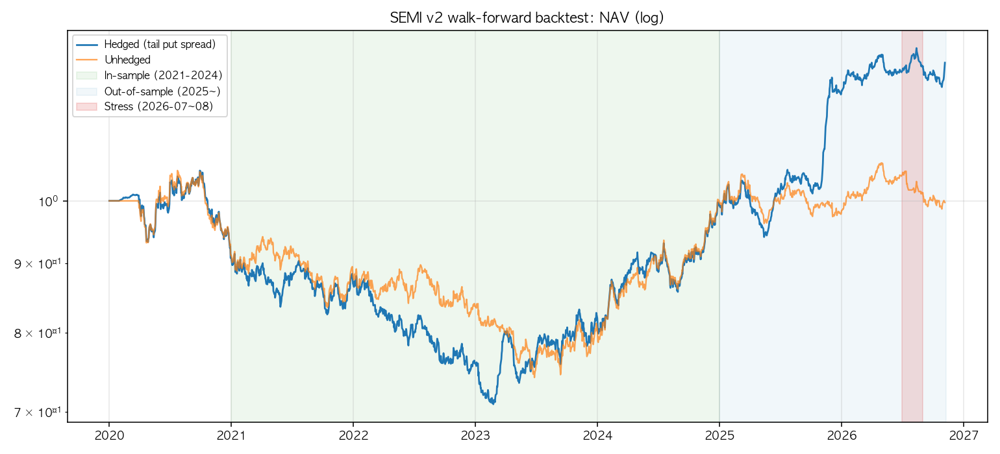
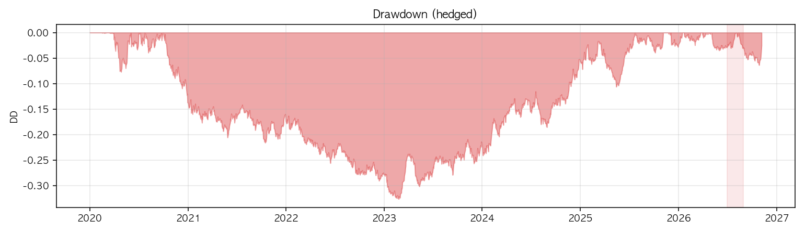
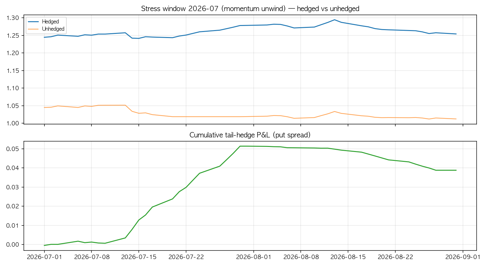
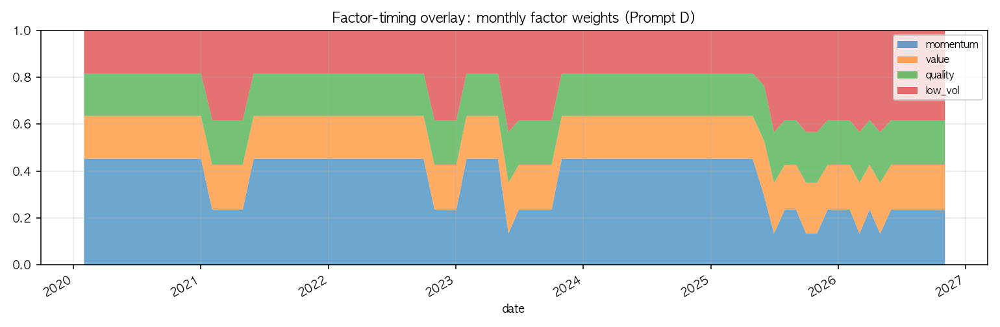

# SEMICONDUCTOR-QUANT-PROMPTS-V2 — 검증 스크립트

> "LLM은 엑셀이지 오라클이 아니다" — 프롬프트가 정의한 규칙을 실제 코드로 옮겨 **실행 가능한지** 검증한다.
> 합성(synthetic) 데이터 기반이며, 실시장 성과 검증이 아니라 **규칙 정합성 · 룩어헤드 차단 · 사이징 실행가능성 · 워크포워드 프로세스**를 확인하는 것이 목적이다.

## 구조

```
SEMICONDUCTOR-QUANT-PROMPTS-V2-2026-11/
├── SEMICONDUCTOR-QUANT-PROMPTS-V2-2026-11.md   # 프롬프트 원문
├── gpt/                        # ChatGPT Custom GPT (Instructions + 가이드)
│   ├── GPT-instructions-KR.md  # 시스템 지침 (한국어)
│   ├── GPT-instructions-EN.md  # 시스템 지침 (영어)
│   └── GPT-setup-guide.md      # Custom GPT 만들기 가이드
├── script/
│   ├── config.py              # 프롬프트의 모든 수치·가중치·임계값 (문서의 상수 모음)
│   ├── synthetic_data.py      # 결정적(seed 고정) 합성 데이터 생성기 (실데이터 교체 지점)
│   ├── factors.py             # mom_12_1 / mom_3m / revision / quality / value / low_vol
│   ├── regime.py              # 사이클 국면 판정 R1~R4 + N/A 폴백 (프롬프트 A 2))
│   ├── scoring.py             # 서브섹터 중립 z, 컴포지트, 3.2 JSON 스키마 출력
│   ├── portfolio.py           # crowd_z, 후보 선정, 사이징, 리스크 트리거 (프롬프트 C/E)
│   ├── hedge.py               # 3M 풋 스프레드 테일 헤지 + 예산 관리 (프롬프트 D 4))
│   ├── backtest.py            # 워크포워드 백테스트 엔진 (프롬프트 D 5))
│   ├── consistency.py         # 데이터 없이 하는 규칙 정적 정합성 검사 20개
│   ├── tests.py               # 단위 테스트 22개 (unittest)
│   └── run_validation.py      # 전체 실행기: 검사 → 데모 → 백테스트 → 차트 → 리포트
└── result/                    # 산출물 (JSON/CSV/PNG/리포트)
```

Claude Agent Skill은 레포 루트의 `.claude/skills/semiconductor-quant-v2/`에 있다
(`SKILL.md` + `references/`). Claude Code에서 자동 로드되며, 이 폴더의 파이프라인을 호출한다.

## 실행

```bash
# Python 3.9+, pandas / numpy / matplotlib
python script/run_validation.py            # 전체 실행 (~70초)
python script/run_validation.py --no-charts
python script/run_validation.py --skip-tests
python -m unittest script/tests -v         # 단위 테스트만
```

## Claude 스킬 / ChatGPT GPT

| 도구 | 위치 | 모드 |
|---|---|---|
| Claude Code · claude.ai | `.claude/skills/semiconductor-quant-v2/SKILL.md` (+ `references/`) | `compute`(규칙 계산) / `codegen`(코드 생성) / `validate`(이 파이프라인 실행) / `interpret`(결과 해석) |
| ChatGPT Custom GPT | `gpt/GPT-instructions-KR.md`(·EN) + `gpt/GPT-setup-guide.md` | 규칙 계산·코드 생성 (실행은 로컬 파이썬) |

- Claude 스킬: 프롬프트 A~E 규칙이 축약본(`references/`)으로 번들되어 `<DATA>` 블록만 주면 스코어·포지션 JSON을 계산하고, `validate` 모드로 이 검증 파이프라인을 직접 돌릴 수 있다.
- ChatGPT: Instructions에 지침을 붙여넣고 원문 md를 Knowledge에 업로드해 Custom GPT로 만든다(가이드 참고). ChatGPT는 코드를 실행하지 못하므로 결정적 계산은 Claude 스킬/로컬 파이썬을 권장.
- 문서-스킬-코드 1:1 대응: 프롬프트 원문을 고치면 `.claude/skills/.../references/`, `gpt/GPT-instructions-*.md`, `script/config.py`를 함께 갱신한다.

## 검증 항목

| # | 항목 | 프롬프트 근거 | 결과 |
|---|---|---|---|
| 1 | 규칙 정적 정합성 20개 (가중치 합=100, 사이징 모순, 국면 규칙 커버리지, 13F 가중치 상한, 스키마) | 3.2 · A · B · C · D · E | **20/20 통과** |
| 2 | 단위 테스트 22개 | "codegen 모드는 단위 테스트 포함" | **22/22 통과** |
| 3 | 국면 분류기 vs 진국면 (82개월) | A 2) | **일치율 91.5%** |
| 4 | AS_OF compute 데모 (스키마 준수 JSON) | A/B/C/E | 생성됨 |
| 5 | 워크포워드 백테스트 (IS 파라미터 선택 → OOS 평가) | D 5) | IS 샤프 기준 mom_w=50 선택 |
| 6 | 테일 헤지 스트레스 검증 (2026-07 튜닝 금지 구간) | D 4) | 헤지 효율 **2.68** |

### 1) 원본(v1) 사이징 모순 → v2 해소

원본은 "롱 160% / 4종목 / 종목당 15% 상한"으로 **최대 60%**밖에 달성할 수 없어 수학적으로 불가능했다. v2는 롱 120% / 6~8종목 / 20% 상한으로 정합적이다.



### 2) 사이클 국면 판정 (프롬프트 A 2))

DRAM/NAND 계약가 변화율·재고일수·CAPEX/매출의 5년 z-score로 R1~R4를 판정. 2개 이상 입력 결측 시 N/A+low 폴백.



### 3) AS_OF 컴포지트 (프롬프트 A, 2026-11-06 기준)

국면 가중치(mom_12_1/revision/cycle)로 서브섹터 중립 컴포지트를 산출. 3.2 스키마 JSON(`prompt_a_compute_asof.json`)으로 출력된다.



### 4) 워크포워드 백테스트 (프롬프트 D)

파라미터(모멘텀 기본 가중치 30/40/50)는 **2021~2024(IS)에서만 선택**, 2025-01~AS_OF는 아웃오브샘플. 2026-07 모멘텀 붕괴는 스트레스 구간으로 분리(튜닝 금지).

| 구간 | CAGR | 연 변동성 | Sharpe | MaxDD | Calmar |
|---|---|---|---|---|---|
| 전체 | 3.3% | 9.7% | 0.39 | −32.6% | 0.10 |
| 인샘플 2021–2024 | 2.2% | 10.5% | 0.26 | −22.4% | 0.10 |
| 아웃오브샘플 2025–2026 | 13.4% | 7.4% | 1.74 | −9.1% | 1.48 |





### 5) 테일 헤지 스트레스 테스트 (프롬프트 D 4))

2026-07 모멘텀 붕괴 구간(튜닝 금지): 헤지 없음 **−3.1%**, SMH 유사 지수 3M 풋 스프레드(예산 연 1.5% NAV) 포함 **+0.8%**. 헤지 효율(손실 감소/연 헤지 비용) = **2.68**.



### 6) 팩터 타이밍 오버레이 (프롬프트 D 3))

자체 모멘텀 L/S 팩터의 12M 롤링 샤프 히스테리시스(≤0 2개월 → momentum 20/low_vol 40)와 Jaccard 오버랩 감속(×0.5)이 월별 가중치로 동작한다.



## 검증 중 발견된 프롬프트 이슈

1. **프롬프트 C 후보 규칙 내부 충돌** — 유니버스 15종목에서 "composite 상위 1/3"은 5종목인데 "롱 6~8종목" 규칙과 맞지 않는다. 검증 코드는 종목 수 규칙을 우선하고 `data_gaps`로 보고한다.
2. **숏 후보 부족** — 롱/숏 후보가 겹치는 종목이 있어 유효 숏 후보가 4종목 미만으로 줄 수 있다. 3.1의 확장 유니버스(9종목 추가)가 해소 경로다.
3. **국면 판정 경계월** — z-score가 경계 근처에서 노이즈에 흔들려 국면 전환 인접월 오분류 가능(합성 기준 일치율 91.5%). 실데이터에서는 판정 1개월 지연 확정 등 완충 규칙을 검토할 수 있다.

## 산출물 목록

| 파일 | 내용 |
|---|---|
| `result/consistency_report.json` | 정적 정합성 검사 20개 결과 |
| `result/backtest_summary.json` | 워크포워드·구간별 성과·헤지 효율 |
| `result/backtest_equity.csv` | 일별 NAV(헤지 포함/미포함)·드로다운 |
| `result/factor_weights_monthly.csv` | 월별 팩터 가중치(타이밍 오버레이) |
| `result/factor_returns_daily.csv` | 모멘텀 L/S 팩터 수익률·헤지 P&L |
| `result/regime_history.csv` | 월별 국면 판정 vs 진국면 |
| `result/prompt_a_compute_asof.json` | AS_OF compute 데모 (3.2 스키마) |
| `result/prompt_b_candidates_asof.csv` | 서브섹터별 후보·팩터 기여 분해 |
| `result/prompt_c_positions_asof.json` | 포지션·crowd_z·손절 규칙·제약 체크 |
| `result/factor_table_asof.json` | AS_OF 팩터 원시값 스냅샷 |
| `result/validation_report.md` | 종합 리포트 (차트 포함) |

## 실데이터로 검증하려면

`synthetic_data.py`의 `load_all()`이 반환하는 dict와 동일한 키(`prices`, `cycle`, `crowding`, `ntm_eps`, `n_analysts`, `om_slope`, `fcf_margin`, `nd_ebitda`, `book_ps`, `fcf_ta`, `eps_vol`, `mcap`, `index_iv`)로 실데이터를 채우면 나머지 파이프라인은 그대로 동작한다.

> **고지:** 본 검증은 합성 데이터 기반이며 특정 종목 매매를 권유하지 않는다. 모든 가중치·임계값은 초기값으로, 실제 운용 전 독립적인 검증이 필요하다.
