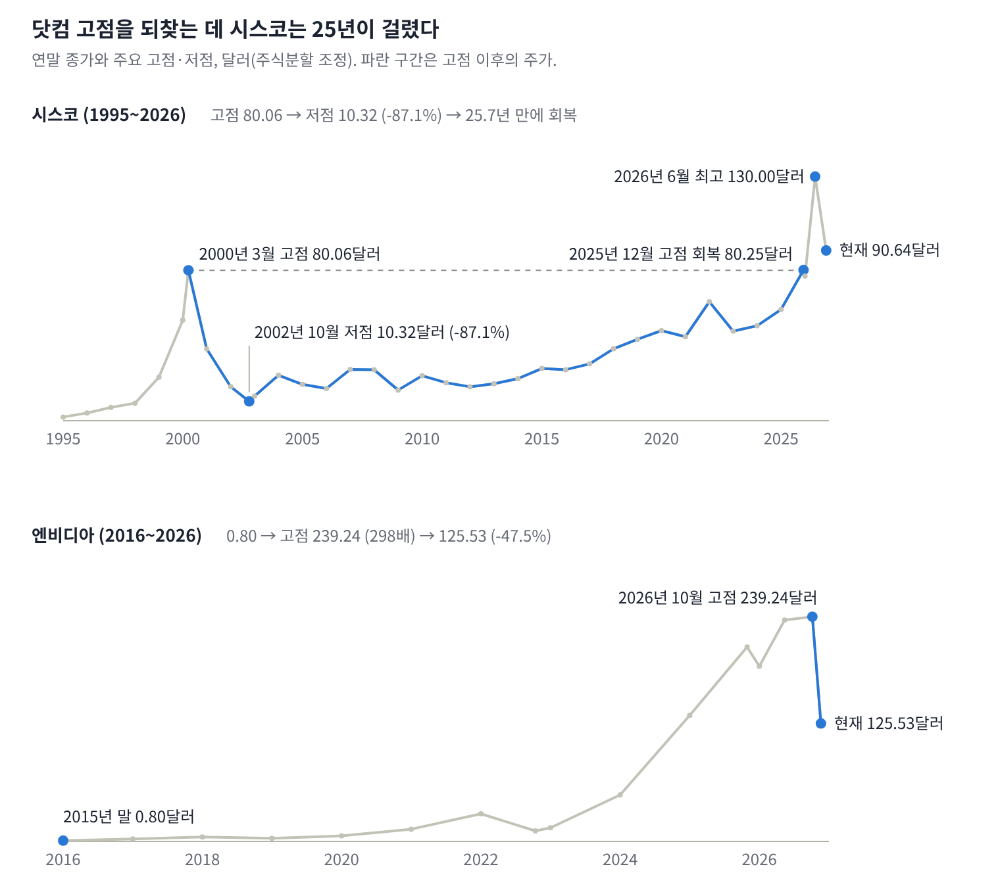

# 조정인가 하락인가? - 일단, 하락 횡보

2026-11-23 · 김호광 (Dennis Kim)

**Vibe Quant Insight Report — NVidia, AI Sector** · [vibequant.cc](https://vibequant.cc/)

## 목차

- [저자 소개](#저자-소개)
- [들어가며](#들어가며)

1. [평균으로 돌아가는 시간](#평균으로-돌아가는-시간)
2. [3년의 지형도](#3년의-지형도)
3. [닷컴 버블의 주역 시스코와 엔비디아의 공통점](#닷컴-버블의-주역-시스코와-엔비디아의-공통점)
4. [가격의 거품과 수요의 거품 사이에서 무엇이 다른가?](#가격의-거품과-수요의-거품-사이에서-무엇이-다른가)
5. [왜 폭락도 반등도 아닌 횡보인가?](#왜-폭락도-반등도-아닌-횡보인가)
6. [횡보를 끝낼 신호들](#횡보를-끝낼-신호들)
7. [맺으며, 같은 듯 다른 두 개의 정점](#맺으며-같은-듯-다른-두-개의-정점)

- [출처](#출처)

## 저자 소개

**김호광 (Dennis Kim)**

- 前 싸이월드 대표 — 한국의 대표 소셜 플랫폼, 3,500만 회원
- 게임 보안, 소셜 플랫폼, 블록체인 분야 28년 이상의 개발 경력
- Microsoft Azure MVP 9년 연속 (2015-2023)
- 사이버 위협 인텔리전스(CTI) · AI 기반 퀀트 투자 · Web3를 연구하는 독립 연구자
- 원본 취약점 연구: 텔레그램 0-click RCE (ZDI-CAN-30207, CVSS 9.8 Critical)
- 한국어·영어·일본어·중국어 4개 국어 콘텐츠 발행
- 오픈 리서치 플랫폼 VibeQuant 운영: AI 퀀트 · 사이버 위협 인텔리전스 · Web3, 투자 칼럼 447편
- 공개: [vibequant.cc](https://vibequant.cc/)

## 들어가며

신호와 소음 속에서 투자는 감정을 배제하고 데이터로 해야한다고 믿었던 시대가 있었다. 그러나 인간의 뜨거운 감정은 때론 욕망이 되고 그 크기가 버블이 될 때가 있다. 그리고 소망하던 것들이 우리 생활을 윤택하게 만드는 기술이 되었다.

닷컴 버블 이후, 기술의 발전이 인류의 발전과 행복이 되리라 믿었고 그런 기술 낙관주의는 보편적인 인공지능으로 인해 기본 소득이 생겨날 것이라는 믿음을 가졌다.

2026년 가을, 엔비디아의 리더쉽은 젠슨 황 개인의 문제를 넘어 인공지능과 인공지능 인프라 섹터 전체로 파급되었다.

신호와 소음 사이에서 인류의 희망적인 발전을 믿으며 데이터를 더해 지금의 상황을 파악하고자 이 글을 쓰게 되었다.

원본 저장소 : <https://github.com/gameworkerkim/vibe-investing>

## 평균으로 돌아가는 시간

결론부터 적는다. 조정도 하락도 아니다. 일단은 횡보다. V자 반등도, 시스코식 붕괴도 아닌, 몇 분기에 걸친 중기 하락 횡보가 가장 가능성 높은 길이라고 보고 있다.

나스닥 100을 추종하는 QQQ는 긴 호흡으로 보면 한 해 10\~15% 오르는 자산이다. 그런데 최근 4년은 평균과 거리가 멀었다. 2023년 53.8%, 2024년 24.9%, 2025년 20.2%가 올랐고, 2026년에도 9월 하순까지 21.3%를 더했다. 4년 누적 180%로, 1999년 이후 가장 가파른 4년이었다([Benzinga][benzinga]).

금융 시장에서 평균보다 빠르게 오른 것은 대부분 평균으로 수렴한다. 지난주가 그 장면이었다. 11월 20일 금요일, 엔비디아는 하루에 14% 빠져 125.53달러로 마감했다([Yahoo Finance][yahoo-nov20]). 나스닥 종합지수는 5% 넘게 떨어지며 올해 상승분을 전부 반납했고, 다우와 S&P 500도 조정 구간에 들어섰다([Yahoo Finance][yahoo-live]).

평균으로 돌아가는 길은 두 가지다. 가격이 떨어지거나, 시간이 흐르거나. 가격은 이미 많이 떨어졌다. 이제 남은 것은 시간이다.

## 3년의 지형도

3년 동안 주도주는 해마다 바뀌었고, 가장 먼저 오른 종목이 가장 먼저 지쳤다.

**2024년은 엔비디아의 해였다.** 엔비디아가 171% 오르며 선두에 섰고([Motley Fool][fool]), 브로드컴과 TSMC도 100% 안팎의 수익률로 AI 인프라 붐을 이끌었다. 이 열기는 AMD와 삼성전자까지는 오지 않았다.

**2025년에는 주도권이 메모리로 넘어갔다.** SK하이닉스가 HBM 수요 폭발로 200%를 훌쩍 넘게 올랐다. 파이낸셜타임스는 12월 집계 기준 234% 오른 이 회사를 그해 글로벌 증시의 승자로 꼽았다([헤럴드경제][herald]). 삼성전자와 AMD도 크게 반등했고, 엔비디아는 올랐지만 상승률은 눈에 띄게 둔화되었다. AI GPU에서 AI를 지체하는 병목 구간으로 옮겨간 것이다.

**2026년은 차별화의 해다.** AMD와 인텔은 NPU와 추론(학습 후 연산) 수요, 공급 병목을 타고 10월 중순까지 각각 연초 대비 175% 안팎 올랐다. 같은 시점 엔비디아의 상승률은 22%에 그쳤다([Yahoo Finance][yahoo-intel]). 브로드컴은 9월 초 기준 7%였다([24/7 Wall St.][wallst-sep]).

그리고 11월, 후발 주자들도 무너지기 시작했다. 인텔은 10월 30일 하루에 29% 급락했다([Yahoo Finance][yahoo-correction]). AMD는 11월 13일 8.75%([Yahoo Finance][yahoo-amd]), 19일 7.7%([24/7 Wall St.][wallst-nov20]), 20일 11.3% 빠졌고, 브로드컴도 20일 같은 폭으로 떨어졌다([AlphaStreet][alphastreet]).

차별화 장세가 동반 하락으로 바뀌었다는 것은 의미가 크다. 시장이 개별 종목이 아니라 AI 인프라라는 주제 전체의 희망과 욕망의 값에서 실질적으로 돈을 버는 값을 다시 매기고 있다는 뜻이다.

## 닷컴 버블의 주역 시스코와 엔비디아의 공통점

AI와 AI 인프라 주식은 100년에 걸쳐 오를 몫을 몇 년 만에 올랐다. 이 대목에서 떠오르는 이름이 시스코다.

닷컴 버블기의 시스코는 그야말로 환상적인 상승을 보여줬다. 2000년 3월 27일 80.06달러로 정점을 찍었고, 2002년 10월까지 87% 떨어졌다([Webull][webull]). 그 고점을 다시 넘은 날은 2025년 12월 10일이다. 25년이 걸렸다([Bloomberg][bloomberg]).

*그림: 시스코 연말 종가는 MarketScreener 연간 등락률을 2025년 말 종가에서 역산, 엔비디아는 Macrotrends 기준. 2026년 11월 20일 종가까지.*

시스코는 고점을 되찾기까지의 25년 가운데 대부분을 고점의 절반 아래에서 보냈다. 엔비디아의 차트는 아직 그 첫 장면에 서 있다.

시스코와 엔비디아는 거울처럼 닮았다.

**첫째, 기술 혁명의 병목을 장악한 주도주였다.** 시스코는 인터넷 트래픽을 처리하는 라우터·스위치를, 엔비디아는 AI 연산을 가능하게 하는 GPU 가속기를 압도적 점유율로 쥐었다. 두 회사 모두 골드러시의 곡괭이와 삽을 팔았다.

**둘째, 폭발적인 매출 성장에 '이번엔 다르다'는 서사가 붙었다.** 시스코의 매출 성장률은 회계연도 1998년 32%, 1999년 43%, 2000년 55%로 해마다 가팔라졌다([SEC 1998][sec-1998], [SEC 1999][sec-1999], [SEC 2000][sec-2000]). 엔비디아는 더 극적이다. 지난 회계연도 매출이 2,159억 달러로 3년 전의 약 8배가 되었고([엔비디아 8-K][nvda-8k]), 지난 분기에도 전년 대비 103% 늘었다.

**셋째, 고객의 구매를 금융으로 떠받친다.** 시스코는 현금이 부족한 통신·인터넷 신생 기업이 장비를 살 수 있도록 벤더 파이낸싱을 제공했다. 엔비디아도 같은 길에 들어서 있다. 3분기 말 보증 규모는 1,180억 달러이고([Longbridge][longbridge]), 데이터센터 리스와 클라우드 서비스 약정은 1,020억 달러다([CNBC][cnbc-q3]). 장비 회사가 금융 공학 회사를 겸하기 시작하면, 수요의 진짜 크기는 알기 어려워진다.

**넷째, 밸류에이션이 압축되었다.** 엔비디아는 10월 6일 고점에서 7주 연속 하락해 종가 기준 47.5%가 빠졌다. 7주 연속 하락은 2008년 금융위기 이후 처음이다([CNBC][cnbc-streak]). 선행 PER은 11월 초 13배로 S&P 500보다 낮아졌고([Crypto Briefing][cryptobriefing]), 지난주 급락 뒤에는 집계에 따라 8배 안팎까지 내려왔다([GuruFocus][gurufocus]).

이것은 시스코가 2000년 이후 겪은 멀티플 붕괴와 같은 메커니즘이다. 다만 시스코는 그 과정에서 매출이 꺾였고, 엔비디아는 매출이 여전히 두 배씩 늘고 있다. 거울은 여기서 금이 간다.

## 가격의 거품과 수요의 거품 사이에서 무엇이 다른가?

시스코는 주가가 실적이 바탕되지 않았던 버블이고, 엔비디아는 수요가 일시적일 수 있는 버블이다. 두 회사의 본질적 기초 체력은 다섯 가지에서 차이가 발생한다.

| 구분 | 시스코 (2000년 정점) | 엔비디아 (2026년 11월) |
| --- | --- | --- |
| 밸류에이션 | PER 200배 이상, EV/매출 31배 | 선행 PER 8\~15배, 집계 기관별 |
| 매출총이익률 | 약 65% | 약 75% |
| 핵심 고객 | 현금이 부족한 통신·인터넷 신생 기업 | 하이퍼스케일러, 분기 매출 600억 달러 |
| 수요의 성격 | 백본을 한 번 깔면 둔화 | 모델과 사용량이 커질수록 반복 증가 |
| 공급과 재고 | 2001년 약 22억 달러 재고 상각 | 공급 부족, 공급 약정 3,900억 달러 |

*자료: 시스코 밸류에이션은 [FT][ft], 매출총이익률은 [SEC 공시][sec-1999]. 엔비디아 밸류에이션은 [io-fund][iofund], 매출총이익률은 [8-K][nvda-8k], 하이퍼스케일러 매출은 [컨퍼런스콜][call], 공급 약정은 [CNBC][cnbc-q3].*

**밸류에이션의 출발선이 다르다.** 시스코의 가격은 완벽함을 가정한 가격이었다. 성장이 조금만 둔화되어도 버틸 수 없었다. 엔비디아의 가격은 이미 성장 둔화를 상당 부분 반영하고 있다.

**마진의 질이 다르다.** 10%포인트의 격차는 엔비디아의 제품이 하드웨어를 넘어 CUDA 생태계와 결합된 풀스택 플랫폼이라는 데서 나온다. 높은 마진은 수요가 둔화될 때 완충재가 된다. 다만 회사가 4분기 마진 전망을 낮춰 잡았다는 점은 적어 둔다([Panabee][panabee]).

**고객의 지불 능력이 다르다.** 시스코의 고객은 버블이 꺼지자 함께 무너졌다. 엔비디아의 핵심 고객은 자기 현금흐름으로 투자하는 빅테크다. 그러나 가장 빨리 크는 쪽은 하이퍼스케일러가 아니라 1년 새 거의 세 배가 된 AI 클라우드·산업·엔터프라이즈 고객군이고, 앞 장에서 본 보증과 약정이 불어난 시기와 겹친다. 이 차이는 예전만큼 선명하지 않다.

**수요의 지속성이 다르다.** 인터넷 인프라는 한 번 깔면 끝이었다. AI 연산은 학습이 끝난 뒤에도 추론으로 계속 소비된다. 엔비디아의 수요 기반이 시스코보다 동적이고 반복적이라는 뜻이다.

**공급의 방향이 다르다.** 시스코는 수요가 꺾이는 시점에 재고를 쌓았고, 엔비디아는 공급이 수요를 못 따라간다. 하지만 마이클 버리가 2월에 경고했을 때 952억 달러였던 구매 약정은 그새 네 배가 되었다([Barchart][barchart]). 지난 분기에만 1,110억 달러가 늘었고 대부분 다년 메모리 조달이다. 공급 부족이 만든 약정이지만, 수요가 꺾이는 날에는 그대로 재고 위험이 된다.

정리하면 거품의 위치가 '가격'에서 '수요의 지속 가능성'으로 옮겨 갔다. 가격의 거품은 하루아침에 터지지만, 수요의 거품은 분기 실적이 하나씩 나올 때마다 천천히 검증된다. 횡보를 예상하는 첫 번째 이유가 여기에 있다.

## 왜 폭락도 반등도 아닌 횡보인가?

주가 하락의 하방은 럭셔리 브랜드와 비견되는 순이익이 막고, 주가 상승은 리더쉽과 지속적인 수익이라는 불확실성이 막는다. 그 사이에 공포와 희망 사이에서 갇힌 주가가 갈 곳은 게걸음이다.

### 아래를 막는 것

**이익이라는 바닥이 있다.** 엔비디아의 선행 PER은 시장 평균보다 낮다. 여기서 주가가 다시 반 토막 나려면 이익이 반 토막 나야 한다. 그런데 회사는 4분기 매출 1,300억 달러를 제시했고, 다음 회계연도 성장률 전망도 약 75%로 올렸다([컨퍼런스콜][call]).

**회사가 자기 주식을 산다.** 엔비디아는 3분기에 자사주 매입 한도를 1,500억 달러 늘렸다. 남은 한도는 2,270억 달러이고 2028 회계연도 말까지 집행할 계획이다([Yahoo Finance][yahoo-buyback]). 시가총액 약 3조 달러의 7% 남짓이다. 주가가 내려갈수록 같은 돈으로 더 많은 유통되는 주식을 소각하는 효과가 있다.

**매출의 절반은 여전히 현금 부자에게서 나온다.** 하이퍼스케일러의 투자가 갑자기 멈추지 않는 한, 2001년 시스코처럼 주문이 하루아침에 사라지는 일은 일어나기 어렵다.

### 위를 막는 것

**숫자로 풀리지 않는 문제가 쌓였다.** 11월 17일 엔비디아는 예상치 1,091억 달러를 넘는 1,158억 달러의 매출을 발표했다. 주가는 그 뒤 사흘 내리 빠졌다. 젠슨 황이 11월 12일 즉시 사임했고([24/7 Wall St.][wallst-nov13]), 20일에는 SEC가 회계 문제를 들여다본다는 로이터 보도가 나왔다. SEC와 회사 어느 쪽도 확인하지 않은 보도다([South Shore Press][southshore]). 후계와 규제는 분기 실적이 아니라 시간이 푸는 문제다.

**위에는 매물이 쌓여 있다.** 7주 만에 47.5%가 빠졌다는 것은 그 사이 모든 가격대에 물린 매수자가 있다는 뜻이다. 20일·50일·100일·200일 이동평균선이 모두 190\~212달러에 몰려 있다([Mitrade][mitrade]). 반등할 때마다 본전을 기다리던 매물이 나올 수 밖에 없다.

**눈높이가 너무 높아졌다.** 매출이 두 배가 되어도 주가가 떨어진다는 것은 시장이 '놀라운 성장'이 아니라 '더 놀라운 성장'을 요구한다는 뜻이다. 100%를 넘는 성장률은 산술적으로 오래갈 수 없다. 회사 스스로 내년 성장률을 그보다 낮게 제시하고 있다.

### 그래서, 시간

가격 조정은 상당 부분 진행되었다. 남은 것은 기간 조정이다. 주가가 멈춰 선 채 이익이 자라 밸류에이션을 메우고, 후계와 규제 문제가 하나씩 정리되고, 물린 매물이 손바뀌는 시간이 필요하다. 시장이 공포에서 벗어나 냉정하게 엔비디아의 본질 가치를 평가할 시간이 필요하다.

시스코의 진짜 교훈은 87% 폭락이 아니라 그 뒤의 시간이다. 바닥을 친 뒤에도 시스코는 돈을 잘 버는 회사였지만 주가는 오랫동안 박스권에 갇혀 있었다. 엔비디아가 시스코처럼 25년을 기다려야 한다는 뜻은 아니다. 출발 밸류에이션이 다르니 기간도 훨씬 짧을 것이다. 하지만 몇 분기의 횡보와 하락은 각오해야 한다.

## 횡보를 끝낼 신호들

횡보는 전망이지 약속이 아니다. 박스가 어느 쪽으로 깨지는지는 아래 신호들이 알려 줄 것이다.

상승 전환 시나리오, 위로 깨지는 조건

- 후임 CEO가 확정되고 SEC 관련 보도가 사실무근으로 정리된다.
- 내년 초 4분기 실적에서 매출 1,300억 달러를 넘기고 마진을 지킨다.
- 하이퍼스케일러들이 2027년 설비투자 계획을 유지하거나 늘린다.

횡보 후 급락 시나리오. 아래로 깨지는 조건

- 하이퍼스케일러 가운데 한 곳이라도 설비투자를 줄인다. 상위 세 고객이 매출의 36%를 차지한다([Panabee][panabee]).
- 엔비디아가 보증을 선 고객 가운데 자금 조달에 실패하는 곳이 나온다.
- 3,900억 달러의 공급 약정이 재고 상각으로 바뀌기 시작한다.
- 회계 문제가 사실로 확인된다.

아래쪽 조건이 하나라도 현실이 되면 이 글의 결론은 횡보에서 하락으로 바뀐다. 그때는 엔비디아가 정말로 매출과 이익은 있지만 물린 사람들이 다시는 쳐다보지 않을 시스코의 길을 걷는 것이다.

## 맺으며, 같은 듯 다른 두 개의 정점

시스코의 교훈은 한 문장이다. 기술적 리더십만으로는 정당화될 수 없는 가격이 있다. 그러나 2026년의 엔비디아는 그 교훈을 그대로 반복하지 않는다. 시스코의 몰락은 200배 PER이라는 가격에 내재된 운명이었고, 엔비디아의 위험은 훨씬 낮은 가격에서 AI 인프라에 쏟아부은 자본이 실제 수익으로 돌아오느냐에 달려 있다.

인공지능이 미래라는 것은 누구도 부정하지 못한다. 인터넷도 미래였고, 실제로 그 미래는 왔다. 다만 미래가 오는 속도와 주가가 그것을 반영하는 속도는 다르다.

개인적으로 조심스럽게 평가한다. 앞으로 몇 분기 동안 엔비디아와 AI 인프라 주식은 더 놀라운 성장을 보여주지 못하는 한 박스권을 벗어나기 어렵다. 급락의 공포는 지나가고 있지만, 그 뒤에는 지루함이라는 다른 종류의 지옥이 기다린다. 조정인가 하락인가를 묻는다면, 일단은 횡보와 계단 식 하락이라고 답하겠다.

*\*주의:이 글은 개인적인 시장 견해이며 투자 권유가 아니다. 주가와 실적 수치는 2026년 11월 20일 종가와 그 주의 보도를 기준으로 했다.*

## 출처

- 엔비디아 주가와 11월 20일 급락: [CNBC][cnbc-streak], [Yahoo Finance][yahoo-nov20], [Mitrade][mitrade]
- 엔비디아 2027 회계연도 3분기(2026년 8\~10월) 실적: [CNBC][cnbc-q3], [컨퍼런스콜 전문][call], [Longbridge][longbridge], [Panabee][panabee]
- 엔비디아 밸류에이션: [Crypto Briefing][cryptobriefing], [io-fund][iofund], [GuruFocus][gurufocus]
- 나스닥 100과 반도체 종목별 수익률: [Benzinga][benzinga], [Yahoo Finance][yahoo-intel], [헤럴드경제][herald]
- 시스코: [Bloomberg][bloomberg], [2000 회계연도 실적 발표][sec-2000], [1999 회계연도 보고서][sec-1999]
- 마이클 버리의 구매 약정 경고: [Barchart][barchart]
- 주가 차트: [MarketScreener][marketscreener](시스코 연간 등락률), [Macrotrends 시스코][macrotrends-csco], [Macrotrends 엔비디아][macrotrends-nvda], [Yahoo Finance][yahoo-bubble](엔비디아 종가 고점)

[benzinga]: https://www.benzinga.com/news/26/09/61931324/nasdaq-100-best-four-year-rally-since-1999-memory-chips-lead
[yahoo-nov20]: https://finance.yahoo.com/markets/stocks/articles/stock-market-today-nov-20-215502847.html
[yahoo-live]: https://finance.yahoo.com/markets/live/stock-market-today-friday-november-19-dow-sp-500-nasdaq-anthropic-nvidia-141644188.html
[fool]: https://www.fool.com/investing/2025/01/13/why-nvidia-stock-skyrocketed-1712-in-2024-but-is-s
[herald]: https://www.heraldk.com/article/2025122220572759800
[yahoo-intel]: https://finance.yahoo.com/markets/stocks/articles/intel-174-2026-amd-175-190533310.html
[wallst-sep]: https://247wallst.com/investing/2026/09/01/semiconductor-stocks-slide-as-global-bond-selloff-lifts-yields-intel-drops-3-nvidia-and-amd-slip/
[yahoo-correction]: https://finance.yahoo.com/markets/stocks/articles/nasdaq-100-now-officially-correction-123859739.html
[yahoo-amd]: https://finance.yahoo.com/technology/ai/articles/amd-intel-nvidia-fall-ai-114519979.html
[wallst-nov20]: https://247wallst.com/investing/2026/11/20/amd-stock-drops-another-7-0-before-the-bell-and-taiwan-semiconductor-slides-4-2-as-nasdaq-futures-fall-1-6-after-asias-chip-selloff/
[alphastreet]: https://news.alphastreet.com/broadcom-plunges-11-3-amid-sector-wide-selling/
[webull]: https://www.webull.com/news/15889916331344896
[bloomberg]: https://www.bloomberg.com/news/articles/2025-12-10/cisco-shares-finally-top-dot-com-record-after-more-than-25-years
[sec-1998]: https://www.sec.gov/Archives/edgar/data/0000858877/000089161800000470/0000891618-00-000470.txt
[sec-1999]: https://www.sec.gov/Archives/edgar/data/0000858877/000109581100002304/ex99-1.txt
[sec-2000]: https://www.sec.gov/Archives/edgar/data/858877/000089161800004430/ex99-1.txt
[nvda-8k]: https://www.sec.gov/Archives/edgar/data/1045810/000104581026000019/q4fy26pr.htm
[longbridge]: https://longbridge.com/en/academy/accounting/blog/how-to-read-nvidia-s-fy2027-q3-earnings-beyond-doubled-revenue-what-do-the-supply-chain-and-risks-signal-101704
[cnbc-q3]: https://www.cnbc.com/2026/11/17/nvidia-nvda-earnings-report-q3-2027.html
[cnbc-streak]: https://www.cnbc.com/amp/2026/11/20/nvidias-7-week-losing-streak-is-longest-since-2008-financial-crisis.html
[cryptobriefing]: https://cryptobriefing.com/nvidia-forward-pe-below-sp-500-walmart/
[gurufocus]: https://www.gurufocus.com/term/forward-pe-ratio/NVDA
[ft]: https://tech.slashdot.org/story/25/12/11/2013233/
[iofund]: https://io-fund.com/ai-stocks/nvidia-stock-5-reasons-ai-trade-has-only-begun
[call]: https://stockanalysis.com/stocks/nvda/transcripts/739383-q3-2027/
[panabee]: https://www.panabee.com/news/nvidia-earnings-q3-2027
[barchart]: https://www.barchart.com/story/news/4406785/michael-burry-called-nvidias-95-billion-in-purchase-obligations-troubling-in-february-six-months-later-the-filings-show-that-number-ballooned-to-279-billion
[yahoo-buyback]: https://finance.yahoo.com/markets/stocks/articles/nvidia-corp-nvda-q3-2027-050105336.html
[wallst-nov13]: https://247wallst.com/investing/2026/11/13/amd-tumbles-11-broadcom-and-intel-slide-6-as-chip-rally-reverses/
[southshore]: https://www.southshorepress.com/business/nvidia-falls-14-percent-on-an-unconfirmed-account-of-an-sec-accounting-review-dca24c37
[mitrade]: https://www.mitrade.com/kr/insights/shares/analysis/nvidia-stock-price-forecast
[marketscreener]: https://ae.marketscreener.com/quote/stock/CISCO-SYSTEMS-INC-4862/quotes/
[macrotrends-csco]: https://www.macrotrends.net/stocks/charts/CSCO/cisco/stock-price-history
[macrotrends-nvda]: https://www.macrotrends.net/stocks/charts/NVDA/nvidia/stock-price-history
[yahoo-bubble]: https://finance.yahoo.com/technology/ai/articles/ai-bubble-finally-popping-nvidia-140106035.html
