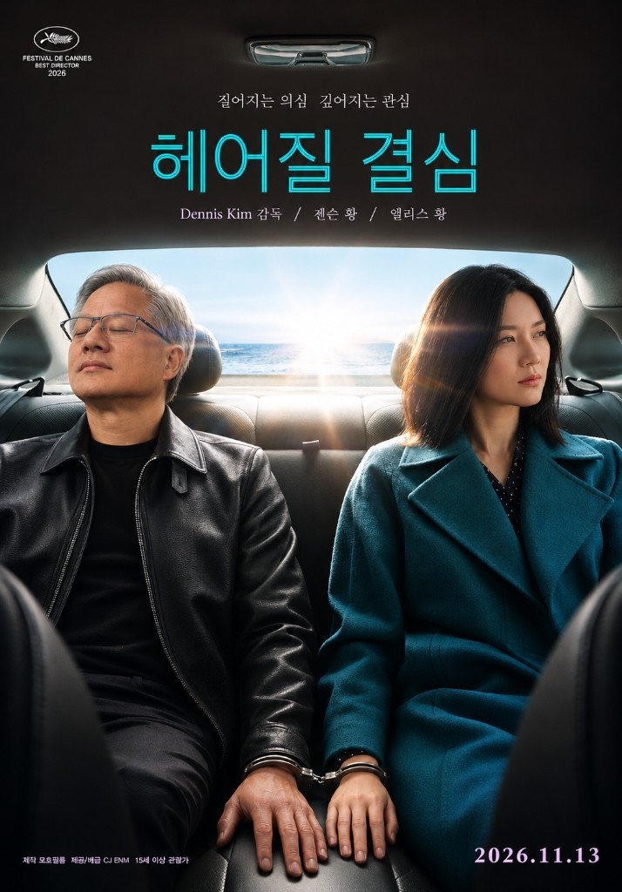

<!--
---
title: "젠슨 황 이후의 엔비디아 — 키맨 리스크"
subtitle: "2026~2027 현금흐름은 계약이 지키고, 2028년 이후 멀티플은 비전에 달렸다"
description: "11월 12일 젠슨 황 사임. 2026~2027 현금흐름은 계약이 지키지만, 2028년 이후 멀티플은 비전의 제도화에 달렸다. 키맨 리스크를 λ와 p, 규제를 q로 나눈다."
date: 2026-11-13
updated: 2026-11-13
author: "김호광 (Dennis Kim)"
lang: ko
tags:
  - 엔비디아
  - 젠슨 황
  - 키맨 리스크
  - 퀀트
keywords:
  - 엔비디아
  - 젠슨 황
  - 콜레트 크레스
  - 키맨 리스크
  - 헤어질 결심
group: ai-llm
og_image: "https://vibequant.cc/og/nvidia-after-jensen-huang-og.jpg"
image: "https://vibequant.cc/og/nvidia-after-jensen-huang-og.jpg"
schema_type: BlogPosting
draft: false
robots: index,follow
---
-->

# [Vibe Quant] 헤어질 결심. 젠슨 황 이후의 엔비디아 - 키맨 리스크에 가격을 매기는 법



Nov 13, 2026 · @Dennis Kim

11월 12일 엔비디아 이사회는 젠슨 황이 사장, CEO, 이사직에서 즉시 물러났다고 [공시](https://www.sec.gov/Archives/edgar/data/0001045810/000104581026000082/nvidiaannouncesceotransiti.htm)했다. 33년 만의 일이다. 질문은 "그가 물러날 것인가"에서 "그가 없는 엔비디아에 얼마를 매길 것인가"로 바뀌었다.

이 글의 명제는 하나다. **2026\~2027년 현금흐름은 계약과 공급망이 지키지만, 2028년 이후의 멀티플은 "비전의 제도화"가 성공하느냐에 걸려 있다.** 그래서 키맨 리스크는 한 덩어리로 다루면 안 된다. 일회성 밸류에이션 충격과 장기 성장률 변수, 두 개로 쪼개서 모델에 넣어야 한다.

아래에서는 리더십, 제품 일정, 고객 관계, 장기 비전, 조사·규제의 다섯 축을 우려와 기회의 대칭 구조로 점검한다. 확인된 사실과 보도·주장은 구분해서 적었다.

## 0. 사건의 성격 정의 - 실적이 아니라 프리미엄이 깨졌다

이 사건은 스캔들이 아니라 수출통제 의혹과 결합된 지배구조 사건이다. 엔비디아의 주문서는 그대로인데, "젠슨 황이 10년 더 이끈다"는 전제 위에 쌓인 밸류에이션 프리미엄이 사라졌다. 퀀트 관점에서는 실적 훼손이 아니라 **할인율과 멀티플의 재정의**로 다뤄야 한다.

확인된 것과 아닌 것을 먼저 가른다. 회사의 8-K와 보도자료는 사임 사유를 밝히지 않았다. 배경은 모두 언론 보도와 황 본인의 사내 서한에서 나온다. 황은 11월 8일 서한에서 혼외 관계를 인정했지만 상대를 특정하지 않았다. 상대가 중국 정보기관과 연계됐다는 것은 미 정부 관계자를 인용한 뉴욕타임스 보도이고, 중국 외교부는 근거 없는 추측이라고 반박했다. 법무부도 사실관계를 아직 확정하지 않았다고 밝혔다.

| 날짜 | 사건 | 출처 |
| --- | --- | --- |
| 2026-11-12 | 황, 사장·CEO·이사직 즉시 사임. 콜레트 크레스 CFO가 임시 CEO 겸직, 하비 존스가 창사 이래 첫 이사회 의장 | [8-K 보도자료](https://www.sec.gov/Archives/edgar/data/0001045810/000104581026000082/nvidiaannouncesceotransiti.htm) |
| 2026-11-11 | NYT, 직속 임원과의 두 번째 관계 보도. WSJ, 이사회가 해임을 준비 중이라고 보도 | [CBS 타임라인](https://www.cbsnews.com/news/jensen-huang-nvidia-resignation-scandal-timeline/) |
| 2026-11-08 | 황, 사내 서한으로 혼외 관계 인정. 이사회, 독립 조사 착수 발표 | [CBS 타임라인](https://www.cbsnews.com/news/jensen-huang-nvidia-resignation-scandal-timeline/) |
| 2026-05-13 | 컬퍼 리서치, 메가스피드 경유 우회 수출 의혹 보고서 공개 | [Culper](https://culperresearch.com/wp-content/uploads/2026/05/Culper_NVDA_5-13-2026.pdf) |
| 2026-02 | 싱가포르, 메가스피드 조사 중 앨리스 황 재입국 금지 | [CBS 타임라인](https://www.cbsnews.com/news/jensen-huang-nvidia-resignation-scandal-timeline/) |
| 2025-02 | 싱가포르, 서버 구매 허위 신고 혐의로 메가스피드 등 조사 개시 | [CBS 타임라인](https://www.cbsnews.com/news/jensen-huang-nvidia-resignation-scandal-timeline/) |

표가 말해 주는 것은 하나다. 시장이 11월에 놀란 재료의 상당수는 5월에 이미 공개돼 있었다. 키맨 리스크는 새로 생긴 것이 아니라, 인간이 보고자 하는 것과 인지하는 것의 차이가 발생하여 가격이 뒤늦게 인정한 것이다.

## 가격이 말하는 것 - 셀사이드는 60%를 깎았고, 시장은 13%를 깎았다

사임 당일 엔비디아는 장중 최대 14\~16% 급락한 뒤 4.34% 하락으로 마감했다. 전일 종가 173.73달러에서 역산하면 종가는 약 166달러다. 10월 6일 사상 최고 종가 239.24달러 대비로는 약 31% 낮다. 장중 시가총액은 2025년 7월 이후 처음으로 4조 달러를 밑돌았고, 이번 주에만 약 5,000억 달러가 증발했다 ([CNBC](https://www.cnbc.com/2026/11/12/nvidia-nvda-jensen-huang-second-affair.html), [NBC](https://www.nbcnews.com/business/markets/nvidia-stock-huang-resigns-rcna608958), [TechTimes](https://www.techtimes.com/articles/330561/20261112/jensen-huang-resigns-nvidia-shares-tumble-interim-ceo-kress-keeps-cfo-job-before-earnings.htm)).

여기서 숫자 두 개를 분리해야 한다. 고점 대비 31% 하락 가운데 스캔들이 불거진 뒤의 하락분은 약 13%라는 집계가 있다 ([IBTimes](https://www.ibtimes.com/nvidia-shares-fall-jensen-huang-ceo-ouster-3809707)). 나머지는 그 전에 이미 빠져 있었다. 로이터에 따르면 주가는 14년 만에 가장 낮은 선행 이익 멀티플에서 거래되고 있다 ([Al Jazeera](https://www.aljazeera.com/news/2026/11/12/ai-titan-jensen-huang-out-as-nvidia-ceo)).

| 기관 | 이전 목표가 | 새 목표가 | 변화 | 11/12 종가(약 166달러) 대비 | 투자의견 |
| --- | --- | --- | --- | --- | --- |
| Evercore ISI | 465달러 | 186달러 | -60% | +12% | Outperform → In Line |
| Baird | 500달러 | 200달러 | -60% | +20% | Outperform → Neutral |
| Bernstein | 400달러 | 200달러 | -50% | +20% | Outperform → Market Perform |
| Yorkville Ives | 300달러 | 225달러 | -25% | +35% | 유지 |
| Mizuho | 250달러 | 250달러 | 0% | +50% | Outperform 유지 |

출처: [Yahoo Finance/TipRanks](https://finance.yahoo.com/markets/stocks/articles/nvda-stock-price-forecast-top-204543429.html), [CNBC](https://www.cnbc.com/2026/11/12/nvidia-boards-crisis-meeting.html), [Newsweek](https://www.newsweek.com/what-nvidias-share-price-could-look-like-without-jensen-huang-12706384). 종가 대비 괴리율은 필자 계산이다. Oppenheimer는 투자의견을 내리고 목표가 자체를 철회했다.

표에서 읽을 것은 세 가지다.

- **깎고도 현재가 위다.** 가장 비관적인 Evercore의 186달러조차 종가보다 12% 높다. 셀사이드의 하향은 "팔라"가 아니라 "예전만큼 비싸게 사 줄 이유가 없다"에 가깝다.
- **명시적 키맨 할인은 25%다.** 대니 아이브스는 "젠슨이 있는 엔비디아 300달러, 없는 엔비디아 225달러"라고 적었다. 초안의 25\~30% 할인 추정이 목표가로 구체화된 숫자다.
- **분산이 신호다.** 같은 회사에 186달러와 250달러가 동시에 붙어 있다. 하향 전 평균 목표가는 283.83달러였다. 컨센서스 자체가 "황 전제" 위에 쌓여 있었고, 그 전제가 빠지자 추정의 닻이 사라졌다.

기저율도 하나 있다. 야후 파이낸스가 보잉, HP, 베스트바이, 윈, 인텔, 맥도날드의 CEO 품행 사건 6건을 검토한 결과, 첫날 주가 반응의 중앙값은 약 -3%였고 6건 중 4건이 이후 12개월간 S&P 500을 중앙값 약 12%포인트 밑돌았다 ([TechTimes](https://www.techtimes.com/articles/330561/20261112/jensen-huang-resigns-nvidia-shares-tumble-interim-ceo-kress-keeps-cfo-job-before-earnings.htm)). 표본 6건은 통계가 아니라 일화다. 다만 "첫날 반등했으니 끝났다"는 결론을 경계할 근거로는 충분하다.

## 1. 다음 리더의 문제 - 가장 크고, 가장 정량화하기 어려운 리스크

### 우려

엔비디아는 승계 계획 없이 승계 국면에 들어갔다. 황은 COO 없이 약 60명의 직보를 두고 디테일을 직접 챙겼고, 승계 계획을 믿지 않는다고 말해 왔다. 올여름에는 앞으로 20년을 더 이끌 조직이라고 했다. 회사의 위임장 설명서조차 "오랜 경영진에 크게 의존한다"는 위험 문구를 담고 있다 ([TechTimes](https://www.techtimes.com/articles/330561/20261112/jensen-huang-resigns-nvidia-shares-tumble-interim-ceo-kress-keeps-cfo-job-before-earnings.htm), [CBS](https://www.cbsnews.com/news/jensen-huang-next-nvidia-ceo-candidates/)).

임시 체제도 구조적으로 얇다. 콜레트 크레스는 2013년부터 CFO를 맡은 재무통이고, 임시 CEO와 CFO를 겸직한다. 사베인스-옥슬리법이 분기·연간 보고서 인증 주체로 지목하는 두 자리를 한 사람이 채운 셈이다. 애널리스트들은 그를 정식 후임이 아닌 관리형 임시 수장으로 본다. 이사회는 탐색 일정을 밝히지 않았다.

세 번째 우려는 인재 유출이다. Oppenheimer는 "브레인 드레인" 가능성을 경고했다. 60명이 한 사람에게 보고하던 조직은 그 한 사람이 사라지면 보고선뿐 아니라 충성의 대상도 잃는다.

### 기회

후보군 자체는 얇지 않다. 다만 시장은 누가 될지 전혀 합의하지 못하고 있다.

| 후보 | 현직 | 강점 | Kalshi | Polymarket |
| --- | --- | --- | --- | --- |
| 이언 벅 | 엔비디아 데이터센터 총괄, CUDA 창시자 | 매출 대부분이 나오는 사업부, 기술 정통성 | 35% | 32% |
| 팀 쿡 | 애플 이사회 의장(2026년 9월 CEO 퇴임) | 공급망·대관·승계 경험, 트럼프 공개 지지 | - | 약 50% |
| 콜레트 크레스 | 임시 CEO 겸 CFO | 연속성, 투자자 신뢰 | 22% | 24% |
| 르네 하스 | Arm CEO, 전 엔비디아 임원 | 칩 설계 조직 운영 경험 | 9% | 9.2% |
| 조니 스루지 | 애플 하드웨어 총괄 | 애플 실리콘 주역, 이사회 검토 보도 | - | - |

출처: [CBS News](https://www.cbsnews.com/news/jensen-huang-next-nvidia-ceo-candidates/), 11월 12일 오전 기준. 두 시장의 계약 구조가 달라 확률 합은 100%가 아니다.

이 표는 그 자체로 퀀트 입력값이다. 같은 질문에 한 시장은 벅 35%, 다른 시장은 쿡 50%를 매긴다. **후임 분포의 엔트로피가 높다는 것이 곧 리더십 할인의 크기다.** 반대로, 이사회가 외부 서치펌까지 동원한 만큼 내부 승계 실패 위험은 외부 인재 시장으로 분산돼 있다. 영구 CEO가 확정되는 날, 누가 되든 이 할인의 일부는 기계적으로 되돌려진다.

후보 유형에 따라 되돌림의 성격은 다르다. 벅 같은 내부 기술 리더는 로드맵 연속성 프리미엄을, 쿡 같은 운영형 외부 인사는 지배구조·대관 프리미엄을 준다. 전자는 축 4(비전)를, 후자는 축 5(규제)를 완화한다. 둘을 동시에 주는 후보는 명단에 없다.

## 2. 제품 일정 - 단기 실적의 닻

### 우려

개발 조직이 한 사람의 판단에 맞춰 설계돼 있었다. CEO 공백은 설계 의사결정의 속도와 우선순위에 마찰을 만든다. 차세대 아키텍처의 테이프아웃, 고객 인증, 공급사 물량 배정은 최고 의사결정자의 승인 지연에 민감한 일정이다.

연 1회 아키텍처 교체라는 속도 자체가 위험이기도 하다. 12개월마다 랙 규격이 바뀌는 일정은 누군가 매 분기 "이것을 먼저 한다"고 잘라 줘야 유지된다. 그 역할이 재무 책임자에게 임시로 넘어갔다.

### 기회

이번 세대는 이미 출하 중이고, 다음 두 세대는 날짜가 공개돼 있다.

| 세대 | 시기 | 상태 |
| --- | --- | --- |
| 베라 루빈 (VR200 NVL72) | 2026년 하반기 | 2026년 8월 양산 출하 개시. CoreWeave, 구글 클라우드, 애저, 오라클, Nebius에 배치 |
| 루빈 울트라 (NVL576 "Kyber") | 2027년 하반기 | 로드맵 공표 |
| 파인만 (Rosa CPU 결합) | 2028년 | 로드맵 공표, 세부 사양 미공개 |

출처: [Inside Deep Tech](https://www.insidedeeptech.com/nvidia-vera-rubin-nvl72-full-guide/), [intechnologies](https://www.intechnologies.co/insights/nvidia-gtc-2026-vera-rubin-roadmap-buying-blackwell-now), [Tom's Hardware](https://www.tomshardware.com/pc-components/gpus/nvidia-updates-data-center-roadmap-with-rosa-cpu-and-stacked-feynman-gpus-optical-nvlink-groq-lpus-with-nvfp4-and-nvlink-also-on-deck).

수요 쪽 락인은 더 강하다. 황은 GTC 2026에서 2027년까지 약 1조 달러 규모의 주문을 언급했다 ([ModulEdge](https://www.moduledge.com/blog/nvidia-vera-rubin)). 팔로알토 네트웍스의 니케시 아로라는 지난달 "젠슨에게 말해도 2028년까지는 칩을 못 받는다"고 했다 ([CBS](https://www.cbsnews.com/news/jensen-huang-next-nvidia-ceo-candidates/)). 이사회도 사임 발표문에 "운영, 고객 약속, 제품 로드맵은 중단 없이 이어질 것"이라는 문장을 넣었다.

퀀트 관점의 결론은 이렇다. **2026\~2027년 매출 추정치의 분산은 CEO 리스크보다 작다.** 이미 테이프아웃이 끝난 세대와 체결된 공급 계약은 CEO가 누구인지 묻지 않는다. 일정 리스크가 숫자에 나타난다면 그것은 루빈 울트라의 램프 시점, 즉 2027년 하반기부터다. 그 전까지 제품 일정은 다섯 축 가운데 가장 낮은 리스크다.

## 3. 고객, 파트너 관계는? - "깐부 외교"의 공백

### 우려

젠슨 황의 관계 자본은 조직도에 적히지 않은 무형 자산이었다. 2025년 10월 30일 이재용 삼성전자 회장, 정의선 현대차그룹 회장과의 "깐부 회동" 이튿날 엔비디아는 삼성, SK와의 협력 계획을 발표했다 ([뉴스핌](https://www.newspim.com/news/view/20261112001134)). CEO 개인 간 유대가 계약의 비공식 보증 역할을 해 온 것이다. 후임자가 이것을 단기간에 복제하기는 어렵다.

한국 시장은 이 공백을 노출도 순서대로 가격에 넣었다. 해임설이 돈 11월 12일 SK하이닉스는 약 2%, 삼성전기는 약 4% 내렸고, 사업이 분산된 삼성전자는 0.97% 올랐다 ([블루밍비트](https://bloomingbit.io/feed/news/124280)). 엔비디아향 HBM 매출 비중이 클수록 민감도가 컸다. 증권가는 엔비디아의 고객사 금융지원 정책이 유지되는지도 변수로 꼽는다.

### 기회

관계가 비어도 주문은 비지 않았다. 삼성전자는 10월 29일 실적 콘퍼런스콜에서 2027년 HBM 물량이 이미 솔드아웃이라고 밝혔다. SK하이닉스는 2027\~2028년 생산능력의 절반 이상을 장기공급계약으로 확보했다고 했다 ([뉴스핌](https://www.newspim.com/news/view/20261112001134), [비즈니스플러스](https://www.businessplus.kr/news/articleView.html?idxno=119801)). 하나증권의 지적대로 봐야 할 것은 황의 거취가 아니라 **기존 HBM 발주량이 유지되는가**다.

엔비디아의 협상력은 애초에 개인 관계가 아니라 CUDA 전환비용과 공급망 내 대체 불가능성에서 나온다. 깐부 회동이 계약을 만든 것이 아니라, 계약할 수밖에 없는 구조가 회동을 가능하게 했다. 관계의 공백은 모트를 훼손하지 않는다. 가려져 있던 담당 임원들의 역량이 드러나는 시험대가 될 뿐이다.

한국 투자자에게는 헤지 구조가 하나 더 있다. 엔비디아의 지배력이 약해져도 AMD GPU나 빅테크 자체 칩이 그 자리를 채우면 HBM 수요는 다른 공급망으로 옮겨 갈 뿐 사라지지 않는다. 키맨 리스크는 엔비디아 주주의 것이지, HBM 공급사의 것이 아닐 수 있다.

## 4. 가장 구조적인 장기 비전의 문제

### 우려

"스티브 잡스 없는 애플"이라는 비유는 정확하고, 그래서 불편하다. 잡스 이후 애플은 매출과 주가가 모두 커졌다. 그러나 "세상이 이렇게 흘러갈 것"이라고 먼저 말하는 카테고리 창조형 비전은 약해졌다는 평가를 받아 왔다. 후임 후보 1순위로 거론되는 인물이 바로 그 시기 애플을 이끈 팀 쿡이라는 점은 시장이 무엇을 기대하고 무엇을 포기했는지를 보여 준다.

엔비디아의 지난 20년은 GPU, CUDA, AI 팩토리, 피지컬 AI로 이어진 비전의 연속이었다. CUDA는 수익이 나기 10년 전부터 밀어붙인 투자였다. 이런 결정은 위원회가 내리지 못한다. 한 사람의 인지적 프레임과 그것을 관철할 지분, 권위가 함께 있어야 한다. 황은 약 3.6%의 지분을 유지하지만 이사회에서는 나갔다.

범위 축소 가능성도 있다. 데이터센터가 매출의 대부분을 차지하는 회사에서 운영형 CEO가 오면 게이밍, 로보틱스, 자율주행 같은 "아직 돈이 안 되는" 사업의 우선순위가 가장 먼저 흔들린다. 다음 CUDA는 대개 그런 곳에서 나온다.

### 기회

엔비디아의 가치는 최근 5년간 비전에서 구매 주문서로 이동했다. 2020년의 엔비디아는 "AI가 올 것"이라는 믿음으로 평가받았다. 2026년의 엔비디아는 2028년까지 밀린 주문으로 평가받는다. 역설적으로 단기·중기 현금흐름의 비전 의존도는 과거 어느 때보다 낮다. Futurum의 셰이 볼루어 말대로 고객의 컴퓨팅 수요는 리더십 교체와 무관하게 남는다 ([IBTimes](https://www.ibtimes.com/nvidia-shares-fall-jensen-huang-ceo-ouster-3809707)).

비전의 일부는 이미 제도가 됐다. 연 1회 아키텍처 주기, 2028년 파인만까지 공개된 로드맵, CUDA 개발자 생태계는 사람이 아니라 조직과 계약에 들어 있다. 로드맵을 만든 엔지니어들은 여전히 회사에 있다.

따라서 핵심 질문은 \*\*"비전의 원천이 사람인가, 조직인가"\*\*다. 답은 시간대에 따라 다르다. 2028년까지는 조직이다. 그 이후는 아직 모른다. 그리고 고성장주의 현금흐름할인 모형에서 가치의 절반 이상은 통상 5년 이후 구간에서 나온다. 가장 불확실한 구간이 가장 큰 가치를 담고 있다는 것, 이것이 멀티플이 실적보다 먼저 무너진 이유다.

## 5. 조사와 규제 리스크

### 우려

다섯 축 가운데 유일하게 매출 숫자를 직접 건드릴 수 있는 축이다. 숏셀러 컬퍼 리서치는 5월 13일 보고서에서 엔비디아의 2026 회계연도 컴퓨트 매출 중 20% 이상이 동남아 중개상을 통한 우회 공급으로 여전히 중국에서 나왔다고 주장했다. 메가스피드와 말레이시아 계열사 스피드매트릭스가 3년간 48억 달러어치의 엔비디아 장비를 샀다는 것이 근거다 ([CBS](https://www.cbsnews.com/news/nvidia-short-seller-culper-jensen-huang/)). 디인포메이션은 앨리스 황이 관여한 회사들이 약 75억 달러의 대중 칩 판매를 중개했다고 보도했다.

이 숫자들은 주장이다. 컬퍼는 엔비디아 공매도 포지션을 공개한 이해당사자다. 엔비디아는 2025년 4월 이후 중국 매출이 "제로"라는 입장이고, 메가스피드 경유 유출 의혹은 지난해 조사해 반박했다고 밝혀 왔다. 메가스피드는 미국 법을 준수했다고 했고, 싱가포르 경찰은 앨리스 황의 위법을 확인하지 못했다. 그럼에도 시장이 이 주장을 다시 꺼내 든 이유는 하나다. 5월에 조롱받던 보고서의 인물 관계가 11월에 사실로 드러났기 때문이다.

정치적 압력은 초당적이다. 워런, 뱅크스 상원의원은 3월에 이미 대중국 및 동남아향 엔비디아 수출 허가의 즉시 중단을 상무부에 요구했다. 하원 위원장 세 명은 11월 18일 비공개 브리핑을 요청했다. FBI가 사안을 들여다보고 있고, 주주 집단소송도 제기됐다. JP모건은 중국향 직간접 출하 지침이 더 엄격해질 위험이 커졌다고 봤고, Baird는 의회 청문 이후 정부 조치의 불확실성이 걷힐 때까지 중립이라고 밝혔다 ([NBC](https://www.nbcnews.com/business/markets/nvidia-stock-huang-resigns-rcna608958), [TechTimes](https://www.techtimes.com/articles/330561/20261112/jensen-huang-resigns-nvidia-shares-tumble-interim-ceo-kress-keeps-cfo-job-before-earnings.htm)).

결과는 아직 이진적이다. 사임으로 개인 문제로 닫히거나, 기업 차원의 제재와 수출 허가 재검토로 번지거나. 이사회는 독립 조사의 일정도, 결과 공개 여부도 밝히지 않았다.

### 기회

사임은 규제 리스크의 "개인화"를 걷어낸다. 야누스 헨더슨의 제러마이아 버클리는 사임을 "클리어링 이벤트"라고 불렀다. 조사의 초점이 한 CEO의 판단에서 기업 컴플라이언스 체계로 옮겨 가면, 회사는 오히려 제도를 고쳐 정당성을 회복할 여지를 얻는다. 수출통제 완화를 가장 강하게 로비해 온 인물이 떠났다는 점은 워싱턴과의 관계 재설정에도 쓰일 수 있다.

기본 시나리오는 "전면 금지"보다 "강화된 단속"에 가깝다. 동남아 중개상 실사 의무, 최종 사용자 확인 강화가 먼저 올 가능성이 높다. 이 경우 매출 영향은 컬퍼 주장의 일부에 그친다.

퀀트 전략 관점에서는 헤드라인과 숫자를 분리해야 한다. 규제 헤드라인이 실적 컨센서스를 건드리지 않는 구간의 변동성은 사는 쪽이, 컨센서스가 실제로 내려가기 시작하는 구간의 변동성은 파는 쪽이 유리하다. 11월 17일 실적 발표는 컬퍼의 "20%"와 엔비디아의 "제로"를 지역별 매출 숫자로 처음 대조해 볼 관문이다.

## 퀀트 프레임의 관점 - 리스크를 둘로 쪼갠다

다섯 축은 성격이 다르므로 같은 변수에 넣으면 안 된다. 제품 일정과 고객 관계는 현금흐름 변수이고, 리더십과 비전은 할인율·성장률 변수이며, 규제는 확률이 붙은 점프 변수다.

| 축 | 성격 | 모델 내 위치 | 단기(0\~6개월) | 중기(6\~18개월) |
| --- | --- | --- | --- | --- |
| 리더십 | 이벤트 드리븐 | 위험 프리미엄 λ | 할인 진행 중, 후임 분포 불확실 | 영구 CEO 확정 시 일부 환원 |
| 제품 일정 | 계약·공급망 락인 | 현금흐름 CF | **가장 낮은 리스크** | 2027년 하반기 루빈 울트라 램프 |
| 고객 관계 | 무형 자산 | 현금흐름 CF | 협상 마찰 가능 | CUDA 모트가 완충 |
| 장기 비전 | 구조적, 정성적 | 장기 성장률 g | 직접 영향 제한 | **가장 높은 불확실성** |
| 규제 | 이진적 꼬리 | 점프 확률 q | 11/17 실적, 11/18 브리핑 | 입법·허가 방향에 따라 재정의 |

이원화 모델은 다음과 같이 쓸 수 있다.

```latex
P_0 = \sum_{t=1}^{T} \frac{CF_t}{(1+r+\lambda)^t} + \frac{TV(g^*)}{(1+r+\lambda)^T}, \qquad g^* = p\,g_H + (1-p)\,g_L
```

λ는 키맨 위험 프리미엄이다. 사임과 함께 튀어 올랐고, 영구 CEO가 확정되고 조사가 종결되면서 감쇠한다. 일회성 충격이다. p는 후임 CEO가 전략적 연속성을 확보할 확률이다. 장기 성장률을 높은 경로(g\_H)와 낮은 경로(g\_L)로 가르는 영구적 변수다. 2026\~2027년의 CF는 건드리지 않는다. 지금 근거가 없는 곳에 손을 대지 않는 것이 이 접근의 요점이다.

### 시장가격에 내재된 확률을 거꾸로 읽기

애널리스트 목표가를 시나리오의 닻으로 쓰면 현재가가 무엇을 가정하는지 역산할 수 있다. 아래 주가 수준은 필자의 예시 가정이며 예측이 아니다.

| 시나리오 | 조건 | 주가 닻 | 근거 |
| --- | --- | --- | --- |
| 강세 | 기술형 후임 조기 확정, 단속 강화에 그침 | 약 267달러 | Mizuho 250달러와 하향 전 평균 284달러의 중간 |
| 기본 | 운영형 후임, 장기 탐색, 수출 지침 강화 | 약 212달러 | Bernstein·Baird 200달러와 Ives 225달러의 중간 |
| 약세 | 기업 차원 제재, 핵심 인재 이탈 | 약 120달러 | 현재가에 Ives의 25\~30% 할인을 한 번 더 적용 |

강세와 기본의 비중을 1:2로 두면 두 시나리오의 가중 평균은 약 230달러다. 여기에 약세 확률 q를 섞어 종가 166달러가 나오려면 q는 약 58%여야 한다.

즉 **현재가는 약세 시나리오에 절반이 넘는 확률을 부여한 가격**이다. 이 숫자가 과하다고 보면 매수 논거가 되고, 조사 결과를 모르는 상태에서 합리적이라고 보면 관망 논거가 된다. 어느 쪽이든 논쟁의 대상은 "엔비디아가 좋은 회사인가"가 아니라 "q가 58%인가"로 좁혀진다. 퀀트 프레임이 주는 것은 답이 아니라 이 질문의 형태다.

### 전략의 의미

- **모멘텀 전략**: 고점 대비 30% 낙폭은 기계적 비중 축소 신호를 낸다. 이벤트성 낙폭과 추세 훼손을 구분하는 필터가 없으면 바닥에서 팔고 반등 후 되사는 휩소에 노출된다. 실적 추정치 변화율을 보조 신호로 붙일 만하다.
- **밸류·퀄리티 전략**: 14년 만에 가장 낮은 선행 멀티플은 진입 신호처럼 보이지만, 분모인 이익 추정치가 "황 전제"로 만들어졌다는 점을 감안해야 한다. 컨센서스 하향이 멈추는 시점이 먼저다.
- **변동성 전략**: 11월 17일과 18일에 이벤트가 연달아 있다. 내재변동성은 이미 높을 것이므로 방향성보다 이벤트 통과 후의 변동성 축소에 거는 구조가 맞는다.
- **페어·바스켓**: 엔비디아 키맨 리스크를 AI 설비투자 사이클 리스크와 분리하려면 HBM 공급사, 경쟁 가속기 업체와의 상대 포지션이 유효하다. 11월 12일 한국 시장의 종목별 차별화가 그 민감도 순서를 보여 줬다.

## 다음주 숫자로 말하는 관전 포인트

엔비디아는 11월 17일(화) 미 동부시간 오후 4시 20분경 회계연도 2027년 3분기 실적을 예정대로 발표한다. 한국시간으로는 18일 오전 6시 20분경이다. 크레스가 임시 CEO로서 처음 서는 자리다. 이튿날에는 하원의 비공개 브리핑 요청일이 잡혀 있다 ([TechTimes](https://www.techtimes.com/articles/330561/20261112/jensen-huang-resigns-nvidia-shares-tumble-interim-ceo-kress-keeps-cfo-job-before-earnings.htm)).

각 항목은 위 모델의 어느 변수를 움직이는지와 함께 본다.

- [ ] 지역별 매출: 싱가포르, 말레이시아 등 동남아 청구지 매출 비중과 그에 대한 회사 설명 (q)
- [ ] 다음 분기 가이던스와 2027년 주문 잔고 언급이 사임 전 수준을 유지하는가 (CF)
- [ ] CEO·CFO 겸직 상태에서 보고서 인증을 어떻게 처리하는가, 별도 재무 책임자 지명 여부 (λ)
- [ ] 영구 CEO 탐색 일정과 이사회의 후보 기준 (λ, p)
- [ ] 이언 벅 등 핵심 기술 임원의 잔류 여부와 리텐션 보상 공시 (p)
- [ ] 독립 조사의 범위, 일정, 결과 공개 여부 (q)
- [ ] 11월 18일 하원 브리핑이 진행되는가, 소환장으로 격상되는가 (q)
- [ ] 상무부의 동남아향 수출 허가 조치 (q, CF)
- [ ] 삼성전자, SK하이닉스의 HBM 발주량 변동 여부 (CF)
- [ ] 셀사이드 이익 추정치 하향이 멈추는 시점 (밸류 전략 진입 조건)

## 맺으며

젠슨 황은 엔비디아의 비전이자 영업이자 최종 결재자였다. 시장은 그 세 가지를 한 사람의 이름으로 묶어 프리미엄을 줬고, 지금 그 묶음을 풀어 따로 값을 매기는 중이다. 결재는 계약과 로드맵이 대신한다. 영업은 CUDA 모트가 대신한다. 비전만은 아직 대신할 것이 정해지지 않았다.

그래서 결론은 처음의 명제로 돌아간다. 2026\~2027년의 현금흐름은 방어 가능하다. 2028년 이후의 멀티플은 비전의 제도화에 달렸다. 키맨 리스크는 일회성 충격(λ)과 장기 성장률 변수(p)로 나눠 넣고, 규제는 확률(q)로 따로 다룬다. 그리고 다음 주 화요일, 처음으로 숫자가 헤드라인에 답한다.

*이 글은 2026년 11월 13일 기준 공개 보도와 공시를 바탕으로 한 분석이며 투자 권유가 아니다. 중국 정보기관 연계, 우회 수출 등은 보도와 일방의 주장 단계이고 사실로 확정되지 않았다. 시나리오 주가와 확률은 사고 틀을 보이기 위한 예시다. 투자 판단과 책임은 독자에게 있다.*
