# 업스테이지 IPO, 2.7조에 빨리 그리고 낮게

Dennis Kim · 2026년 11월 24일 작성, 11월 25일 개정


*증권 화면과 보고서. 공모 몸값과 모델 경쟁력을 한자리에서 본다.*

> 보고서 PDF: [업스테이지 IPO 리포트 (2026-11-25)](https://vibequant.cc/files/upstage-ipo-report-2026-11-25.pdf) — 브라우저에서 바로 읽을 수 있습니다.

Vibe Quant Insight · https://vibequant.cc/

> **주의 (Legal Notice)**
>
> 이 문서는 투자에 대한 권유나 자문이 아닙니다. 인공지능 산업, 그리고 중국 오픈웨이트 AI 랩의 상장과 그 결과에 견주어 업스테이지의 성공과 가능성을 살펴본 개인적인 평가입니다. 자세한 내용은 업스테이지의 공시와 투자 IR 자료를 살펴보아야 합니다.

---

## 업스테이지 회사 소개

업스테이지는 자체 대규모 언어모델 '솔라'와 문서 AI를 기업과 공공에 공급하는 한국 AI 스타트업이다. 2026년 4월 국내 생성형 AI 기업으로는 처음 기업가치 1조 원을 넘겼고, 지금은 상장을 준비하고 있다.

| 항목 | 내용 |
| --- | --- |
| 설립 | 2020년 10월. 대표 김성훈은 홍콩과기대 교수와 네이버 클로바 AI 책임자를 지냈다 |
| 본사와 인력 | 서울 강남구, 임직원 213명(2026년 10월) |
| 주력 제품 | 언어모델 솔라(Solar Pro 4, Solar Mini 4, Solar Mini 4.5 프리뷰, 오픈웨이트 Solar Open 2), 문서 AI Document Parse, AskUp |
| 계열 | 2026년 5월 포털 다음 운영사 AXZ 인수, 6월 AI 에이전트 타임리와 함께 '업스테이지 컴퍼니' 출범 |
| 고객 | 국내외 200여 곳, 매출의 70% 이상이 금융권 |
| 2025년 실적 | 매출 248억 원, 영업손실 305억 원 |
| 주요 주주 | 김성훈, 이활석, SK네트웍스, 카카오, 산업은행, KT, AWS, AMD. 엔비디아가 투자 예정 |
| 정책 지위 | 독자 AI 파운데이션 모델 사업 3차 단계 진출, 국민성장펀드 직접투자 대상 |
| 상장 준비 | 주관사 KB증권·미래에셋증권·UBS, 코스닥 우선 검토, 시기 미정 |

설립·인력·주주는 [아웃스탠딩 스타트업DB](https://outstanding.kr/startup-db/company/16f33d943888d082), 계열과 고객은 [뉴시스](https://mobile.newsis.com/view/NISX20260616_0003671084), 대표 이력은 [위키백과](https://en.wikipedia.org/wiki/Upstage_(company)) 기준이다.

## 핵심 요약

업스테이지는 가능한 한 빨리 공모 시가총액 2.2\~3.5조 원(중심 2.7조 원)으로 상장하는 편이 유리하다고 본다. 3.5\~5조 원을 기다리는 쪽은 유니콘의 저주에 걸릴 위험이 크다. 가장 유리한 시점은 2027년 상반기지만 예심 청구가 밀리고 있어 실제 상장은 2027년 중반 이후가 될 수 있다. 시점보다 중요한 것은 그 사이에 사모 라운드를 더 열어 본전선을 높이지 않는 것이다.

- **저주의 실체는 현금이 아니다.** 2025년 소진 속도라면 신규 조달 없이도 35\~42개월을 버틴다. 말라가는 것은 밸류에이션, 서사, 임직원 유동성이다.
- **비상장 몸값은 14개월 만에 약 2.8배가 됐다.** 2025년 8월 7,300억 원에서 2026년 10월 프리머니 2조 400억 원이 됐고, 이는 2025년 매출 248억 원의 약 85배다.
- **상장 비교군은 반대로 움직였다.** 지푸는 고점 대비 약 88% 빠졌고, 흑자에 12배 성장 중인 앤트로픽은 매출의 19배에 거래된다.
- **범용 모델 경쟁력에 한계가 드러난다.** 솔라 프로 4는 11월 Artificial Analysis 지능지수에서 14점으로 1위(65점)의 5분의 1이고, 상장 비교군인 지푸(32점)와 미니맥스(19점)보다 낮다. 11월 23일 공개된 소형 모델 솔라 미니 4.5 프리뷰는 회사 제공 평가로 20점이다. 토큰 판매는 위의 앤트로픽·오픈AI와 아래의 중국 오픈웨이트 사이에 끼어 수익화가 어렵고, 공개된 지표만 보면 금융·공공처럼 국산 요건이 있는 국내 시장에 묶이는 갈라파고스 위험이 크다. 오픈웨이트라는 대안이 있어 아래아 한글 같은 독과점 지위를 만들기도 어려워 보인다.
- **경영 계획대로면 시계가 빨라진다.** 조달액 절반 이상을 GPU와 학습에 쓰고 다음까지 운영하면 연 소진액이 2,000억 원대로 뛰어 여유는 2년 안팎으로 줄어든다. 이 소진액은 회사가 밝힌 계획이 아니라 이 문서의 추정이다.
- **판정.** 2027년 내 상장 성사 확률 65% 안팎, 상장하더라도 회사 희망가인 3.5조 원 이상으로 공모될 확률은 15% 안팎으로 본다.
- **기회는 남아 있다.** AI는 국가 전략 산업의 한 축이고 미중 패권 경쟁은 틈을 만든다. 현대차가 로열티를 내고 엔진을 배워 자립했듯 가져다 쓰며 쌓는 길이 있다. 다만 그 기회는 해외 매출로 확인되기 전까지 몸값의 근거가 되기 어렵다.

본 문서는 확률과 밸류에이션은 공개된 기술 평가와 공개 자료에 근거한 추정이며 투자 자문이 아니다. 공개 자료 및 아웃스탠딩에서 공개한 기업 자료, 뉴스 보도 자료를 종합하였으며, 중국의 AI 랩 상장과 엔트로픽 상장에 따른 투자 자료를 포함하여 업스테이지의 상장 성공 가능성을 평가하였다.

## 스타트업 유니콘의 저주

마켓컬리와 야놀자의 사례는 비상장 단계에서 형성된 높은 기업가치가 상장 시장의 평가와 괴리를 보일 때 IPO 일정과 전략이 크게 흔들릴 수 있음을 보여준다. 원스토어 역시 유니콘, 데카콘의 저주에서 실패했다.

현재 업스테이지에 필요한 것은 폭발적인 성장을 위한 자금과 압도적인 고객이다. 지금  업스테이지를 말리는 것은 통장의 잔고가 아니라 라운드마다 올라간 몸값과 그 몸값을 검증해 줄 시간의 부족, 글로벌 플레이어들과 경쟁할 AI 성능이다.

### 저주가 작동하는 다섯 경로

1. **밸류 래칫.** 기업가치는 2025년 8월 약 7,300억 원, 2026년 4월 프리머니 1조 3,000억 원, 10월 프리머니 2조 400억 원으로 올랐다([뉴스톱](https://www.newstopkorea.com/news/articleView.html?idxno=48050)). 10월에 주당 약 55만 원으로 들어온 투자자는 신주 15% 발행을 가정하면 공모 시총 약 2.5조 원 아래에서 손실을 본다. 라운드가 하나 더 쌓일수록 상장 하한선이 올라가고 협상 여지는 줄어든다.
2. **자본 쏠림.** 앤트로픽의 11월 19일 나스닥 공모는 구주매출을 포함해 813억 달러 규모였고(회사 조달분 약 794억 달러), 이는 업스테이지 누적 조달액의 약 150배다. 국내 VC는 펀드 규모와 기업당 한도가 작아 이 격차를 민간 시장만으로 메우기 어렵다는 지적이 나온다([지디넷코리아](https://zdnet.co.kr/view/?no=20261120103634)).
3. **공모 시장의 재평가.** 지푸는 6월 고점 시총 1.33조 홍콩달러에서 11월 17일 1,635억 홍콩달러로 내려왔다([펑파이](https://www.thepaper.cn/newsDetail_forward_34492933)). 앤트로픽도 연초 거론된 2조 달러에서 목표를 25% 넘게 낮춰 상장했다([야후파이낸스](https://finance.yahoo.com/markets/stocks/articles/prediction-anthropic-stock-nov-19-172702666.html)). 비교군 멀티플이 내려갈수록 비상장 몸값과의 간극은 더 벌어진다.
4. **기술 서사의 감가.** 독파모 2차 단계평가에서 업스테이지는 69.9점으로 SK텔레콤(70.6점)에 이어 2위였다. 글로벌 벤치마크 AAII에서는 37점으로, 탈락한 모티프(47점)보다 낮았다([전자신문](https://v.daum.net/v/20260827204708760)). "국가대표 AI"라는 프리미엄은 평가가 반복될 때마다 다시 검증된다.
5. **임직원 유동성.** 행사가 1,000원 스톡옵션이 9차에 걸쳐 약 27.6만 주 부여됐고, 최근 1년 퇴사자는 54명(이직률 25.4%)이다([아웃스탠딩 스타트업DB](https://outstanding.kr/startup-db/company/16f33d943888d082), 2026-11-24 기준). 현금화 창구가 열리지 않으면 인재를 붙잡는 수단이 약해진다.

### 반론과 그 한계

- **현금은 넉넉하다.** 스타트업DB는 2025년 실적 기준 런웨이를 42개월로 추정한다. 2026년 조달까지 더하면 본업만으로는 장기간 버틴다. 다만 경영진이 밝힌 GPU 투자와 다음 운영을 넣으면 계산이 달라진다.
- **서두른 상장도 저주를 풀지 못한다.** 높은 가격에 적은 유통 물량으로 상장하면 지푸처럼 락업 해제 때 무너진다. 코난테크놀로지와 솔트룩스가 PSR 4배대에 머무는 것은 상장 뒤에 말라가는 모습이다.

따라서 처방은 "빨리"만으로 부족하고 "빨리, 그리고 낮게"다. 직전 라운드와 비슷한 가격을 받아들일 수 있을 때 상장해야 래칫이 한 칸 더 올라가기 전에 빠져나온다.

## 재무 실체

업스테이지는 매출이 5년 새 4배가 됐지만 한 해도 영업흑자를 낸 적이 없고, 2025년에도 손실이 매출보다 컸다.

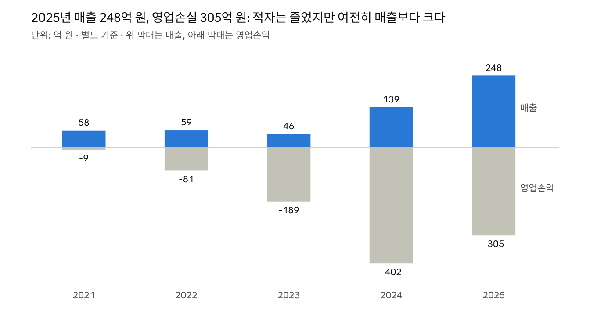

*그림 1. 아웃스탠딩 스타트업DB 재무제표(별도), 2021\~2025년 · 2021년 매출은 영업이익률에서 역산*

적자 폭은 2024년을 정점으로 줄었고 영업손실률은 289%에서 123%로 내려왔다. 방향은 좋지만 손익분기까지는 아직 멀다.

### 비용과 재무상태 (2025년, 별도)

| 항목 | 금액 | 비고 |
| --- | --- | --- |
| 판매관리비 | 553억 원 | 매출의 223%, 매출원가는 0으로 집계 |
| 급여 | 171억 원 | 전년 142억 원 |
| 영업외손익 | +21억 원 | 순손실 284억 원 |
| 유동자산 | 1,103억 원 | 총자산 1,168억 원 |
| 부채 | 95억 원 | 차입금과 전환사채 없음 |
| 누적 결손금 | 914억 원 | 자본잉여금 1,984억 원으로 상쇄, 자본 1,073억 원 |

2024년에는 영업비용 541억 원 가운데 276억 원이 GPU와 클라우드 성격의 지급수수료였고, 손익분기 매출은 최소 400억 원으로 추정됐다([더벨](https://www.thebell.co.kr/front/newsview.asp?key=202509221329596200101832)). 이 표와 아래 절의 2025년 수치는 전자공시에 올라온 감사보고서 원문으로 대조했다.

### 감사보고서로 본 재무적 특징 (2025 회계연도)

> 주석: 이 절의 출처는 금융감독원 전자공시시스템(DART)에 공시된 2026년 3월 24일자 제6기 감사보고서(2025 회계연도, 별도 기준)다. 다음 인수와 시리즈C 조달은 2026년에 일어난 일이어서 여기에 들어 있지 않다. 2026 회계연도 감사보고서는 몇 달 안인 2027년 3\~4월에 공시될 것으로 보이며, 그때 이 절의 수치를 모두 갱신해야 한다.

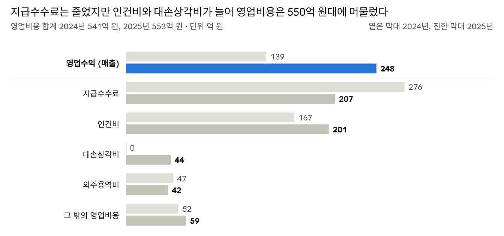

*그림 2. 출처: 전자공시시스템(DART), 주식회사 업스테이지 제6기 감사보고서(한미회계법인, 2026-03-24) 손익계산서, 별도 기준 · 인건비는 급여, 퇴직급여, 복리후생비의 합*

- **감사의견은 적정이고, 회계기준은 일반기업회계기준이다.** 감사인은 한미회계법인이다. 중소기업 회계처리 특례를 적용해 주식보상비용을 인식하지 않고, 1년 안에 끝나는 용역은 완료한 날에 매출로 잡는다. 상장하려면 K-IFRS로 바꿔야 하므로 손익과 자본 분류가 달라질 수 있다.
- **매출의 87%가 기술용역이다.** 영업수익 248억 원 가운데 기술용역이 217억 원으로 전년보다 115% 늘었고, 교육은 31억 원으로 18% 줄었다. 매출원가를 따로 구분하지 않아 매출총이익률은 알 수 없다. 완료 시점에 매출을 잡는 방식은 상반기와 하반기 매출이 크게 다르다는 집계를 설명할 수 있는 단서다.
- **비용의 두 축은 지급수수료와 인건비다.** 지급수수료 207억 원은 전년보다 25% 줄었고 인건비 201억 원은 20% 늘었다. 각각 매출의 83%, 81%다. 광고선전비는 2.7억 원에서 14억 원으로 늘었다.
- **설비를 거의 갖지 않은 회사다.** 유형자산은 16억 원이고 2025년 설비 취득은 4.7억 원이다. 연산 자원을 사지 않고 빌려 쓰는 구조여서, 경영진이 밝힌 GPU 구매는 재무 구조 자체를 바꾸는 결정이 된다. 지급수수료의 세부 내역은 감사보고서에 나오지 않는다.
- **매출채권의 64%에 대손충당금이 쌓였다.** 매출채권 69억 원 가운데 44억 원이고, 전년에는 없던 대손상각비 44억 원이 비용으로 잡혔다. 매출의 18%에 해당한다. 이를 빼면 영업손실은 261억 원이다. 어느 거래처의 채권인지는 공개되지 않았다.
- **현금흐름은 손익보다 나빴다.** 영업손실은 402억 원에서 305억 원으로 줄었지만 영업활동 현금흐름은 -319억 원에서 -341억 원으로 나빠졌다. 선수금이 68억 원, 미지급금이 51억 원 줄어든 영향이다.
- **현금은 1,009억 원이고 차입금은 없다.** 2025년 유상증자로 626억 원이 들어왔다. 이자수익 22억 원과 정부보조금 21억 원이 영업외에서 손실을 줄였고, 해외 법인의 지분법손실 21억 원이 그 절반을 되돌렸다.
- **우선주는 모두 전환우선주이고 전환가격 조정 조항이 있다.** 일곱 차례에 걸쳐 1,985억 원어치가 발행됐고 주당 발행가는 21,000원에서 293,956원까지 올랐다. 지금은 자본으로 분류돼 있다. 조정 조건에 따라 K-IFRS에서는 부채로 분류될 수 있어 상장 준비 과정에서 확인이 필요하다.
- **스톡옵션과 무상 크레딧.** 2025년 말 잔여 스톡옵션은 135,721주이고 행사가는 1,000원이다. 고객에게 준 무상 크레딧에 대해 충당부채 5억 원을 처음 쌓았다.

### 매출의 질

- **반기 편차.** 2025년 상반기 매출이 170억 원이라는 집계([데모데이](https://demoday.co.kr/bm-analysis/130))가 맞다면 하반기는 78억 원이다. 인식 기준 차이일 수 있어 예심 서류에서 확인해야 한다.
- **고객 집중.** 매출의 70% 이상이 금융권에서 나온다([한국M&A경제신문](https://www.kmnanews.com/news/articleView.html?idxno=10415)).
- **프로젝트성 계약.** 2024년 9월 이후 공공조달 계약 24건 가운데 최근 건은 교육 콘텐츠 개발, 부트캠프 운영, 문항 생성 기능 개발 같은 용역이 많다(스타트업DB).
- **해외.** 미국 법인은 매출 8.4억 원에 순손실 14억 원, 일본 법인은 자본잠식, 홍콩 법인은 청산됐다.
- **수주 모멘텀.** 회사는 2026년 상반기 신규 계약액이 2025년 전체 실적을 넘었고 고객이 200곳을 넘는다고 밝혔다([뉴시스](https://mobile.newsis.com/view/NISX20260616_0003671084)). 절대 금액과 연결 매출은 공개하지 않았다.
- **현금흐름과 채권.** 감사보고서로 확인했다. 2025년 영업활동 현금흐름은 -341억 원으로 영업손실보다 크고, 매출채권 69억 원 가운데 44억 원에 대손충당금이 쌓였다.

### 투자 라운드

| 시기 | 라운드 | 금액 | 기업가치 | 주요 투자자 |
| --- | --- | --- | --- | --- |
| 2026년 10월 | 시리즈C 2차 (진행 중) | 557억 원 | 프리 2조 400억 원 | 전북은행, 광주은행, JB우리캐피탈, SK네트웍스, 엔비디아(예정) |
| 2026년 5월 | 국민성장펀드 연계 | 총 5,600억 원 | 프리 1조 3,000억 원 | 첨단기금 1,000억, 산업은행 300억, 민간 4,300억 |
| 2026년 4월 | 시리즈C | 1,800억 원 | 프리 1조 3,000억 원 | 사제파트너스, 현대차, 기아, 엑시엄아시아 |
| 2025년 8월 | 시리즈B 브릿지 | 620억 원 | 포스트 약 7,300억 원 | AMD, AWS, 산업은행 |
| 2024년 5월 | 시리즈B | 993억 원 |   | SK네트웍스, KT, 산업은행 |
| 2021년 9월 | 시리즈A | 316억 원 |   | 컴퍼니케이, 소프트뱅크벤처스 |

누적 조달액은 출처마다 다르다. 스타트업DB는 9,729억 원, 회사는 6월에 7,300억 원, [뉴스톱](https://www.newstopkorea.com/news/articleView.html?idxno=48050)은 10월에 약 4,500억 원으로 적었다. 5,600억 원이 시리즈C 1,800억 원을 포함한 총액으로 보여, 이 문서는 회사 발표에 10월분을 더한 약 7,900억 원을 쓴다. 5,600억 원의 구성은 [더팩트](https://news.tf.co.kr/read/ogmeta/2320265.htm) 보도 기준이다.

최근 엔비디아 투자는 좋은 시그널이지만, 몇 조 단위 투자금이 필요하다는 것은 중국의 AI 랩을 보았을 때 현실에서 더 많은 자금과 GPU 구매 비용, 좋은 인력을 유인하기 위한 비용이 필요하다.

엔비디아는 11월 9일 과기정통부와 연 AI 스타트업 파트너십 포럼에서 투자 계획을 밝혔고, 업스테이지는 진행 중인 시리즈C 2차 라운드에 엔비디아가 참여할 예정이라고 발표했다([디일렉](https://www.thelec.kr/news/articleView.html?idxno=65139), [지디넷코리아](https://zdnet.co.kr/view/?no=20261109173602)). 투자 금액, 지분율, 클로징 시기는 공개되지 않았다.

- **라운드 조건.** 2차 라운드 단가는 주당 55만 원 안팎, 기업가치는 2조 원대로 추정되고 SK네트웍스도 약 200억 원을 더 넣는다([넘버스](https://www.numbers.co.kr/news/articleView.html?idxno=23134)).
- **투자자 구성.** 성사되면 AWS, AMD, 엔비디아가 모두 주주가 된다. 세 회사 모두 클라우드나 GPU를 파는 공급자여서 성격은 한국 정부와 연계된 전략적 투자로 평가될 수 있다.
- **기술 협력.** 엔비디아는 솔라 오픈 2를 포함한 한국 오픈 모델용 다이나모 추론 최적화 구성을 내놓았다([스토리지리뷰](https://www.storagereview.com/news/nvidia-dynamo-recipes-korean-open-models-b200-2x?type=Enterprise)). 솔라 오픈 2의 GPU당 처리량이 약 1.43배가 됐다는 수치는 전달받은 요약 기준이고 원문으로 확인하지 못했다.
- **자금 용도.** 회사는 솔라 고도화, 핵심 인재 영입, 미국·일본 진출에 쓰겠다고 했다([AI타임스](https://www.aitimes.kr/news/articleView.html?idxno=42658)).

### 지분 구조

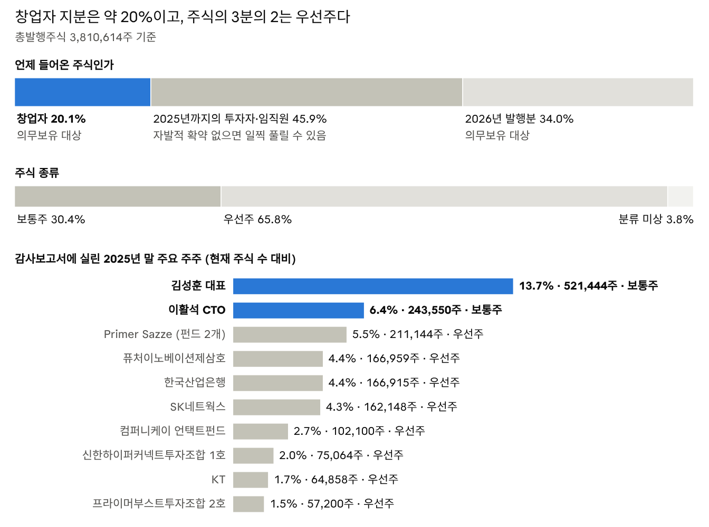

*그림 3. 주주별 주식 수와 2025년 말 총주식 2,514,831주는 전자공시시스템(DART)의 제6기 감사보고서 주석 1(2025-12-31 기준), 현재 총발행주식과 주식 종류는 스타트업DB(2026-11-13 기준) · 2026년 이후 주주별 변동은 반영되지 않음*

총발행주식은 3,810,614주(2026-11-13 기준)이고 이 중 우선주가 약 3분의 2다. 김성훈 대표 521,444주와 이활석 CTO 243,550주를 현재 주식 수로 나누면 각각 약 13.7%와 6.4%로, 창업자 합산 지분은 20% 안팎이라는 계산이 나온다. SK네트웍스는 11.7%(스타트업DB 뉴스 목록의 9월 7일자 보도 제목 기준), 카카오는 약 10%([조선비즈](https://news.nate.com/view/20260527n02225))로 알려졌다.

그림의 주주별 막대는 감사보고서 주석에 실린 2025년 말 주주별 주식 수를 현재 총발행주식으로 나눈 값이다. 2026년에 새로 발행된 34%에는 시리즈C 투자자와 카카오의 몫이 들어 있지만 주주별 내역은 공개되지 않았다. 명부상 SK네트웍스의 162,148주는 현재 주식 수의 4.3%여서 보도된 11.7%와 맞지 않는다. 2026년 추가 취득분이 있거나 계산 기준이 다른 것으로 보이며 증권신고서에서 확인해야 한다.

## 런웨이 계산

본업만 보면 업스테이지는 10년을 버티지만, 경영진이 공언한 투자를 집행하면 여유는 2년 안팎으로 줄어든다. 상장 시계는 잔고가 아니라 이 투자 계획과 GPU의 소모량, 차기 GPU 구매 계획에 따라 달라진다.

### 가용 현금 추정

- 2025년 말 유동자산은 1,103억 원이다. 스타트업DB는 이를 기준으로 신규 조달 없이 42개월을 버틴다고 계산했다. 현금성 자산 1,009억 원을 감사보고서의 영업활동 현금흐름 -341억 원으로 나누면 약 35개월이다.
- 2026년 조달액은 출처에 따라 약 2,500억\~5,900억 원으로 갈린다. 하단은 뉴스톱 누적치, 상단은 회사 발표치에서 2025년 말까지의 우선주 발행가액 약 1,985억 원을 뺀 값이다.
- 2026년 소진분을 빼면 연말 가용 현금은 약 3,200억\~6,000억 원, 중간값 4,500억 원 안팎으로 추정한다.

### 시나리오별 여유 기간

| 시나리오 | 연 소진액 가정 | 여유 기간 (현금 4,500억 원 기준) | 근거 |
| --- | --- | --- | --- |
| A. 본업 유지 | 300\~350억 원 | 13년 이상 | 2025년 영업손실 305억 원 |
| B. 본업 + 다음 AI 전환 | 800\~1,200억 원 | 4\~5.5년 | 포털 운영비와 AI 검색 추론비 가정 |
| C. B + GPU·학습 투자 집행 | 2,000\~3,000억 원 | 1.5\~2.3년 | 조달액 절반 이상을 GPU와 학습에 쓴다는 대표 발언 |

B와 C의 소진액은 회사 공시가 아니라 이 문서의 가정이다. 근거가 되는 사실은 세 가지다.

- 김성훈 대표는 6월 미디어데이에서 조달액 7,300억 원의 절반 이상을 GPU 구매와 모델 학습에 쓰겠다고 밝혔다([뉴시스](https://mobile.newsis.com/view/NISX20260616_0003671084)).
- 3월에는 다음 인수 후 하루 1조 토큰 처리를 목표로 AMD MI355 약 1만 장이 필요하다고 말했다([딜사이트](https://dealsite.co.kr/articles/159904/068020)).
- 카카오는 매각 직전 AXZ에 운영자금 162억 원을 유상증자로 넣었다([아시아경제](https://view.asiae.co.kr/article/2026051514505508377)). 다음이 자체 현금흐름만으로 돌아가지 않았다는 신호다.

위 표는 손익이 아니라 현금 유출 기준이다. GPU를 구매하면 현금은 2\~3년에 나가지만 손익에는 감가상각으로 나뉘어 잡힌다. 3,650억 원어치를 5년 정액 상각한다고 가정하면 연 730억 원이다.

- **구매 비중이 높을수록** 영업손실은 현금 소진보다 작게 보이고, 손익분기 시점과 현금이 마르는 시점이 어긋난다.
- **임차(클라우드)라면** 전액이 그해 비용이라 두 기준이 거의 같아진다.
- **구매한 GPU의 잔존가치**는 런웨이를 다소 늘린다.
- GPU는 세대가 바뀌면 경쟁력과 효율을 위해 다시 사야 한다. 감가상각이 끝나도 재투자가 이어지므로 설비투자는 한 번으로 끝나는 지출이 아니라 지속적인 지출이 된다.

구매와 임차의 비율은 공개되지 않았고, 전력과 유지보수 비용도 따로 추정하지 못했다. 상장 후 공시되는 영업손실만 보고 현금 사정을 판단하면 안 되는 이유다.

### 규모의 격차

지푸는 2026년 상반기 연구개발비로만 21.31억 위안(약 4,400억 원)을 썼다([시나파이낸스](https://cj.sina.com.cn/articles/view/1654203637/629924f50200171pq)). 업스테이지가 창업 후 모은 돈의 절반 이상이 반년 치 연구비다. 시나리오 C는 과장이 아니라 파운데이션 모델 경쟁에 남기 위한 최소 입장료에 가깝다.

공모 시총 2.7조 원에 신주 15\~20%를 발행하면 4,000억\~5,400억 원이 들어와 시나리오 C의 여유가 약 2년 늘어난다. 상장이 2028년 이후로 밀리면 그 전에 투자를 줄이거나 더 높은 몸값의 사모 라운드를 또 열어야 한다.

## 상장 AI 랩 비교

상장된 AI 랩 가운데 업스테이지의 희망 몸값을 뒷받침하는 비교군은 없고, 직전 라운드 가격조차 가장 비싼 지푸보다 높다.

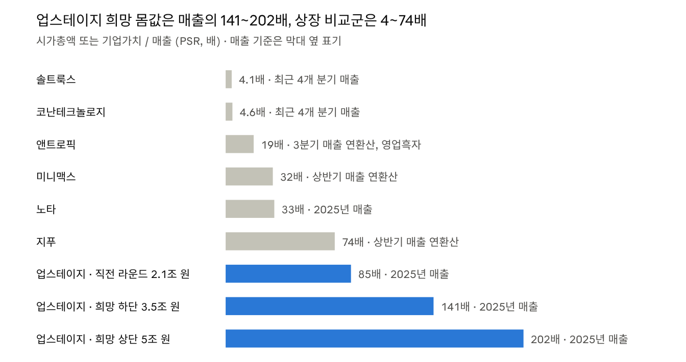

*그림 4. PSR은 이 문서 계산 · 시가총액 기준일은 회사별로 2026년 9\~11월 · 앤트로픽은 기본주식수 기준 첫날 종가*

한 차트에 놓았지만 사업모델은 다르다. 앤트로픽·지푸·미니맥스는 파운데이션 모델 회사이고, 노타·코난테크놀로지·솔트룩스는 국내 AI 소프트웨어 회사다. 문서 AI·엔터프라이즈 SaaS 상장사와의 비교는 이 문서에 없다. 업스테이지가 반복매출, 매출총이익률, 순매출유지율을 공개해야 그 비교가 가능하다.

### 비교군의 규모와 손익

| 회사 | 시가총액 | 매출 | 성장률 | 손익 |
| --- | --- | --- | --- | --- |
| [앤트로픽](https://futuresearch.ai/anthropic-financial-forecast/) (나스닥) | 1.28조 달러, 완전희석 약 1.8조 달러 | 3분기 170억 달러 | 전년 대비 약 12배 | 2분기 영업이익 9.74억 달러 |
| [지푸](https://www.thepaper.cn/newsDetail_forward_34492933) (홍콩) | 1,635억 홍콩달러 (11월 17일) | 상반기 9.54억 위안 | +399.7% | 상반기 순손실 20.72억 위안 |
| [미니맥스](https://companiesmarketcap.com/minimax-group/marketcap/) (홍콩) | 75.2억 달러 (11월) | 상반기 1.166억 달러 | 2025년 연간 0.79억 달러를 반기에 넘김 | 적자 |
| [노타](https://stockdigging.com/stock/486990) (코스닥) | 4,321억 원 (10월 7일) | 2025년 131억 원 | +55% | 순손실 166억 원 |
| [코난테크놀로지](https://www.chickstockfi.com/stocks/402030) (코스닥) | 1,593억 원 (9월 15일) |   |   | 적자 |
| [솔트룩스](https://www.chickstockfi.com/stocks/304100) (코스닥) | 1,887억 원 (9월 16일) |   |   | 적자 |
| 업스테이지 (비상장) | 직전 라운드 약 2.1조 원 | 2025년 248억 원 | +78.4% | 영업손실 305억 원 |

앤트로픽의 3분기 매출과 성장률은 [CNN](https://www.cnn.com/2026/11/19/business/anthropic-ipo-stock-test-ai), 완전희석 시총은 [포춘](https://fortune.com/2026/11/19/anthropic-ipo-first-day-trading-nasdaq-record-valuation/), 지푸와 미니맥스의 상반기 매출은 [포위크MBA](https://fourweekmba.com/ai-anthropic-made-63x-the-revenue-of-chinas-zhipu-and-minimax/)와 [제일재경](https://news.qq.com/rain/a/20260901A054CP00) 기준이다.

### 비교에서 읽히는 것

- **성장과 이익이 멀티플을 정한다.** 앤트로픽은 12배 성장에 영업흑자인데 19배다. 업스테이지는 78% 성장에 적자인데 직전 라운드가 이미 85배다.
- **지푸의 74배는 가속을 선반영한 값이다.** 8월 연환산 반복매출(ARR) 16억 달러를 쓰면 약 13배로 내려간다. 업스테이지는 그런 반복매출 지표를 아직 공개하지 않았다.
- **규모가 다르다.** 5조 원은 미니맥스 시총의 약 45%인데, 업스테이지 매출은 미니맥스 연환산 매출의 약 7%다.
- **유통 물량이 급등과 급락을 만들었다.** 상장 당시 유통 비중은 지푸 약 3.9%, 미니맥스 약 5.4%였다([푸투](https://news.futunn.com/en/post/71910770/a-surge-of-5-8-times-upon-listing-are-zhipu)). 지푸는 공모가의 25배까지 올랐다가 고점 대비 약 88% 내렸다.
- **다음 매출은 AI 멀티플을 받지 못한다.** 다음을 합치면 연결 PSR은 10\~15배로 내려가지만, 거래가 약 2,000억 원은 2024년 포털비즈 매출 3,320억 원의 0.6배였다.
- **플랫폼 대기업은 본업 현금으로 AI에 투자한다.** 카카오는 2026년 2분기 매출 2조 985억 원에 영업이익 2,770억 원을 냈다([카카오](https://www.kakaocorp.com/page/detail/12096)). 업스테이지의 연 매출은 그 분기 매출의 1.2%다.
- **첨부 메모의 팔란티어·C3.ai 대비도 같은 방향이다.** 메모는 팔란티어 선행 PSR 74배(영업이익률 47%), C3.ai 6.4배를 들었다. 이 수치는 이번에 재검증하지 않았다.

## 단서: 모델 경쟁력과 갈라파고스 위험

현재 공개된 범용 모델 평가와 외부 채택 지표로 보면 업스테이지는 글로벌 선두권과 격차가 크다. 주력 모델 솔라 프로 4는 11월 Artificial Analysis 지능지수에서 14점으로 1위(65점)의 5분의 1이고, 집계된 190개 모델 구성 가운데 122위다([벤치LM](https://benchlm.ai/benchmarks/artificialanalysis), 11월 23일).

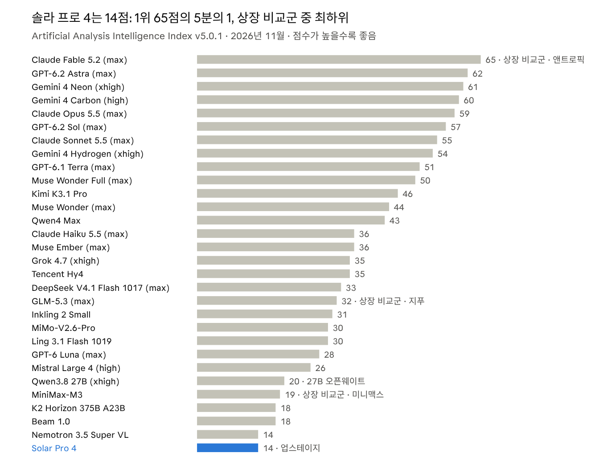

*그림 5. Artificial Analysis 화면(2026-11-23, 765개 중 28개 선택)에 Solar Pro 4와 MiniMax-M3의 모델 페이지 점수를 추가 · 1위 모델은 이 문서 작성에 쓰인 Claude와 같은 모델*

### 순위가 말하는 것

- **상장 비교군 중 최하위다.** 앤트로픽 65점, 지푸 GLM-5.3 32점, 미니맥스 M3 19점, 솔라 프로 4 14점이다. 매출 대비 몸값은 업스테이지가 가장 높은데 모델 점수는 가장 낮다.
- **내려받아 쓰는 모델보다 낮다.** 27B 크기의 오픈웨이트 Qwen3.8 27B가 20점이다. Artificial Analysis는 솔라 프로 4가 같은 등급 중앙값 21점에 못 미친다고 적었다([모델 페이지](https://artificialanalysis.ai/models/solar-pro-4)).
- **효율도 뒤진다.** 지수 과제 하나에 63.5분이 걸려 중앙값 6.4분의 10배이고, 과제당 비용은 0.96달러다. 51점인 GPT-6.1 Terra가 v5 발표 시점에 같은 0.96달러였다([v5 발표문](https://artificialanalysis.ai/articles/artificial-analysis-intelligence-index-v5)).
- **8월의 42점은 옛 기준이다.** 출시 당시 보도된 42점([전자신문](https://www.etnews.com/20260814000345))은 이전 버전 지수다. 10월 27일 v5로 바뀌며 에이전트형 실무 과제 비중이 커졌고, 솔라가 강했던 장문 이해 평가(AA-LCR)는 빠졌다. 선두와 오픈웨이트 최고 모델의 격차도 3점에서 12점으로 벌어졌다.
- **국내 1위도 아니다.** 8월 독파모 2차 평가의 글로벌 벤치마크 항목에서 모티프가 47점, 업스테이지가 37점이었다([전자신문](https://v.daum.net/v/20260827204708760)).

쉬운 시험에서 좁아 보이던 차이가 어려운 시험에서 드러났다.

> 주석: 11월 23일 공개된 솔라 미니 4.5 프리뷰의 20점을 업스테이지의 대표 점수로 쓰면 미니맥스 M3(19점)를 넘어 상장 비교군 "최하위"가 아니게 된다. 다만 회사가 제공한 수치이고 프리뷰여서, 위 목록은 솔라 프로 4의 14점 기준으로 두었다.
>
> 평가: 20점으로 바꿔 읽으면 순위는 네 곳 중 3위가 되고, 1위(65점)와의 거리는 5분의 1에서 3분의 1에 조금 못 미치는 수준으로 좁혀진다. 미니맥스와의 차이는 1점이고 자료의 점수가 반올림 표시여서, 앞섰다기보다 같은 수준으로 보는 편이 안전하다. 지푸(32점)와는 12점 차이가 남는다. 그래도 방향은 분명하다. 8월에 나온 주력 모델이 지금 기준으로 14점인데, 석 달 뒤에 나온 활성 파라미터 3B의 소형 모델이 20점을 냈다. 계속 성장하고 있어 기대가 된다. Artificial Analysis의 독립 측정값이 나오고 12월 1일 정식 출시본이 같은 점수를 유지하면, 대표 점수를 20점으로 바꾸고 이 절의 "최하위" 표현을 고친다.

### 수능에서도 순서는 같았다

2027학년도 수능을 17개 모델에 풀게 한 대시보드에서 솔라 프로 4는 450점 환산 392.8점으로 14위였다([경제타임스](https://www.ket.kr/news/article.html?no=42254)). 딥시크에 밀렸고, 상위권은 미국의 상용 폐쇄형 모델이 차지했다.

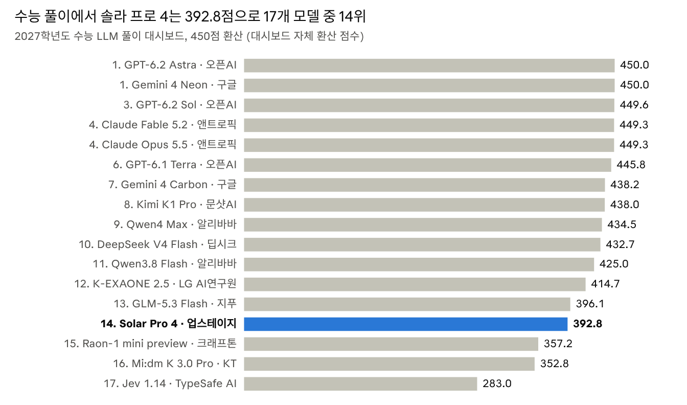

*그림 6. 경제타임스 2026-11-22 보도 그래픽의 17개 모델을 다시 그림 · 자료: 순천향대 구유겸 씨 대시보드 · 450점은 대시보드 자체 환산 점수로 실제 수능 성적 산출 방식과 다름*

- **1\~7위는 미국의 폐쇄형 상용 모델이다.** 오픈AI, 구글, 앤트로픽의 일곱 모델이 438점 이상이고, GPT-6.2 Astra와 Gemini 4 Neon은 450점 만점이다.
- **딥시크에 밀렸다.** 딥시크 V4 Flash는 432.7점으로 10위이고 솔라 프로 4보다 39.9점 높다. Kimi와 큐원도 솔라 위에 있고, GLM-5.3 Flash(396.1점)도 3.3점 앞선다.
- **국산 가운데 1위도 아니다.** LG AI연구원의 K-EXAONE 2.5가 414.7점으로 21.9점 앞선다.
- **읽을 때 감안할 점.** 450점은 대시보드 자체 환산 점수여서 실제 수능 성적 산출 방식과 다르다. 과목 구성과 채점 방법은 보도에 나오지 않고, 개인이 만든 집계다.

업스테이지의 LLM을 적절한 수준에서 적응하여 사용할 수는 있지만 같은 값에 더 똑똑한 대안이 많다. 오픈웨이트에서는 무한 경쟁의 시장이다.

### 공정하게 봐야 할 점

- 솔라 프로 4는 8월 모델이고, 후속 모델이 나오면 점수는 바뀐다. 11월 23일 공개된 솔라 미니 4.5 프리뷰가 그 사례다(이 절 뒤의 "새 자료" 참조).
- 회사는 솔라 프로 4와 솔라 미니 4가 오픈라우터의 폐쇄형 모델 토큰 사용량 최상위권에 올랐다고 설명한다([파이낸셜뉴스](https://www.fnnews.com/news/202611091915255020)).
- 실제 매출은 범용 지능이 아니라 문서 AI에서 나온다. 벤치마크 순위가 곧 사업 경쟁력은 아니다.
- 엔비디아가 시리즈C 2차에 참여할 예정이다(11월 9일 발표, 금액 비공개). 다만 같은 날 모티프와 리얼월드 등 국내 스타트업 여러 곳에 대한 투자 계획이 함께 나왔다([연합뉴스](https://www.koreatimes.com/article/11630891)).

그러나 상장 서사는 "문서 AI 기업"이 아니라 "한국의 프런티어 AI 랩"으로 값을 받으려 한다. 그 서사를 받치는 숫자는 아직 공개된 자료에서 확인되지 않는다.

### 새 자료: 솔라 미니 4.5 프리뷰 (11월 23일 공개)

업스테이지는 11월 23일 소형 모델 솔라 미니 4.5의 프리뷰를 공개했고, 정식 출시는 12월 1일로 예고했다([업스테이지 콘솔](https://console.upstage.ai/docs/models/solar-mini-4-5-preview)). 전체 35B 파라미터 가운데 추론 때 3B만 쓰는 구조이고, 자체 API와 오픈라우터, 온프레미스로 제공된다. 가중치는 11월 25일 현재 허깅페이스에 올라와 있지 않다. 아래 수치는 회사가 공개한 자료를 옮긴 것이다.

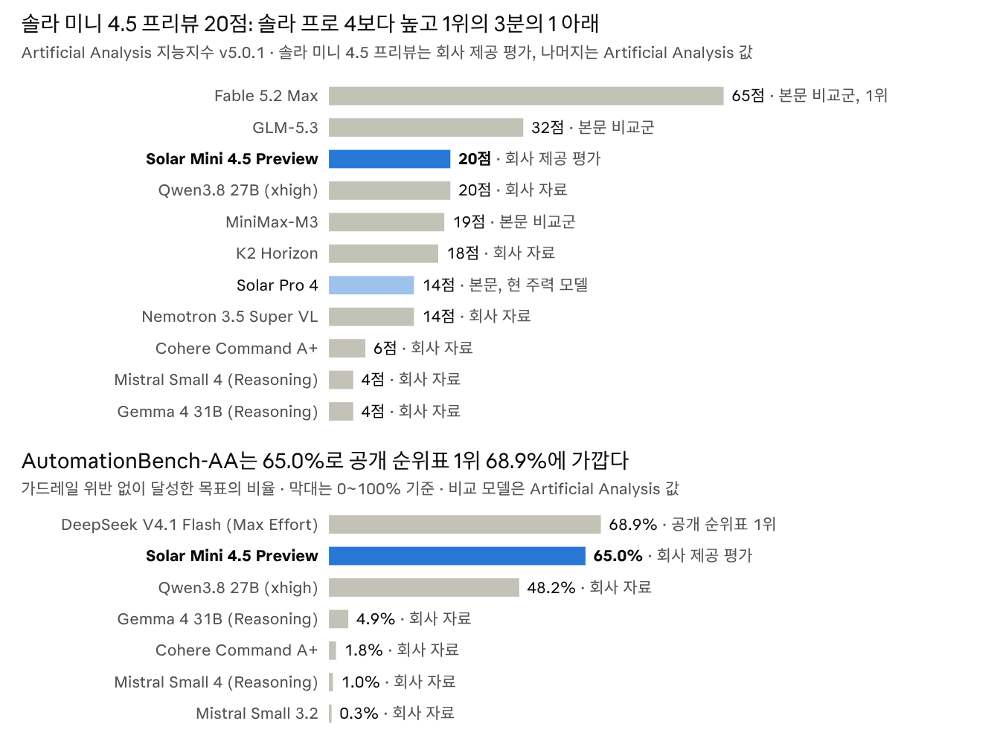

*그림 7. 업스테이지 공개 자료(2026-11-25 작성자 제공, 비교 모델은 artificialanalysis.ai 2026-11-20 값, 반올림 표시) · 본문 비교군 점수는 이 문서의 지능지수 절과 같은 값 · AutomationBench-AA 1위는 Artificial Analysis 평가 페이지(2026-11-25 확인)*

- **소형 모델로는 의미 있는 진전이다.** 지능지수 v5.0.1에서 20점으로, 활성 파라미터가 9배인 Qwen3.8 27B와 같고 현 주력 모델인 솔라 프로 4(14점)와 미니맥스 M3(19점)보다 높다. 업무 자동화 평가인 AutomationBench-AA에서는 65.0%로, Artificial Analysis 공개 순위표 1위(68.9%)에 가깝다([평가 페이지](https://artificialanalysis.ai/evaluations/automationbench-aa)).
- **회사가 제공한 수치다.** 자료의 출처 표기는 솔라가 "제공된 평가 결과", 비교 모델이 11월 20일 Artificial Analysis 값이다. 누가 측정했는지는 적혀 있지 않고, Artificial Analysis의 공개 순위표에서는 이 모델의 점수를 아직 확인하지 못했다. 프리뷰여서 정식 출시 때 사양과 동작이 바뀔 수 있다.
- **비교군은 회사가 골랐다.** 자료에는 "선택한 모델이며 크기와 세대가 다르다"는 단서가 붙어 있고, 비교 대상은 소형 오픈웨이트 모델이다. 이 문서의 비교군에 놓으면 20점은 지푸 GLM-5.3(32점) 아래이고 1위(65점)의 3분의 1에 못 미친다.
- **활성 파라미터 기준은 연산량의 비교다.** 추론 연산에는 3B만 쓰지만 메모리에는 35B 전체를 올려야 한다. 전체 크기로는 Qwen3.8 27B보다 크다.
- **전작의 점수와는 견줄 수 없다.** 솔라 미니 4의 24점([바이라인네트워크](https://byline.network/2026/10/2-459/))은 10월 27일 v5로 바뀌기 전의 지수여서 20점과 직접 비교되지 않는다.
- **과제당 비용은 아직 모른다.** 정가는 100만 토큰당 입력 0.10달러, 출력 0.40달러이고 11월 30일까지 90% 할인한다. 과제당 비용과 소요 시간은 공개되지 않았다. 전작은 토큰 단가가 낮아도 출력이 길어 과제가 느리고 비싸다는 평가가 있었다([알파시그널](https://alphasignal.ai/news/upstage-s-solar-mini-4-triples-its-benchmark-score-with-3b-active-parameters)).

앞 절의 단서대로 새 모델에서 점수가 달라졌다. 다만 지금까지 나온 것은 소형 모델과 업무 자동화라는 좁은 구간의 효율이고, 범용 선두권과의 격차와 오픈웨이트 채택 지표는 그대로다. 독립 측정값과 정식 출시 뒤의 토큰 사용량이 나오면 이 절을 갱신해야 한다.

### 가치사슬에서 본 업스테이지의 자리

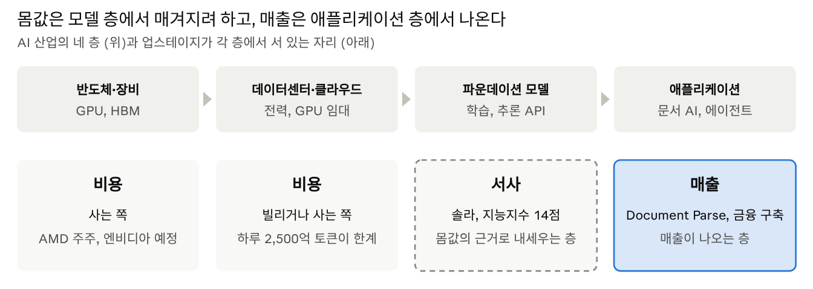

*그림 8. 이 문서의 정리 · 각 칸의 수치와 사실은 본문 해당 절의 출처를 따름*

AI 산업은 반도체, 데이터센터, 파운데이션 모델, 애플리케이션의 네 층으로 나뉘고 층마다 돈을 버는 방식이 다르다. 업스테이지는 앞의 두 층에서는 비용을 내는 쪽이고, 매출은 넷째 층인 문서 AI와 금융권 구축형 계약에서 나온다.

그런데 상장 서사는 셋째 층인 파운데이션 모델의 멀티플을 받으려 한다. GPU 시간당 매출, 토큰당 추론 원가, 층별 매출총이익률이 공개되면 이 어긋남의 크기를 숫자로 잴 수 있다. 업스테이지는 폭발적인 성장이나 성능, 강력한 팬덤 중 최소 2가지 방향에서 증명해야 한다.

### 수익화의 샌드위치

토큰을 팔아 돈을 버는 시장에서 업스테이지는 위의 앤트로픽·오픈AI와 아래의 중국 오픈웨이트 사이에 끼어 있어 수익화가 어렵다. 대표는 매출이 모델이 만들어 소비되는 토큰 양에 달렸다고 설명했지만([뉴시스](https://mobile.newsis.com/view/NISX20260616_0003671084)), 그 토큰의 가격을 정하는 쪽은 업스테이지가 아니다.

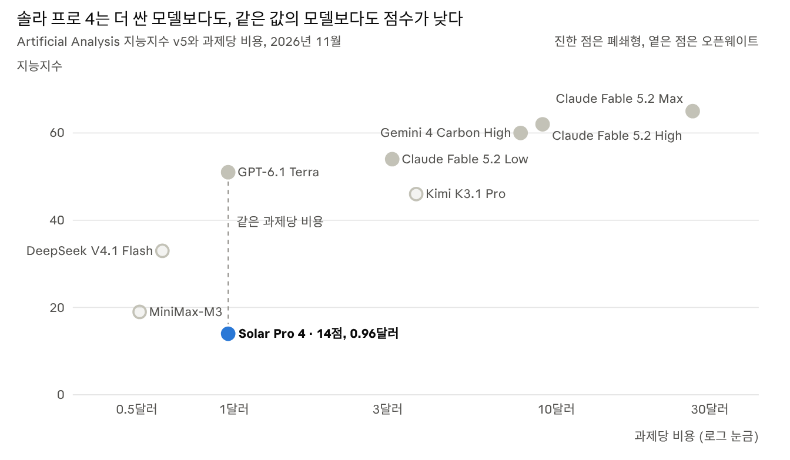

*그림 9. Artificial Analysis 지능지수 v5.0.1과 과제당 비용 · 솔라 프로 4, MiniMax-M3, Fable 5.2 Max는 이 문서가 확인한 값, GPT-6.1 Terra는 v5 발표 시점 값, 나머지는 작성자의 11월 23일 리포트가 인용한 2차 자료(NeuralTrust, Crux Digits) 기준*

가로축은 지수 과제 하나를 푸는 데 든 비용이다. 솔라 프로 4와 같은 0.96달러에 GPT-6.1 Terra는 51점을 받았고, 더 싼 MiniMax-M3와 DeepSeek V4.1 Flash도 점수가 더 높다.

| 층 | 대표 모델 | 지능지수 | 과제당 비용 | 고객이 고르는 이유 |
| --- | --- | --- | --- | --- |
| 위: 프런티어 폐쇄형 | Claude Fable 5.2, GPT-6.2 Astra | 62\~65점 | 26.54달러 (Fable 5.2) | 가장 어려운 일을 맡긴다. 비싸도 쓴다 |
| 가운데: 업스테이지 | Solar Pro 4 | 14점 | 0.96달러 | 국산이어야 하는 요건 |
| 아래: 중국 오픈웨이트 | DeepSeek V4.1 Flash, GLM-5.3, MiniMax-M3 | 19\~33점 | 0.51달러 (MiniMax-M3) | 싸고, 내려받아 직접 돌릴 수 있다 |

과제당 비용은 Artificial Analysis가 지수 과제 하나를 돌리는 데 든 평균 비용이다. Fable 5.2는 [트루IQ](https://trueiq.si/guides/artificial-analysis-intelligence-index-v5)가 전한 11월 10일 순위표, 솔라와 MiniMax-M3는 각 [모델](https://artificialanalysis.ai/models/solar-pro-4) [페이지](https://artificialanalysis.ai/models/releases/minimax-m3) 기준이다.

- **위쪽은 지불 의사를 가져간다.** 앤트로픽은 고객 약 1만 4,000곳 가운데 250곳가량이 연 1,000만 달러 이상을 쓴다([CNN](https://www.cnn.com/2026/11/19/business/anthropic-ipo-stock-test-ai)). 기업의 큰 AI 예산은 가장 잘하는 모델을 선택한다
- **아래쪽은 가격을 무너뜨린다.** 솔라 프로 4의 토큰 가격은 100만 토큰당 입력 0.30달러, 출력 1.20달러로 MiniMax-M3와 같다. 그런데 M3는 19점에 과제당 0.51달러이고 솔라는 14점에 0.96달러다. 점수는 낮고 비용은 더 든다.
- **아래쪽 1등도 남기기 어렵다.** 지푸는 API 매출 비중이 86.5%로 커지는 동안 종합 매출총이익률이 약 50%에서 26%로 내려갔다([오프위크](https://mp.ofweek.com/finance/a556714238677)). 물량이 늘수록 마진이 얇아지는 시장이다.
- **목표를 다 이뤄도 크지 않다.** 대표가 말한 하루 1조 토큰을 솔라 프로 4의 혼합 단가(100만 토큰당 0.22달러)로 전부 외부에 팔아도 연 약 1,200억 원이다. 그 토큰의 상당 부분은 다음에서 자체 소비되므로 매출이 아니라 비용이다.
- **엔비디아 투자는 이 구도를 바꾸지 않는다.** 엔비디아는 GPU를 파는 회사이고, 같은 자리에서 모티프와 리얼월드에도 투자 계획을 밝혔다. 추론 최적화 협력은 원가를 낮춰 주지만 가격 결정력을 주지는 않는다.

가운데에 낀 모델에게 가장 든든한 방어 시장은 성능이나 가격보다 데이터 주권·보안·규제 요건 때문에 국산을 찾는 곳으로 보인다. 그것이 뒤에서 다루는 갈라파고스 경로로 빠질 수도 있다. 중국 AI랩의 오픈웨이트는 미국의 스타트업에서도 많은 선택을 받고 있다.

### 오픈라우터로 보는 이용자와 토큰 사용량: 솔라 대 중국 LLM

실사용 지표로 봐도 격차는 벤치마크만큼 크다. 같은 플랫폼인 오픈라우터에서 솔라 미니 4의 토큰 처리량은 딥시크 V4.1 Flash 1017의 약 55분의 1이다. 회사별 발표 물량은 기준이 서로 달라 배율이 아니라 자릿수 차이로만 읽어야 한다.

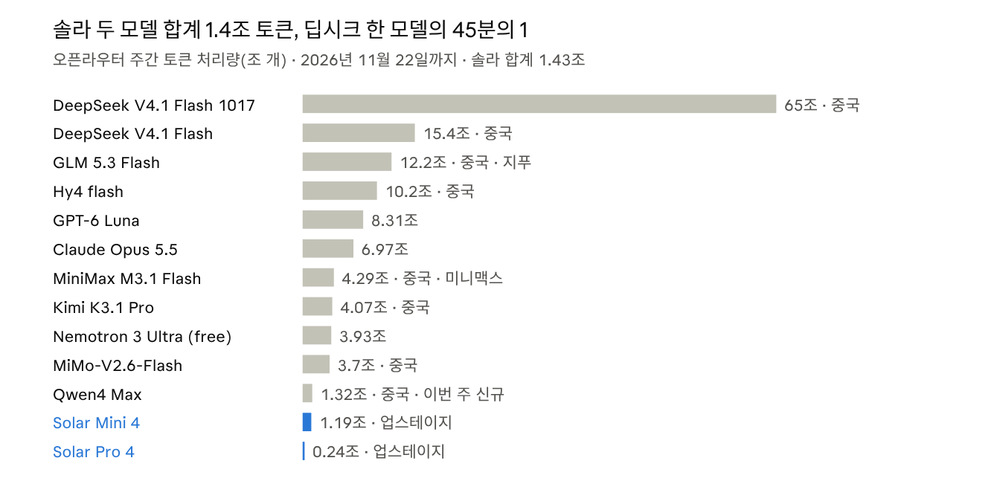

*그림 10. 오픈라우터 순위 페이지(2026-11-22까지) · 솔라 미니 4는 급상승 목록, 솔라 프로 4는 모델 모음 페이지의 표기값이며 집계 기간이 명시되지 않아 주간으로 유리하게 읽음*

**토큰 처리량**

| 기준 | 솔라 | 중국 LLM | 배율 | 자료 성격 |
| --- | --- | --- | --- | --- |
| 오픈라우터 주간 (같은 플랫폼, 개별 모델) | 솔라 미니 4 1.19조 개, 솔라 프로 4 0.24조 개 | 딥시크 V4.1 Flash 1017 65조, GLM 5.3 Flash 12.2조, MiniMax M3.1 Flash 4.3조 | 미니 4 대비 55배, 10배, 3.6배 | 외부 API 경유분의 실제 처리량. 중국 모델은 주간 순위표 값, 솔라는 집계 기간이 명시되지 않은 표기값을 주간으로 읽음 |
| 회사 발표 하루 물량 (시점과 정의가 다름) | 솔라 프로 4 최대 2,500억 개 (9월, 서버 GPU 한계) | 더우바오 180조 (6월), 미니맥스 약 3조 (3월), GLM 5.3 Flash 출시 6일간 62조 | 자릿수만 비교 가능: 약 700배, 12배, 40배 | 솔라는 처리 한계치, 중국은 각 사가 발표한 실제 처리량. 자사 서비스 소비분과 무료 사용분이 섞였을 수 있음 |
| 시장 전체 하루 |   | 중국 전체 140조 개 (3월, 국가데이터국) |   | 참고값 |

솔라 수치는 [오픈라우터 순위](https://openrouter.ai/rankings)와 [뉴스토마토](https://www.newstomato.com/ReadNews.aspx?no=1313291), 중국 수치는 [CGTN](https://news.cgtn.com/news/2026-06-18/China-builds-computing-network-as-AI-token-usage-skyrockets-1O4tgBLAnxS/p.html), [로보노믹스](https://robonomics.substack.com/p/china-open-source-llm-tracker), [세미펀더멘털](https://semifundamental.substack.com/p/china-ai-model-fundamentals), [시나파이낸스](https://finance.sina.com.cn/tech/csj/2026-09-01/doc-iniqiatw4811029.shtml) 기준이다.

이 배율은 규모의 자릿수를 보여 줄 뿐 시장점유율이 아니다. 오픈라우터는 API 시장의 한 창구이고, 솔라 매출의 중심인 금융권 구축형 계약은 여기에 잡히지 않는다. 회사 발표 물량은 시점, 최대치와 실제치, 자사 서비스 소비분의 포함 여부가 서로 달라 같은 기준으로 맞출 수 없었다.

**이용자**

| 회사 | 공개된 이용자 지표 |
| --- | --- |
| 업스테이지 | 아숙업 누적 사용자 230만 명 (2026년 1월 발표), 기업 고객 200여 곳 |
| 더우바오 (바이트댄스) | 월간 이용자 3.82억 명 (6월) |
| 딥시크 | 월간 이용자 1.29억 명 (6월) |
| 큐원 (알리바바) | 월간 이용자 1억 명 이상 |
| 지푸 | MaaS 개발자 740만 명 (8월), 1,000만 명 돌파 (11월) |

업스테이지의 숫자는 같은 기준이 아니다. 아숙업은 월간이 아니라 누적이다. 솔라 API의 활성 개발자 수와 유료 고객 수는 공개된 적이 없다. 이용자 수치는 [AI타임스](https://www.aitimes.com/news/articleView.html?idxno=205314), [세컨드탤런트](https://www.secondtalent.com/resources/doubao-vs-deepseek/), [진스데이터](https://shishixinwen.news/news/jin10/20261117131545832800)를 따랐다.

**다음 이용자는 LLM 이용자로 평가하면 과도한 해석이다.**

회사가 내세우는 다음의 주간 이용자 약 1,000만 명은 포털 회원과 방문자이지 솔라를 쓰는 사람이 아니어서 위 표에서 제외했다. 그 포털 자체도 줄어드는 중이다.

- **검색에서 밀렸다.** 인터넷트렌드 기준 2026년 상반기 검색 점유율은 네이버 64.28%, 구글 28.37%, 빙 3.84%, 다음 2.90%다([디지털데일리](https://www.ddaily.co.kr/page/view/2026071214223169501)). 다음은 빙에도 뒤진 4위이고, AI 요약을 내놓은 7월 이후에도 2.78%였다([뉴스토마토](https://newstomato.com/readnews.aspx?no=1309227)).
- **이용자가 줄었다.** 월간 이용자는 전성기 2,700만 명에서 600만\~700만 명으로 4분의 1이 됐다([딜사이트](https://dealsite.co.kr/articles/153021), 2025년 12월). 와이즈앱 집계로 다음 앱 이용자는 2018년 10월 1,079만 명에서 2023년 10월 724만 명으로 5년간 33% 줄었다([매드타임스](https://www.madtimes.co.kr/news/articleView.html?idxno=19261)). 회사가 말하는 주간 1,000만 명과는 집계 기준이 다르다.
- **웹 방문 순위는 나무위키 아래다.** 시밀러웹의 10월 국내 웹사이트 순위에서 나무위키는 5위, 다음은 7위다([시밀러웹](https://www.similarweb.com/top-websites/korea-republic-of/)). 앞선 집계인 Digital 2026 보고서에서는 다음이 월 3.57억 회로 나무위키 3.04억 회를 앞섰다([멜트워터](https://www.meltwater.com/en/blog/social-media-statistics-south-korea)). 순위는 웹 방문 기준이어서 앱 이용이 빠져 있고, 이용자 수를 직접 평가한 값은 아니다.
- **AI 기능 이용자는 공개되지 않았다.** 다음의 AI 요약은 7월에 베타로 나왔고 AI 모드는 연내 출시 예정이다. 이 기능을 실제로 쓰는 사람 수가 공개돼야 LLM 이용자로 평가할 수 있다. 지금은

**오픈웨이트 채택 (허깅페이스)**

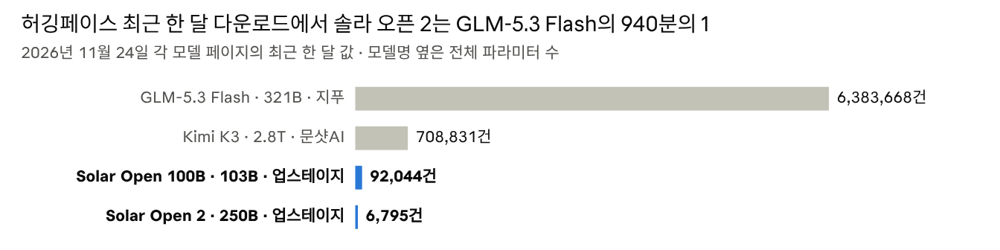

*그림 11. 허깅페이스 각 모델 페이지, 2026-11-24 확인 · 다운로드는 내려받은 횟수이며 이용자 수나 사용량이 아님*

| 모델 | 크기 (전체 / 활성)와 최소 사양 | 공개 (2026년) | 최근 한 달 다운로드 | 파생 모델 |
| --- | --- | --- | --- | --- |
| 솔라 오픈 2 | 250B / 15B, H200 4장 | 7월 (기술 보고서 기준) | 6,795건 | 18개 (파인튜닝 3, 양자화 15) |
| 솔라 오픈 100B | 103B / 12B, A100 80GB 4장 | 1월 (기술 보고서 기준) | 92,044건 | 20개 (파인튜닝 6, 양자화 14) |
| GLM-5.3 Flash | 321B / 18B, 최소 사양 명시 없음 | 8월 25일 | 6,383,668건 | 319개 (파인튜닝 44, 양자화 256, 어댑터 15, 병합 4) |
| Kimi K3 | 2.8T / 104B, 최소 사양 명시 없음 | 7월 | 708,831건 | 121개 (파인튜닝 57, 양자화 57, 어댑터 7) |
| 큐원 계열 (참고, 계열 합계) |   |   | 상위 300개 모델 30일 합계 1.74억 건, 전체의 50.9% | 약 15만 개 |

네 모델의 다운로드는 11월 24일 각 허깅페이스 모델 페이지의 "최근 한 달" 값이어서 플랫폼과 기간이 같다. 다운로드는 내려받은 횟수이지 이용자 수나 사용량이 아니다. 솔라 오픈 2는 H200 4장이 최소 사양이라 내려받을 수 있는 사람이 적다. 그러나 크기가 비슷한 GLM-5.3 Flash의 다운로드는 같은 한 달에 솔라 오픈 2의 약 940배이고, 11배 큰 Kimi K3도 약 100배다. 하드웨어 문턱만으로는 설명되지 않는 차이다. 솔라 안에서는 더 작은 100B가 약 9.2만 건으로 250B의 14배다. 출처는 허깅페이스의 [솔라 오픈 2](https://huggingface.co/upstage/Solar-Open2-250B), [솔라 오픈 100B](https://huggingface.co/upstage/Solar-Open-100B), [GLM-5.3 Flash](https://huggingface.co/zai-org/GLM-5.3-Flash), [Kimi K3](https://huggingface.co/moonshotai/Kimi-K3) 모델 페이지이고, 큐원 계열은 [DEV 커뮤니티](https://dev.to/ai_openfree_b23025ef075cf/qwen-still-takes-half-of-open-llm-downloads-what-changed-in-the-hugging-face-top-300-since-1gbn) 집계다.

11월 23일 공개된 솔라 미니 4.5 프리뷰는 11월 25일 현재 허깅페이스에 가중치가 올라와 있지 않아 이 표에 없다. 자체 API와 오픈라우터, 온프레미스로만 제공된다([업스테이지 콘솔](https://console.upstage.ai/docs/models/solar-mini-4-5-preview)). 가중치가 공개되면 이 표에 더해야 한다.

**플랫폼 전체의 흐름**

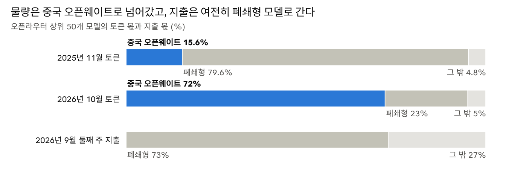

*그림 12. Ryan Doser 집계(2026-11-12), 오픈라우터 상위 50개 모델의 분류된 토큰 기준 · '그 밖'은 이 문서가 나머지로 계산 · 한 라우팅 플랫폼의 수치이며 전체 시장 점유율이 아님*

오픈라우터 상위 50개 모델 기준으로 중국 오픈웨이트의 토큰 몫은 1년 사이 15.6%에서 72.0%가 됐다. 그러나 9월 둘째 주 지출의 73%는 폐쇄형 모델로 갔다([Ryan Doser](https://ryandoser.com/research/chinese-ai-models/)). 솔라는 두 흐름 어느 쪽에서도 뚜렷한 몫을 차지하지 못했다.

**숫자가 말하는 것**

- **성과는 사실이다.** 솔라 프로 4는 9월 오픈라우터 폐쇄형 모델 주간 3위까지 올랐고, 등재 첫 주에 3,700억 토큰을 넘겼다. 한국 모델로는 처음이며 주목할만한 성과이다.
- **그러나 오픈웨이트 판은 중국 모델이 차지했다.** 오픈라우터 요청 점유율은 딥시크 25.4%, 텐센트 11.7%, 지푸 7.3%, 큐원 7.1%다. 업스테이지는 "기타 6.6%" 안에 있다.
- **토큰이 곧 매출은 아니다.** 위 솔라 물량을 오픈라우터 표시 가격(미니 4는 100만 토큰당 입력 0.05달러·출력 0.20달러, 프로 4는 0.15달러·0.60달러)에 대입한 환산액은 약 12만 달러, 1.8억 원이다. 입력 토큰 90%를 가정한 표시 가격 기준 환산액이지 실제 매출이 아니다. 할인과 무료 제공, 플랫폼 수수료, 기업별 계약 단가, 캐시 과금, 출력 토큰 비중에 따라 달라진다. 지푸의 MaaS 연환산 매출은 8월에 16억 달러였다.
- **지금 GPU 서버로 낼 수 있는 토큰 매출에는 상한이 있다.** 대표는 하루 2,500억 개가 서버 GPU의 한계라고 밝혔다. 이 한계를 1년 내내 채워 전부 표시 가격에 팔아도 환산액은 연 260억\~520억 원이다(입력 90% 가정, 하단은 오픈라우터 가격, 상단은 직접 판매 가격). 2025년 매출 248억 원의 한두 배이고, 그 위로는 GPU를 먼저 사야 한다. 토큰 성장은 곧 런웨이 계산의 시나리오 C다.
- **이익까지 가려면 지표가 더 필요하다.** 유료 토큰 비중, 토큰당 실효 단가, GPU 시간당 매출, 토큰당 추론 원가, 모델별 매출총이익률은 공개된 적이 없다. 사용량이 적어도 금융권 구축형 계약의 마진이 높다면 결론은 달라지고, 토큰이 늘어도 GPU 비용이 더 빨리 늘면 성장이 가치를 깎는다.

### 증류 차단과 GPU 규제: 중국의 한계가 한국의 기회가 되기 어려운 이유

중국 오픈웨이트의 추격에는 두 가지 제약이 걸리기 시작했다. 미국 프런티어 모델의 추론 기록을 뽑아 학습에 쓰는 길이 좁아지고 있고, GPU 수출 규제로 자체 연산 능력도 묶여 있다. 그러나 그 틈을 한국 모델이 메우기는 어려워 보인다.

| 시점 | 일어난 일 | 자료 성격 |
| --- | --- | --- |
| 2026년 5\~7월 | 앤트로픽이 클로드를 겨냥한 증류 캠페인을 관측. 알리바바 연계 계정 1억 5,100만 건 이상, 문샷 2,300만 건 이상, 딥시크 1,200만 건 이상 | 앤트로픽의 자체 조사와 귀속 판단 (9월 10일 보고서) |
| 7월 | 오픈AI에서도 추론 기록 추출 시도가 나타남. 7월 24\~25일 4,000명 이상이 1만 6,000건을 요청했고 7월 28일까지 차단. 핵심 활동은 문샷 관련 인물로 귀속 | 오픈AI 발표 (9월 30일) |
| 10월 | 앤트로픽은 새 방어로 증류 세력이 거두는 데이터가 90\~99% 줄었다고 설명. 디인포메이션은 딥시크와 문샷이 최신 모델 학습에 오픈AI GPT-6 Astra의 출력을 많이 썼다고 보도 | 익명 소식통 보도. 세 회사 모두 확인하지 않음 |
| 11월 20일 | 오픈AI가 방어 성과를 발표. 보호된 추론 기록의 추출 성공률이 54.0%에서 0.2%로 내려감 | 오픈AI 내부 평가. 독립 검증 없음 |

앤트로픽 수치는 [테크크런치](https://techcrunch.com/2026/09/10/anthropic-details-distillation-campaigns-from-alibaba-moonshot-ai-and-deepseek/)와 [CNBC 전재 기사](https://longbridge.com/en/news/298660175), 7월 캠페인은 [오픈AI](https://openai.com/index/disrupting-a-coordinated-model-distillation-campaign/), 10월 보도는 [윈버저](https://winbuzzer.com/2026/10/29/chinese-ai-labs-reportedly-train-models-on-gpt-6-astra-outputs-xcxwbn/) 기준이다. 11월 20일 수치는 작성자의 11월 23일 리포트에서 가져왔고 이번에 원문을 다시 열지는 못했다.

- **앤트로픽이 막자 오픈AI로 옮겨 갔다는 흐름은 보도와 정황에 근거한다.** 두 회사가 관측한 캠페인은 5\~7월과 7월로 시기가 겹친다. 한쪽이 막혀 옮겨 갔다기보다 두 곳을 함께 두드리다 방어가 약한 쪽으로 쏠렸다고 읽는 편이 자료에 가깝다. 수치는 모두 미국 기업의 자체 조사이고 사법적으로 확정된 사실이 아니다.
- **오픈AI 쪽도 막히고 있다.** 오픈AI는 7월 캠페인을 차단한 뒤 방어를 덧붙였다. 다만 협력사 클라우드에서는 같은 수법이 몇 주 더 통했다는 연구자들의 지적이 있어([더 디코더](https://the-decoder.com/openai-says-it-stopped-a-campaign-to-steal-its-models-reasoning-but-the-trick-still-worked-on-azure/)) 완전히 닫힌 것은 아니다.
- **GPU도 묶여 있다.** 에포크 AI는 화웨이의 2026년 AI 연산 생산량이 엔비디아의 4%에 못 미치고, 최상위 칩의 성능이 2022년에 나온 H100의 절반 수준이라고 추정한다([에포크 AI](https://epoch.ai/publications/huaweis-roadmap-to-2031)).
- **큐원 계열을 비롯한 기존 모델의 한계가 보이기 시작했지만 인과는 확정되지 않았다.** 앤트로픽은 알리바바의 캠페인이 큐원 모델 학습용이었다고 주장한다. 11월 지능지수에서 가중치가 공개된 중국 모델의 최고점은 30점대이고 프런티어 최고점은 65점이다. 그러나 지금 평가된 모델은 방어가 강화되기 전이나 그 무렵에 학습된 것이어서, 이 격차가 증류 차단 때문이라는 증거는 아니다. 차단의 효과는 다음 세대 모델에서 드러난다.

**한국이 이 틈을 메우기 어려운 이유**

| 항목 | 미국 | 중국 | 한국 |
| --- | --- | --- | --- |
| 주목할 만한 AI 모델 수 (2025년 출시, 스탠퍼드 AI 인덱스 2026) | 50개 | 30개 | 5개 |
| 세계 AI 논문 점유율 (2025년 6월, OECD) | 13.4% | 36.1% | 3.2% |

- **논문과 인재.** 한국은 모델 수로 세계 3위지만 1·2위와의 거리가 크다. 2022년 신기술 ICT 분야 박사 배출은 617명으로 미국 2,759명의 22.3%였고, 전문가들은 최상위 인재의 해외 유출을 가장 큰 문제로 꼽는다([세계일보](https://www.segye.com/newsView/20250916516193)). 모델 수는 [한국경제](https://www.hankyung.com/article/2026041406381) 기준이다.
- **연구 자원.** 2027년 정부 예산안의 차세대 GPU 확보 계획은 1만 장, 3조 8,500억 원이다(작성자의 11월 23일 리포트, 아이뉴스24 인용). 업스테이지는 서버 GPU가 하루 2,500억 토큰에서 한계에 닿고, 지푸는 반기 연구개발비만 약 4,400억 원을 쓴다.

중국의 추격이 느려지더라도 업스테이지가 얻는 것은 시간이지 순위가 아니다. 솔라 프로 4는 이미 중국 오픈웨이트보다 아래에 있고(14점 대 30점대), 그 거리를 좁히려면 논문과 GPU가 필요하다. 둘 다 한국이 아직 경쟁력을 확보하기 어려운 영역이다.

### 또 다른 아래아 한글이 되는 경로

글로벌에서 잘 팔리지 않는 모델에 남기 쉬운 시장은 국산 요건이 있는 곳, 곧 정부·공공기관과 규제를 받는 금융권이다. 그쪽으로 기우는 신호가 보인다.

- 매출의 70% 이상이 금융권이다. 금융권은 민간 기업이 대부분이어서 이 숫자가 보여 주는 것은 정부 매출 의존이 아니라 규제 산업 고객 집중이다. 정부·공공 매출 비중은 공개되지 않았고, 확인되는 것은 2024년 9월 이후 공공조달 계약 24건이다.
- 미국 법인 매출은 8.4억 원, 일본 법인은 자본잠식, 홍콩 법인은 청산됐다. 이는 해외 법인의 실적이고, 본사가 해외 고객에게 직접 판 매출은 공개되지 않았다.
- 최근 가장 큰 자금과 사업 기회는 국민성장펀드와 독파모, 곧 정부 쪽에서 왔다.

한글과컴퓨터는 그 길이 어디에 닿는지 보여 주는 사례다.

| 항목 | 한글과컴퓨터 | 뜻 |
| --- | --- | --- |
| 수익성 | 2025년 별도 매출 1,753억 원, 영업이익 509억 원 | 공공 표준은 안정적인 이익을 낸다 |
| 해외 | 글로벌 매출 비중 약 1% | 보호막 밖 매출은 작다 |
| 시장 평가 | 2026년 추정 실적 기준 PSR 1.2배, PER 11.3배 | 성장주 멀티플은 받지 못하고 있다 |

실적은 [CEO스코어데일리](https://www.ceoscoredaily.com/page/view/2026022315273032793), 해외 비중은 [녹색경제신문](https://www.greened.kr/news/articleViewAmp.html?idxno=339374), 멀티플은 한국IR협의회 6월 보고서를 전한 [바이라인네트워크](https://byline.network/2026/06/24-598/) 기준이다.

### 한컴보다 불리한 세 가지

아래아 한글은 정부와 공공기관이 구매하고, 정부에 내는 문서의 사실상 표준이어서 그 위에 독과점 생태계가 만들어져 있다. 업스테이지 솔라는 이런 독과점을 구성하기 힘들 것으로 보인다. 오픈웨이트 모델이 강력한 대안이기 때문이다. 내려받아 기관 내부망에서 직접 돌릴 수 있는 모델은 데이터를 밖으로 내보내지 않아도 된다. 다만 공공 부문이 해외 오픈웨이트를 얼마나 허용할지는 정책에 달려 있다.

1. **락인이 약하다.** 한글은 수십 년치 공문서가 그 파일 형식으로 쌓여 있다. LLM은 API 주소만 바꾸면 교체된다.
2. **비용 구조가 다르다.** 패키지 소프트웨어는 한 번 만들면 복제 비용이 거의 없다. LLM은 추론할 때마다 GPU를 쓰고, 뒤처지지 않으려면 해마다 다시 학습해야 한다.
3. **보호막이 정책에 달렸다.** 글로벌 모델이 국내 리전과 망분리 요건을 충족할수록 국산이어야 할 이유는 줄어든다.

그래서 아래아 한글만큼의 지위도 쉽게 얻어지지 않을 수 있다. 한컴은 표준과 흑자를 가졌지만, 국내 시장에 묶인 LLM은 표준 없이 적자를 안고 같은 시장에서 경쟁해야 한다. 한컴 같은 안정적 지위에 이르려면 높은 고객 유지율과 반복매출을 먼저 입증해야 한다.

### 밸류에이션에 주는 의미

같은 2027년 매출 750억 원이라도 시장이 어떤 회사로 보느냐에 따라 값이 20배 이상 갈린다.

| 시장이 보는 정체성 | 적용 멀티플 | 공모 시총 (지분가치) |
| --- | --- | --- |
| 글로벌 AI 랩 (지푸·미니맥스형) | PSR 30\~70배 | 2.3\~5.3조 원 |
| 국내 AI 소프트웨어 성장주 (노타형) | 약 30배 | 약 2.3조 원 |
| 용역형 국내 AI (코난·솔트룩스형) | 4\~5배 | 3,000억\~3,750억 원 |
| 공공 표준 소프트웨어 (한컴형) | 1.2\~1.7배 | 900억\~1,300억 원 |

회사 희망가 3.5\~5조 원은 첫째 줄에서만 성립하는데, 현재 순위표로는 업스테이지를 그 줄에 놓기 어렵다. 이 문서의 기준 구간 2.2\~3.5조 원도 둘째 줄, 곧 국내 성장주 대우가 상장 시점까지 유지된다는 전제 위에 있다.

### 그래서 자본시장에서 대량의 자금을 확보하기 위해 상장 시계가 더 빨라져야 한다.

현금은 천천히 줄지만 기술 서사는 지수가 갱신될 때마다 깎인다. "국가대표 AI"라는 프리미엄이 가격에 남아 있는 동안 상장하는 것이 기존 주주에게 합리적이고, 공모에 들어오는 투자자에게는 그만큼 조심할 이유다.

갈라파고스를 피하는 유력한 길은 프런티어 모델 경쟁을 접고 문서 AI라는 좁은 영역에서 세계 시장을 노리는 것으로 보인다. 그 경우에도 몸값의 근거는 다시 써야 한다.

## 강세 경로, 무엇이 맞아야 하는가?

갈라파고스는 공개된 지표로 볼 때 가능성이 큰 경로이지 유일한 경로가 아니다. 네 갈래의 강세 경로가 있고, 그중 문서 AI의 글로벌화만 모델 순위와 무관하게 성립할 수 있다.

| 경로 | 맞아야 하는 것 | 지금의 근거 | 걸림돌 | 가능성 판단 |
| --- | --- | --- | --- | --- |
| A. 국산 AI 프리미엄 | 정부·금융의 국산 수요가 커진다 | 독파모 3차 진출, 국민성장펀드, 공공조달 24건 | 시장이 작고 정책에 달렸다. 갈라파고스와 같은 길이다 | 높음 |
| B. 문서 AI 글로벌화 | Document Parse가 해외에서 팔린다 | 실제 매출원. 자체 벤치마크에서 구글·마이크로소프트보다 5% 이상 앞선다고 발표(2024년) | 독립 벤치마크 근거가 없다. 리덕토, 라마파스, 코히어 Parse, 오픈소스 Docling과 경쟁. 미국 법인 매출 8.4억 원 | 중간 |
| C. 다음의 AI 전환 | 포털 트래픽이 AI 유통 채널이 된다 | 주간 이용자 1,000만 명, 36년치 뉴스 데이터, 솔라 기반 AI 모드 연내 출시 예정 | 검색 점유율 2.9%로 빙에도 밀린 4위이고 웹 방문 순위는 나무위키 아래다. AXZ 대표도 당장 판을 뒤집기는 어렵다고 말했다. 추론비는 비용이다 | 낮음\~중간 |
| D. 모델 경쟁력 회복 | 후속 모델이 글로벌 순위에서 도약한다 | 솔라 프로 4가 전작의 3배 점수(이전 버전 기준), 엔비디아·AWS·AMD의 지원 | 추격에 필요한 자본 규모, v5에서 벌어진 격차 | 낮음 |

가능성 판단은 이 문서의 정성적 평가다. 다음 관련 근거는 [브릿지경제](https://www.viva100.com/article/20260616500596)와 [헤럴드경제](https://www.heraldk.com/article/2026112304410794828), 문서 AI 벤치마크는 [업스테이지 블로그](https://www.upstage.ai/blog/en/let-llms-read-your-documents-with-speed-and-accuracy), 경쟁 제품은 [코히어](https://cohere.com/blog/parse)와 [리덕토](https://llms.reducto.ai/best-llm-ready-document-parsers-2025) 자료를 따랐다.

### 문서 AI는 다른 시험이다

지능지수 14점은 범용 모델의 성적이고, 업스테이지가 실제로 돈을 버는 문서 AI의 성적이 아니다. 문서 AI는 OCR, 표와 레이아웃 인식 정확도, 장당 비용, 처리 속도로 평가받는다.

- 이 문서는 Document Parse의 성능을 독립 자료로 검증하지 못했다. 확인한 것은 회사가 만든 벤치마크의 2024년 결과뿐이다.
- 이 시장에도 샌드위치가 있다. 위에는 멀티모달 프런티어 모델과 클라우드 3사의 문서 서비스가, 아래에는 무료로 쓰는 오픈소스가 있다.
- 그럼에도 범용 모델 경쟁보다는 자본이 덜 들고, 한국어·금융 문서라는 출발점이 있다.

경로 B가 성립하면 업스테이지는 글로벌 AI 랩이 아니라 기업용 문서 AI 회사로 값을 받는다. 그 판단에 필요한 해외 매출 비중, 문서 AI 반복매출, 매출총이익률, 순매출유지율은 아직 공개되지 않았고, 증권신고서가 나오면 가장 먼저 봐야 할 숫자다.

## 현재 장점

업스테이지의 강점은 자본 접근력과 정책 프리미엄이고, 이 둘은 상장 심사와 수요예측에서 실제로 작동하는 자산이다.

- **정책 프리미엄.** 국민성장펀드가 첨단전략산업기금 1,000억 원을 직접 투자했다([디지털데일리](https://www.ddaily.co.kr/page/view/2026050610543265533)). 독파모는 2차 평가를 2위로 통과해 3차 단계에 남은 세 팀 중 유일한 스타트업이다([이투데이](https://www.etoday.co.kr/news/view/2619088)).
- **거래소의 유치 의지.** 한국거래소 이사장이 5월에 직접 코스닥 상장을 권유했고, 시총 1조 원 이상이면 적자여도 코스피 특례를 쓸 수 있다([KMJ](https://www.kmjournal.net/news/articleView.html?idxno=13490)).
- **손익 방향.** 영업손실이 402억에서 305억 원으로 줄었고 차입금이 없다. 영업손실률 123%는 지푸의 상반기 순손실률 약 217%보다 낮다.
- **문서 AI와 금융권 레퍼런스.** 실제 매출은 Document Parse와 프라이빗 LLM이 이끌고, 고객은 200곳을 넘는다. 규제 산업 고객은 한번 들어가면 잘 바꾸지 않는다.
- **주주 구성.** AWS, AMD, SK네트웍스, KT, 카카오, 현대차·기아, 산업은행이 주주다. GPU 조달, 유통 채널, 공공 수주에서 각각 우군이 된다.
- **다음과 타임리.** 다음은 주간 이용자 약 1,000만 명과 30년치 콘텐츠 데이터를 가졌다. 다만 이들은 포털 방문자여서 이 문서는 LLM 이용자로 세지 않는다. 타임리는 국내 약 600개 기관이 쓰고 지난해 흑자였다([뉴시스](https://mobile.newsis.com/view/NISX20260616_0003671084)).
- **주관사단과 해외 접점.** KB증권과 미래에셋증권에 UBS가 합류했다([헤럴드경제](https://v.daum.net/v/20260716103219059)). 11월 17일에는 코히어와 전략적 파트너십을 맺었다.

## 핵심 리스크

가장 큰 위험은 적자 자체가 아니라 직전 라운드 2.1조 원과 희망가 3.5\~5조 원 사이를 메울 실적이 아직 공개되지 않았다는 점이다.

| 리스크 | 내용 | 영향 |
| --- | --- | --- |
| 밸류 간극 | 희망가는 2025년 매출의 141\~202배, 상장 비교군 최고치는 74배 | 수요예측 부진 또는 공모가 하향 |
| 다음 통합 | 포털비즈 매출은 2021년 4,925억에서 2024년 3,320억 원으로 3년 연속 감소, 검색 점유율 2%대. 인수 일주일 만에 AXZ 대표가 사퇴 의사를 밝혔고 노조가 반발 | 연결 적자 확대, 심사에서 사업 안정성 질문 |
| 매출의 질 | 금융권 비중 70% 이상, 용역형 계약 다수, 반복매출 지표 미공개 | 소프트웨어 멀티플 대신 SI 멀티플 적용 위험 |
| 인프라 비용 | 2024년 지급수수료가 매출의 약 2배, AI 검색과 하루 1조 토큰 구상은 비용을 더 키움 | 손익분기 시점 지연 |
| 자본 쏠림 | 미스트랄은 30억 유로 라운드, 코히어는 캐나다 정부에서 최대 16억 캐나다달러 지분 투자를 받음 | 모델 경쟁에서 상대적 후퇴 |
| 오버행 | 우선주가 발행주식의 약 3분의 2, 2026년 발행분이 전체의 약 34% | 락업 해제 시 지푸형 급락 |
| 회계 기준 전환 | 현재 일반기업회계기준. 상장을 위해 K-IFRS로 바꾸면 전환우선주가 조건에 따라 부채로 분류될 수 있음 | 장부상 평가손실과 자본 감소(현금 유출 없음), 조건은 증권신고서에서 확인 필요 |
| 지배구조 | 창업자 합산 지분 약 20% 추정, SK네트웍스 11.7%와 카카오 약 10%가 바로 뒤 | 공모 희석 후 경영권 안정성 질문 |
| 정책자금 논란 | 4년 연속 적자 기업에 5,600억 원 투입을 두고 공정성·회수 가능성 시비 | 심사와 여론의 변수, 정권 주기 노출 |
| 일정 | 11월 20일 보도 기준 상장 시장과 시기 미확정, 연내 예심 청구 방침만 알려짐 | 상장이 2027년 하반기 이후로 밀릴 위험 |
| 모델 경쟁력 | 솔라 프로 4는 11월 Artificial Analysis 지능지수 14점으로 1위의 5분의 1, 상장 비교군 중 최하위 | 해외 기관 수요 약화, 규제 산업·공공 시장 의존 고착(갈라파고스) |

다음 매출 추이는 [마이데일리](https://www.mydaily.co.kr/page/view/2025122209561582128), AXZ 대표 사퇴는 [아시아경제](https://view.asiae.co.kr/article/2026051514505508377), 정책자금 논란은 [더팩트](https://news.tf.co.kr/read/ogmeta/2320265.htm)와 [지디넷코리아](https://zdnet.co.kr/view/?no=20260507173707), 해외 랩 조달과 일정은 [지디넷코리아 11월 20일자](https://zdnet.co.kr/view/?no=20261120103634) 보도를 따랐다. 회계 기준 전환과 지배구조 항목은 스타트업DB의 주식 현황에서 이 문서가 도출한 추정이다.

## 예상 상장 밸류에이션

공모 시가총액은 2.2\~3.5조 원, 중심 2.7조 원으로 추정한다. 회사가 IR에서 제시한 3.5\~5조 원([더벨](https://m.thebell.co.kr/m/newsview.asp?newskey=202603101416230320109279))과 비교하면 중심값이 하단보다 23%, 상단보다 46% 낮다.

### 용어와 희석 기준

이 문서의 가치는 모두 지분가치 기준이고, 매출은 다음을 뺀 업스테이지 별도 기준이다.

| 용어 | 이 문서에서의 뜻 |
| --- | --- |
| 공모 시총 | 상장 직후 지분가치. 공모 신주를 포함한 전체 주식 수에 공모가를 곱한 값 |
| 기업가치 (비상장 라운드) | 투자 전(프리머니) 또는 투자 후(포스트머니) 지분가치. 표기마다 구분했다 |
| PSR | 시가총액을 매출로 나눈 값. 순차입금을 반영한 EV/매출이 아니다 |
| 부문별 합산 | 본업을 PSR로 평가하고 다음과 순현금을 따로 더한 지분가치 |

비교군의 PSR에는 그 회사들의 현금이 이미 들어 있어, 업스테이지의 순현금을 따로 더하면 일부가 겹친다. 노타의 현금이 시총의 3% 안팎인 것처럼 비교군의 현금 비중이 작아 겹치는 폭은 기준값의 3% 안팎으로 본다.

"신주 15%"는 상장 후 지분의 15%를 뜻한다. 우선주는 보통주와 1 대 1로 전환된다고 가정했다.

| 기준 | 상장 후 주식 수 | 10월 투자자 본전선 |
| --- | --- | --- |
| 신주가 상장 후 지분의 15% (이 문서 기준, 신주 672,461주) | 4,483,075주 | 2.47조 원 |
| 신주가 기존 주식의 15% | 4,382,206주 | 2.41조 원 |
| 2025년 말 잔여 스톡옵션 135,721주 전량 행사 포함 | 4,642,747주 | 2.55조 원 |

현재 발행주식은 3,810,614주(2026-11-13)다. 스톡옵션은 감사보고서에 적힌 2025년 말 잔여 수량이다. 9차까지 292,801주가 부여돼 117,730주가 행사되고 39,350주가 취소됐으며, 행사가는 모두 1,000원이다. 2026년 부여분은 알 수 없다. 전환가격 조정의 구체 조건과 구주매출은 공개되지 않아 반영하지 못했다.

### 부문별 합산 (기준 시나리오)

| 구성 | 가정 | 가치 |
| --- | --- | --- |
| AI 본업 | 2027년 매출 750억 원(연 74% 성장 2년) × PSR 28배 | 약 2.1조 원 |
| 다음(AXZ) | 인수 거래가 수준 | 0.2\~0.3조 원 |
| 순현금 | GPU 투자 집행 후 잔액 가정 | 약 0.3조 원 |
| 합계 |   | 약 2.6\~2.7조 원 |

PSR 28배는 노타(33배)와 미니맥스(32배)에서 소폭 할인한 값이다. 매출 가정은 회사 가이던스가 아니라 2025년 성장률 78%를 연장한 이 문서의 추정이다.

다음의 가치 0.2\~0.3조 원은 인수 거래가를 그대로 쓴 값이다. 인수 가격은 과거의 거래가격이지 지금의 독립적인 기업가치가 아니어서, 이 값은 다음 세 조건이 지켜진다는 전제 위에 있다.

- 다음의 영업손실이 인수 당시보다 커지지 않는다.
- 검색 점유율과 이용자가 지금 수준에서 더 줄지 않는다.
- AI 전환에 들어간 투자가 손상 없이 자산가치로 남는다.

인수 후 손실과 추가 투자로 자산가치는 내려갈 수 있다. 그래서 시뮬레이션은 다음 가치를 0.1\~0.3조 원으로 더 낮게 잡았고, 가치가 0이 되는 경우는 스트레스 표에 따로 넣었다. AI 전환에 드는 추가 투자비는 이 값에서 빼지 않았고, 런웨이 계산의 시나리오 B(연 소진액 800억\~1,200억 원)에 비용으로 들어 있다.

### 세 시나리오

| 시나리오 | 공모 시총 구간 | 확률 | 2025년 매출 대비 | 조건 |
| --- | --- | --- | --- | --- |
| 강세 | 3.5조 원 이상 (대표 범위 3.5\~4.5조 원) | 15% | 141배 이상 | 2026년 본업 매출 500억 원 이상, 반복매출 지표 공개, 다음 AI 전환 지표 확인, 후속 모델의 글로벌 순위 회복 |
| 기준 | 2.2\~3.5조 원 (중심 2.7조 원) | 50% | 89\~141배 | 본업 연 60\~100% 성장 확인, 다음 손익 방어 |
| 약세 | 2.2조 원 미만 (대표 범위 1.5\~2.2조 원) | 35% | 89배 미만 | 다음 적자 확대, AI 투자 심리 악화, 지푸 추가 하락, 모델 순위 부진이 수요예측에 반영 |

세 구간은 빈틈 없이 이어지고, 시뮬레이션과 "확률의 구조" 표도 같은 경계(2.2조 원, 3.5조 원)를 쓴다. 구간별 대표값 4.0조, 2.7조, 1.85조 원으로 계산한 확률가중 기대값은 약 2.6조 원이다. 11월 글로벌 순위를 반영해 강세 확률을 25%에서 15%로 낮추고 약세를 35%로 올렸다.

### 민감도와 시뮬레이션

기준 추정은 성장률과 멀티플 가정에 크게 흔들리며, 회사 희망 상단 5조 원은 두 가정이 모두 최상단일 때만 나온다.

| 연 성장률 (2027년 매출) | PSR 10배 | PSR 28배 | PSR 40배 |
| --- | --- | --- | --- |
| 30% (419억 원) | 1.0조 원 | 1.7조 원 | 2.2조 원 |
| 74% (751억 원) | 1.3조 원 | 2.7조 원 | 3.6조 원 |
| 120% (1,200억 원) | 1.8조 원 | 3.9조 원 | 5.4조 원 |

표의 값은 본업 가치에 다음과 순현금 0.55조 원을 더한 공모 시총(지분가치)이다. 신주 발행 비율에 따라 10월 투자자의 본전선은 10%일 때 2.33조 원, 15%일 때 2.47조 원, 20%일 때 2.62조 원이다.

같은 변수를 분포로 놓고 20만 회 돌렸다. 성장률은 30\~120%(최빈 74%), PSR은 10\~40배(최빈 28배)의 삼각분포이고 둘의 상관은 0.5로 뒀다. 다음 가치는 0.1\~0.3조 원, 순현금은 0.2\~0.45조 원의 균등분포다.

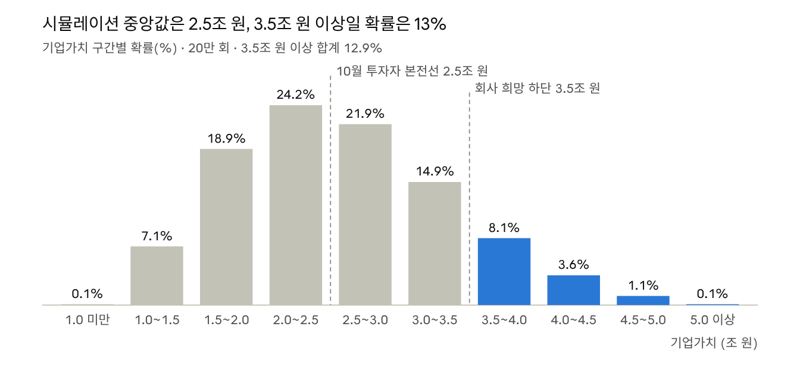

*그림 13. 이 문서의 시뮬레이션 · 입력 분포는 모두 가정 · 20만 회, 난수 시드 고정*

| 결과 | 값 |
| --- | --- |
| 중앙값 / 평균 | 2.5조 원 / 2.6조 원 |
| 80% 구간 (하위 10%\~상위 10%) | 1.6\~3.6조 원 |
| 본전선 2.5조 원 이상 | 50% |
| 2.2조 원 미만 | 36% |
| 2.2\~3.5조 원 | 52% |
| 3.5조 원 이상 | 13% |
| 5조 원 이상 | 0.1% |

시뮬레이션 결과(3.5조 원 이상 13%, 2.2\~3.5조 원 52%, 2.2조 원 미만 36%)는 모형이 낸 값이고, 시나리오 확률 15%, 50%, 35%는 이 문서의 최종 판단값이다. 둘은 서로 다른 추정치다. 판단값은 시뮬레이션보다 먼저 정했고, 모형 결과와 2%포인트 안에서 맞는다. 다만 같은 가정에서 나온 일치여서 모형이 판단을 독립적으로 검증해 주는 것은 아니다. 가정을 숫자로 드러내 반박할 수 있게 하는 장치로 읽어야 한다.

입력값의 근거와 성격은 다음과 같다. 모형이 계산한 것은 분포의 모양뿐이고, 범위와 최빈값은 모두 작성자의 판단이다.

| 입력 | 값 | 근거 |
| --- | --- | --- |
| 연 성장률 | 30\~120%, 최빈 74% | 업스테이지 실적: 2023년 -22%, 2024년 +201%, 2025년 +78%. 비교군: 노타 +55%, 지푸 +400% |
| PSR | 10\~40배, 최빈 28배 | 상장 비교군 4\~74배. 노타 33배, 미니맥스 32배 |
| 성장률과 PSR의 상관 | 0.5 | 통계로 추정한 값이 아니라 가정 |
| 다음 가치, 순현금 | 0.1\~0.3조 원, 0.2\~0.45조 원 | 인수 거래가와 이 문서의 가용 현금 추정 |

상관계수를 0으로 두면 3.5조 원 이상 확률은 7.5%, 0.8로 두면 15.8%로 움직인다. 중앙값은 2.46\~2.51조 원으로 거의 변하지 않는다.

**대체 분포와 스트레스 테스트**

삼각분포라는 가정이 결과를 좌우하는지 보려고 PSR 분포만 바꿔 다시 돌렸다.

| PSR 분포 가정 | 중앙값 | 3.5조 원 이상 | 2.2\~3.5조 원 | 2.2조 원 미만 |
| --- | --- | --- | --- | --- |
| 삼각분포 10\~40배, 최빈 28배 (본문) | 2.5조 원 | 13% | 52% | 36% |
| 상장 비교군 6곳의 실제 PSR을 그대로 사용 | 2.4조 원 | 23% | 30% | 46% |
| 비교군에 맞춘 로그정규분포 | 1.8조 원 | 26% | 16% | 58% |

중앙값은 1.8\~2.5조 원으로 어느 가정에서도 회사 희망가 아래에 모인다. 그러나 양 꼬리의 확률은 분포 가정에 따라 크게 달라진다. 비교군의 실제 PSR은 4배에서 74배까지 퍼져 있어 삼각분포보다 위와 아래가 모두 두껍다. 비교군이 6곳뿐이어서 어느 분포도 검증된 것이 아니고, 본문의 15%, 50%, 35%는 계산값이 아니라 판단값으로 읽어야 한다.

| 충격 | 바꾼 가정 | 공모 시총 |
| --- | --- | --- |
| 기준 | 연 74% 성장, PSR 28배, 다음 0.25조 원, 순현금 0.3조 원 | 2.65조 원 |
| 성장 급락 | 연 성장률 30% | 1.7조 원 |
| 멀티플 압축 | PSR 15배 | 1.7조 원 |
| GPU 투자로 순현금 소진 | 순현금 0 | 2.35조 원 |
| 다음 가치 손상 | 다음 가치 0 | 2.4조 원 |
| 성장·멀티플·순현금이 함께 | 성장률 30%, PSR 15배, 순현금 0 | 0.9조 원 |

스트레스 값은 부문별 합산 식에 가정을 하나씩 넣은 계산이다. 추론 단가 하락과 GPU 가격 변동은 성장률과 순현금을 통해서만 반영했고, 모형에 직접 넣지는 못했다.

### 벨류의 본전선은 약 2.5조 원

현재 주식 381만 주에 신주 15%를 더해 상장한다고 가정하면, 10월 투자자의 단가 55만 원은 공모 시총 약 2.5조 원에 해당한다. 기준 시나리오의 중심 2.7조 원은 주당 약 60만 원으로, 마지막 투자자에게 10% 남짓의 수익만 남긴다.

- 기준 범위의 하단 2.2조 원은 주당 약 49만 원으로 본전선 아래다. 상장 자체가 가장 최근 투자자와의 협상 대상이 된다.
- 전환우선주에 공모가 연동 전환가 조정 조항이 있다면 낮은 공모가는 창업자 지분 희석으로 이어진다. 감사보고서는 모든 전환우선주의 전환가격이 발행 계약서의 기준에 따라 조정될 수 있다고 적었지만, 공모가에 연동되는지는 밝히지 않았다.
- 사모 라운드가 한 번 더 열리면 이 본전선은 다시 올라간다.

### 상장 직후 주가

유통 물량이 적으면 초기에 시총 4\~5조 원을 일시적으로 찍을 수 있다. 미니맥스는 상장 첫날 109% 올랐고 지푸는 5개월 만에 25배가 됐다. 두 회사 모두 락업 해제 전후로 고점의 대부분을 반납했으므로, 첫 달 주가는 성공의 지표가 아니다.

한국 규정에서는 유통 물량이 오히려 많을 수 있다. 코스닥 의무보유는 최대주주(6개월\~1년), 예심 청구 전 1년 내 제3자배정 취득분(6개월\~1년), 투자 기간 2년 미만 벤처금융 지분(1개월)에 걸린다([거래소 상장심사 안내](https://kind.krx.co.kr/external/dst/reference/11242/2025%20%EC%BD%94%EC%8A%A4%EB%8B%A5%20%EC%83%81%EC%9E%A5%EC%8B%AC%EC%82%AC%20%EC%9D%B4%ED%95%B4%EC%99%80%20%EC%8B%A4%EB%AC%B4.pdf)). 현재 주식 기준으로 창업자 약 20%와 2026년 발행분 약 34%는 묶이지만, 2025년 이전에 들어온 약 46%는 자발적 확약이 없으면 일찍 풀릴 수 있다. 지푸식 급등보다 조기 매물 부담이 먼저 올 수 있어, 자발적 보호예수 범위가 증권신고서에서 가장 먼저 확인할 항목이다.

## 상장 타이밍 시나리오

세 경로 가운데 2027년 안에 가능한 한 일찍 2조 원대로 상장하는 경로만 래칫을 멈추고 투자 계획의 재원을 확보한다.

일정은 이미 밀리고 있다. 예심 청구 목표는 1월 보도에서 5월([더벨](https://www.thebell.co.kr/front/newsview.asp?key=202601281610348400108466)), 8월 보도에서 연내([네이트 뉴스](https://m.news.nate.com/view/20260804n34965))였고, 11월 23일 헤럴드경제는 내년 초 상장 추진으로 전했다. 회사는 11월 20일에도 시장과 시기가 미정이라고 했다.

연내 청구가 무산되면 상장은 빨라야 2027년 중반이다. 그래서 이 문서의 "2027년 상반기"는 달성 가능한 일정이 아니라 빠를수록 좋다는 방향으로 읽어야 하고, 2027년 내 상장 확률은 72%에서 65%로 낮췄다. 예심 청구를 내년 초로 미루는 방안을 검토한다는 11월 3일 더벨 보도를 기준으로 했다.

| 경로 | 시점과 가격 | 얻는 것 | 잃는 것 | 그 경로를 택했을 때 성사 확률 |
| --- | --- | --- | --- | --- |
| A. 빨리, 낮게 | 2027년 중 가장 이른 시점(목표는 상반기), 2.2\~3.5조 원 | 공모 자금 4,000억\~5,400억 원, 래칫 종료, 임직원 현금화 창구 | "5조 원" 서사, 10월 투자자의 수익률 | 75% |
| B. 빨리, 높게 | 2027년 중 가장 이른 시점(목표는 상반기), 3.5\~5조 원 고수 | 성사 시 더 큰 조달액과 대장주 지위 | 수요예측 실패나 철회 위험, 성사해도 지푸형 급등락 | 25% |
| C. 미루기 | 2028년 이후, 실적으로 5조 원 증명 | 검증된 실적으로 높은 공모가 가능성 | 사모 라운드 추가로 본전선 상승, 투자 축소 또는 현금 압박, 상장 창 닫힘 | 30% |

세 확률은 서로 배타적인 사건이 아니라 각 경로를 택했을 때 그 경로가 성사될 조건부 확률이어서 합이 100%가 아니다. 조건 없이 읽을 수 있는 확률은 성공 가능성 판정 절 "확률의 구조" 표의 상장 시점 65%, 22%, 13%뿐이다. 같은 표의 공모 시총 15%, 50%, 35%에는 상장이 성사된다는 조건이 붙는다.

### 왜 2027년 상반기인가?

- **회사 계획과 맞는다.** 블룸버그는 2025년 12월 업스테이지가 늦어도 2027년 상반기까지 국내 상장을 계획한다고 보도했다([블룸버그](https://www.bloomberg.com/news/articles/2025-12-02/ai-startup-upstage-hires-kb-securities-mirae-for-korea-ipo)).
- **심사 기간이 짧아졌다.** 하반기 코스닥 예심 승인 기업의 평균 심사기간은 63.8영업일이다([이투데이](https://www.etoday.co.kr/news/view/2646939)). 연내 청구하면 2027년 2분기, 청구가 내년 초로 밀리면 3분기 상장이 된다.
- **창이 열려 있다.** 앤트로픽이 첫날 17% 상승으로 마감해 AI 공모 수요가 확인됐다. 오픈AI 상장은 2027년 10월 전후로 예측되는데([퓨처서치](https://futuresearch.ai/anthropic-openai-ipo-dates-valuations/)), 그 전이 글로벌 자금이 덜 분산되는 구간이다.
- **정책 우호 구간이다.** 국민성장펀드 투자와 거래소의 코스닥 유치 의지가 동시에 작동한다. 이 조합이 얼마나 지속될지는 회사가 통제할 수 없다.

### 경로 C가 저주인 이유

미루는 동안 업스테이지는 두 가지 중 하나를 고르게 된다. GPU 투자를 줄이면 모델 경쟁에서 밀리고, 투자를 유지하면 2년 안에 더 비싼 사모 라운드가 필요하다. 어느 쪽이든 상장 때 증명해야 할 숫자는 커지고, 증명할 체력은 줄어든다. 현금이 남아 있는 채로 몸값만 거래되지 않는 상태가 말라죽은 유니콘이다.

모델 순위 격차가 이 계산을 더 나쁘게 만든다. 미루는 동안 지수가 갱신될 때마다 "국가대표 AI" 프리미엄이 먼저 깎이고, 남는 것은 공공 시장에 기대는 내수 기업의 멀티플이다. 이를 반영해 경로 B와 C의 성사 확률을 각각 10%포인트 낮췄다.

## 성공 가능성 판정

상장 자체는 성사될 가능성이 높지만, 상장 후 주가 방어와 본업 흑자는 각각 절반 이하의 확률로 본다.

| 성공의 기준 | 확률(추정) | 근거 |
| --- | --- | --- |
| 2027년 내 상장 성사 | 65% 안팎 | 주관사단 확정, 거래소 유치 의지, 정책자금 회수 필요 |
| 공모 시총 3.5조 원 이상 | 상장 시 15% (전체 약 10%) | 비교군 멀티플과의 간극, 연결 실적 미공개, 글로벌 모델 순위 |
| 상장 1년 뒤 공모가 이상 | 40\~45% | 지푸·미니맥스의 락업 이후 흐름, 우선주 비중 |
| 2028년까지 본업 영업흑자 | 25\~30% | 대표는 2027년 손익분기를 언급했으나([딜사이트](https://dealsite.co.kr/articles/151812)) GPU 투자 계획과 상충 |
| 상장 3년 뒤 글로벌 AI 랩으로 평가 (갈라파고스 탈출) | 10\~15% | 11월 지능지수 14점, 추격에 필요한 자본 규모, 해외 법인 실적 |

확률은 모형에서 나온 값이 아니라 위 근거를 종합한 판단이다.

### 확률의 구조

상장 시점은 조건이 붙지 않는 서로 배타적인 세 사건으로, 공모 시총은 상장이 성사된다는 조건 아래의 세 구간으로 나눠 본다. 각 묶음의 합은 100%다.

| 묶음 | 사건 | 확률 |
| --- | --- | --- |
| 상장 시점 | 2027년 내 상장 | 65% |
| 상장 시점 | 2028년 이후로 미뤄져 상장 | 22% |
| 상장 시점 | 철회 또는 장기 표류 | 13% |
| 공모 시총 (상장 성사 조건부) | 3.5조 원 이상 | 15% |
| 공모 시총 (상장 성사 조건부) | 2.2\~3.5조 원 | 50% |
| 공모 시총 (상장 성사 조건부) | 2.2조 원 미만 | 35% |

두 묶음을 곱하면 2027년 안에 3.5조 원 이상으로 상장할 확률은 약 10%다. 두 묶음 모두 이 문서의 판단값이다. 시뮬레이션이 낸 13%, 52%, 36%는 판단값과 구분되는 모형 결과이고 참고로만 대조했다.

### 다른 상장 AI 랩과 비교한 위치

- **앤트로픽과는 다른 종목이다.** 매출 규모가 천 배 넘게 차이 나고, 앤트로픽은 이미 영업흑자다. 벤치마크로 삼을 수 없다.
- **지푸·미니맥스가 가장 가까운 선례다.** 자국 정책 프리미엄, 대규모 적자, 적은 유통 물량이 같다. 다만 두 회사는 반기 매출이 업스테이지 연 매출의 7\~8배이고 API 매출이 폭증하는 구간에 상장했다.
- **노타가 국내 기준선이다.** 매출 131억 원에 시총 4,000억 원대로, 적자 AI 소프트웨어에 코스닥이 주는 상단이 30배 안팎임을 보여준다.
- **코난·솔트룩스는 경고다.** 성장이 둔화된 용역형 AI 기업은 4배대로 수렴한다. 반복매출 전환에 실패하면 업스테이지가 갈 자리다.

### 예심 서류와 증권신고서에서 확인할 것

- [ ] 2026년 연결 매출과 다음(AXZ)의 영업손익
- [ ] 반복매출(ARR)과 API·구독 매출 비중
- [ ] 금융권 매출 비중과 상위 고객 집중도
- [ ] 매출채권 회수와 대손충당금, 영업활동 현금흐름
- [ ] 전환우선주 조건: 전환가 조정, 상환권, K-IFRS 분류
- [ ] 의무보유 확약과 상장 직후 유통 물량 비율
- [ ] 공모 구조(신주와 구주 비율)와 자금 사용 계획의 GPU 투자 일정
- [ ] 5,600억 원 투자의 실제 납입액과 조건
- [ ] 유료 토큰 비중과 토큰당 실효 단가, GPU 시간당 매출, 토큰당 추론 원가, 모델별 매출총이익률

## 남는 기회: 로열티를 내고 배운 현대차의 길

이 문서의 결론은 비관에 가깝지만 한국 AI에 길이 없다는 뜻은 아니다. AI 산업이 국가 전략 산업의 한 축이라는 점은 부정하기 힘들고, 미국과 중국의 AI 패권 전쟁은 그 사이에 선 나라에 기회도 만든다.

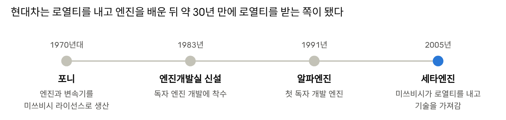

*그림 14. SAE 논문(1989), 현대자동차그룹 기술 연대기, Car스텔라 칼럼 기준 · 연도는 각 자료의 표기를 따름*

- **현대차는 사 오면서 배웠다.** 현대자동차는 엔진을 사 올 때 로열티를 주고 그 기술을 적극 받아들였다. 포니의 엔진과 변속기는 미쓰비시 라이선스로 만들었고([SAE](https://saemobilus.sae.org/content/891185/)), 1983년 엔진개발실을 세워 1991년 첫 독자 엔진인 알파엔진을 내놓았다([현대자동차그룹](https://www.hyundaimotorgroup.com/ko/story/CONT0000000000114240)). 세타엔진 때는 미쓰비시가 로열티를 내고 기술을 가져갔다([Car스텔라 칼럼](https://web.getcha.kr/community/all/50568?topic=13)). 그 결과 현대자동차그룹은 기술 자립을 이룰 수 있었다.
- **AI에서 사 올 수 있는 엔진은 오픈웨이트와 프런티어 API다.** 가중치가 공개된 모델은 내려받아 고쳐 쓸 수 있고(GLM-5.3 Flash는 MIT 라이선스다), 프런티어 모델은 API 요금이라는 로열티를 내고 쓸 수 있다. 처음부터 전부 만들기보다 가져다 쓰면서 제품과 데이터, 운영 경험을 쌓고 이길 수 있는 영역부터 독자화하는 길이 있다. 업스테이지에게 그 영역은 문서 AI로 보인다.
- **미중 경쟁이 여는 틈이 있다.** 미국은 프런티어 지능을 담장 안에 두기 시작했고, 중국산 모델은 미국과 동맹국의 규제 산업에서 쓰기 어렵다. 한국은 미국 국무부가 주도하는 AI 공급망 협의체 팍스 실리카에 참여하고 있고([경향신문](https://khan.co.kr/article/202608161244001)), 정부는 독자 AI 기술을 바탕으로 다른 나라와 협력하는 방안을 추진한다([뉴스1](https://www.news1.kr/it-science/internet-platform/6233290)). AWS와 AMD가 업스테이지의 주주이고 엔비디아가 투자를 예정한 것도 이 구도와 맞닿아 있다.
- **조건이 있다.** 현대차의 자립에는 약 30년이 걸렸고, AI의 세대 교체는 그보다 훨씬 빠르다. 기회가 몸값의 근거가 되려면 해외 매출과 반복매출로 확인돼야 한다. 이 문서의 확률 추정은 그 확인 전의 값이고, 이 절을 더하면서 바꾸지 않았다.

## 방법론과 한계

이 문서의 숫자는 감사보고서 요약, 기업 데이터베이스, 언론 보도에서 가져왔고 원문 공시와 최신 데이터를 반영하지 않았을 수 있다.

이 문서는 AI 산업 분석을 바탕으로 한 IPO·밸류에이션 투자 리서치다. 민감도 분석과 시뮬레이션을 쓰지만 입력값은 작성자의 판단이고, 과거 상장 사례로 검증한 퀀트 모델이 아니다. 성장률, 매출총이익률, 반복매출, 자본집약도로 멀티플을 설명하는 팩터 모델과 과거 AI 기업 IPO에 대한 백테스트는 후속 과제로 남긴다.

- **PSR.** 상장사는 시가총액, 비상장사는 라운드 지분가치를 매출로 나눴다. 분기·반기 매출은 연환산했고, 기준은 차트에 적었다.
- **환율.** 1달러 1,470원, 1위안 약 205원, 1달러 7.78홍콩달러를 썼다.
- **추정 항목.** 가용 현금, 연 소진액, 2027년 매출, 신주 발행 비율, 창업자 현재 지분율, 모든 확률은 이 문서의 가정이다.
- **빈 곳.** 2026년 실적, 다음 편입 후 연결 재무, 우선주 조건, 5,600억 원의 납입 현황은 공개되지 않았다. 예심 청구와 증권신고서가 나오면 밸류에이션을 다시 계산해야 한다.
- **첨부 메모.** 독파모 점수는 메모의 "1차 평가"가 아니라 2026년 8월 2차 단계평가 결과로 바로잡았다. 영업활동 현금흐름, 대손충당금, 팔란티어·C3.ai 수치는 검증하지 못해 그렇게 표시했다.

### 시뮬레이션 재현 정보

아래 값과 코드로 본문의 시뮬레이션 결과를 다시 만들 수 있다.

| 항목 | 값 |
| --- | --- |
| 계산식 | 공모 시총(조 원) = 248억 원 × (1 + g)² × PSR ÷ 10,000 + 다음 가치 + 순현금 |
| 연 성장률 g | 삼각분포 (최소 0.30, 최빈 0.74, 최대 1.20) |
| PSR | 삼각분포 (최소 10, 최빈 28, 최대 40) |
| g와 PSR의 종속 | 가우시안 코풀라, 상관계수 0.5 |
| 다음 가치, 순현금 | 균등분포 0.10\~0.30조 원, 0.20\~0.45조 원. 다른 변수와 독립 |
| 반복 횟수와 난수 | 200,000회, NumPy default\_rng 시드 20261124 |
| 대체 분포 | 비교군 PSR 4.1, 4.6, 19, 32, 33, 74배의 경험 분위수, 같은 값에 맞춘 로그정규분포 (중앙값 17.4배, 로그 표준편차 1.16) |
| 비교군과 가중치 | 솔트룩스, 코난테크놀로지, 앤트로픽, 미니맥스, 노타, 지푸. 동일 가중 |

```python
import numpy as np
from math import erf, sqrt

N, rho = 200_000, 0.5
rng = np.random.default_rng(20261124)
z = rng.multivariate_normal([0, 0], [[1, rho], [rho, 1]], size=N)
u = 0.5 * (1 + np.vectorize(erf)(z / sqrt(2)))

def tri(u, a, c, b):
    fc = (c - a) / (b - a)
    return np.where(u < fc, a + np.sqrt(u * (b - a) * (c - a)),
                    b - np.sqrt((1 - u) * (b - a) * (b - c)))

g = tri(u[:, 0], 0.30, 0.74, 1.20)
psr = tri(u[:, 1], 10, 28, 40)
v = 248 * (1 + g) ** 2 * psr / 1e4 + rng.uniform(0.10, 0.30, N) + rng.uniform(0.20, 0.45, N)
print(np.median(v), (v >= 3.5).mean(), (v < 2.2).mean())
```

비교군은 상장돼 있고 AI가 주 사업인 여섯 곳이다. 파운데이션 모델 회사 셋(앤트로픽, 지푸, 미니맥스)과 국내 AI 소프트웨어 회사 셋(노타, 코난테크놀로지, 솔트룩스)으로, 사업모델과 성장 단계가 서로 다르다. 동일 가중이 맞다는 근거는 없고, 본문의 PSR 28배는 성장 단계가 가까운 노타와 미니맥스에 무게를 둔 판단이다.

### 평가 지표의 기준

| 평가 | 버전과 기준일 | 대상 모델 |
| --- | --- | --- |
| Artificial Analysis 지능지수 | v5.0.1, 2026년 11월 23일 확인 | 솔라 프로 4 (2026년 8월 공개) |
| 지능지수와 AutomationBench-AA (회사 제공 평가) | v5.0.1, 비교 모델은 11월 20일 값, 자료는 11월 25일 확인 | 솔라 미니 4.5 프리뷰 (2026년 11월 23일 공개) |
| 수능 풀이 대시보드 | 2027학년도 수능, 11월 22일 보도 | 솔라 프로 4 |
| 독파모 2차 단계평가 | 2026년 8월, 이전 버전 지수 | 솔라 오픈 2 |
| 허깅페이스 다운로드 | 11월 24일 기준 최근 한 달 | 솔라 오픈 2, 솔라 오픈 100B |
| 오픈라우터 토큰 | 11월 22일까지의 순위 페이지 | 솔라 프로 4, 솔라 미니 4 |

지능지수는 버전이 다르면 점수를 비교할 수 없고, 평가마다 대상 모델과 기준일이 다르다.

### 핵심 수치의 검증 등급

검증은 두 축으로 나눠 적는다. 원자료의 신뢰도는 A(감사보고서·공시·공식 발표), B(복수 언론에서 확인), C(단일 언론 또는 기업 데이터베이스), D(이 문서의 추정 또는 미검증)다. 원문 대조는 이 문서가 그 원자료를 직접 열어 확인했는지를 뜻한다. 자료가 믿을 만한 것과 작성자가 그것을 확인한 것은 다른 문제다.

| 수치 | 원자료 신뢰도 | 원문 대조 | 근거 |
| --- | --- | --- | --- |
| 2025년 매출 248억 원, 영업손실 305억 원, 재무상태 | A | 직접 확인 | 전자공시시스템에 공시된 제6기 감사보고서 원문 (한미회계법인, 2026년 3월 24일) |
| 2025년 영업활동 현금흐름 -341억 원, 대손충당금 44억 원 | A | 직접 확인 | 감사보고서 현금흐름표와 재무상태표 |
| 2025년 말 주주 구성, 전환우선주 발행 조건, 스톡옵션 잔여 수량 | A | 직접 확인 | 감사보고서 주석 1, 3, 12 |
| 솔라 프로 4 지능지수 14점 | A | 직접 확인 | Artificial Analysis 모델 페이지 |
| 솔라 미니 4.5 프리뷰 지능지수 20점, AutomationBench-AA 65.0% | B | 회사 자료로 확인 | 업스테이지 공개 자료(회사 제공 평가). Artificial Analysis 공개 순위표에서는 확인하지 못함 |
| 엔비디아 투자 예정 | A | 언론 보도로 확인 | 회사 발표를 전한 복수 언론 |
| 시리즈C 1차 1,800억 원, 프리머니 1조 3,000억 원 | B | 언론 보도로 확인 | 복수 언론, 금융위 발표 |
| 2차 라운드 단가 약 55만 원, 기업가치 2조 원대 | B | 언론 보도로 확인 | 뉴스톱, 넘버스 |
| 상장 비교군 시가총액과 매출 | B\~C | 공시 원문 미대조 | 언론과 시세 집계 사이트, 기준일 상이 |
| 현재 총발행주식 3,810,614주, 2026년 주식 종류별 수량 | C | 미대조 | 스타트업DB. 등기 원문은 보지 못함 |
| 누적 조달 약 7,900억 원 | D | 해당 없음 | 출처별 4,500억\~9,729억 원, 이 문서의 채택치 |
| 2026년 말 가용 현금, 연 소진액 시나리오 | D | 해당 없음 | 이 문서의 추정 |
| 2027년 매출 750억 원, 적용 PSR | D | 해당 없음 | 이 문서의 가정 |
| 다이나모 1.43배 | D | 미대조 | 전달받은 요약 |
| 전환가격 조정의 구체 조건, 2026년 실적, 다음 편입 후 연결 손익 | 미공개 | 대조 불가 | 2026 회계연도 감사보고서와 증권신고서에서 확인 필요 |

2025 회계연도 재무 수치는 전자공시에 올라온 감사보고서 원문과 대조했다. 2026년 수치는 아직 감사받은 자료가 없어 모두 보도와 추정이고, 2026 회계연도 감사보고서가 공시되면 다시 맞춰야 한다.

자금 조달은 완료된 것과 예정인 것을 구분해야 한다.

| 항목 | 상태 | 기준 |
| --- | --- | --- |
| 시리즈C 1차 1,800억 원 | 완료 | 2026년 4월 |
| 국민성장펀드 연계 5,600억 원 (첨단기금 1,000억 원 포함) | 승인. 납입 내역은 확인하지 못함 | 4월 30일 기금운용심의회 |
| 시리즈C 2차 전환우선주 약 557억 원 | 납입일 19일로 보도 | 10월 보도 |
| SK네트웍스 약 200억 원 | 취득 예정 | 11월 보도 |
| 엔비디아 | 투자 예정, 금액·지분율 미공개 | 11월 9일 발표 |

주의: 본 문서는 공개된 자료를 바탕으로 개인이 평가한 자료이며, 최신 투자 정보 및 비공개 정보가 있을 경우 판단이 달라질 수 있다. 투자는 투자 전문가의 조언에 따라야 하며 본 문서는 특정 기업의 투자를 지지하거나 응원하는  것이 아니다.

## 출처

**업스테이지 재무·투자**

- [아웃스탠딩 스타트업DB, 업스테이지](https://outstanding.kr/startup-db/company/16f33d943888d082) (첨부 PDF, 2026-11-24 조회)
- [오픈비즈데이터, 업스테이지 감사보고서 요약](https://www.openbizdata.com/upstage/)
- [더벨, 인프라 비용과 적자](https://www.thebell.co.kr/front/newsview.asp?key=202509221329596200101832)
- [더벨, 상장 밸류 최대 5조 제시](https://m.thebell.co.kr/m/newsview.asp?newskey=202603101416230320109279)
- [뉴스톱, 560억 추가 펀딩](https://www.newstopkorea.com/news/articleView.html?idxno=48050)
- [뉴시스, 6월 미디어데이](https://mobile.newsis.com/view/NISX20260616_0003671084)
- [더팩트, 국민성장펀드 5,600억 논란](https://news.tf.co.kr/read/ogmeta/2320265.htm)
- [디지털데일리, 첨단기금 1,000억 직접투자](https://www.ddaily.co.kr/page/view/2026050610543265533)
- [데모데이, 비즈니스모델 분석](https://demoday.co.kr/bm-analysis/130)
- [한국M&A경제신문, IPO와 주주](https://www.kmnanews.com/news/articleView.html?idxno=10415)

**상장 일정·다음·정책**

- [지디넷코리아, IPO 앞둔 업스테이지 자금 확보 고심 (11월 20일)](https://zdnet.co.kr/view/?no=20261120103634)
- [KMJ, 코스닥행으로 가닥](https://www.kmjournal.net/news/articleView.html?idxno=13490)
- [헤럴드경제, UBS 주관사 합류](https://v.daum.net/v/20260716103219059)
- [블룸버그, 주관사 선정](https://www.bloomberg.com/news/articles/2025-12-02/ai-startup-upstage-hires-kb-securities-mirae-for-korea-ipo)
- [이투데이, 예심 심사기간](https://www.etoday.co.kr/news/view/2646939)
- [딜사이트, 다음 실적과 GPU 구상](https://dealsite.co.kr/articles/159904/068020)
- [마이데일리, 포털비즈 매출 추이](https://www.mydaily.co.kr/page/view/2025122209561582128)
- [조선비즈, 카카오 지분 약 10%](https://news.nate.com/view/20260527n02225)
- [금융감독원 전자공시시스템(DART), 접수번호 20260413000172](https://dart.fss.or.kr/dsaf001/main.do?rcpNo=20260413000172), 주식회사 업스테이지 제6기 감사보고서 (한미회계법인, 2026년 3월 24일): 2025 회계연도 재무제표와 주석
- [아시아경제, AXZ 유상증자와 대표 사퇴](https://view.asiae.co.kr/article/2026051514505508377)
- [이투데이, 독파모 2차 평가 점수](https://www.etoday.co.kr/news/view/2619088)
- [전자신문, 독파모 평가 세부](https://v.daum.net/v/20260827204708760)

**비교군**

- [퓨처서치, 앤트로픽 재무 전망](https://futuresearch.ai/anthropic-financial-forecast/)
- [CNN, 앤트로픽 상장](https://www.cnn.com/2026/11/19/business/anthropic-ipo-stock-test-ai)
- [포춘, 앤트로픽 첫날 거래](https://fortune.com/2026/11/19/anthropic-ipo-first-day-trading-nasdaq-record-valuation/)
- [야후파이낸스, 앤트로픽 상장 밸류 하향](https://finance.yahoo.com/markets/stocks/articles/prediction-anthropic-stock-nov-19-172702666.html)
- [펑파이, 지푸 시총 추이](https://www.thepaper.cn/newsDetail_forward_34492933)
- [제일재경, 지푸 상반기 실적](https://news.qq.com/rain/a/20260901A054CP00)
- [시나파이낸스, 지푸 연구개발비](https://cj.sina.com.cn/articles/view/1654203637/629924f50200171pq)
- [포위크MBA, 지푸·미니맥스 상반기 매출](https://fourweekmba.com/ai-anthropic-made-63x-the-revenue-of-chinas-zhipu-and-minimax/)
- [컴퍼니스마켓캡, 미니맥스 시총](https://companiesmarketcap.com/minimax-group/marketcap/)
- [푸투, 지푸·미니맥스 유통 물량](https://news.futunn.com/en/post/71910770/a-surge-of-5-8-times-upon-listing-are-zhipu)
- [스톡디깅, 노타](https://stockdigging.com/stock/486990)
- [치킨스탁, 코난테크놀로지](https://www.chickstockfi.com/stocks/402030)
- [치킨스탁, 솔트룩스](https://www.chickstockfi.com/stocks/304100)
- [카카오, 2026년 2분기 실적](https://www.kakaocorp.com/page/detail/12096)

**모델 경쟁력·갈라파고스**

- Artificial Analysis Intelligence Index 화면 (사용자 제공 측처, 2026-11-23)
- [경제타임스, 2027학년도 수능 LLM 풀이 순위 (11월 22일)](https://www.ket.kr/news/article.html?no=42254)
- [NPR, 앤트로픽 공모 규모 813억 달러와 회사 조달분 (11월 19일)](https://www.opb.org/article/2026/11/18/anthropic-ipo-raises-record-dollar81-3-billion-on-strong-ai-demand/)
- [테크크런치, 앤트로픽 9월 증류 캠페인 보고서](https://techcrunch.com/2026/09/10/anthropic-details-distillation-campaigns-from-alibaba-moonshot-ai-and-deepseek/)
- [CNBC 전재, 알리바바·문샷·딥시크 관측 규모](https://longbridge.com/en/news/298660175)
- [오픈AI, 7월 증류 캠페인 차단 발표 (9월 30일)](https://openai.com/index/disrupting-a-coordinated-model-distillation-campaign/)
- [윈버저, 디인포메이션의 GPT-6 Astra 증류 보도 정리 (10월 29일)](https://winbuzzer.com/2026/10/29/chinese-ai-labs-reportedly-train-models-on-gpt-6-astra-outputs-xcxwbn/)
- [더 디코더, 협력사 클라우드에서 이어진 추출 수법](https://the-decoder.com/openai-says-it-stopped-a-campaign-to-steal-its-models-reasoning-but-the-trick-still-worked-on-azure/)
- [에포크 AI, 화웨이 AI 칩 로드맵 분석](https://epoch.ai/publications/huaweis-roadmap-to-2031)
- [한국경제, 스탠퍼드 AI 인덱스 2026 주목할 모델 수](https://www.hankyung.com/article/2026041406381)
- [세계일보, AI 논문 점유율과 인재 유출 (2025년 9월)](https://www.segye.com/newsView/20250916516193)
- 작성자 리포트 「앤트로픽이 막은 뒤: 중국 AI는 BYD가 되고, 한국 LLM은 갈라파고스 앞에 섰다」 (2026년 11월 23일): 오픈AI 11월 20일 발표 수치, 2027년 GPU 예산
- [Ryan Doser, 오픈라우터 상위 50개 모델의 토큰·지출 몫 (11월 12일)](https://ryandoser.com/research/chinese-ai-models/)
- [SAE, 현대 알파엔진의 설계와 개발 (1989)](https://saemobilus.sae.org/content/891185/)
- [현대자동차그룹, 기술 연대기](https://www.hyundaimotorgroup.com/ko/story/CONT0000000000114240)
- [Car스텔라 칼럼 전재, 알파엔진과 세타엔진](https://web.getcha.kr/community/all/50568?topic=13)
- [경향신문, 팍스 실리카 (8월 16일)](https://khan.co.kr/article/202608161244001)
- [뉴스1, 미중 AI 경쟁과 정부의 대응 (7월 21일)](https://www.news1.kr/it-science/internet-platform/6233290)
- [Artificial Analysis, Solar Pro 4 모델 페이지](https://artificialanalysis.ai/models/solar-pro-4)
- [Artificial Analysis, MiniMax-M3 모델 페이지](https://artificialanalysis.ai/models/minimax-m3)
- [Artificial Analysis, Intelligence Index v5 발표문](https://artificialanalysis.ai/articles/artificial-analysis-intelligence-index-v5)
- [벤치LM, 지능지수 순위표](https://benchlm.ai/benchmarks/artificialanalysis)
- [전자신문, 솔라 프로 4 공개](https://www.etnews.com/20260814000345)
- [파이낸셜뉴스, 엔비디아 투자 유치](https://www.fnnews.com/news/202611091915255020)
- [연합뉴스, 엔비디아 국내 스타트업 투자 계획](https://www.koreatimes.com/article/11630891)
- [CEO스코어데일리, 한컴 2025년 실적](https://www.ceoscoredaily.com/page/view/2026022315273032793)
- [녹색경제신문, 한컴 글로벌 매출 비중](https://www.greened.kr/news/articleViewAmp.html?idxno=339374)
- [바이라인네트워크, 한국IR협의회 한컴 보고서](https://byline.network/2026/06/24-598/)
- [업스테이지 콘솔, Solar Mini 4.5 Preview 모델 문서 (11월 25일 확인)](https://console.upstage.ai/docs/models/solar-mini-4-5-preview)
- 업스테이지 공개 자료, Solar Mini 4.5 Preview 평가 그래픽 4장 (11월 25일 작성자 제공)
- [Artificial Analysis, AutomationBench-AA 평가 페이지](https://artificialanalysis.ai/evaluations/automationbench-aa)
- [바이라인네트워크, 솔라 미니 4 공개 (10월 1일)](https://byline.network/2026/10/2-459/)
- [알파시그널, 솔라 미니 4 분석](https://alphasignal.ai/news/upstage-s-solar-mini-4-triples-its-benchmark-score-with-3b-active-parameters)

지능지수는 버전이 바뀌면 점수를 서로 비교할 수 없다. 이 문서의 순위는 v5.0.1 기준이고, 8월의 42점과 독파모 평가의 37점은 이전 버전 기준이다.

**엔비디아 투자·수익화**

- [디일렉, 엔비디아 AI 스타트업 파트너십 포럼](https://www.thelec.kr/news/articleView.html?idxno=65139)
- [지디넷코리아, 엔비디아 투자 예정 발표](https://zdnet.co.kr/view/?no=20261109173602)
- [AI타임스, 엔비디아 투자와 자금 용도](https://www.aitimes.kr/news/articleView.html?idxno=42658)
- [넘버스, 시리즈C 2차 단가와 기업가치](https://www.numbers.co.kr/news/articleView.html?idxno=23134)
- [스토리지리뷰, 엔비디아 다이나모 한국 오픈 모델 구성](https://www.storagereview.com/news/nvidia-dynamo-recipes-korean-open-models-b200-2x?type=Enterprise)
- [트루IQ, 지능지수 v5 해설과 11월 순위](https://trueiq.si/guides/artificial-analysis-intelligence-index-v5)
- [Artificial Analysis, MiniMax-M3 비용](https://artificialanalysis.ai/models/releases/minimax-m3)
- [오프위크, 지푸 매출총이익률](https://mp.ofweek.com/finance/a556714238677)

**강세 경로·의무보유**

- [브릿지경제, 다음 AI 검색 재편 계획](https://www.viva100.com/article/20260616500596)
- [헤럴드경제, 다음 점유율과 AI 모드 출시 계획 (11월 23일)](https://www.heraldk.com/article/2026112304410794828)
- [업스테이지 블로그, Document Parse 자체 벤치마크](https://www.upstage.ai/blog/en/let-llms-read-your-documents-with-speed-and-accuracy)
- [코히어, Parse 출시](https://cohere.com/blog/parse)
- [리덕토, 문서 파서 비교](https://llms.reducto.ai/best-llm-ready-document-parsers-2025)
- [한국거래소, 코스닥 상장심사 이해와 실무](https://kind.krx.co.kr/external/dst/reference/11242/2025%20%EC%BD%94%EC%8A%A4%EB%8B%A5%20%EC%83%81%EC%9E%A5%EC%8B%AC%EC%82%AC%20%EC%9D%B4%ED%95%B4%EC%99%80%20%EC%8B%A4%EB%AC%B4.pdf)

**이용자·토큰 사용량·상장 일정**

- [오픈라우터, 모델 순위 (11월 22일까지)](https://openrouter.ai/rankings)
- [오픈라우터, 할인 모델 모음의 솔라 토큰 표기](https://openrouter.ai/collections/discounted-models)
- [뉴스토마토, 솔라 프로 4 토큰 사용량과 하루 2,500억 개](https://www.newstomato.com/ReadNews.aspx?no=1313291)
- [업스테이지, 솔라 프로 4 발표문](https://www.upstage.ai/news/upstage-ai-unveils-solar-pro-4-scoring-42-on-artificial-analysis-index-to-rank)
- [AI타임스, 아숙업 230만 사용자](https://www.aitimes.com/news/articleView.html?idxno=205314)
- [디지털데일리, 2026년 상반기 검색 점유율](https://www.ddaily.co.kr/page/view/2026071214223169501)
- [뉴스토마토, 다음 AI 요약 이후 점유율 (8월 4일)](https://newstomato.com/readnews.aspx?no=1309227)
- [딜사이트, 다음 월간 이용자 추이 (2025년 12월)](https://dealsite.co.kr/articles/153021)
- [매드타임스, 다음 앱 이용자 5년 추이](https://www.madtimes.co.kr/news/articleView.html?idxno=19261)
- [시밀러웹, 10월 국내 웹사이트 순위](https://www.similarweb.com/top-websites/korea-republic-of/)
- [멜트워터, Digital 2026 국내 웹사이트 방문수](https://www.meltwater.com/en/blog/social-media-statistics-south-korea)
- [허깅페이스, Solar-Open2-250B](https://huggingface.co/upstage/Solar-Open2-250B)
- [허깅페이스, Solar-Open-100B (11월 24일 확인)](https://huggingface.co/upstage/Solar-Open-100B)
- [DEV 커뮤니티, 허깅페이스 상위 300 다운로드](https://dev.to/ai_openfree_b23025ef075cf/qwen-still-takes-half-of-open-llm-downloads-what-changed-in-the-hugging-face-top-300-since-1gbn)
- [허깅페이스, GLM-5.3-Flash (11월 24일 확인)](https://huggingface.co/zai-org/GLM-5.3-Flash)
- [허깅페이스, Kimi-K3 (11월 24일 확인)](https://huggingface.co/moonshotai/Kimi-K3)
- [CGTN, 중국 하루 토큰 140조 개](https://news.cgtn.com/news/2026-06-18/China-builds-computing-network-as-AI-token-usage-skyrockets-1O4tgBLAnxS/p.html)
- [로보노믹스, 더우바오 하루 180조 개](https://robonomics.substack.com/p/china-open-source-llm-tracker)
- [세미펀더멘털, 미니맥스 하루 약 3조 개](https://semifundamental.substack.com/p/china-ai-model-fundamentals)
- [세컨드탤런트, 더우바오·딥시크 월간 이용자](https://www.secondtalent.com/resources/doubao-vs-deepseek/)
- [시나파이낸스, 지푸 MaaS 지표](https://finance.sina.com.cn/tech/csj/2026-09-01/doc-iniqiatw4811029.shtml)
- [진스데이터, 지푸 개발자 1,000만 명](https://shishixinwen.news/news/jin10/20261117131545832800)
- [더벨, 5월 예심 청구 계획 (1월)](https://www.thebell.co.kr/front/newsview.asp?key=202601281610348400108466)
- [네이트 뉴스 전재 기사, 연내 예심 청구 계획 (8월)](https://m.news.nate.com/view/20260804n34965)
