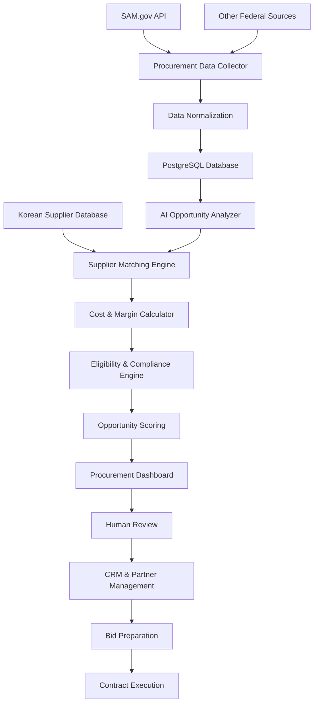

# 시스템 구축 계획 (자동화 시스템)

- Version: 1.1 (기획서의 자동화 시스템 부분 분리)
- Date: 2026년 11월 22일

> 실행 단계 게이트와 작업 단위는 `개발계획/02-3단계기술로드맵.md` 참조.

---

# 1. 시스템 목표

본 플랫폼은 사람이 매일 SAM.gov를 직접 검색하는 업무를 자동화한다.

시스템의 최종 목표는 다음과 같다.

- 공고 자동 수집
- 공고 내용 자동 분석
- 한국 기업 참여 가능성 평가
- 공급사 자동 매칭
- 예상 원가 및 마진 계산
- 입찰 마감일 관리
- 담당자 알림
- 입찰 진행 현황 관리

단순한 크롤링이 아니라 조달 비즈니스 운영 시스템으로 구축한다.

---

# 2. 전체 아키텍처



---

# 3. 시스템 구성

## Module 1. SAM.gov Data Collector

SAM.gov 공개 API를 활용해 공고를 자동 수집한다.

수집 항목:

- Notice ID
- Solicitation Number
- Title
- Agency
- Sub Agency
- Office
- NAICS
- PSC
- Notice Type
- Posted Date
- Response Deadline
- Estimated Value
- Place of Performance
- Set-Aside Type
- Award Information
- Attachments
- Official URL
- Status

검색 조건:

```yaml
contract_value:
  min: 100000
  max: 5000000

target_margin:
  min: 0.20

notice_types:
  - Solicitation
  - Combined Synopsis/Solicitation
  - Sources Sought
  - Presolicitation

status:
  - Active

preferred_locations:
  - South Korea
  - United States
  - Japan
  - Guam
  - Overseas US Government Facilities
```

주의: Sources Sought와 Presolicitation은 실제 입찰 공고와 구분한다. 계약 규모와 예산이 공개되지 않은 경우에는 추정치로도 임의 확정하지 않는다.

## Module 2. AI Opportunity Analyzer

수집한 공고를 LLM으로 분석한다.

분석 항목:

1. 발주 목적
2. 구매 품목
3. 기술 사양
4. 납품 장소
5. 계약 기간
6. 응찰 자격
7. 해외 공급 허용 여부
8. 인증 조건
9. 납품 및 설치 조건
10. 보증 및 유지보수
11. 필수 서류
12. 마감일
13. 위험 요소

AI가 공고 문서의 내용을 추출하고 핵심 요약을 생성한다.

모든 판단은 원문 근거 문장과 페이지를 연결해 보관한다.

## Module 3. Supplier Matching Engine

한국 공급업체 DB와 조달공고를 연결한다.

예시:

```json
{
  "opportunity": {
    "category": "UPS",
    "naics": "335999",
    "location": "South Korea",
    "budget": 500000
  },
  "supplier": {
    "company": "Supplier A",
    "category": "Power Equipment",
    "origin": "South Korea",
    "certification": ["Relevant Certification"],
    "estimated_cost": 280000
  },
  "matching": {
    "product_fit": 95,
    "delivery_fit": 90,
    "compliance_fit": 80,
    "price_fit": 88
  }
}
```

점수는 실제 검증 자료를 입력했을 때만 계산한다.

## Module 4. Cost & Margin Calculator

예상 수익성을 계산한다.

기본 산식:

```text
Revenue
- Supplier Purchase Cost
- International Logistics
- Customs and Duties
- Installation Cost
- US Partner Fee
- Warranty Reserve
- Other Direct Costs
= Gross Profit
```

```text
Gross Margin = Gross Profit / Revenue
```

예시:

```yaml
contract_value: 500000

cost:
  supplier: 280000
  logistics: 15000
  installation: 30000
  us_partner: 25000
  warranty: 10000
  other_direct: 10000

gross_profit: 130000
gross_margin: 0.26
```

위 사례의 예상 매출총이익률은 26%다.

단, 공급사 견적의 유효기간, 환율, 운송비, 관세, 설치비 및 계약 변경 가능성을 고려해 계산한다.

견적이 없는 비용은 추정값으로 표시하고, 최종 입찰 전에는 실제 견적을 요구한다.

## Module 5. Compliance Engine

공고의 참여 자격을 분석한다. (상세 규정은 `법률/01-조달규정-컴플라이언스.md` 참조)

자동 체크:

- Small Business Set-Aside
- 8(a)
- HUBZone
- SDVOSB
- WOSB
- Buy American
- TAA
- Country of Origin
- DFARS
- CMMC
- ITAR
- EAR
- Foreign Ownership Restrictions
- Security Clearance
- Facility Clearance

결과는 세 단계로 구분한다.

| 상태 | 의미 |
|---|---|
| GREEN | 기본 참여 요건 확인 |
| YELLOW | 법률·원산지·자격 추가 검토 |
| RED | 확인된 참여 제한 또는 필수 조건 미충족 |

AI의 자동 판단만으로 RED 또는 GREEN을 확정하지 않는다. 계약 문구에 대한 담당자 검토가 필요하다.

## Module 6. Opportunity Scoring

모든 공고에 사업성 점수를 부여한다.

총점 100점:

| 평가 기준 | 배점 |
|---|---:|
| 한국 공급 가능성 | 20 |
| 예상 매출총이익률 | 20 |
| 계약 규모 | 15 |
| 입찰 참여 가능성 | 15 |
| 경쟁 강도 | 10 |
| 공급업체 확보 여부 | 10 |
| 납품 난이도 | 5 |
| 마감일까지 남은 시간 | 5 |
| 합계 | 100 |

등급:

- A: 80점 이상
- B: 65~79점
- C: 50~64점
- D: 50점 미만

추가 규칙:

참여 자격이 확인되지 않은 공고는 점수가 높더라도 입찰 후보로 확정하지 않는다.

매출총이익률 20% 미만인 공고는 기본적으로 제외한다. 단, 전략적 파트너십 또는 후속 유지보수 매출이 있는 경우 별도 승인한다.

---

# 4. 자동화된 실제 운영 시나리오

## Scenario A: UPS 조달 기회 발굴

1. 매일 오전 SAM.gov API에서 신규 공고 수집
2. AI가 UPS 관련 공고 탐색
3. 한국 납품 가능 지역인지 확인
4. Buy American 및 TAA 관련 문구 분석
5. 공고의 UPS 사양과 수량 추출
6. 한국 UPS 제조사 DB 검색
7. 공급사에 견적 요청
8. 물류 및 설치 비용 계산
9. 예상 매출총이익률 계산
10. 20% 이상이면 우선 검토 목록 등록
11. 미국 조달 파트너 후보 검색
12. 담당자가 입찰 참여 결정

## Scenario B: 사이버보안 조달

1. 사이버보안 관련 공고 수집
2. SOC, CTI, EDR, SIEM, Network Security 등으로 분류
3. 소프트웨어 공급 및 라이선스 조건 분석
4. FedRAMP, FIPS, CMMC 등 요구사항 확인
5. 한국 보안기업 제품과 매칭
6. 미국 현지 Prime Contractor 후보 연결
7. 기술 제안서 초안 작성
8. 가격 및 라이선스 구조 검증
9. 계약 참여 여부 결정

## Scenario C: 미국 현지 파트너 매칭

1. 공고 발주기관과 지역 확인
2. 필요한 현장 서비스 파악
3. 미국 현지 업체 DB 검색
4. NAICS 및 과거 계약 이력 확인
5. 협력 가능 여부 문의
6. 파트너 계약 및 역할 분담
7. 견적과 입찰 일정 관리

---

# 5. 시스템 기술 스택

초기에는 빠른 개발과 낮은 운영비용을 우선한다.

| 영역 | 추천 기술 |
|---|---|
| Runtime | Cloudflare Workers (Node.js + TypeScript) |
| Backend | Hono (Workers 위) |
| Database | Cloudflare D1 (SQLite, 무료 티어) |
| Vector Search | 없음 (검색 활성화 시 Neon + pgvector 전환) |
| Scheduler | Cloudflare Cron Triggers |
| AI Analysis | OpenAI API (JSON Schema 고정 출력) |
| Document Parsing | unpdf (Workers) / OCR 외부 파서 |
| Data Source | SAM.gov API, FPDS/USAspending, DLA DIBBS |
| Authentication | 구글 OAuth 2.0 (구글 로그인 전용) |
| Frontend / Dashboard | Next.js (Cloudflare Pages, vinext) + Recharts |
| Hosting | Cloudflare |
| Monitoring | Sentry |
| Storage | Cloudflare R2 |

확장 시 도입 (초기 제외):

| 영역 | 기술 | 도입 조건 |
|---|---|---|
| Queue | Cloudflare Queues | 알림 큐 병목 발생 시 |
| Workflow | Cloudflare Workflows | 배치 파이프라인 복잡도 증가 시 |
| Workflow | n8n | 운영 워크플로 수동화 필요 시 |

무료 티어 주의:

- Workers 요청당 CPU 시간 제한 → 무거운 AI 분석은 Cron Triggers 기반 배치로 분리
- D1 무료 티어(저장 5GB, 일 행 읽기/쓰기 한도) 내 운영 — 원문은 R2 보관으로 D1 부담 최소화
- 검색·유사도 검색 요구 발생 시 Neon(PostgreSQL+pgvector) 무료 티어로 전환

개발 원칙:

- API 기반 데이터 수집
- 원본 문서 보관
- 데이터 출처 추적
- AI 분석 결과와 원문 분리
- 사용자 승인 기반 입찰 진행
- API 사용량 관리
- 모든 주요 업무에 Audit Log 기록

## 5.1 데이터베이스 설계

핵심 테이블:

```text
procurement_notices
procurement_documents
procurement_requirements
procurement_awards
agencies
naics_codes
psc_codes

suppliers
supplier_products
supplier_certifications
supplier_quotes
supplier_export_history

us_partners
partner_capabilities
partner_contracts

opportunity_matches
opportunity_scores
cost_estimates
compliance_reviews

bid_projects
bid_documents
bid_submissions
contracts
deliveries
invoices

users
organizations
notifications
audit_logs
```

특히 `supplier_quotes`와 `cost_estimates`는 견적 유효기간 및 가격 변경 이력을 반드시 저장한다.

## 5.2 주요 API 설계

```text
GET /api/opportunities
GET /api/opportunities/{id}
GET /api/opportunities/{id}/documents
GET /api/opportunities/{id}/analysis

GET /api/suppliers
POST /api/suppliers
GET /api/suppliers/{id}

POST /api/matching/run
GET /api/matching/{id}

POST /api/cost-estimates
GET /api/cost-estimates/{id}

POST /api/compliance/review
GET /api/dashboard
GET /api/alerts
```

---

# 6. 사용자 대시보드 설계

초기 제품은 다음 5개 메뉴로 구성한다.

## 6.1 Dashboard

핵심 KPI:

- 신규 공고
- 분석 완료 공고
- 한국 공급 가능 공고
- 20% 이상 마진 후보
- 공급사 매칭 완료
- 입찰 준비 중
- 입찰 제출 완료
- 낙찰 및 계약 진행

## 6.2 Opportunity Finder

검색 필터:

- Contract Value
- Agency
- NAICS
- PSC
- Location
- Notice Type
- Deadline
- Set-Aside
- Margin
- Korean Supplier Match

## 6.3 Supplier Network

공급업체 관리:

- 업체 프로필
- 제품 카탈로그
- 견적 관리
- 인증서
- 수출 경험
- 납품 이력
- 공급 가능 국가
- 미국 파트너

## 6.4 Deal Room

개별 프로젝트 관리:

- 조달공고
- 공급업체
- 미국 파트너
- 견적서
- 원가표
- 예상 마진
- 규제 검토
- 제안서
- 마감일
- 계약 진행 상황

## 6.5 Analytics

사업 분석:

- 분야별 조달 규모
- 기관별 공고
- 산업별 경쟁 강도
- 평균 계약 규모
- 매칭 성공률
- 입찰 성공률
- 공급사별 매출
- 예상 및 실현 마진

---

# 7. 자동화 알림 시스템

매일 오전 9시 한국시간 기준으로 조달 기회 리포트를 발송한다.

알림 채널:

- Email
- Telegram
- Slack
- Dashboard
- Kakao 비즈니스 채널 (추가 연동 검토)

알림 유형:

| 알림 | 조건 |
|---|---|
| New Opportunity | 신규 공고 |
| High Margin | 예상 마진 20% 이상 |
| High Value | 계약 규모 100만 달러 이상 |
| Deadline Warning | 마감 7일 전 |
| Urgent Deadline | 마감 48시간 전 |
| Supplier Match | 적합 공급사 발견 |
| Quote Required | 공급사 견적 미확보 |
| Compliance Alert | 규제 검토 필요 |
| Award Notice | 낙찰 결과 업데이트 |

중요한 공고는 담당자에게 즉시 알림을 보낸다.

자동으로 입찰하거나 계약을 체결하지 않는다. 입찰 제출과 가격 확정은 반드시 권한 있는 담당자의 승인을 거친다.
