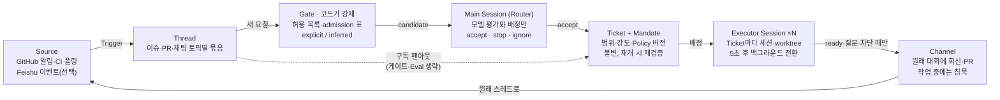

# DeepSeek dsh-superagent-prototype 심층 분석

> 아키텍처 · 권한 모델 · 실행 모델 · 장단점 · 경쟁 구도 · Getting Started
> 기준일: 2026-11-02 · 작성: Dennis Kim (김호광)

---

## 한눈에 보기

dsh-superagent는 "**GitHub 저장소 하나에 상주하는, 말 걸 때만 일하는 팀원형 코딩 에이전트**"를 DeepSeek Harness(DSH) 번들로 구현한 연구 코드다. 코딩 실력이 아니라 **누가 일을 시킬 수 있는가(권한) · 어떤 대화가 어떤 작업으로 이어지는가(라우팅) · 사람의 주의를 얼마나 덜 쓰는가(소음 제어)**를 시스템으로 풀어낸 것이 핵심 가치다.

- 2026년 10월 31일 공개, MIT 라이선스, TypeScript, 커밋 1개, v0.1.0. 소스 약 15,200줄에 테스트 약 15,000줄로 테스트 비중이 이례적으로 높다.
- 동반 설계 글 「Exploring Super-agent Design」의 아이디어 중 일부만 구현됐다. 외부 Watchdog 에이전트, Bring Your Own Machine, Chain of Recall 같은 개념은 레포에 그대로 들어 있지 않다.
- DSH(0.2.1 alpha) 위에서만 돈다. Claude Code나 Codex에 바로 꽂아 쓰는 범용 라이브러리가 아니다.
- 실전 도입보다는 **설계 레퍼런스**로서 가치가 크다. 특히 Mandate(위임 범위) 기반 권한 모델과 "observe 모드로 먼저 관찰" 운영 철학은 어떤 에이전트 시스템에도 이식할 만하다.

한 줄 요약하면 아주 훌륭하고 DeepSeek에서 에이전틱 플랫폼의 이정표를 세웠다고 평가할 수 있다.

---

## 1. 프로젝트 개요

레포는 DeepSeek Harness 팀이 사내에서 쓰던 "슈퍼에이전트"를 공개용으로 다듬은 것이다. README는 첫 줄부터 공식 제품이 아니며, 코드 상당 부분을 코딩 에이전트가 썼고, 내부 버전 및 설계 글과 다르다고 못 박는다.

| 항목 | 내용 |
| --- | --- |
| 저장소 | [deepseek-ai/dsh-superagent-prototype](https://github.com/deepseek-ai/dsh-superagent-prototype) |
| 공개일 | 2026-10-31 (설계 글과 동시) |
| 라이선스 / 언어 | MIT / TypeScript (Node 22.19+ 또는 24+) |
| 형태 | DSH 번들 (`cordis.patch.yml` + 웹 패널 클라이언트) |
| 런타임 의존 | `@deepseek-ai/dsh` 0.2.1 alpha 계열, 피어 의존성 20여 개 |
| 상태 저장 | 로컬 SQLite 1개 (`orchestrator.sqlite`) + 디렉터리 락 |
| 이벤트 소스 | GitHub (필수), Feishu (선택) |
| 규모 | src 약 15,200줄, tests 약 15,000줄, 테스트 파일 60여 개 |
| 반응 | 공개 이틀 만에 Star 약 3.3k, Fork 약 290 |

### 레포 구조

- `docs/` — 000~008 번호 문서. 앞 문서만 알면 다음 문서를 읽을 수 있게 순서대로 설계돼 있다. 아키텍처 분석의 1차 자료.
- `src/core/` — 도메인 엔진 (Intake, Evals, Tickets, Assignments, Replies). 외부 의존 없는 순수 로직.
- `src/app/` — 런타임, 설정, Outbox, Effects(저장 후 실행 큐), 관리 API, 패널 뷰.
- `src/sources/` — GitHub·Feishu 소스 구현. 새 소스(예: Slack)는 `docs/008-cookbook.md` 절차로 추가.
- `src/executor/` — DSH 세션을 띄우고 백그라운드 작업을 관리하는 Executor.
- `prompts/` — 오케스트레이터·워커·팀 섹션 프롬프트 원문. 소음 억제 규칙이 여기에 집중돼 있다.
- `skills/` — 워커가 쓰는 GitHub·Feishu 스킬.
- `SETUP.md` — 사람이 아니라 **코딩 에이전트가 읽고 따라 하는 설치 지침서**. 이 점이 독특하다.

### 설계 철학 한 줄

> 사람의 주의는 최소로 쓰고, 가치는 최대로 준다.

메시지, 알림, 질문, 설정 항목, 패널 요소, 문서 한 문단까지 "주의 비용"으로 평가한다. 그래서 에이전트는 작업 중엔 침묵하고, 결과가 준비됐거나 사람의 결정이 필요할 때만 말한다. GitHub 메시지에는 기본으로 "사람이 아닌 자동 에이전트가 작성"했다는 고지 줄이 붙는다.

---

## 2. 아키텍처

설계 글의 Router-Worker 이중 구조는 레포에서 **Main Session(오케스트레이터, 프리셋 `dsh-superagent-router`)과 Executor Session(워커, 프리셋 `dsh-superagent-worker`)**으로 구현돼 있다. 그 사이를 Trigger · Thread · Eval · Ticket · Mandate · Assignment · Subscription이라는 도메인 개념이 잇는다.

핵심은 **이원 경로**다. 새 요청은 반드시 게이트와 평가를 거치지만, 이미 진행 중인 작업의 후속 대화는 구독을 통해 워커로 바로 흘러간다.



점선이 이 설계의 핵심이다. 이미 Ticket이 구독 중인 스레드의 후속 대화는 게이트를 건너뛰고 워커로 가지만, 권한은 늘어나지 않는다.

### 핵심 개념

| 개념 | 한 줄 정의 | 존재 이유 |
| --- | --- | --- |
| Source | 이벤트 스트림 (GitHub, Feishu). 읽기 위치와 봇 신원을 보유 | 재시작해도 이벤트를 재생하지 않기 위해 |
| Trigger | 불변 이벤트 1건. 같은 Trigger를 두 번 수락해도 Ticket은 1개 | 감사·멱등성의 단위 |
| Thread | 같은 이슈·PR·채팅 토픽의 Trigger 묶음. 한 번에 Eval 1개만 실행 | 평가에 일관된 맥락 제공 |
| Eval | 게이트(코드) + 평가(모델) 2단 판단. 결과는 accept · stop · ignore · unavailable | 새 작업 시작 여부 결정 |
| Mandate | 수락이 부여하는 위임장: 범위, 강도, 정책 버전, 요청자 | 이 일을 왜, 어디까지 해도 되는지 기록 |
| Ticket | 승인된 작업 단위. 오직 Eval만 생성 | 실행과 보고의 주체 |
| Assignment | Ticket과 Executor 인스턴스의 바인딩. 재시도마다 새로 생성 | 실행자를 도메인 안에서 추적 |
| Subscription | Ticket과 Thread의 다대다 관계 | 다시 멘션하지 않아도 후속 논의가 워커에 도달 |
| Channel | Thread의 쓰기 측. 확인·답변·결과·질문 메시지 | 원래 대화로 회신 |

### 설계 글과 구현의 차이

| 설계 글의 개념 | 레포 구현 상태 |
| --- | --- |
| Router는 셸 없이 조율만 | 라우터 전용 작은 툴셋. 셸은 있으나 5초 후 백그라운드 전환 |
| Worker가 결론을 Router에 보고, Router가 외부 회신 | 워커가 자기 범위의 후속 대화에 직접 확인·답변 가능 |
| 외부 Watchdog 에이전트 | 없음. 시간당 status 점검 스케줄 + 재시작 복구 노트로 대체 |
| CI 실패·채팅 버그 리포트에 자율 착수 | 가능하나 기본 꺼짐. `observe` 기본값, `auto` 전환 + 팀 규칙 필요 |
| Bring Your Own Machine (원격 실행 엔드포인트) | 없음. 운영자 머신 로컬 실행만 |
| Chain of Recall (ID 링크를 따라가는 기억 탐색) | 일부. Thread 페이지를 읽는 리소스와 구독·상관관계로 맥락 연결 |
| 상태와 연산의 분리 (클라우드 상주) | 로컬 SQLite 1개 + 디렉터리 락 |

---

## 3. 권한 모델

이 프로젝트에서 가장 공들인 부분이다. 원칙은 하나: **허용 목록 · 규칙 · Mandate는 호스트 코드가 강제하고, 메시지 · 코멘트 · 인용 문서는 판단의 입력일 뿐 권한을 바꿀 수 없다.** 프롬프트 인젝션으로 "권한을 달라"고 써도 게이트는 코드에서 걸린다.

### 두 갈래 경로

- **Eval 경로 (새 작업)** — 허용된 사람이 에이전트를 @멘션하거나 DM하면 explicit 요청. 그 외는 Source별 admission 표에 따라 inferred 후보가 되거나 버려진다.
- **Subscription 경로 (기존 작업 이어가기)** — 이미 Ticket이 구독 중인 Thread의 메시지는 게이트를 건너뛰고 워커에게 컨텍스트로 바로 간다. 단, 새 권한은 주지 않는다. 범위 밖 요청이면 워커가 "이건 내 일 아님"이라며 반납(hand back)하고, 그때서야 새 Eval을 탄다.

### Strength (근거의 강도)

| 강도 | 해당 경우 |
| --- | --- |
| explicit | 허용 목록의 사람이 에이전트를 호출, 또는 Ticket 있는 Thread에서 후속 발언 |
| inferred | 목록 밖 사람의 후속 발언, admission 표가 inferred로 둔 칸, 봇 목록(예: `dependabot[bot]`)의 메시지 |
| not admitted | 목록 밖 봇, admission 표가 무시하는 것, `off` 모드의 모든 inferred |

봇은 절대 explicit 요청을 만들 수 없고 Ticket을 멈출 수도 없다. 일반 계정으로 돌아가는 자동 리뷰어는 호스트 눈에는 "사람"이므로, 팀 프롬프트에 리뷰 봇이라고 적어줘야 한다.

### Accept mode (자율 착수 스위치)

| 모드 | 동작 |
| --- | --- |
| `off` | inferred 후보 자체를 만들지 않음 |
| `observe` (기본) | 평가는 하되 "수락했을 것"이라고 기록만 하고 실행 안 함 |
| `auto` | 긍정 평가 + 매칭 규칙 1개 이상이면 자동 수락 |

explicit 요청은 모든 모드에서 동작한다. 문서가 권하는 순서는 observe로 기록을 쌓아 검토한 뒤 auto로 넘어가는 것이다. 이 "그림자 운영" 단계가 설계의 백미다.

### Mandate와 Policy 버전

수락 시점의 Policy 버전, 범위, 강도, 매칭 규칙, 요청자 신원이 Mandate로 봉인된다. Mandate는 불변이고, 범위가 넓어지면 새 Ticket을 만든다.

Policy가 바뀌면 진행 중인 Eval은 폐기·재큐잉되고, 영향받는 Ticket에는 "정책 변경" 입력이 전달된다. 진행 중인 작업을 즉시 취소하지 않는 이유는 반쯤 끝난 작업이 남기 때문이다. 대신 종료된 Ticket이 재개될 때 현재 Policy로 재검증해서, 요청자가 목록에서 빠졌다면 재개를 거부한다.

Mandate를 바꾸는 연산은 세 가지뿐이다: accept(생성), 사람의 stop(철회), 재검증 실패(취소). 워커가 "사람이 멈추라고 했다"고 스스로 선언할 수는 없다.

---

## 4. 실행 모델

수락된 Ticket마다 `worker-<ticket id>` 세션 하나와 전용 디렉터리 하나가 생긴다. prepare 명령(보통 `git worktree add`)이 처음 한 번 돌아 체크아웃을 만들고, 브랜치는 `agent/<short name>` 형태다.

### Ticket 단계

위에서부터 처음 맞는 행이 현재 단계다. 패널은 `person`으로 시작하는 단계만 사람에게 보여준다.

| 단계 | 조건 | 패널 표시 |
| --- | --- | --- |
| person / delivery | 워커에 입력 전달 실패 (2초부터 최대 1분 백오프 재시도) | Input undelivered |
| person / answer | 사람에게 던진 질문(Attention)이 있음 | Awaiting answer |
| person / review | 최신 Report가 `ready` | Awaiting review |
| person / blocked, failed | `blocked`·`failed` 이후 사람 메시지 없음 | Blocked · Failed |
| working / queued | 워커 슬롯 대기 | Queued |
| idle | `waiting` 보고 또는 Assignment 종료 | Waiting for a Trigger |
| working | 그 외 | Working |

### 동시성과 백그라운드 작업

- **워커 슬롯**: `maxWorkers` 1~16. 슬롯이 꽉 차도 **사람 메시지용 여분 슬롯 1개**를 남겨, 새 작업이 기존 작업과의 대화를 막지 못하게 했다.
- **5초 규칙**: 포그라운드 셸 명령은 5초가 지나면 백그라운드 잡으로 넘어간다. 긴 빌드가 돌아도 워커는 다음 스텝에서 새 메시지를 받을 수 있다. 설계 글이 말한 "full-duplex"의 실제 구현이다.
- **30분 한도**: 턴이 끝난 뒤 남은 백그라운드 작업은 최대 30분. 넘으면 잡을 죽이고 `waiting`으로 보고한다.
- **서브에이전트**: 워커는 DSH `standard` 프리셋의 서브에이전트를 쓸 수 있고, 권한은 워커와 같다.

### 머지 정책

호스트에는 머지 판단 로직이 없다. 전부 Delivery requirements 프롬프트로 정한다. 기본값은 에이전트 계정으로 auto-merge를 절대 켜지 않는 것이다. GitHub가 머지 주체를 "auto-merge를 켠 사람"으로 기록하기 때문이다.

켜려면 다른 계정의 CLI를 지정해야 하고, 기본 조건은 승인이 헤드 커밋을 덮고 변경량(추가+삭제)이 200줄 미만일 때다. 문서는 진짜 강제는 GitHub branch protection으로 하라고 분명히 한다.

### 장애 복구

- **저장 후 실행(Stored work)**: 결정 이후의 모든 부수효과(릴레이, 실행, 입력 전달, 메시지 발송)를 먼저 SQLite에 적고 나중에 실행한다. 프로세스가 죽어도 유실되지 않는다.
- **일시적 장애**: 모델 공급자의 408 · 429 · 5xx, 연결 리셋·타임아웃은 백오프로 3회 재시도.
- **재시작**: 실행 중이던 Assignment는 "host restarted"로 끝나고, 새 Assignment가 "외부 행동을 반복하기 전에 디렉터리·git 히스토리·GitHub를 먼저 확인하라"는 복구 노트와 함께 시작한다. 같은 PR을 두 번 여는 사고를 막는 장치다.
- **발신 메시지 순서 보장**: 같은 대화에 대한 한 Ticket의 메시지는 큐 순서대로 나간다. 확인 메시지보다 결과가 먼저 도착하는 일이 없다.
- **일시정지**: 패널에서 처리를 멈추면 Source는 계속 기록하되, 디스패치·Eval·발신이 멈춘다.

---

## 5. 설계 글의 실험 결과

슈퍼에이전트 구조는 단일 세션 대비 **중앙값 완료 시간을 39% 줄였지만, 캐시 읽기 토큰은 약 3.8배 더 썼다.** 속도를 토큰으로 산 셈이다. 아래 수치는 레포가 아니라 설계 글에 실린 팀 자체 실험이며, 외부에서 재현된 적은 없다.

실험 조건: 실행당 메시지 약 300건(그중 실제 작업 요청 약 20건, 나머지는 잡담·후속·취소·CI 피드백), 설계당 5회 반복. **코딩 작업은 시간만 소비하는 가짜 도구로 대체**했고, 메시지 간격과 작업 시간은 1/4로 축소했으나 모델 호출 시간은 그대로 뒀다.

| 설계 | 완료 시간 p50 (분) | 완료 시간 p95 (분) | 실행당 캐시 읽기 토큰 (백만) |
| --- | ---: | ---: | ---: |
| 슈퍼에이전트 | 12.4 | 15.7 | 23.2 |
| 슈퍼에이전트, 패스스루 없음 | 12.6 | 15.5 | 31.8 |
| 단일 세션 + 서브에이전트 도구, 중립 프롬프트 | 20.4 | 29.5 | 6.1 |
| 단일 세션 + 서브에이전트 도구, 위임 우선 프롬프트 | 13.8 | 29.0 | 10.8 |

출처: [Kingy AI 정리](https://kingy.ai/blog/deepseek-super-agent-design-explained/), [Analytics India Magazine](https://analyticsindiamag.com/ai-news/deepseek-proposes-super-agent-architecture-to-automate-ai-coding-workflows)

### 해석

- **이득의 정체는 "강제 위임"이다.** 중립 프롬프트 단일 세션은 5회 중 한 번도 위임하지 않았다. 위임 우선 프롬프트로 바꾸자 중앙값은 13.8분까지 따라왔지만, 한 번은 "작은 일"이라며 직접 처리해 꼬리 지연(p95 29.0분)이 남았다. 구조로 역할을 강제하면 이런 변덕이 사라진다.
- **패스스루(구독 직행)는 토큰을 27% 줄였다.** 후속 대화를 라우터가 매번 판단하지 않고 워커로 바로 보내니 라우터 결정이 약 30% 줄었다. 반면 완료 시간 차이는 거의 없다.
- **라우터 배치 효과.** 별도 스트레스 테스트에서 결정이 필요한 이벤트가 분당 약 1건에서 40건으로 늘자 평균 배치 크기가 1.0에서 2.8로 커졌고, 결정당 환산 추론 시간은 6.4초에서 1.6초로 75% 줄었다.
- **측정하지 않은 것.** 코드 품질, 수락된 PR 비율, 사람의 리뷰 시간, 총비용(출력 토큰·가격 미공개), 오판율. 실전 가치는 이 실험만으로는 판단할 수 없다.

---

## 6. 장점

코딩 능력이 아니라 **운영 체계**에서 앞서 있다. 아래 일곱 가지는 다른 에이전트 제품을 쓰더라도 그대로 가져다 쓸 만한 설계다.

1. **세션이 아니라 작업이 단위다.** 사용자는 "어느 창에서 그 얘기 했더라"를 기억할 필요가 없다. Thread 구독 덕분에 채팅에서 시작된 작업이 PR 리뷰 코멘트까지 같은 워커로 이어진다. 사람이 동시에 볼 수 있는 세션 3~5개라는 한계를 시스템이 대신 진다.
2. **권한과 컨텍스트를 분리했다.** 구독으로 들어오는 메시지는 "참고 자료"이지 "권한"이 아니다. PR에 외부인이 "이것도 고쳐줘"라고 써도 Mandate 범위 밖이면 새 Eval을 거친다. 에이전트 보안에서 가장 놓치기 쉬운 지점을 도메인 모델로 막았다.
3. **observe → auto 단계적 자율화.** 처음부터 자율로 돌리지 않고 "했을 일"을 기록하게 한 뒤 사람이 검토하고 켠다. 자율 에이전트 도입의 가장 현실적인 경로다.
4. **소음 억제가 1급 요구사항이다.** 기본 프롬프트가 "PR이 생겼다는 것 자체는 전달할 소식이 아니다", "보낼 문장마다 지우면 사람이 행동 못 하는지 자문하라"까지 규정한다. 팀 채널을 봇 알림으로 오염시키는 문제를 정면으로 다룬다.
5. **장애에 강한 상태 관리.** 저장 후 실행, 멱등 Trigger, 재시작 복구 노트, 메시지 순서 보장. 데모 수준이 아니라 "며칠씩 켜두는" 운영을 전제로 만들어졌다.
6. **에이전트가 설치하는 소프트웨어.** `SETUP.md`는 코딩 에이전트용 대화 스크립트다. 질문은 한 번에 하나, 비밀번호는 채팅에 묻지 않기, 계획을 한 번 보여주고 확인 후 실행. 설치 경험 자체가 철학의 시연이다.
7. **문서 품질.** 000~008 문서가 개념 → 권한 → 실행 → 배포 → 아키텍처 순으로 쌓이고, 채택하지 않은 개념(Rejected concepts)과 이유까지 적었다. 연구 레퍼런스로서 가치가 높다.

---

## 7. 단점과 리스크

가장 큰 리스크는 보안 격리 부재이고, 가장 큰 실무 장벽은 DSH 종속과 중국 생태계(Feishu) 전제다.

| 구분 | 내용 | 심각도 | 완화책 |
| --- | --- | --- | --- |
| 보안 | 워커·라우터 모두 `danger-full-access`, 운영자 OS 사용자 권한으로 승인 없이 명령 실행. 절대경로로 차단 명령 우회 가능, 홈 디렉터리 읽기 가능 | 높음 | 전용 OS 계정 또는 VM·컨테이너. 개인 `gh`·클라우드 자격증명이 없는 계정에서 실행 |
| 프롬프트 인젝션 | 권한은 코드가 막지만, Mandate 범위 안에서 이슈 본문·코멘트가 워커 행동을 오도할 여지는 남음. 문서도 "신뢰할 Trigger 필드"를 미해결 과제로 남김 | 높음 | 허용 목록 최소화, 공개 저장소에는 observe 유지, branch protection 필수 |
| 플랫폼 종속 | DSH 0.2.1 alpha에 묶인 번들. 다른 하네스로 옮기려면 Executor·Session 계층을 다시 써야 함. DSH 업그레이드가 에이전트를 깨뜨릴 수 있다고 문서가 인정 | 중간 | 별도 프로필·고정 버전 설치, 업그레이드 전 SQLite 백업 |
| 범위 제한 | 배포당 GitHub 저장소 1개, github.com만(GHES 미지원), 에이전트는 GitHub App이 아닌 사용자 계정이어야 함(알림 API 의존) | 중간 | 저장소별로 인스턴스를 여러 개 띄움 |
| 채널 | 채팅 소스는 Feishu뿐. Slack·Teams·카카오워크 미지원 | 중간 | Cookbook으로 Source 직접 구현 |
| 비용 | 설계 글 실험에서 단일 세션 대비 캐시 읽기 토큰 약 3.8배. 총비용은 공개되지 않음 | 중간 | `maxWorkers` 축소, Eval 모델을 경량 모델로 분리 |
| 데이터 증가 | 오래된 Trigger·Decision·Ticket을 지우는 로직이 아직 없음 | 낮음 | 주기적 백업·수동 정리 |
| 지연 | GitHub 알림 폴링 기반이라 반응까지 약 1분. 이슈 본문을 편집해 멘션을 추가하면 감지 못 함 | 낮음 | 멘션은 새 코멘트로 |
| 품질 | "버그·비일관 코드 가능" 명시, 커밋 히스토리 1개라 변경 이력 추적 불가 | 낮음 | 포크 후 자체 검증 |

덧붙여, 설계 글의 실험은 **스케줄링 성능만** 측정했다. 코딩 작업은 "시간을 소비하는 가짜 도구"로 대체됐으므로, 이 에이전트가 PR을 얼마나 잘 만드는지는 검증된 바 없다. 실제 코드 품질은 DSH에 연결한 모델(DeepSeek 등)의 실력에 그대로 달려 있다.

---

## 8. 경쟁 구도

진짜 경쟁 상대는 AutoGPT·CrewAI 같은 범용 프레임워크가 아니라 **"이슈에서 @멘션하면 PR을 올려주는 저장소 상주형 에이전트"**들이다. 이 범주에서 dsh-superagent의 차별점은 실행 능력이 아니라 **상시 상주 + 권한 모델 + 소음 제어**다.

| 제품 | 실행 위치 | 트리거 | 상태·연속성 | 권한 모델 | 차별점 |
| --- | --- | --- | --- | --- | --- |
| **dsh-superagent** | 운영자 머신(자체 호스팅), 로컬 상태 보존 | GitHub 알림 폴링, Feishu | 상주 프로세스 + SQLite. 채팅→PR→리뷰를 한 Ticket으로 연결 | 허용 목록·admission 표·Mandate·accept mode를 코드로 강제 | 소음 억제, observe 모드, 오픈소스. 대신 격리 없음 |
| [Claude Code GitHub Actions](https://code.claude.com/docs/en/github-actions) | GitHub Actions 러너(일회성) | `@claude` 멘션 또는 워크플로 이벤트·스케줄 | 실행마다 새 환경. 기억은 `CLAUDE.md` 등 저장소 파일 | GitHub App 권한 + 쓰기 권한자 멘션 + 워크플로 조건 | 설치가 쉽고 러너 단위로 격리. 채팅 연동·상주 라우팅은 직접 구성 |
| GitHub Copilot coding agent | GitHub 호스팅 환경 | 이슈 할당, 멘션 | 작업 단위, GitHub 안에서 완결 | GitHub 권한·정책 체계 | GitHub 네이티브 통합 |
| OpenAI Codex (클라우드) | OpenAI 호스팅 샌드박스 | 앱·IDE·GitHub·Slack 등 | 작업 단위 병렬 실행 | 계정·조직 설정 | 호스팅 샌드박스 격리, 병렬 작업 |
| AutoGPT / CrewAI / LangGraph | 개발자가 구성 | 직접 구현 | 직접 구현 | 직접 구현 | 범용 오케스트레이션 프레임워크. 같은 범주가 아님 |

호스팅 제품 3종의 세부 기능은 빠르게 바뀌므로 도입 시점에 공식 문서로 재확인할 것. 참고로 OpenAI Operator는 브라우저 조작 에이전트라 이 비교축에 들어가지 않는다.

### 위치 정리

- **Claude Code GitHub Actions와 가장 가깝다.** 둘 다 "멘션 → 작업 → 스레드에 답변" 흐름이다. 차이는 Actions가 이벤트마다 깨끗한 러너에서 실행되고 끝나는 반면, dsh-superagent는 상주 라우터가 여러 대화를 하나의 작업으로 꿰어 기억한다는 점이다. 거꾸로 격리와 설치 난이도는 Actions가 압도적으로 낫다.
- **호스팅형(Copilot, Codex)과는 철학이 반대다.** 호스팅형은 깨끗한 샌드박스를 주고, dsh-superagent는 "이미 세팅된 내 개발 머신"을 쓴다. 사내망·GPU·로컬 의존성이 필요한 팀에는 후자가 유리하지만, 그 대가가 보안 격리다.
- **"Claude Code를 겨냥했다"는 해석은 추측에 가깝다.** 설계 글은 오히려 Anthropic의 managed agents 연구를 참고 문헌으로 인정하고 있다. 경쟁이라기보다 같은 문제(사람의 주의 병목)에 대한 다른 해법으로 보는 편이 정확하다.

---

## 9. Getting Started

설치 경로는 두 가지다. 공식 권장은 **A. 코딩 에이전트에게 맡기기**이고, 구조를 이해하려면 **B. 수동 설치**를 한 번 따라가 보는 편이 좋다. 어느 쪽이든 0단계(격리)는 빼지 말 것.

### 0. 사전 준비

- [ ] **전용 OS 계정 또는 VM 준비.** 개인 SSH 키, 개인 `gh` 로그인, 클라우드 자격증명이 없는 깨끗한 계정에서 돌린다. 문서 원문의 핵심 경고다.
- [ ] 필수 도구: Node.js 22.19+ 또는 24+, pnpm, git 2.32+, tmux, Python 3.8+, GitHub CLI 2.48+ (Feishu를 쓰면 `lark-cli`)
- [ ] **에이전트 전용 GitHub 사용자 계정** 생성 후 대상 저장소에 write 권한 부여. GitHub App은 안 된다(알림 API를 읽어야 하므로).
- [ ] DeepSeek Harness에 쓸 모델 공급자 준비 (DeepSeek API 등)
- [ ] 대상 저장소의 branch protection에서 필수 리뷰 승인 켜기

### A. 에이전트 안내 설치 (권장)

```sh
git clone https://github.com/deepseek-ai/dsh-superagent-prototype.git dsh-superagent
cd dsh-superagent
```

그다음 쓰고 있는 코딩 에이전트(Claude Code, DSH 등)에게 이렇게 말한다.

```text
Read SETUP.md in this repository and set up dsh-superagent with me.
```

에이전트는 환경을 점검한 뒤 질문을 하나씩 던진다. 소스(GitHub만 / Feishu 포함), 대상 저장소, 에이전트 계정, 허용할 GitHub 로그인, 로컬 클론 위치, 커밋 작성자, auto-merge 여부 순이다. 권장 답은 대부분 기본값("허용 목록은 나만", "auto-merge 끔")이다. 비밀번호·토큰은 채팅에 묻지 않고 "당신 터미널에서 이 명령을 실행하라"고 넘긴다.

### B. 수동 설치

**1단계 — 에이전트용 `gh` 래퍼**

```sh
mkdir -p ~/.local/bin
cat > ~/.local/bin/gh-agent <<'EOF'
#!/bin/sh
GH_CONFIG_DIR="$HOME/.config/gh-agent" exec gh "$@"
EOF
chmod +x ~/.local/bin/gh-agent
gh-agent auth login            # 에이전트 계정으로 로그인
gh-agent api user --jq .login  # 에이전트 로그인 이름이 출력되면 성공
```

**2단계 — DSH와 번들 설치**

```sh
npm install -g @deepseek-ai/dsh@0.2.1-rc.3
cd dsh-superagent
pnpm install && pnpm build
dsh superagent --from-default-profile web --dump-config > /dev/null   # superagent 프로필 생성 (최초 1회만)
dsh plugin --profile superagent add "link:$PWD"
```

> 주의: 프로필 생성 명령은 기존 프로필을 덮어쓰고 설정 파일을 지운다. 업그레이드 때는 절대 다시 실행하지 말 것.

**3단계 — 머신 설정**

`examples/profile.cordis.patch.yml`을 `~/.dsh/profiles/superagent/cordis.patch.yml`로 복사하고 `stateDir`를 절대경로로 채운다.

```yaml
- id: webserver
  config:
    host: 127.0.0.1
    port: 3082
- id: dsh-superagent
  config:
    stateDir: /home/agent/.dsh/state/superagent
```

**4단계 — 기동과 상태 확인**

```sh
scripts/dsh-superagent start
scripts/dsh-superagent status   # 0 정상 / 1 미기동 / 2 부품 오류 / 3 설정 대기
```

로그에 찍힌 URL(기본 `http://127.0.0.1:3082`)을 열고 사이드바에서 **Superagent**를 선택한다. 첫 기동은 설정이 비어 있어 종료 코드 3이 정상이다.

**5단계 — 패널에서 설정 (위에서부터 순서대로)**

1. **Sources** — 저장소 `owner/name`, 에이전트 CLI 경로 `/home/agent/.local/bin/gh-agent`
2. **Policy** — GitHub 허용 목록에 본인 로그인만 추가. 목록이 비어 있으면 어떤 요청도 Ticket이 되지 않는다. accept mode는 `observe` 유지
3. **Execution** — Ticket별 worktree를 만드는 prepare 명령

   ```sh
   git -C /home/agent/src/myrepo fetch --no-tags \
     "https://github.com/$DSH_SUPERAGENT_GITHUB_REPOSITORY.git" \
     "${DSH_SUPERAGENT_GITHUB_PR_HEAD:-HEAD}:refs/dsh-superagent/$DSH_SUPERAGENT_TICKET" &&
   git -C /home/agent/src/myrepo worktree add -b "agent/$DSH_SUPERAGENT_NAME" \
     "$DSH_SUPERAGENT_DIR" "refs/dsh-superagent/$DSH_SUPERAGENT_TICKET"
   ```

4. **Prompts** — GitHub 고지 문구, 리뷰 봇 계정, 커밋 작성자, auto-merge 조건. "원 대화의 언어로 답하라"가 이미 기본값이라 한국어 팀도 별도 설정이 필요 없다.

설정은 관리 API(`http://127.0.0.1:3082/orchestrator/api/`, 헤더 `x-orchestrator-request: 1`)로도 저장할 수 있다. 자동화 스크립트나 에이전트가 설정할 때 쓴다.

```sh
api=http://127.0.0.1:3082/orchestrator/api
rev=$(curl -s -H 'x-orchestrator-request: 1' $api/settings \
  | jq '.sources[] | select(.id == "github") | .revision')
curl -s -X PUT -H 'x-orchestrator-request: 1' -H 'content-type: application/json' \
  $api/settings/source:github \
  -d "{\"value\": {\"enabled\": true, \"config\": {\"repository\": \"acme/widgets\", \"cli\": \"$HOME/.local/bin/gh-agent\"}}, \"revision\": $rev}"
```

### 첫 작업 시켜보기

허용 목록 계정으로 대상 저장소에 이슈를 열고 **새 코멘트**로 요청한다. 이슈 본문을 편집해서 넣은 멘션은 감지되지 않는다.

```text
@my-agent-bot README의 설치 섹션에 Node 22 요구사항을 추가해줘
```

약 1분(폴링 주기) 안에 Overview에 Ticket이 뜨고, 에이전트가 짧게 확인 코멘트를 단 뒤 조용히 작업하다가 PR 링크를 남긴다.

### 상시 운영: 시간당 점검

평소 쓰는 DSH 프로필(에이전트 프로필이 아닌 쪽)에 매시간 상태를 점검하는 스케줄을 건다. 종료 코드가 1이면 `--respect-stop restart`로 복구하고, 2·3이면 재시작하지 말고 알리기만 한다. 정확한 프롬프트 원문은 `docs/006-deployment.md`의 Hourly check 절에 있다. 설계 글의 Watchdog을 대신하는 장치다.

### 업그레이드

1. 실행 중인 워커 턴이 없을 때까지 기다린다
2. `<stateDir>/orchestrator.sqlite` 백업 (마이그레이션 후엔 구버전이 못 연다)
3. `git pull && pnpm install && pnpm build`
4. `scripts/dsh-superagent restart` 후 status 확인, 패널에서 "Default updated" 표시된 프롬프트 검토

### 자주 막히는 지점

| 증상 | 원인과 해결 |
| --- | --- |
| 멘션했는데 아무 일도 없음 | 작성자가 허용 목록에 있는지, Source가 켜졌는지, 처리가 일시정지 상태가 아닌지 확인. 본문 편집 멘션은 무시되므로 새 코멘트로 |
| `cannot push to …` | 에이전트 계정에 저장소 write 권한 부여 |
| `The prepare command failed` | 출력에 나온 경로 오류 등을 고친 뒤 패널에서 Ticket Retry |
| `git does not read the github.com credential configuration` | git 2.32 이상 설치 |
| `status`가 2로 종료 | 재시작으로 안 고쳐지는 부품 오류. `errors` 항목의 상세 확인 |
| `status`가 3으로 종료 | 설정 대기. `setup` 항목과 Overview 링크를 따라 설정 |

---

## 10. 도입 권장 시나리오와 운영 팁

지금 당장 프로덕션 저장소에 붙일 물건은 아니다. 다만 소규모 팀이 **사내 도구·문서 저장소에서 2~4주 그림자 운영**을 해보면, 에이전트가 팀 흐름에 어떻게 끼어드는지 배울 것이 많다.

| 시나리오 | 적합도 | 이유 |
| --- | --- | --- |
| 에이전트 시스템 설계 연구·레퍼런스 | 높음 | 도메인 모델·권한 모델·소음 정책이 문서로 완결돼 있음 |
| 5인 내외 팀의 사내 툴·문서 저장소 | 중간 | 허용 목록이 짧아 관리 쉬움. 실수 비용이 낮은 저장소에서 시작 |
| 오픈소스 공개 저장소 | 낮음 | 외부인 입력이 많아 프롬프트 인젝션 노출 큼. observe 고정 권장 |
| 핵심 서비스·결제·보안 코드 | 피할 것 | 격리 부재, 프로토타입 품질 |
| Slack·Teams 중심 한국 팀 | 낮음(현재) | Feishu만 지원. Cookbook으로 Slack Source를 직접 만들어야 함 |

### 운영 팁

1. **허용 목록은 본인 1명으로 시작.** 문서의 "Start narrow" 원칙. 에이전트 말투와 판단이 팀에 맞는지 먼저 혼자 본다.
2. **observe 기록을 주 1회 검토.** "would accept"로 기록된 결정을 보고, 맞았던 것만 규칙으로 남긴 뒤 auto로 전환한다.
3. **소음이 나면 프롬프트를 줄여라.** 소음을 설명하는 메시지를 더 보태지 말고 프롬프트를 짧고 엄격하게 고친다.
4. **Eval과 Executor 모델을 분리.** 라우팅 판단은 저렴한 모델, 실제 코딩은 강한 모델. 설계 글도 라우터는 경량 모델로 충분할 수 있다고 본다. 토큰 비용 3.8배 문제의 1차 완화책이다.
5. **`maxWorkers`는 2~3부터.** 동시 PR이 많아지면 리뷰하는 사람의 주의가 새 병목이 된다.
6. **차단 명령 목록 채우기.** 운영자 개인 계정으로 로그인된 CLI(개인 `gh`, 클라우드 CLI 등)를 `blockedCommands`에 넣는다. 다만 절대경로로 우회 가능하므로 근본 대책은 전용 OS 계정이다.
7. **Team skills로 신원 매핑.** "채팅의 누구 = GitHub의 누구" 같은 정보는 설정이 아니라 `identities` 스킬 텍스트로 넣도록 설계돼 있다.

### 이식할 만한 아이디어 (DSH를 안 쓰더라도)

- Trigger → Thread → Eval → Ticket(Mandate) → Assignment 도메인 모델
- "구독은 컨텍스트를 줄 뿐 권한을 주지 않는다"는 원칙
- observe / auto 이원 accept mode
- 저장 후 실행(outbox) 패턴과 재시작 복구 노트
- "보낼 문장마다, 지우면 사람이 행동 못 하는가" 자문 규칙

---

## 결론

dsh-superagent는 "더 똑똑한 코더"가 아니라 **"더 좋은 동료의 근무 규칙"**을 코드로 만든 프로젝트다. 단일 세션 에이전트가 성능의 벽이 아니라 사람의 주의라는 벽에 부딪힌다는 진단은 정확하고, 그 해법으로 내놓은 권한·라우팅·침묵의 설계는 완성도가 높다. 반면 격리 없는 실행, DSH 알파 종속, Feishu 한정이라는 제약 때문에 지금은 직접 쓰기보다 읽고 배우는 쪽이 이득이다.

한 줄로 요약하면, 이 레포의 진짜 산출물은 코드보다 `docs/` 폴더다. LLM이 엑셀이라면, 이 프로젝트는 그 엑셀을 팀에 배치할 때 필요한 결재 라인과 업무 분장표를 처음으로 공개한 사례다.

---

## 참고 자료

- [deepseek-ai/dsh-superagent-prototype — GitHub](https://github.com/deepseek-ai/dsh-superagent-prototype) (README, SETUP.md, docs/000~008 원문 직접 검토, 2026-11-02 클론 기준)
- [DeepSeek's Super-agent Design Explained — Kingy AI](https://kingy.ai/blog/deepseek-super-agent-design-explained/) (설계 글 실험 수치 정리)
- [DeepSeek Proposes Super-Agent Architecture — Analytics India Magazine](https://analyticsindiamag.com/ai-news/deepseek-proposes-super-agent-architecture-to-automate-ai-coding-workflows)
- [DeepSeek Releases a Silent Coding Agent — AlphaSignal](https://alphasignal.ai/news/deepseek-releases-a-silent-coding-agent-that-works-without-bothering-you)
- [Claude Code GitHub Actions — 공식 문서](https://code.claude.com/docs/en/github-actions)
- 설계 글 원문: 「Exploring Super-agent Design: Towards a More Autonomous Agent System」, DeepSeek Harness 팀, 2026-10-31 (위챗 공식 계정 중문 원문, X에 영문 번역)

---

*작성: Dennis Kim (김호광) · Cyworld 전 대표 · [github.com/gameworkerkim](https://github.com/gameworkerkim)*
