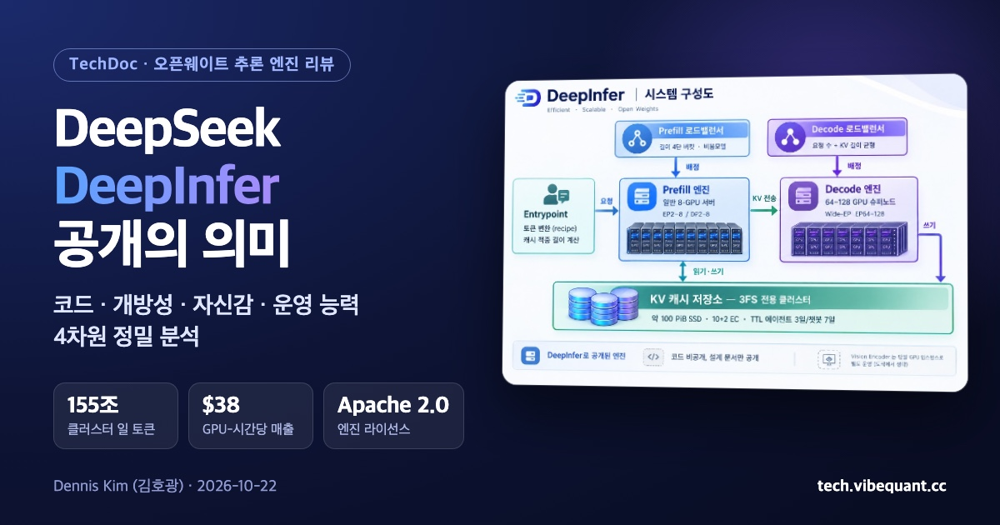
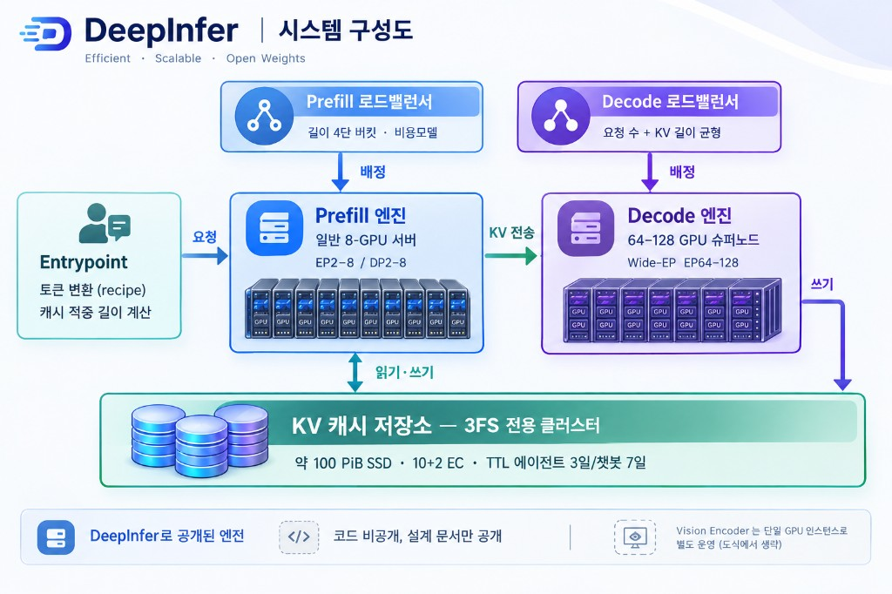

<!--
---
title: "DeepSeek 추론 엔진 DeepInfer 공개의 의미"
title_en: "What DeepSeek's DeepInfer Release Means — Code, Openness, Confidence, Operations"
subtitle: "코드 레벨 · 개방성 · 자신감 · 오퍼레이션 능력 4차원 정밀 분석"
description: "DeepSeek가 프로덕션 추론 엔진 DeepInfer를 Apache 2.0으로 공개했다. FP4 KV, DSpark 추측 디코딩, 100 PiB KV 저장소, GPU-시간당 38달러. 코드·개방성·자신감·운영 4차원 분석."
abstract: |
  2026-10-20 DeepSeek는 프로덕션 추론 프레임워크 DeepInfer를 Apache 2.0으로 공개했다. vLLM 포크 위에 FP4 KV, SWA bounded replay, DSpark 신뢰도 기반 추측 디코딩, 배치 불변 결정적 추론을 얹은 DeepSeek-V4.1-Flash 전용 엔진이다.
  KV 캐시·로드밸런서는 코드 대신 설계 문서로 공개했다. 클러스터당 일 155조 토큰, GPU-시간당 매출 38달러, 100 PiB 3FS KV 저장소, 최소 효율 단위 128 GPU.
  공개의 의미는 빠른 엔진이 아니라 하이퍼스케일 추론 운영의 설계도다. 모든 수치는 DeepSeek 자체 보고. 투자 권유 아님.
summary_for_ai: |
  TechDoc review (KO), 2026-10-22, Dennis Kim. DeepSeek DeepInfer (open-sourced 2026-10-20, Apache 2.0; deepseek-recipe and V4.1-Flash weights MIT).
  Scope: offline inference for DeepSeek-V4.1-Flash only; NVIDIA SM100 and Huawei Ascend 950 from one code tree (DEEPINFER_ACCELERATOR). Not included: KV cache store, full P/D disaggregation, DP load balancer (design docs only).
  Code: vLLM base, async zero-overhead scheduler, FP4 main KV, MXFP4 MoE weights, SWA bounded replay (128-token recompute, prefill ~halved), DSpark confidence-head variable-length verification (+5.4% at operating point 60 seqs/rank), structured output, Rust tokenizer with special-token injection blocking. Public vs internal gap up to 5% end-to-end.
  Ops: E/P/D split, prefill on 8-GPU servers EP2-8, decode on 64-128 GPU supernodes Wide-EP, 3FS KV store ~100 PiB SSD, 10+2 EC, TTL agent 3d / chatbot 7d, LB efficiency ~80% of ideal. 155T tokens/day per cluster, $38 revenue per GPU-hour (off-peak pricing). All numbers self-reported; no independent reproduction yet.
date: 2026-10-22
updated: 2026-10-22
author: "김호광 (Dennis Kim)"
lang: ko
tags: [DeepSeek, DeepInfer, 추론 엔진, vLLM, MoE, KV Cache, Open Weight, LLM Serving]
keywords: ["DeepInfer", "DeepSeek 추론 엔진", "DeepSeek-V4.1-Flash", "Apache 2.0", "DSpark", "3FS KV 캐시", "Wide-EP", "LLM 서빙"]
group: llm-agents
featured: true
featured_rank: 1
og_image: "https://vibequant.cc/og/deepinfer-review-og.jpg"
image: "https://vibequant.cc/og/deepinfer-review-og.jpg"
schema_type: TechArticle
draft: false
robots: index,follow
---
-->

# DeepSeek 추론 엔진 DeepInfer 공개의 의미

## 코드 레벨 · 개방성 · 자신감 · 오퍼레이션 능력 4차원 정밀 분석

- 작성 기준일: 2026-10-22
- 작성: Dennis Kim (김호광)

## 요약

2026년 10월 20일, DeepSeek는 자사 프로덕션 추론 프레임워크 **DeepInfer**를 Apache 2.0으로 공개했다. 공개 하루 만에 Hacker News 2,000점 이상(10월 22일 기준 2,293점·879댓글), GitHub 스타 1만 4,000개 이상을 기록했다.

이번 공개의 의미는 "빠른 엔진"이 아니라 "**하이퍼스케일 추론 운영의 설계도를 숫자까지 공개했다**"는 데 있다. 가중치는 복사하면 끝이지만, 서빙 스택은 하드웨어·드라이버·커널·스케줄러가 얽힌 복합 시스템이다. DeepSeek는 그중 가장 비싸고 모방하기 어려운 계산 경로(커널·병렬화·추측 디코딩·스케줄링)는 코드로, 저장·라우팅 계층은 설계 문서로 풀었다.

간단하게 이야기하면, 맛집 레시피를 공장에서 양산할 수 있게 밀키트 개발할 정도까지 공개한 것이다. 

| 분석 축 | 핵심 판단 | 대표 근거 |
| --- | --- | --- |
| 코드 레벨 | vLLM 포크 위에 FP4 KV, SWA bounded replay, 신뢰도 기반 추측 디코딩, 결정적 추론을 깊게 이식한 단일 모델 특화 계산 경로 | 재계산 비용 상수화, 프리필 연산 약 절반 감소, 공개판·내부판 종단 간 차이 5% 이내 |
| 개방성 | 엔진 코드는 전부, KV 캐시·로드밸런서는 코드 대신 설계 문서로 공개. 라이선스 게이트 없음 | 엔진 Apache 2.0, 토크나이저·가중치 MIT, 동일 코드 트리에서 NVIDIA·Huawei 지원 |
| 자신감 | 2025년의 공개 보류 방침을 번복하고 단위 경제까지 공개. 우위가 코드가 아닌 규모·트래픽에 있다는 선언 | 클러스터당 일 155조 토큰, GPU-시간당 매출 38달러, 공개 범위 한계의 투명한 명시 |
| 오퍼레이션 | E/P/D 분리, 100 PiB 전용 KV 저장소, 쿼터 기반 오토스케일로 "대수의 법칙"형 운영 | 캐시 TTL 3·7일, 최소 효율 단위 128 GPU, LB 효율은 이상치의 약 80% |

> 주의: 모든 성능·사업 수치는 DeepSeek 자체 보고이며 독립 재현 결과는 아직 없다. 지원 모델은 DeepSeek-V4.1-Flash 1종, 하드웨어는 NVIDIA SM100·Huawei Ascend 950으로 한정된다.

---

## 1. 무엇이 공개되었나?

DeepInfer의 README 첫 문장은 이 프레임워크가 **DeepSeek의 대규모 프로덕션 서비스를 구동하는 고성능 추론 프레임워크**라고 밝힌다. 연구용 데모가 아니라 실서비스 코드라는 선언이다. **[1차]**

| 구분 | 내용 | 상태 |
| --- | --- | --- |
| 지원 모델 | DeepSeek-V4.1-Flash (기본 체크포인트 `DeepSeek-V4.1-Flash-1017`) | 포함 |
| 추론 형태 | 오프라인(배치) 추론 | 포함 |
| 하드웨어 | NVIDIA SM100 GPU, Huawei Ascend 950 NPU | 포함 |
| 빌드 요건 | Linux, GCC 13+, Python 3.12, CUDA 13(NVIDIA) 또는 CANN 9.2(Ascend) | — |
| 동반 공개 | deepseek-recipe (토큰 인코딩·API 프로토콜 변환), 배포 Q&A 문서 | 포함 |
| KV 캐시 시스템 | 서빙용 캐시 저장 계층 | **미포함** |
| VE/Prefill/Decode 분리 | 디스어그리게이션 | **일부만** (엔진 측 기능 대부분은 구현됨) |
| DP 복제본 로드밸런싱 | 프리필·디코드 복제본 간 분산 | **미포함** |

공개 범위의 선 긋기 자체가 핵심 정보다. DeepSeek가 무엇을 "엔진의 핵심"으로, 무엇을 "운영의 부가물"로 보는지가 그대로 드러난다. 따라서 DeepInfer는 vLLM·SGLang 같은 범용 서빙 프레임워크의 대체재가 아니라, **단일 모델에 극단적으로 특화된 오프라인 엔진**으로 읽어야 한다.

## 2. 핵심 기능과 아키텍처

DeepInfer는 "커널 → 모델·샘플러 런타임 → 병렬화 → 스케줄러"의 4층 구조이며, DeepSeek가 2025년 이후 개별 공개해 온 부품을 하나의 운영 엔진으로 묶는다. **[1차]**

| 층 | 구성 요소 | 역할 | 활성화 |
| --- | --- | --- | --- |
| 커널 | FlashMLA, DeepGEMM, DeepEP, TileKernels, DeepSelect, 자체 TileLang 커널 | MLA 어텐션, FP8 GEMM, 전문가 병렬 통신, 희소 선택 | 기본 |
| 병렬화 | Attention DP / balanced CP, MoE EP + EPLB | 어텐션은 데이터·컨텍스트 병렬, MoE는 전문가 병렬 + 부하 재배치 | 기본 |
| 디코딩 가속 | DSpark + 신뢰도 기반 검증 스케줄링 | 초안 토큰 생성 후 신뢰도로 검증 범위 결정 | `DEEPINFER_ENABLE_MTP_VARLEN=1`, 초안 최대 길이 `DEEPINFER_USE_NEXTN_DECODE`(기본 5) |
| 프리필 절감 | Decoder SWA bounded replay | 슬라이딩 윈도우 범위의 접미부만 재실행 | `DEEPINFER_YOCO_PREFILL_TRUNCATION_MODE=compact`, `DEEPINFER_YOCO_PREFILL_KEEP_TOKENS=140` |
| 스케줄러 | 비동기(zero-overhead) 배치 스케줄러 | CPU 스케줄링과 디바이스 실행 중첩 | 기본 |
| 재현성 | 배치 불변 추론, 결정적 샘플링 | 배치 구성과 무관하게 동일 출력 | `DEEPINFER_BATCH_INVARIANT=1` + `DEEPINFER_ENABLE_MTP_VARLEN=0` + 고정 `seq_seed` (NVIDIA 전용) |
| 출력 제약 | 구조적 출력 | 정규식·JSON 스키마·EBNF 문법 제약 | `SamplingParams(so_args=...)` |
| 하드웨어 전환 | 단일 코드 트리 | NVIDIA ↔ Ascend 빌드 전환 | `DEEPINFER_ACCELERATOR=nvidia` 또는 `ascend` |

**세 가지 설계 선택이 두드러진다.**

1. **어텐션과 MoE의 병렬 축 분리.** 어텐션은 DP(/CP)로, MoE는 EP로 쪼갠다. 2025년 V3/R1 추론 시스템에서 밝힌 "대규모 EP + 연산·통신 오버랩" 전략의 직계다.
2. **KV 재사용 대신 "재실행 범위 축소".** 캐시 계층을 빼고 공개하면서도 프리필 비용을 엔진 내부 장치로 줄인다.
3. **재현성을 엔진 기능으로 승격.** 결정적 샘플링은 배치 불변 모드 + 추측 디코딩 비활성 + 고정 시드 조합에서만 성립한다. 속도 기능과 재현성 기능이 상충한다는 사실을 문서 수준에서 숨기지 않았다.

아직 공개하면 안될 코어 부분의 노하우는 남겨 놓았다. DeepSeek는 긍정하지 않지만 상당 수량의 블랙웰 B300을 사용하고 있고 데이터 증류와 이에 대한 모호한 지점이 필요했을 것이다.

## 3. 코드 레벨 분석

### 3.1 계보와 코드 구조

- README는 **vLLM을 주 기반**으로, SGLang과 TensorRT-LLM에서 영감을 받았다고 명시한다. TileLang 커널 경로가 `deepinfer/model_executor/layers/tilelang_ops`로, vLLM의 `model_executor` 디렉터리 관례를 그대로 유지한다. **[1차]**
- 기능 토글이 설정 API가 아니라 `DEEPINFER_*` **환경변수**로 노출된다. 운영 환경의 플래그 체계를 그대로 꺼낸 흔적으로, 범용 사용성보다 내부 재현성을 우선한 설계다.
- PyPI에는 `deepinfer 0.1.0` 소스 배포본(583.9 KB)이 등록돼 있다.
- 참고 문서는 커널이 SM100의 tcgen05.mma, TMEM, CuteDSL 같은 하드웨어 기능을 직접 활용한다고 기술한다. 방향성은 Blackwell 커널의 일반적 특성과 부합하나, 이번 분석에서 저장소 코드로 직접 확인하지는 못했다. **[미확인]**

### 3.2 비동기 스케줄러 — 디코드 루프의 재설계

배포 Q&A에 따르면 디코드 N단계는 `schedule(N) → forward(N) → sample(N) → post-process(N)` 순서이며, `post-process(N)` 전에 GPU-CPU 동기화가 필요해 GPU가 쉬는 구간이 생긴다. DeepInfer는 SGLang·NanoFlow 구현을 따라 **GPU가 `forward(N) → sample(N)`을 도는 동안 CPU가 `schedule(N+1) → launch_forward(N+1) → post-process(N−1) → launch_sample(N+1)`을 처리**해 GPU 유휴 시간을 없앤다. 단일 함수 최적화가 아니라 디코드 단계의 실행 순서 자체를 재배열한 아키텍처 변경이다. **[1차]**

### 3.3 저정밀 데이터 경로

| 대상 | 포맷 | 비고 |
| --- | --- | --- |
| Main KV | FP4, per-16 스케일, e4m3 | NVFP4와 유사하나 글로벌 스케일 없음 |
| Indexer KV | MXFP4, per-32, ue8m0 | 희소 어텐션 인덱서용 |
| MoE 라우티드 전문가 가중치 | MXFP4, per-32, ue8m0 | 메모리 트래픽 최소화 |
| SWA KV | MXFP8, 528 B/token | 시퀀스당 20층 × 134토큰 × 528B = 1,415,040B 저장 |

KV를 FP4까지 압축한 것이 핵심이다. 배포 Q&A는 이 압축 덕분에 **Prefill과 Decode를 서로 다른 데이터센터에 나누는 것도 기술적으로 가능**하다고 적었다(8 GPU당 약 400 Gbps 인터커넥트 필요). **[1차]**

### 3.4 SWA bounded replay — 캐시 미스를 상수 비용으로

- 최근 **128토큰만 재계산**하고, 위치 i의 쿼리는 `max(s, i−127) ~ i` 범위 키만 본다. 근사 SWA KV를 만드는 대신 재계산 비용을 컨텍스트 길이·레이어 수와 무관한 **상수**로 만든다.
- 디코더 측에서는 정확 재구성에 2,560토큰 × 20개 디코더 층이 필요하지만, 마지막 128토큰만 재계산해 **전체 프리필 연산을 거의 절반으로** 줄인다.
- 캐시 적중 상한은 **L − 134** (128 윈도우 + 추측 디코딩 백트래킹 6토큰). README의 `KEEP_TOKENS=140`과 맞물린다.
- 적중 규칙: 적중 길이는 block KV 캐시가 결정하고, 마지막 블록의 재계산 여부는 SWA KV 캐시 존재 여부가 결정한다. SWA가 없으면 한 블록(128) 물러나 재계산한다. **[1차]**

### 3.5 DSpark — 신뢰도 헤드 기반 가변 길이 검증

- 초안 모델이 한 번에 **5토큰**을 만들고, **Confidence Head**가 토큰별 수락 확률을 예측한다. 스케줄러는 기대 수락률 순으로 정렬해 유효 처리량을 최대화하는 접두 부분만 검증한다.
- 가변 길이 검증은 스텝당 검증 토큰을 약 30% 줄이면서(5.00 → 3.2–4.4) 평균 수락 길이는 거의 유지한다(3.29 vs 3.20).
- 비동기 스케줄링 때문에 `schedule(N+1)` 시점엔 N단계 신뢰도가 아직 없다. 그래서 CPU는 총 예산만 정하고, 요청별 길이는 **GPU 위 TileLang 커널**(누적곱, 전역 top-k 정렬, fused remap scatter)이 다시 계산한다. 스케줄링 로직 일부를 커널로 내린 사례다. **[1차]**

| 랭크당 동시 시퀀스 | 고정 5토큰 처리량 (tok/s/rank) | 가변 길이 처리량 (tok/s/rank) | 변화율 |
| --- | --- | --- | --- |
| 16 | 4,891 | 4,816 | −1.5% |
| 32 | 8,964 | 9,111 | +1.6% |
| 48 | 12,032 | 12,467 | +3.6% |
| **60 (운영점)** | **13,730** | **14,466** | **+5.4%** |
| 72 | 14,962 | 15,961 | +6.7% |
| 96 | 16,817 | 18,660 | +11.0% |

출처: 배포 Q&A, EP64/DP64 벤치마크 기반 추정치 **[1차]**. 저동시성에서는 이득이 없고, 배치가 클수록 절약된 검증 연산이 처리량으로 돌아온다. 운영점(랭크당 약 60)에 맞춘 최적화를 했다. 탁월한 전략이다.

### 3.6 구조적 출력

컴파일과 추론을 분리한다. 형식 제약(JSON 스키마·정규식·EBNF)은 **전용 SO 머신에서 비동기로 문법 오토마톤으로 컴파일**되고, 요청은 엔진 진입 전 컴파일 결과를 받는다. 런타임에는 매 디코드 스텝마다 오토마톤을 진행시켜 합법 토큰 마스크를 샘플링에 적용한다. 프롬프트로 "JSON으로 답하라"고 부탁하는 방식과 달리 형식 위반을 원천 차단해 재시도 루프 비용을 줄인다. **[1차]**

### 3.7 deepseek-recipe — 보안 관점에서 주목할 토크나이저 계층

- Chat Completions·Responses·Messages 세 API 프로토콜을 단일 대화 포맷으로 변환한다. 요청 변환·프롬프트 인코딩·출력 파싱은 **Rust로 구현**하고 Python 바인딩을 제공한다.
- **Special-token injection 차단.** 사용자 입력·도구 결과·도구 인자 안의 `<｜User｜>`, `<｜image｜>` 같은 문자열은 일반 토큰 시퀀스로 인코딩한다. 텍스트로 제어 토큰을 주입하는 공격을 토크나이저 단계에서 막는다.
- **출력 측 방어.** `</think>`와 DSML 태그를 토큰 ID로만 인식한다. 모델이 일반 토큰으로 같은 문자열을 써도 추론 종료나 도구 호출이 트리거되지 않는다.
- **세그먼트 병렬 인코딩.** 특수 토큰 위치를 이미 알고 있으므로 그 사이 일반 텍스트 구간을 병렬로 BPE 인코딩해 초장문 요청의 토크나이즈 지연을 줄인다.
- **스트리밍 파서.** 청크 경계에서 잘린 UTF-8 문자를 버퍼링하고, 구분자 인식에 증분 KMP 매칭을 쓰는 상태 기계다. 도구 이름은 파싱 즉시 반환하고, 인자는 JSON 조각으로 바로 흘려보낸다. **[1차]**

### 3.8 내부판과 공개판의 차이를 스스로 공개

배포 Q&A는 공개된 DeepGEMM·FlashMLA가 내부판과 "대체로 같다"면서도, **FlashMLA에 수작업 SASS 최적화 하나가 빠져 디코딩 커널이 5–10% 느리고, 종단 간 차이는 최대 5%**라고 적었다. 초안 모델도 내부판이 조금 더 새롭지만 성능 차이는 작다고 밝혔다. 공개판이 "성능을 깎은 데모"가 아님을 정량으로 보증한 셈이다. **[1차]**

DeepSeek 팀의 라이브 서버와 공개 소스 차이가 상당히 적다는 것은 그 만큼 자신감이 있고 DeepSeek 기반의 AI IDC 인프라에 확산이 중요하다는 점을 명확히 알고 있던 것이다.

## 4. 성능 특징

공개 벤치마크 기준 디코드는 GPU당 25,000 tok/s 이상, 프리필은 비캐시 입력 GPU당 약 60,000–90,000 tok/s다. README는 측정 구성을 **프리필 4개, 디코드 64개 SM100 GPU(각각 단일 scale-up 도메인 내)**로 밝힌다.

| 구간 | 구성 | 수치 | 근거 |
| --- | --- | --- | --- |
| 디코드 처리량 | EP64/DP64, 64×SM100, 131,072 컨텍스트, nextn=3, 수락률 75% | 랭크당 256요청에서 GPU당 25,000 tok/s 이상, 사용자당 약 100 tok/s. 랭크당 8요청이면 사용자당 300 tok/s 이상 | [보도] MarkTechPost의 자체 차트 판독 |
| 프리필 처리량 | EP4/DP4, 4×SM100, bounded replay 140토큰 | 랭크당 4,096토큰에서 GPU당 약 60,000 tok/s, 65,536토큰에서 약 90,000 tok/s (스텝당 약 730ms) | [보도] 상동 |
| Wide-EP 효과 | EP8 vs EP64 | 모든 배치 크기에서 EP64 우위 | [1차] 배포 Q&A 차트 |
| 클러스터 운영 | 단일 클러스터 | 일 155조 토큰, GPU-시간당 매출 38달러(밸리 요금 기준) | [1차] 배포 Q&A |
| 부하 분산 효율 | 운영 LB 전체 | 완전 균형 오프라인 벤치마크의 약 80% | [1차] 배포 Q&A |
| 전문가 부하 불균형 | moe_lb(최저속 랭크/평균) | 프리필 1.045–1.074, 디코드 1.090 | [1차] 배포 Q&A |
| 서비스 지연 | 운영 서비스 | TTFT 약 400ms, 생성 230 tok/s(코딩 300), 입력 캐시 적중 96% | [보도] Dealroom·Latent Space 등. Zhihu 원문은 미확인 |
| 서비스 지연 조건 | 평균 입력 길이 | 평균 입력 77K 토큰 기준 | [미확인] 참고 문서 기재 |
| B200 소규모 구성 | 128K 컨텍스트, 4×B200, 동시 1,024요청 | 총 출력 약 62,000 tok/s, 64카드 확장 시 약 168만 tok/s | [미확인] 참고 문서 기재 (GPU당 약 2.6만 tok/s로, 공식 디코드 차트 수치와는 같은 범위) |

**수치를 읽을 때 구분할 세 가지**

1. **벤치마크와 운영은 다른 숫자다.** 25,000 tok/s는 단일 scale-up 도메인 내 오프라인 측정이고, 운영은 LB 손실로 그 80% 수준이다. 155조 토큰/일은 캐시 적중 96%가 전제된 "대부분 재사용된 입력"의 합계다.
2. **38달러는 매출이지 이익이 아니다.** 또한 "밸리 요금"은 DeepSeek API의 비수기(off-peak) 토큰 요금을 뜻하며, 전력 요금이 아니다. HN에서는 원가 대비 해석, 클러스터 규모 역산(GPU 약 7만 장 필요하다는 추정) 등을 두고 논쟁이 이어졌다. **[커뮤니티]**
3. **추측 디코딩 이득은 동시성에 따라 부호가 바뀐다.** 3.5절 표 참조.

외부 비교 신호도 엇갈린다. HN 댓글 중에는 Together.ai·Baseten 등이 V4.1-Flash-1017을 DeepSeek 자체 서비스보다 높은 처리량·낮은 지연으로 제공한다는 지적이 있었다. **[커뮤니티]** 엔진 자체의 절대적 우월성보다 **운영점에서의 비용 효율**이 DeepInfer의 실체라는 해석에 무게가 실린다. 

이 말이 맞는 부분이다. 운영 코스트가 저렴하고 예측 가능하다는 점. 이 점이 무섭다. 중국은 오픈 소스 생태계로 세상을 혁신하고 오픈 소스의 본고장이었던 미국은 폐쇄형 모델로 대응하고 있다. 

그 성능 차이가 엔비디아 최신형 GPU를 구매하는 것, 몇몇 노하우, 하드웨어를 태워버리는 머슬카처럼 사용하는 미국의 개발 방식에서 나온 부분일지도 모른다. 

## 5. 개방성

DeepInfer의 개방성은 **"엔진 코드는 전부, 클러스터 운영 코드는 설계 문서까지"**라는 2단 구조다. 라이선스는 업계 최상위 수준이지만, 실행 조건과 규제 환경이 실질적 개방 범위를 좁힌다.

### 5.1 라이선스 스택

| 구성 요소 | 라이선스 | 의미 |
| --- | --- | --- |
| DeepInfer 엔진 | Apache 2.0 | 상업 이용·수정·재배포 허용, 파생물 소스 공개 의무 없음, 특허 라이선스 명시적 부여 |
| deepseek-recipe | MIT | 토큰 인코딩·API 프로토콜 변환 계층 |
| V4.1-Flash 가중치 | MIT | 엔진·모델·토크나이저 전부 허용적 라이선스 |

Apache 2.0의 특허 조항은 기업 도입에서 실질적 의미가 있다. 기여자의 관련 특허 사용권이 함께 부여되므로 커널·스케줄러 기법을 상용 스택에 이식할 때 법적 불확실성이 줄어든다(법률 자문 아님).

참고 문서는 동시기 일부 프런티어 연구소가 오픈웨이트 모델 상업 배포에 2,000만 달러 매출 게이트를 둔 것과 대조된다고 적었다. **[미확인]** 사실이라면 DeepInfer의 "게이트 없는 개방"이 더욱 두드러진다.

### 5.2 공개의 경계 — 코드 vs 설계

| 계층 | 코드 | 설계 문서 |
| --- | --- | --- |
| 커널·런타임·샘플러·스케줄러 | 공개 | 공개 |
| VE/Prefill/Decode 분리 | 엔진 측 기능 대부분 공개 | 공개 |
| KV 캐시 저장 (kvcache-store, 3FS 연동) | **비공개** | 배포 Q&A·Zhihu 블로그에 상세 공개 |
| Prefill/Decode/VE/EP 로드밸런서 | **비공개** | 알고리즘·파라미터까지 공개 |
| 토크나이저·API 변환 (deepseek-recipe) | 공개 | 공개 |

DeepSeek는 비공개 사유를 "내부 인프라와 강하게 결합돼 있기 때문"이라고 밝혔다. 그런데 배포 Q&A는 LB의 4단 길이 버킷, 2차 비용 모델, TTL·EC 구성까지 적었다. **코드는 닫았지만 재구현에 필요한 지식은 거의 다 열었다.** 비유하자면 "엔진의 심장(계산 경로)"은 코드로, "혈관과 신경(저장·라우팅)"은 해부도로 공개한 셈이다.

### 5.3 개방의 폭: 동일 코드 트리의 이기종 지원

공개 범위가 "프로덕션 스택"이라는 표현보다 좁은 면이 있는 반면, 넓은 면도 있다. **NVIDIA SM100과 Huawei Ascend 950을 동일한 코드 트리에서 지원**하며, `DEEPINFER_ACCELERATOR` 환경변수 하나로 빌드가 갈린다. 미국산 칩에 의존하지 않는 서빙 경로가 별도 포크가 아니라 빌드 플래그로 구현돼 있다는 뜻이다.

### 5.4 개방의 연속성

| 시점 | 공개 대상 | 성격 |
| --- | --- | --- |
| 2026년 10월 20일 | DeepInfer 엔진 + deepseek-recipe + 배포 Q&A | 운영 엔진 자체 |
| 2025년 4월경 | "자체 엔진은 직접 공개하지 않고 기존 오픈소스에 기여" 방침 | 공개 보류 선언 |
| 2025년 2월경 | FlashMLA·DeepEP·DeepGEMM·3FS 등 부품, V3/R1 추론 시스템 개요 | 부품·설계 |

2025년 일자는 근사치다. DeepSeek는 향후 모델의 추론 코드와 후속 성능 작업도 DeepInfer에 계속 공개하겠다고 밝혀, 개방을 일회성 이벤트가 아닌 지속 프로세스로 선언했다. **[1차]**

### 5.5 개방의 전략적 의미 — 비용 구조의 공개

DeepInfer의 개방은 단순한 코드 공개가 아니라 **비용 구조의 공개**다. 클러스터 처리량과 GPU-시간당 매출을 함께 밝힘으로써 "고성능 추론에는 고비용이 불가피하다"는 통념에 숫자로 도전했다. 참고 문서는 DeepSeek의 출력 토큰 단가(100만 토큰당 약 0.60달러)를 경쟁 프런티어 모델(20–25달러 수준)과 대비시켰는데 **[미확인]**, MarkTechPost는 DeepSeek 공식 API가 비수기 기준 100만 입력 토큰당 0.15달러부터라고 보도했다. **[보도]** HN에서는 "추론 마진이 지속 가능한가", "프런티어 모델 사업 모델이 버틸 수 있는가"를 둘러싼 논쟁이 이어졌다. **[커뮤니티]**

### 5.6 실질적 개방을 좁히는 요인

- **하드웨어 장벽.** SM100 또는 Ascend 950 전용이며, 최소 효율 배포 단위는 프리필 64 + 디코드 64 GPU다. 공개 직후 커뮤니티에서 Ampere(SM80) 포팅 저장소가 등장한 것은 라이선스 개방이 하드웨어 장벽 우회 시도를 낳는다는 신호다. **[커뮤니티]**
- **NVIDIA 전용 기능.** 배치 불변 추론과 결정적 샘플링은 Ascend에서 쓸 수 없다.
- **규제.** 같은 날 HN 첫 페이지에는 미 국토안보부(DHS)의 연방 민간기관 DeepSeek 사용 금지 보도가 함께 올랐다. HN에서는 "미국 호스트가 DeepInfer로 무엇을 서빙하든 DeepSeek 제품을 운영하는 셈"이라는 지적도 나왔다. 코드는 열렸지만, 누가 쓸 수 있는지는 정치가 정한다.

## 6. 자신감

이번 공개가 드러내는 자신감의 핵심은 **"레시피를 줘도 따라올 수 없다"**는 판단이다. DeepSeek는 엔진을 공개하면서 경쟁 우위가 코드가 아니라 운영 규모·저장 인프라·모델 반복 속도에 있다고 사실상 선언했다.

| 신호 | 근거 | 해석 |
| --- | --- | --- |
| 프로덕션 코드 직공개 | README 첫 문장이 "자사 대규모 프로덕션 서비스를 구동"한다고 명시 | 실전성·성숙도에 대한 자신감 없이는 불가능한 선택 |
| 방침 번복 | 2025년엔 내부 인프라 결합·코드 분기·유지보수 여력을 이유로 공개 보류. 2026년엔 결합부를 떼어내는 엔지니어링 후 공개 | 공개 비용을 감수할 만큼 얻을 것이 크다고 판단 |
| 사업 지표 공개 | 클러스터당 일 155조 토큰, GPU-시간당 매출 38달러 | 경쟁사가 공개하지 않는 단위 경제 수치를 먼저 꺼냄 |
| 한계의 투명한 명시 | KV 캐시·분리·LB 미포함과 그 이유를 README·Q&A에 기재 | 약점을 감추지 않고 경계를 그어 오히려 기술적 자신감을 드러냄 |
| 내부판 격차 공개 | 종단 간 최대 5% 차이, FlashMLA SASS 최적화 1건 누락 | 공개판이 "거세된 버전"이 아님을 스스로 보증 |
| 실스케일 벤치마크 | 프리필 4·디코드 64 SM100 구성 | 노트북 데모가 아닌 실제 scale-up 도메인 규모 |
| Ascend 동등 지원 | 첫 릴리스부터 SM100과 Ascend 950 병기 | 특정 칩 벤더 의존에서 벗어났다는 메시지 |
| 공개 시점 | PyTorch 컨퍼런스 첫날 | 개발자 커뮤니티 주목도 극대화 |

### 6.1 무엇을 줘도 괜찮다고 본 것인가?

- **규모 장벽.** 최소 128 GPU에, 운영 GPU당 논리 14.4TB의 KV 저장이 필요하다. DeepSeek 운영 저장소는 약 100 PiB SSD다. 코드를 받아도 이 규모를 갖춘 사업자만 같은 경제성을 낸다.
- **트래픽 자체가 해자.** 96% 캐시 적중률은 엔진이 아니라 대규모 사용자 트래픽에서 나온다. 같은 엔진도 트래픽이 작으면 캐시 효과가 떨어진다.
- **모델 반복 속도.** 엔진은 V4.1-Flash 전용이다. 다음 모델이 나오면 DeepSeek는 엔진을 함께 갱신하지만 외부는 그 뒤를 따라간다.

### 6.2 공개로 얻는 것

- **생태계 표준화.** 외부 호스팅 사업자들이 DeepSeek 최적화를 공통으로 쓰면 "어디서 돌려도 DeepSeek 모델은 싸고 빠르다"는 인식이 굳는다.
- **가격 압박.** 언론은 이번 공개를 OpenAI·Anthropic에 대한 압박 강화로 보도했다. DeepSeek의 공식 명분은 "연산 비용·에너지 절감과 AI의 저렴화"다.
- **하드웨어 정치.** Ascend 지원 코드를 공개 표준으로 만들면, 수출통제 아래서도 중국산 가속기 생태계가 실서비스 수준에 도달했음을 외부에 증명한다.

### 6.3 자신감의 이면

- 비공개로 남긴 KV 캐시·LB가 바로 운영 경쟁력의 핵심이다. 공개된 부분만으로는 DeepSeek의 원가 구조를 그대로 복제할 수 없다. 자신감에는 계산된 부분이 있다.
- 모든 성능 수치는 벤더 자체 보고이며 독립 제3자 벤치마크는 아직 없다. 자신감은 검증의 숙제를 함께 남긴다.

## 7. 오퍼레이션 능력

DeepSeek의 진짜 경쟁력은 엔진보다 그 주변의 운영 체계에 있다. 배포 Q&A는 시스템 설계 목표를 세 가지로 요약한다. **[1차]**

1. **멀티벤더 가속기 지원** — 서로 다른 하드웨어에서 각각의 성능을 끌어낸다.
2. **범용 하드웨어 중심의 P/D 구성** — 프리필은 일반 8-GPU 서버, 디코드는 일반 64–128 GPU 슈퍼노드.
3. **KV 캐시 72시간 이상 보존** — 컨텍스트 재사용 창을 늘려 반복 프리필을 줄인다.

### 7.1 시스템 구성도

*요청은 Entrypoint에서 토큰으로 변환되고 캐시 적중 길이가 계산된 뒤, Prefill 로드밸런서(길이 4단 버킷·비용 모델)가 일반 8-GPU 서버의 Prefill 엔진(EP2–8 / DP2–8)에 배정한다. KV는 Decode 로드밸런서(요청 수 + KV 길이 균형)가 고른 64–128 GPU 슈퍼노드의 Decode 엔진(Wide-EP, EP64–128)으로 전송된다. 두 엔진은 약 100 PiB SSD, 10+2 EC, TTL 에이전트 3일·챗봇 7일의 3FS 전용 KV 캐시 저장소를 공유한다. 엔진은 DeepInfer로 공개됐고 로드밸런서와 KV 저장소는 설계 문서만 공개됐다. Vision Encoder는 단일 GPU 인스턴스로 별도 운영한다(도식에서 생략).*

### 7.2 배포 토폴로지

| 역할 | 하드웨어 | 병렬화 | 설계 원칙 |
| --- | --- | --- | --- |
| Prefill | 일반 8-GPU 서버 | EP2–8 / DP2–8 | HBM이 허용하는 가장 작은 EP/DP |
| Decode | 64–128 GPU 슈퍼노드 | EP64–128 / DP64–128 (Wide-EP) | 가용 GPU가 허용하는 가장 큰 EP/DP |
| Vision Encoder | 단일 GPU, 저가 GPU 권장 | 인스턴스당 1 GPU | EPD 분리 |
| KV 저장소 | 전용 3FS 클러스터, 약 100 PiB SSD | 10+2 이레이저 코딩 | 연산 노드와 독립 확장 |

- 운영에서는 TP와 CP를 쓰지 않는다. README가 오프라인 기능으로 balanced CP를 제공하는 것과 대비된다.
- P:D GPU 비율은 약 1:1이며, **최소 효율 단위는 프리필 64 + 디코드 64 GPU**다.
- KV를 FP4로 압축한 덕분에 P/D를 서로 다른 **인접 데이터센터**에 둔다.

### 7.3 KV 캐시 저장 계층

- **TTL**: 에이전트 트래픽 3일, 챗봇 트래픽 7일. 챗봇은 소수 캐시가 반복 조회되는 롱테일이 강해, TTL 3일로 줄이면 적중률이 0.5–1%p 떨어진다.
- **저장 서버 권장 사양**: 30.73TB SSD 20개, 읽기 40GB/s·쓰기 5GB/s 이상, 24시간분 보존 용량. 운영 GPU 1장당 논리 용량 약 14.4TB.
- **테일 지연 억제**: 읽기는 EC 그룹의 11개 노드에 동시 요청하고, 아무 10개 응답으로 복원한다.
- **SM 무소모 swap-in**: HBM 적재는 CUDA copy engine 대신 GDR(RDMA NIC가 PCIe 대역폭 포화)로 처리한다.
- **독립 저장 클러스터의 근거**: 연산 노드 장애율이 저장 노드보다 10배 이상 높다는 운영 관찰. 또한 어느 프리필 머신이든 모든 접두를 적중할 수 있어 접두 친화 라우팅과 LB가 충돌하지 않는다.
- **GC**: 저장 노드마다 GC Worker를 두고 LRU로 만료 캐시를 회수해 디스크 사용률을 워터마크 이하로 유지한다. **[1차]**

### 7.4 로드밸런싱

- **Prefill LB**: 컨텍스트 길이로 4단 버킷(<16K / 16–64K / 64–256K / ≥256K)을 나누고, 직전 라운드 수요 비율로 엔진 수를 재배분한다. 엔진은 남은 연산 쿼터만큼 작업을 당겨간다.
- **GPU 내 청크 크기**: 고정값이 아니라, 스텝 시간 예산(`compute_quota_limit`)과 적합된 2차 비용 모델 `cost(q, c)`를 풀어 32,768토큰 한도 안의 최대 q를 고른다.
- **Decode LB**: 요청 수(배치 크기)와 총 KV 길이(어텐션 비용)를 동시에 맞춘다. 짧은 요청은 동시성은 낮고 KV가 긴 GPU로, 긴 요청은 KV가 짧은 GPU로 보낸다.
- **EPLB**: GPU마다 핫 전문가 복제본을 두고, 프리필은 100스텝 통계·1,000스텝마다, 디코드는 1,000스텝 통계·10,000스텝마다 재배치한다. 가중치는 NVLink `symm_mem`으로 셔플한다.
- **종합 효율**: 완전 균형 오프라인 벤치마크의 약 80%. **[1차]**

### 7.5 오토스케일링과 장애 대응

| 항목 | 정책 |
| --- | --- |
| 스케일 기준 | Prefill은 비캐시 토큰 수, Decode는 실행 중 요청 수. 변화율 제한과 상·하한 적용 |
| 여유 용량 | 대기 머신 풀 유지, 쿼터 사용률 0.8 초과 시 축소 금지 |
| 디코드 축소 | 종료 통지 후 1분 유예, 미완료 요청과 KV를 다른 디코드 엔진으로 일괄 이관 |
| 재시작 | 분 단위. 단일 엔진 재시작 단축 대신 쿼터 여유 + 요청 재라우팅으로 내결함성 확보 |
| EP 장애 | GPU 1장 장애 시 인스턴스 전체 통신 도메인이 무너지므로, 남은 정상 GPU 수로 EP 크기를 재결정 |

이 정책들은 "단일 엔진을 완벽하게"가 아니라 **"대수의 법칙으로 버티는"** 하이퍼스케일 운영 철학을 보여준다.

### 7.6 "완전한 서비스"와의 거리

DeepInfer는 오프라인 추론만 제공한다. 온라인 서비스를 하려면 KV 캐시, 분리 배포, 로드밸런싱을 직접 구축하거나 vLLM·SGLang·llm-d·Dynamo 등 생태계에서 빌려와야 한다. 즉 DeepInfer는 **"운영의 심장"은 주지만 "운영의 전신"은 주지 않는다.** 엔진 코드는 누구나 받을 수 있지만, 이 정책을 돌릴 트래픽과 하드웨어 풀은 복제되지 않는다.

## 8. 경쟁 엔진 비교

DeepInfer는 범용 서빙 엔진과 경쟁하는 제품이 아니라, 단일 모델 운영의 "정답지"를 범용 엔진 생태계에 던진 참조 구현이다.

| 항목 | DeepInfer | vLLM | SGLang | TensorRT-LLM |
| --- | --- | --- | --- | --- |
| 관리 주체 | DeepSeek | vLLM 프로젝트 | SGLang 프로젝트 | NVIDIA |
| 라이선스 | Apache 2.0 | Apache 2.0 | Apache 2.0 | Apache 2.0 |
| 모델 범위 | V4.1-Flash 1종 | 200개 이상 아키텍처 | LLM·VLM·확산 모델 | NVIDIA 지원 매트릭스 |
| 하드웨어 | SM100, Ascend 950 | NVIDIA·AMD·Intel·CPU, 플러그인으로 Ascend·TPU | NVIDIA·AMD·TPU·Intel·Apple·Ascend 등 | NVIDIA 전용 |
| 전문가 병렬 | EP + EPLB | 지원 | 지원 | Wide-EP |
| 추측 디코딩 | DSpark (신뢰도 스케줄) | n-gram·EAGLE 등 | SpecForge 초안 | 지원 |
| P/D 분리 | 이번 릴리스 미포함 | 지원 | llm-d·Dynamo 연동 | 지원 |
| 온라인 서빙 | 오프라인 전용 | OpenAI 호환 서버 | 지원 | 지원 |
| 재현성 | 배치 불변 + 결정적 샘플링 (NVIDIA) | 제한적 | 제한적 | 제한적 |
| 운영 문서 | 실운영 파라미터 공개 | 범용 가이드 | 범용 가이드 | 범용 가이드 |

관계는 경쟁보다 공급에 가깝다. DeepInfer 자체가 vLLM 포크이고, 비동기 스케줄러는 SGLang 방식을 따랐다. 반대로 DSpark, SWA bounded replay, Wide-EP 운영 파라미터는 범용 엔진이 역수입할 가능성이 크다. 같은 날 구글은 캐시 인지 라우팅을 갖춘 llm-d 1.0을 공개했는데, DeepInfer에 빠진 KV 캐시·라우팅 계층을 메울 후보로 거론될 만하다.

### 자체 서빙 스택 선택의 네 가지 축

| 축 | DeepInfer | 범용 프레임워크 | 판단 포인트 |
| --- | --- | --- | --- |
| 모델 범용성 | V4.1-Flash 단일 | 다수 모델 | 단일 모델 집중이면 특화가 유리 |
| 캐시 계층 | 미포함 | 대개 내장 | 멀티턴 비중이 높으면 불리 |
| 분산 운영 | 직접 구현 필요 | 일부 내장 | 운영 인력 확보 여부 |
| 재현성 | 배치 불변·결정적 샘플링 | 제한적 | 평가 자동화·감사 대응에 유리 |

## 9. 시사점과 리스크 — IDC·GPU 인프라 사업자 관점

IDC·GPU 임대 사업자에게 DeepInfer는 **"GPU를 빌려주는 사업"과 "토큰을 파는 사업"의 수익 격차를 수치로 보여준 자료**다. 단, 도입은 하드웨어 호환성과 규제 검토가 선행돼야 한다.

### 9.1 기회

- **단위 경제 벤치마크.** DeepSeek는 GPU-시간당 매출 38달러(밸리 요금)를 공개했다. HN에서는 H100 임대가가 시간당 약 2.75달러라는 비교가 나왔다. 하드웨어 세대가 달라 직접 비교는 불가하지만, 베어메탈 임대 대비 토큰 서빙의 매출 잠재력이 한 자릿수 배 이상 크다는 방향성은 분명하다.
- **운영 설계의 무료 교과서.** E/P/D 분리, 전용 KV 저장 클러스터, 쿼터 0.8 축소 금지 같은 정책은 자체 추론 클라우드 설계 체크리스트가 된다.
- **이기종 하드웨어 헤징.** 동일 코드로 NVIDIA·Ascend를 운영할 수 있어 공급망 다변화·지정학 리스크 대응의 참고가 된다.
- **결정적 추론.** 배치 불변 + 결정적 샘플링은 금융·공공 고객의 감사 대응 요구에 맞는 차별화 포인트가 될 수 있다(NVIDIA 한정).

### 9.2 확인이 필요한 리스크

| 리스크 | 내용 | 점검 방법 |
| --- | --- | --- |
| 하드웨어 호환 | README는 "SM100 GPU"를 명시한다. B300(Blackwell Ultra)이 이 범주에 들어가는지는 공개 문서로 확인되지 않음 | 보유 장비의 compute capability와 빌드 타깃 대조, `build.sh` 빌드를 이미지 단위로 검증 |
| 규모 요건 | 최소 효율 단위 128 GPU, GPU당 논리 KV 저장 약 14.4TB | 소규모 테넌트용이면 범용 엔진(vLLM·SGLang)이 현실적 |
| 빠진 계층 | KV 캐시·LB·P/D 오케스트레이션 직접 구현 필요 | llm-d·Dynamo 등 외부 계층 조합 또는 자체 개발 인력 산정 |
| 규제·평판 | 미국 연방기관 DeepSeek 사용 금지 등. 수출통제 대상 장비를 운영하는 IDC에서 DeepSeek 소프트웨어를 돌리는 것이 고객·당국에 어떻게 비칠지 별도 판단 필요 | 고객 계약상 소프트웨어 원산지 조항 검토, 법률 자문 |
| 가중치 라이선스 | 엔진은 Apache 2.0이지만 모델 가중치 라이선스는 별개 | 모델 카드의 라이선스 조건 별도 확인 |
| 공급망 보안 | 공개 초기 저장소는 빠르게 바뀌고, 빌드 시 커널을 컴파일 | 커밋 해시 고정, 의존성 잠금, 빌드 산출물 해시 기록 |

### 9.3 재현성·감사 대응 체크리스트

결정적 샘플링은 조건 조합이 하나라도 빠지면 성립하지 않는다. 실행 로그에 다음을 함께 남겨야 동일 결과를 다시 만들 수 있다.

- 모델 리비전 해시, 프레임워크 커밋 해시
- CUDA·드라이버 버전
- 샘플링 파라미터 (`seq_seed` 포함), `DEEPINFER_BATCH_INVARIANT`·`MTP_VARLEN` 설정
- 배치 구성, 입력·출력 토큰 길이
- GPU 모델과 장수, 인터커넥트 종류

## 10. 종합

DeepInfer의 공개는 "모델 가중치 공개"의 다음 단계를 보여준다. DeepSeek는 서빙 스택 중 가장 값비싸고 모방하기 어려운 계산 경로를 Apache 2.0으로 풀고, 저장·라우팅 계층은 설계 문서로 공개했다.

결국 이번 공개는 두 가지 선언이다.

1. **운영 능력의 증명** — "우리는 이렇게 싸게, 이렇게 안정적으로, 이기종 하드웨어까지 커버하며 추론한다."
2. **개방형 자신감의 선언** — "우리의 계산 경로를 가져가 더 싸고 효율적인 AI 인프라를 만들어라. 그래도 규모와 트래픽은 복제할 수 없다."

DeepInfer는 "그대로 가져다 쓰는 엔진"이 아니라 **"하이퍼스케일 추론 운영의 설계도"**로 읽을 때 가치가 가장 크다. 코드는 범용 엔진에 흡수되고, 운영 지식은 자체 스택 설계에 쓰는 것이 현실적인 활용 경로다. Hacker News에서 "추론의 마진이 지속될 수 있는가"를 둘러싼 논쟁이 뜨거웠던 것은, DeepInfer가 그 논쟁의 기술적 실체와 숫자를 처음으로 제공했기 때문이다

## 참고자료

### 1차 자료 (DeepSeek)

- DeepInfer README — https://raw.githubusercontent.com/deepseek-ai/DeepInfer/main/README.md
- DeepSeek V4.1 Flash Inference Deployment Q&A — https://github.com/deepseek-ai/DeepInfer/blob/main/doc/inference_deployment_qa.md
- deepinfer 0.1.0 (PyPI) — https://pypi.org/project/deepinfer/
- DeepSeek Open Infra Index (문서 미러) — https://docsearch.algolia.com/mcp/docs/repo/deepseek-ai/open-infra-index

### 분석·보도

- 제임스의 AI 실전 노트, 「DeepInfer: Apache 2.0로 공개된 DeepSeek 추론 엔진, HN 2,186점」 — https://fornewchallenge.tistory.com/entry/%E2%9A%99%EF%B8%8F-DeepInfer-Apache-20%EB%A1%9C-%EA%B3%B5%EA%B0%9C%EB%90%9C-DeepSeek-%EC%B6%94%EB%A1%A0-%EC%97%94%EC%A7%84-HN-2186%EC%A0%90
- MarkTechPost, "DeepSeek Open-Sources DeepInfer" — https://www.marktechpost.com/2026/10/20/deepseek-deepinfer-open-source-inference-framework/
- Shattered, "DeepSeek Opens DeepInfer, Presses OpenAI, Anthropic" — https://shattered.io/deepseek-deepinfer-open-source-inference-pressure-2026/
- CO/AI, "DeepSeek pivots to sharing AI components instead of full inference engine" — https://getcoai.com/news/deepseek-pivots-to-sharing-ai-components-instead-of-full-inference-engine
- Dealroom, "DeepSeek open-sources its serving engine and reveals $38 of revenue per GPU-hour" — https://dealroom.co/news/164841-deepseek-open-sources-its-serving-engine-and-reveals-38-of-revenue-per-g/
- Latent Space AINews, "DeepSeek DeepInfer" — https://www.latent.space/p/ainews-deepseek-deepinfer-open-source

### 커뮤니티

- Hacker News 토론 스레드 — https://news.ycombinator.com/item?id=50163277
- Hacker News 2026-10-20 프런트 페이지 — https://news.ycombinator.com/front

### [미확인] 표기 항목

참고 문서에 기재됐으나 이번 분석에서 1차 출처로 확인하지 못한 항목: SM100 커널의 tcgen05.mma·TMEM·CuteDSL 활용, 평균 입력 77K 토큰 조건, 4×B200 동시 1,024요청 62,000 tok/s 및 64카드 168만 tok/s, 타 연구소의 2,000만 달러 매출 게이트, 출력 토큰 단가 0.60달러 대 20–25달러 비교. 인용 전 원문 확인을 권한다.
