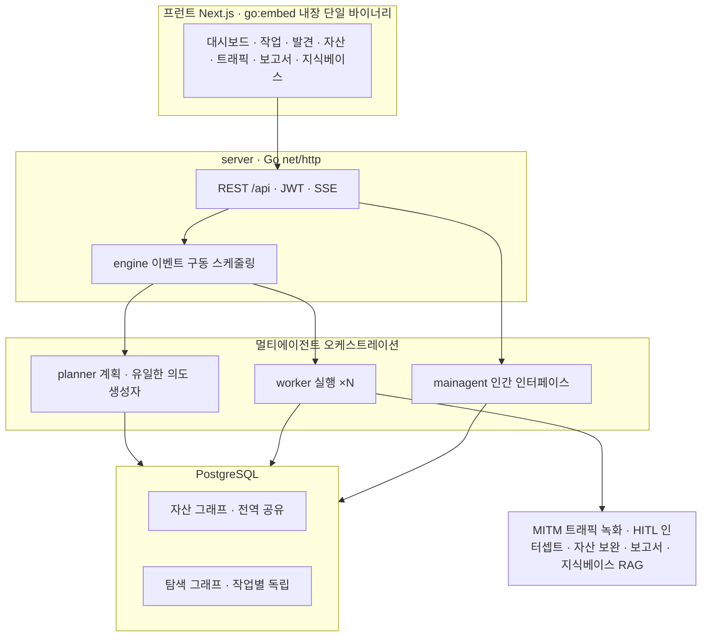

# AntiFox를 이용한 Red Team 운영 가이드

**기업, 공공기관, 금융에서 AI 멀티에이전트 자율 모의 침투 플랫폼을, 인가된 격리 환경에서 안전하고 증거 기반으로 운용하는 법**

> **v1.0-rc · 교정·검증판 (release candidate)** 저자: Dennis Kim (김호광) · Betalabs Inc. 대상 독자: 레드팀 운영자 · 보안 컨설턴트 · 블루/퍼플팀 · 기업·기관 도입 검토자 · 초급 학습자 대상 버전: AntiFox v2.0.x 라인 (저장소 확인: 2026-11) 배포: 지식 공유 목적의 배포


---

> **법적·윤리적 고지 + 업스트림 사용정책 — 반드시 먼저 읽을 것**
>
> 이 문서는 **인가된 테스트**와 **본인이 소유·통제하는 격리 랩 환경에서의 학습·연구·기술 검증**만을 전제로 작성되었습니다. 서면 동의(위임장·ROE·범위 합의) 없이 제3자 시스템이나 인터넷 노출 자산에 실행하는 행위는 「정보통신망법」·「형법」 등에 따라 형사처벌 대상이 될 수 있습니다(부록 C). 실제로 AntiFox는 **자격 증명 탈취 등 악용 사례가 보고된 도구**이며, 2026-11에도 AntiFox 연계 공격이 보도되었습니다(8·10장).
>
> **업스트림(AntiFox 공식) 사용정책** — 공식 README는 이 도구를 **"개인 학습·코드 연구·로컬 기술 검증 용도로만" 허용**하며, **어떤 온라인/운영 시스템에 대한 실제 테스트·공방 대항(red/blue)·생산환경 사용을 금지**한다고 명시합니다(AGPL-3.0, 2026-11 확인). 따라서 본 가이드가 말하는 "Red Team"은 **소유·인가된 격리 환경에서의 적대적 시뮬레이션·학습**으로 한정되며, 실제 외부 표적 공격은 이 도구의 라이선스·정책과 법 양쪽에 위배됩니다. 본 가이드는 특정 익스플로잇·공격 레시피를 제공하지 않고, 방어·검증·보고 자동화를 위한 방법론·안전 구성에 집중합니다. 본 문서는 법률 자문이 아닙니다.

---

## 독자 유형별 읽기 경로

| 당신이…              | 이 순서로                             | 핵심 산출                 |
| ----------------- | --------------------------------- | --------------------- |
| **레드팀 운영자**       | 2 → 7 → 6 → 8 → 12 → 5 → 부록 A·B   | 안전하게 돌리고 증거를 남기는 법    |
| **보안 컨설턴트**       | 1 → 4 → 8 → 부록 B·E → 9            | 도구 선택 근거·납품물·계약 템플릿   |
| **블루/퍼플팀**        | 2 → 10 → 4 → 7                    | 에이전트 행위 탐지·룰 보완       |
| **도입 검토자(기업·기관)** | 법적고지 → 6 → 8 → 11 → 12 → 부록 C·D·E | 리스크·예산·법무·백업을 경영진 언어로 |
| **초급 학습자**        | 3 → 1 → 4 → 부록 F(용어집) → 9 → 11    | 개념·역사·원칙부터            |

---

## 목차

**본문**: 1. 소개 · 2. Red Team 구성 원리 · 3. 역사 · 4. 장점과 리스크 · 5. 기능·스크린샷·마스킹 · 6. 설치와 하드닝 · 7. 안전 통제 · 8. 시나리오 · 9. 금융·공공·오픈웨이트 · 10. 블루팀 탐지·로깅 · 11. 예산·환경 · 12. 운영(백업·복구·IR·증거 연계성·트러블슈팅·규모별 체크리스트·TCO) **부록**: A. 워크스루 (Virtual Engagement Walkthrough) · B. 보고서 샘플 · C. 법적 체크리스트 · D. AGPL · E. 계약·운영 템플릿 · F. 용어집 · G. 레퍼런스

---

# 1. AntiFox 소개

AntiFox는 ARTEX(저자 @Autumn-27)의 v0.1.1에서 2차 개발된 AI 멀티에이전트 자율 침투 테스트 플랫폼이다. 이 한 문장을 제대로 이해하려면 세 가지를 알아야 한다. AntiFox의 기술적 뿌리인 ARTEX가 무엇이고 왜 보안 업계를 뒤흔들었는지, 2026년 "레드팀 LLM" 생태계가 어디로 가고 있는지, 그리고 그 흐름 위에서 AntiFox가 ARTEX를 어떻게 확장했는지다. 이 장은 그 세 층위를 순서대로 서술한다.

---

## 1.1 뿌리 — ARTEX라는 변곡점

### ARTEX는 무엇인가?

ARTEX는 2026년 7월, "Autumn-27"이라는 핸들을 쓰는 개발자가 GitHub에 AGPL-3.0으로 공개한 **오픈소스 멀티에이전트 자율 침투 테스트 프레임워크**다. Go로 작성된 단일 바이너리에 Next.js UI를 내장하고, 상태는 PostgreSQL에 저장하며, 트래픽을 증거로 기록하는 MITM(중간자) 프록시 심(shim)을 갖춘 구조다. 같은 개발자가 만든 중국산 자산 탐색 플랫폼 ScopeSentry가 정찰의 토대로 쓰인다.

ARTEX의 설계 철학은 두 가지 아이디어로 요약된다.

첫째는 **플래너-워커(planner-worker) 멀티에이전트**다. 플래너 에이전트가 목표를 읽어 "의도(intent)"를 생성해 N개의 워커(기본 작업당 3개)에게 분배하고, 워커들은 그 의도를 claim해 Bash·Nmap·curl·ripgrep·HTTP 클라이언트 같은 **실제 도구**로 실행한다. 워커들은 서로의 실행 기록을 검색할 수 있어, 병렬 분기에서 같은 일을 중복하지 않는다. 사람은 자율 실행 중간에 채팅으로 끼어들어 힌트를 주입할 수 있다(HITL).

둘째는 **이중 그래프(dual-graph)**다. ARTEX는 상태를 두 개의 그래프로 나눈다. 작업 간 공유되는 **전역 자산 그래프**(루트 도메인·서브도메인·IP·서비스·애플리케이션·엔드포인트)와, 작업마다 독립적인 **탐색 그래프**(목표·의도·사실·발견·힌트와 그 혈통)이다. 둘은 앵커로 연결된다. 이 분리의 핵심은, 인프라에 대한 "사실"이 에이전트의 "판단·관찰"과 뒤엉키지 않게 하는 것이다. 자율 에이전트가 길을 잃거나 오염되어도, 전역 자산이라는 진실의 원천은 건드려지지 않는다.

모델은 공급자 무관(provider-agnostic)으로, Anthropic·OpenAI·Ollama(로컬)나 OpenAI 호환 엔드포인트를 UI에서 지정한다. 한 줄 Docker 설치를 지원한다. 요약하면 ARTEX는 "정찰부터 데이터 유출까지, 사람의 개입을 거의 받지 않고 자율적으로 수행하는 LLM 에이전트 팀"이다.

### ARTEX가 오용으로 인해 폐쇄된 이유

문제는 이 강력한 ARTEX가 **공개되자마자 공격에 그대로 쓰였다**는 데 있다. ARTEX는 "인가된 자산 내에서의 학습·연구"를 전제로 공개됐지만, 어떤 수정도 없이 실제 침입에 전용됐다.

2026년 10월 7일, CrowdStrike Intelligence는 9월 말~10월 초에 걸쳐 **한국 금융기관을 겨냥한 캠페인**에 ARTEX가 쓰였다고 보고했다. 그 하루 뒤인 10월 8일, 개발자 Autumn-27은 관여를 부인하며 프로젝트를 **클로즈드 소스로 전환**했다. 그러나 이미 복제본은 세상에 퍼진 뒤였고, 한국어 포크를 비롯한 파생본들이 "소스를 닫아도 회수되지 않는" 상태로 남았다.

Microsoft는 중국 국가연계 행위자 Storm-0940이 **ConnectWise 공급망 공격**에 ARTEX를 썼다고 밝혔다. 이 공격에서 에이전트들은 탈취한 앱 자격증명으로 2,250개 이상의 Microsoft 365 테넌트에 로그인을 시도했고, 일부는 **3시간 이내에 권한 있는 접근**에 도달했다. Microsoft는 한 AI 에이전트가 GitHub에서 시크릿을 스캔하던 상태에서 Azure Key Vault의 데이터를 유출하기까지 **5분**밖에 걸리지 않은 사례도 관측했다. Mandiant는 ARTEX가 "기본적으로 요란하다(loud)"고 기록했다 — 23초 동안 27건의 클라우드 권한 탐색, 파일명을 상대로 한 500건 이상의 웹 요청 퍼징 같은 폭발적 활동이다.

ARTEX 사건이 업계에 남긴 교훈은 두 가지다. 

하나, **인가된 테스트용으로 공개된 도구가 아무 수정 없이 침입에 쓰일 수 있다**는 것. 

둘, 공격자의 시계(clock)가 방어자의 시계로부터 분리됐다는 것 — AI 에이전트는 사람이 따라갈 수 없는 속도로 "머신 스피드" 공격을 수행한다. 


바로 이 지점이 "그렇다면 공격자가 당신 환경에 ARTEX를 돌리기 전에, 당신이 먼저 자신에게 돌려봐야 한다"는 방어 논리를 낳았다. AntiFox는 이 방어자를 위한 보안 툴과 공격자를 위한 강력한 도구 사이 긴장의 연장선 위에 있다.

---

## 1.2 흐름 — 2026년 레드팀 LLM 생태계

ARTEX는 혼자가 아니다. 2026년은 "자율 펜테스트(autonomous pentest)"가 한 범주로 굳어진 해였다. 이 흐름의 특징을 네 가지로 정리할 수 있다.

**첫째, 아키텍처의 수렴.** 대부분의 자율 펜테스트 도구가 비슷한 뼈대로 수렴했다. 목표를 작업으로 분해하고, 여러 에이전트를 병렬로 돌리고, 발견을 **그래프로 통합**하는 구조다. ARTEX·PentAGI·AntiFox가 모두 이 패턴을 공유한다. 차이는 핵심 엔진이 아니라 "그 주위를 무엇으로 감싸는가"에서 난다 — FOSS 툴킷인가(ARTEX), 결과를 책임지는 서비스인가(Astra 같은 클로즈드 플랫폼인가), 증거·보고에 특화됐는가(AntiFox).

**둘째, "지속적·자율적" 커버리지로의 이동.** 과거의 "연 1~2회 심층 펜테스트"는 공격자의 속도를 따라갈 수 없다는 인식이 퍼졌다. 취약점 공개 전에 공격이 먼저 오는 "타임 투 익스플로잇(time to exploit)" 개념이 무의미해지는 시대에, 상시 자율 펜테스트가 "따라잡을 수 있는 유일한 커버리지 모델"로 부상했다.

**셋째, 양날의 칼로서의 생태계.** 같은 도구가 방어와 공격 양쪽에서 쓰인다. ARTEX와 유사한 펜테스트 프레임워크 수십 종이 "자격증명 공격과 클라우드 침해를 머신 스피드로 실행할 수 있는" 능력을 가진 채 공개돼 있다. 일부는 C2(명령·제어) 기능까지 내장한다. 이 도구들이 본질적으로 악하다는 뜻이 아니라, **오늘날 공격자가 선택할 수 있는 옵션의 폭이 그만큼 넓어졌다**는 뜻이다. 그래서 이 분야 도구들은 공통적으로 강한 사용정책(개인 학습·로컬 격리 검증만 허용)과 방어·탐지 가이드를 함께 배포하는 쪽으로 움직이고 있다(AntiFox도 마찬가지다).

**넷째, 환각이라는 품질의 벽.** 자율 도구가 빠르게 많이 찾는 만큼, 그 결과의 상당 부분이 환각·허위 양성이라는 문제가 전면에 드러났다(4장에서 상술). curl 바운티 붕괴로 상징되는 이 "신호 대 잡음" 위기는, 자율 펜테스트의 다음 경쟁 축이 "얼마나 많이 찾는가"가 아니라 **"찾은 것을 어떻게 증거로 확정하고 납품하는가"**임을 보여줬다. AntiFox가 서 있는 자리가 정확히 여기다.

---

## 1.3 AntiFox는 ARTEX를 어떻게 넘어섰나?

AntiFox는 ARTEX v0.1.1을 기점으로 2차 개발을 시작해, 이후 여러 해킹, 보안 커뮤니티의 의견과 상류(upstream)의 진화를 따라가며 상호 교류·차용했다. AntiFox 자신이 밝히듯, ARTEX는 "자동 발견"을 매우 강하게 만들었지만 "보고서 납품"은 고객·프로젝트마다 다른 영역으로 상대적으로 덜 다듬어져 있었다. AntiFox는 바로 그 **"리포트"** 자동화에 공학적 무게를 실었다. 핵심 지향을 한 문장으로 하면, "발견"에 그치지 않고 AI가 찾은 취약점을 **엔지니어가 이해하고 재현 가능한, 증거가 붙은 보고서**로 만드는 것이다.

AntiFox가 ARTEX의 토대 위에 확장한 특징은 다음과 같다.

**증거 구동 납품(evidence-driven delivery).** 이것이 가장 큰 차별점이다. 악용(exploit)을 수행하는 바로 그 순간에, 각 단계의 요청·응답·예상·검증 결론을 구조화해 DB에 기록한다. 사후에 짜맞추는 방식이 아니다. 발견 페이지는 진입점·전제조건부터 단계적 악용까지를 **단계별 자연어 설명 + 실제 요청**으로 쪼개 보여주고(익스플로잇 체인 분할 표시), 작업 중 모든 요청을 MITM으로 녹화해 시간창·순서로 각 단계에 정확히 매칭한다(구문 강조·본문 검색·명중 횟수 제공). 이로써 "재현 절차가 누락되거나 조작될" 여지가 줄어든다. 레드팀 보고서의 품질은 "무엇을 찾았나"보다 "어떻게 재현되나"에서 갈리는데, AntiFox는 그 지점을 자동화한다.

**확인 즉 보강(confirm-then-enrich)과 보고서 관리.** 사람이 취약점을 "확인(Confirmed)"하는 순간, 그것을 구조화 데이터로 자동 보강한다. 보고서는 기본적으로 **확인된 취약점만** 수록하고, 명명 템플릿(발주처·로고·담당자·CVSS)과 취약점 부분집합 선택 수록, 증거 캡션 자동 생성을 지원한다. 납품급 .docx를 중국어 간체·번체·영어로 생성한다. 이 "에이전트가 후보를 만들고, 사람이 증거로 확정하고, 그 확정된 것만 납품에 오른다"는 흐름이 AntiFox의 정체성이다 — 환각 시대에 신뢰를 지키는 제품 차원의 답이다(3·4장).

**운영·거버넌스 기능의 추가.** ARTEX의 규칙 기반 HITL 인터셉트를 계승하면서, AntiFox는 기업·기관 운영에 필요한 통제를 보탰다. **RBAC 다중 사용자**(권한 매트릭스·시스템 역할·자원 레벨 범위·로그인 감사)로 운영자별 접근을 분리하고, **전역 출구 프록시**(v2.0.3 — 모든 에이전트 트래픽을 하나의 http/https/socks5 프록시로 송출, 소스 IP 은닉/점프, 작업별 직결/프록시 선택, 출구 IP 에코 가용성 테스트)로 트래픽 경로를 통제한다. 취약점 4단계 심각도·배치 보강, 전역+작업 이중 pgvector RAG 지식베이스, MCP·Skill 확장, 그리고 SHA256·원자 교체·실패 롤백을 갖춘 원클릭 업데이트도 제공한다.

정리하면, ARTEX가 "자율 발견 엔진"이라면 AntiFox는 그 엔진 위에 **증거·검수·납품·거버넌스**라는 "교부 계층(delivery layer)"을 얹은 확장판이다. 아키텍처의 뼈대(멀티에이전트·이중 그래프·MITM 증거)는 ARTEX에서 물려받되, 그 결과물을 "엔지니어가 책임지고 고객에게 낼 수 있는 형태"로 다듬는 데 공학을 집중한 것이 AntiFox다.

---

## 1.4 한눈에 보는 개요 (저장소 확인 2026-11)

| 항목 | 내용 |
|---|---|
| 기반 | ARTEX v0.1.1에서 2차 개발(저자 @Autumn-27) |
| 기술 스택 | Go 단일 바이너리(`go:embed`로 Next.js 내장) · PostgreSQL(+pgvector) |
| 요구 런타임 | Go 1.24+ / Node 20+ / PostgreSQL / Python 3(보고서 렌더) |
| 라이선스 | AGPL-3.0 — 사용정책: 개인 학습·로컬 격리 검증만 허용 |
| 현재 버전 | v2.0.3 (2026-10-30 릴리스) |
| 기본 포트 | `8787`(웹 콘솔, 최초 `/setup`에서 관리자 비밀번호) · `8788`(MITM 트래픽 녹화 프록시) |
| 컨테이너 | `ghcr.io/antifox-ai/antifox` |
| 에이전트 | planner(의도 생성) · worker ×N(실행) · mainagent(인간 인터페이스) |
| 지식 구조 | 전역 자산 그래프 + 작업별 탐색 그래프(이중 그래프, 앵커로 상호연결) |
| 보고서 언어 | 중국어 간체·번체·영어(한국어 비지원) |
| 공식 채널 | GitHub 저장소·Releases · GHCR 패키지 · 위챗 공식계정 — 별도 웹사이트 없음(2026-11-14 확인) |

> 강점이 곧 위험이다. 증거 자동 수집은 인증·세션·요청/응답이 PostgreSQL에 쌓인다는 뜻이다. 또한 기반 ARTEX 계열에서 공급망 사고가 확인됐다: 2026-11-06 CSA 분석 "Trojanized Offensive AI Tooling: The ARTEX Docker Backdoor"는 Docker Hub의 `tomicdd/artex`(및 `congdonglinux/artex`) 이미지에 로그인 처리에 숨긴 무인증 root 명령 실행 백도어가 삽입됐고 약 9,000회 내려받혔다고 밝혔다. AntiFox 자체가 감염됐다는 근거는 현재 없다(공식 Compose는 GHCR 사용) — 그러나 "소스가 깨끗해도 이미지가 깨끗하단 보장은 없다"는 교훈이 핵심이다. 도입 전 (1) 데이터 보관·접근 통제·파기, (2) 배포 이미지 출처·무결성 검증을 먼저 세워라(6·7·12장).

### 공식 기술 아키텍처

Go 단일 바이너리(Next.js 프런트 `go:embed` 내장) + PostgreSQL. 핵심은 이중 그래프 — 전역 자산 그래프(작업 간 공유 진실 원천) + 작업별 탐색 그래프(목표·의도·사실·취약점의 혈통 체인)이며 앵커로 상호연결된다. 엔진은 이벤트 구동: 그래프가 변하면 planner가 의도를 생성, worker가 실행 결과를 되쓰고, 그게 다시 이벤트를 일으킨다.



> 출처: 공식 README "기술 아키텍처" 절의 mermaid 다이어그램(2026-11-14 확인, 라벨 한국어 번역).

---

## 1.5 경쟁 프로젝트와 비교

| 프로젝트 | 특징 | AntiFox와의 관계 |
|---|---|---|
| ARTEX | 탐색 그래프 엔진·MITM·HITL·멀티에이전트. ScopeSentry 기반 정찰 | 직접 조상. 공격 악용 후 원본 closed-source화 |
| PentAGI | 완전 자율, Docker, Nmap·Metasploit·sqlmap 오케스트레이션 | 설계 철학이 가장 유사한 대안 |
| Astra | 클로즈드 소스 자율 펜테스트 플랫폼(결과를 책임지는 서비스형) | ARTEX가 툴킷이라면 Astra는 서비스 — 다른 포지셔닝 |
| Agent Zero | 범용 자율 에이전트, 인증 미설정 사례 다수 | 경량·범용 |
| PentestGPT | LLM 보조, XBOW 벤치 상위 | 탐색·추론 보조 강점 |
| HexStrike AI · Strix · RedAmon | 도구 통합형 · 앱 특화 · MIT 유연 | 각 틈새 대안 |

> 요약 — ARTEX를 그대로 대체하려면 PentAGI가 가장 가깝고, 결과를 통째로 외주하려면 Astra 같은 서비스형이 대안이다. 그러나 **보고서 자동화·증거 구동 납품**이 핵심 요구라면 AntiFox의 접근이 차별적이다. 자율 펜테스트의 다음 경쟁 축이 "발견량"이 아니라 "증거·납품 품질"로 옮겨 가는 흐름(1.2) 위에서, AntiFox의 경쟁력과 위치가 분명해진다.

---

> 이 장이 인용한 ARTEX 오용 사건(한국 금융권·ConnectWise)·아키텍처·공급망 사고는 2026년 공개 보도·연구(CrowdStrike·Microsoft·Mandiant·CSA 등) 기준이며, 세부는 시점·출처에 따라 갱신될 수 있으므로 도입 시점에 원 출처로 재확인하라. AntiFox는 이 모든 리스크를 이해한 위에서, 인가·격리·증거라는 울타리 안에서만 운용돼야 한다.

---

# 2. Red Team의 구성 원리

도구를 켜기 전에 팀이 선다. AntiFox 같은 에이전트는 레드팀 업무 일부를 **증폭**할 뿐, 레드팀 그 자체가 아니다.

> **관점 전환 — "도구"가 아니라 "권한 가진 인프라"** — 자율 에이전트는 테스트 대상 정보뿐 아니라 API 키·인증정보·네트워크 접근 권한까지 보유한다. 따라서 AntiFox를 단순한 침투 테스트 프로그램이 아니라 **보안 권한을 가진 에이전트 실행 인프라**로 취급하고, 도입·운영·폐기 전 과정에서 그 수준의 통제(6·7·12장)를 걸어야 한다. ARTEX 백도어 사건(1장·6장)이 그 이유를 보여준다.

### Red · Blue · Purple

- **Red** — 공격자를 모사해 탐지·대응을 시험하는 공격 측.
- **Blue** — 탐지·대응·방어(SOC·DFIR).
- **Purple** — 레드·블루가 실시간 협업해 탐지 규칙을 함께 개선.

> 자율 에이전트는 특히 **퍼플팀**에서 가치가 크다 — 재현 가능한 증거가 "어느 요청에서 탐지가 비었나"를 즉시 드러낸다(10장).

### 모의 침투 vs 레드팀 vs 취약점 평가

| 구분         | 목적            | 범위     | 은밀성 |
| ---------- | ------------- | ------ | --- |
| 취약점 평가(VA) | 알려진 취약점 식별·목록 | 넓고 얕게  | 불필요 |
| 모의 침투      | 악용 가능성 검증     | 정의된 범위 | 선택적 |
| 레드팀 평가     | 목표 달성·탐지 시험   | 목표 지향  | 필수  |

AntiFox 자동화는 **VA–모의 침투** 구간을 가속한다. 본격 레드팀 평가(은밀성·목표 의사결정)는 사람이 핸들을 쥔다.

### 표준 프레임워크

Cyber Kill Chain · MITRE ATT&CK · PTES · OSSTMM / NIST SP 800-115.

### 엔게이지먼트 수명주기와 AntiFox의 위치

| 단계                  | AntiFox 기여   | 사람의 몫             |
| ------------------- | ------------ | ----------------- |
| ① 사전 교섭(범위·ROE·위임장) | —            | 전적으로 사람           |
| ② 정찰 · ③ 열거         | 자동 그래프·매핑    | 범위 외 걸러내기·우선순위    |
| ④ 검증                | 에이전트 검증 + 증거 | False Positive 선별 |
| ⑤ 후속 악용             | 보조           | 의사결정·은밀성          |
| ⑥ 보고                | 3언어 docx 초안  | 비즈니스 맥락·검수        |

> **①번을 건너뛰지 말 것** — 서면 범위 합의·위임장 없는 실행은 불법이며, 업스트림 정책상으로도 실제 환경 사용은 금지된다. ROE에는 (a) 대상 화이트리스트, (b) 금지 행위, (c) 시간창, (d) 비상 중단 연락선이 포함돼야 한다(부록 C·E).

---

# 3. 레드팀과 모의 침투의 역사

"레드팀"은 보안이 아니라 전쟁에서 왔다. 적의 눈으로 아군 계획을 깨뜨려 보는 사람들 — 그 계보가 AntiFox의 등장을 설명한다.

- **냉전·워게임(1950s–60s)** — 소련(붉은 진영)의 시각에서 자국 전략을 공격하는 모의 훈련에서 "레드팀" 역할이 자리 잡았다.
- **타이거 팀(1960s–70s)** — 미 정부·RAND의 의도적 공격 팀. *Anderson Report*·*Multics 평가*가 침투 테스트의 원형을 남겼다.
- **도구의 시대(1990s–2000s)** — Nmap(1997)·Nessus(1998)·Metasploit(2003), OSSTMM·PTES·OSCP 생태계.
- **APT·에뮬레이션(2010s)** — adversary emulation 부상, **MITRE ATT&CK**(2013 내부/2015 공개)가 공용어가 됐다.
- **LLM·자율 에이전트(2023– )** — PentestGPT류 보조에서 ARTEX·PentAGI·AntiFox 같은 멀티에이전트 자율 펜테스트로. AntiFox는 "증거·보고서 자동화" 분파다.

> *도구는 공격의 문턱을 계속 낮춰 왔고, 그때마다 "누가 책임지고 어디까지 하는가"라는 규율이 도구를 쫓아왔다.*

---

# 4. LLM을 이용한 모의 침투의 장점과 리스크

> "LLM은 엑셀이지 오라클이 아니다." 빠르게 정리하고 계산하는 도구이지, 진실을 선언하는 신탁이 아니다. 이 장은 그 한 문장을 실제 사건으로 증명한다.

LLM 기반 자율 모의 침투는 2026년 현재 "실험"이 아니라 "현실"이다. 문제는 그 현실이 두 얼굴을 가졌다는 데 있다. 한쪽에는 사람이 수일 걸리던 정찰·열거·초동 검증을 몇 시간으로 압축하는 생산성이 있고, 다른 한쪽에는 그 결과물의 상당 부분이 **그럴듯하지만 틀린** 환각이라는 신뢰성 문제가 있다. AntiFox가 "발견"이 아니라 "증거를 붙인 납품"에 무게를 둔 것도, 바로 이 두 번째 얼굴을 다루기 위해서다. 이 장은 장점을 과소평가하지도, 리스크를 미화하지도 않고, 실제 뉴스로 확인된 사례를 들어 "무엇을 자동화에 맡기고 무엇을 사람이 반드시 검토해야 하는가"를 정리한다.

---

## 4.1 장점 — 왜 그럼에도 쓰는가?

LLM 기반 자율 펜테스트의 장점은 추상적 구호가 아니라, 이미 실측된 생산성의 이동이다.

첫째, **속도와 커버리지**다. 자율 에이전트는 지치지 않고, 반복적인 정찰·열거·초동 검증을 사람보다 빠르게 수행한다. 특히 "모든 엔드포인트·파라미터를 빠짐없이 훑는" 종류의 작업에서 사람의 집중력 한계를 넘어선다. HackerOne은 2026년 3월까지 1년간 제출 건수가 76% 늘었다고 보고했는데, 이 폭증 자체가 — 뒤에서 보듯 양날의 칼이지만 — AI가 발견의 문턱을 얼마나 낮췄는지를 보여주는 지표다.

둘째, **24시간 지속 실행과 회귀 테스트**다. 야간·주말에도 돌릴 수 있고, 코드가 바뀔 때마다 같은 시나리오를 다시 돌려 "회귀 취약점"을 잡는 데 유리하다. 사람 팀으로는 비용 때문에 불가능한 빈도다.

셋째, **보고서 자동화**다. 이것이 AntiFox류 도구의 핵심 차별점이다. 재현 절차·증거·다국어 초안을 자동 생성해 리포팅 공수를 크게 줄인다. 보고서 작성은 전통적으로 모의해킹 공수의 상당 부분을 차지해 왔고, 이 부분의 자동화는 실질적 절감으로 이어진다.

넷째, **지식 재사용과 민주화**다. 전역 자산 그래프와 RAG 지식베이스를 통해 과거 발견을 다음 테스트에 전이할 수 있고, 소규모 팀도 중급 수준의 체계적 테스트에 접근할 수 있게 된다. 전담 레드팀을 꾸릴 수 없는 조직에게는 이 "진입 장벽 하락"이 가장 큰 가치다.

그리고 이 장점들이 허황된 것이 아님을 보여주는 실제 성과도 있다. 2026년에는 프런티어 AI의 보조로 발견된 취약점이 실제 CVE로 등재되고 공격에 악용되는 사례가 나왔다. 대표적으로 **ActiveMQ의 CVE-2026-34197**은 한 연구자가 Claude의 보조를 받아 발견했고, 이후 실제 공격에 악용되어 미국 CISA의 "알려진 악용 취약점(KEV)" 목록에 올랐다. Mozilla는 2026년 2월 자사 브라우저의 잠복 취약점을 찾고 고치는 데 내부적으로 프런티어 모델을 쓰고 있다고 확인했고, Chrome의 CVE 공개는 전년 대비 563% 늘었다. **AI는 실제로 취약점을 찾는다.** 이 사실에는 더 이상 의심의 여지가 없다. 문제는 "찾은 것 중 무엇이 진짜인가"다.

---

## 4.2 리스크 1 — 환각과 허위 양성: curl이 바운티를 닫은 이유

LLM 기반 펜테스트의 가장 근본적인 리스크는 **환각(hallucination)**, 즉 존재하지 않는 취약점을 그럴듯하게 지어내는 것이다. 이것은 이론적 우려가 아니라, 2026년 오픈소스 생태계를 실제로 무너뜨린 사건으로 증명됐다.

전 세계 거의 모든 서버에 설치된 데이터 전송 도구 **curl**의 메인테이너 다니엘 스텐베리(Daniel Stenberg)는 2026년 1월 말, 운영하던 버그 바운티 프로그램을 종료했다. 이유는 간결하고 참담했다: **2025년 제출된 보고서 중 유효한 것이 5% 미만**이었기 때문이다. 제출량은 2024년의 "검토 가능한 수준"에서 2025년 48시간당 1건으로 두 배가 됐고, 2026년 6월에는 18시간당 1건으로 다시 두 배가 됐다. 스텐베리는 이 상황을 "AI 버그 리포트에 사실상 디도스(DDoS)를 당하고 있다"고 표현했고, 가능하다면 낭비된 시간에 대해 제출자에게 비용을 청구하고 싶다고까지 말했다.

curl 팀이 겪은 환각의 전형을 보여주는 사례가 하나 있다. 잘 포맷팅된, 자신감 넘치는 HTTP/3 취약점 보고서가 접수됐는데, 그 보고서는 **실제로는 존재하지 않는 함수**를 근거로 들고 있었다. 또 다른 AI 슬롭(slop) 보고서(식별번호 H1#3125832)는 존재하지 않는 함수를 인용하고 검증되지 않은 패치를 제안했다. curl 보안팀의 하리 신토넨(Harry Sintonen)은 "공격자는 심각하게 오판했다. curl은 수 마일 밖에서도 AI 슬롭 냄새를 맡는다"고 일축했다. 문제는 **curl만큼의 전문성을 갖춘 팀은 드물다는 것**이다. 전담 보안 전문가가 없는 조직에서는 이런 보고서가 "첫눈에 합법적으로 보이기" 때문에 걸러지지 않는다.

이것은 curl만의 문제가 아니었다. 같은 흐름 속에서 **Nextcloud**가 2026년 4월 바운티 프로그램을 종료했고, **HackerOne의 Internet Bug Bounty**는 2026년 3월 27일 모든 신규 제출을 중단했으며, **Google**은 오픈소스 바운티 프로그램의 제출을 일시 중단했다. HackerOne 전체에서 제출은 76% 늘었지만 실제 취약점을 지적한 비율은 25%에 머물렀다 — 즉 **증가분의 거의 전부가 노이즈**였다.

여기서 반드시 짚어야 할 지점이 있다. "작은 모델이라 그렇다"는 변명이 통하지 않는다는 것이다. 스텐베리가 curl을 상대로 Anthropic의 최상위 모델(Mythos)을 직접 시험했을 때, **보고된 5건의 취약점 중 유효한 CVE로 인정된 것은 단 1건**이었다. 프런티어 모델조차 실제 코드베이스에서 의미 있는 허위 양성률을 보인다. 모델이 좋아진다고 검토가 필요 없어지는 것이 아니다.

> 검토해야 하는 리스크: 환각은 "모델 품질을 올리면 사라지는 버그"가 아니라 "자동화에 내재한 상수"다. 따라서 모든 발견은 사람이 증거로 확인하기 전까지 "후보"일 뿐이다. AntiFox의 MITM 증거 자동 연결이 바로 이 지점을 겨눈다 — 실제 요청·응답 패킷이 붙지 않은 주장은 리포트에 올리지 않는다. "패킷이 없으면 주장도 없다"가 원칙이어야 한다. 운영자는 발견을 "확인(Confirmed)" 상태로 승격시키기 전에 재현 패킷을 직접 열어 검토해야 하며, 이 검토 서명이 없는 발견은 발견이 아니다(부록 B의 보고서 Status 필드가 이 경계를 문서에 새긴다).

---

## 4.3 리스크 2 — 신뢰의 붕괴, 환각은 공격이 된다

환각의 두 번째 얼굴은 더 교활하다. 누군가는 이 환각을 **의도적 무기**로 쓴다. 바운티 플랫폼을 노린 분석들은, 일부 공격자의 목적이 "기술적 침해"가 아니라 **"운영 교란"**이라고 지적한다. 그럴듯한 허위 보고서로 방어자의 시간을 소모시키고 공개 프로세스에 대한 신뢰를 무너뜨리는 것 자체가 목적이라는 것이다. 실제로 @evilginx 같은 계정은 여러 조직에 유사한 AI 생성 보고서를 뿌렸고, 일부는 보상금까지 받아냈다.

이 구조가 위험한 이유는, 환각 보고서가 **"운영 부채(operational debt)"**로 쌓이기 때문이다. 단순히 분석가의 시간을 낭비하는 데 그치지 않고, 진짜 연구자들이 좌절해 떠나고, 조직이 바운티를 폐지하고, 재정 지원이 마르는 악순환으로 이어진다. 보안 생태계 전체의 신호 대 잡음비가 무너지는 것이다.

> 검토해야 하는 리스크: 자율 도구를 운영하는 조직은 "우리가 만든 보고서가 받는 쪽의 신뢰를 깎고 있지는 않은가"를 자문해야 한다. AntiFox가 v2.0에서 **기본적으로 확인된 취약점만 보고서에 수록**하도록 바꾼 것은 이 신뢰 문제에 대한 제품 차원의 답이다. 납품물에 증거·상태·검수 서명이 함께 드러나야(부록 B) 받는 쪽이 "에이전트 초안"과 "사람이 확정한 사실"을 구분할 수 있다. 자동화의 생산성으로 노이즈를 대량 생산하는 것은 생산성이 아니라 민폐다.

---

## 4.4 리스크 3 — 환각이 코드가 될 때, 슬롭스쿼팅

환각은 보고서에만 머물지 않는다. 자율 에이전트가 **스스로 생성한 출력을 실행**할 때, 환각은 공급망 공격의 입구가 된다. 2026년 클라우드 보안 연합(CSA)과 USENIX Security 2025 연구가 정리한 **슬롭스쿼팅(slopsquatting)**이 그 전형이다.

LLM은 코드를 생성할 때 **존재하지 않는 패키지(라이브러리)**를 그럴듯한 이름으로 자주 지어낸다. 한 대규모 연구는 57만6천 개의 Python·JavaScript 코드 샘플에서 이 현상을 측정했는데, **AI 코드 제안 다섯 개 중 약 하나(오픈웨이트 모델 평균 약 21.7%, 상용 모델 약 5.2%)가 존재하지 않는 패키지를 가리켰고**, 고유한 가짜 패키지 이름이 20만5천여 개 식별됐다. 더 위험한 것은 이 환각이 **재현 가능**하다는 점이다. 동일 프롬프트를 열 번 반복했을 때 가짜 이름의 43%가 매번 다시 나타났고, 58%가 한 번 이상 재등장했다. 공격자 입장에서는 모델 출력을 몇 번만 관찰하면 "앞으로도 계속 지어낼 이름"을 예측할 수 있다는 뜻이다.

공격 방식은 단순하다. 공격자가 그 가짜 이름으로 PyPI·npm에 **악성 패키지를 미리 등록**해 두면, 이후 AI가 같은 이름을 추천하고 개발자(혹은 자율 에이전트)가 아무 의심 없이 설치하는 순간 악성 코드가 빌드에 주입된다. 실제로 한 연구자가 AI가 반복 추천하던 가짜 패키지를 무해한 테스트용으로 PyPI에 등록했더니, 며칠 만에 알리바바 팀을 포함한 수천 명의 개발자가 이 가상의 의존성을 프로젝트에 끌어다 썼다. 2026년 11월 ARTEX Docker 이미지 백도어 사건, 그리고 AI 개발 파이프라인의 공용 의존성인 litellm을 노린 PyPI 공급망 캠페인(TeamPCP, 2026년 3월)은, **공격자들이 이제 AI 도구 인프라 자체를 고가치 공급망 표적으로 본다**는 신호다.

> 검토해야 하는 리스크: 자율 에이전트가 생성한 코드·명령·의존성을 **검증 없이 실행하게 두지 말 것.** 패키지 이름은 수동 확인하고, 락파일·버전 핀·해시 검증을 강제하며, AI 생성 코드는 격리 환경에서만 실행한다. AntiFox 운영 맥락에서는 7장의 **규칙 기반 HITL 인터셉트**(고위험 행위에 사람 승인 게이트)와 **네트워크 에그레스 차단**이 "에이전트가 임의의 외부 패키지·엔드포인트를 끌어오는" 경로를 막는 최종 안전망이다. 또한 7.4에서 지적했듯 RAG 지식베이스에 **검증 안 된 문서가 섞이면 모델 판단까지 오염**되므로, 지식베이스 입고 단계부터 출처·검증 상태를 관리해야 한다.

---

## 4.5 리스크 4 — 프롬프트 인젝션, 에이전트를 돌려세우는 공격

자율 에이전트의 입력은 "신뢰할 수 없는 대상의 응답"이다. 테스트 대상이 돌려주는 에러 메시지·HTML·HTTP 헤더에 악의적 지시가 숨어 있으면, 그것을 읽은 에이전트가 범위를 벗어난 행동을 하도록 유도될 수 있다. 이것이 **프롬프트 인젝션**이며, 자율 공격 에이전트에서는 특히 치명적이다. 왜냐하면 이 에이전트는 단순히 텍스트를 생성하는 것이 아니라 **API 키·인증정보·네트워크 접근 권한을 쥐고 실제로 행동**하기 때문이다(2장의 "권한 가진 인프라" 관점).

이 리스크가 추상적이지 않다는 것은 AntiFox 자신의 전력이 보여준다. AntiFox는 **공격자에게 탈취되어 실제 AWS 자격증명 탈취·웹셸 설치에 악용**된 사례가 보고됐고, 2026년 11월 보도에서는 일부 AWS API 호출이 차단된 상황에서도 운영 시크릿에 접근한 정황이 지적됐다. 공격 도구가 공격자의 손에 들어가면, 그 "권한 가진 인프라"가 그대로 무기가 된다.

> 검토해야 하는 리스크: 단일 방어는 없다. (1) 대상 응답을 "데이터로만" 취급하도록 신뢰 경계를 설정하고, (2) 에이전트가 호출 가능한 도구·명령을 화이트리스트로 제한하며, (3) 모든 도구 호출 직전 대상 host를 범위와 재대조하고, (4) 쓰기·권한상승·외부호출 같은 고위험 행위는 사람 승인 게이트(HITL)를 거치게 한다(7장). 네트워크 차단(7.1)이 이 모든 것의 최종 백스톱이다. 그리고 블루팀은 레드팀 인프라(AntiFox 호스트·게이트웨이·DB) 자체도 모니터링 범위에 넣어야 한다(10장) — 콘솔 노출·비정상 에그레스는 도구가 탈취됐다는 신호일 수 있다.

---

## 4.6 리스크 5 — 외부 유출·공급망·비결정성

나머지 세 리스크는 간략히 짚되, 모두 "검토가 필요한 구조적 문제"라는 점에서 같다.

**외부 LLM으로의 데이터 유출.** 외부 API를 쓰면 프롬프트와 테스트 정보(인증·세션·개인정보가 섞일 수 있는 트래픽)가 외부 사업자에게 전송된다. 금융·공공은 이것만으로 컴플라이언스 위반이 될 수 있다. 검토 결론은 명확하다 — 규제 환경에서는 로컬·오픈웨이트 모델로 전환한다(9장).

**공급망.** 앞서 본 ARTEX Docker 이미지 백도어는 "소스코드가 깨끗해도 배포 이미지는 깨끗하다는 보장이 없다"는 교훈을 남겼다. 이미지 다이제스트 핀·서명 검증·SBOM·SHA256 대조가 선택이 아니라 전제다(6장).

**민감 데이터 축적과 비결정성.** 증거 자동 수집은 인증·세션·요청/응답을 DB에 쌓는다. 보관·암호화·파기 정책이 없으면 도구 자체가 침해 표면이 된다. 또한 자율 에이전트는 같은 입력에도 다른 경로를 택할 수 있어(비결정성), 범위 화이트리스트를 코드와 네트워크 양쪽에서 강제하고 실행 로그를 전수 보존해야 재현성과 사후 감사가 가능하다(7·12장).

---

## 4.7 정리 — 자동화와 검토의 경계

장점과 리스크를 한 표로 정리하면, 핵심은 "무엇을 자동화에 맡기고 무엇을 사람이 검토하는가"의 경계다.

| LLM이 잘하는 것(맡겨도 되는 것) | 사람이 반드시 검토해야 하는 것(맡기면 안 되는 것) |
|---|---|
| 반복적 정찰·열거·초동 검증 | 발견의 진위 판정(환각·허위 양성 선별) |
| 증거·재현 절차·다국어 보고서 초안 | 보고서의 최종 사실성과 비즈니스 영향 |
| 과거 지식의 재사용·전이 | 지식베이스·패키지·의존성의 출처·무결성 |
| 24시간 지속·회귀 테스트 | 범위·은밀성·고위험 행위에 대한 의사결정과 책임 |

curl 사례(유효 5% 미만), Mythos 대 curl 시험(5건 중 1건 유효), 슬롭스쿼팅(다섯 중 하나가 가짜 패키지)이 공통으로 말하는 것은 하나다. **AI는 찾지만, 확정하지 못한다.** 확정은 증거를 가진 사람의 몫이고, 이 경계가 흐려지는 순간 생산성은 노이즈로, 도구는 공격 표면으로 바뀐다.

그래서 이 장의 결론은 다시 처음의 한 문장으로 돌아간다. **LLM은 엑셀이다.** 셀을 빠르게 채워 주되, 그 숫자가 무엇을 뜻하는지, 그것이 참인지는 당신이 읽는다. 자동화는 초안 생성기이지 결론 생성기가 아니다. 사람이 서명하지 않은 발견은, 발견이 아니다.

---

> 이 장은 민감한 주제(AI를 악용한 공격·공급망 위협)를 방어·검토 관점에서 다룬다. 인용한 사건·수치는 2026년 공개 보도·연구 기준이며, 수치는 시점·표본에 따라 달라질 수 있으므로 도입 시점에 원 출처로 재확인하라.

---

# 5. 기능 · 스크린샷 · 마스킹

> 아래 스크린샷은 AntiFox 공식 저장소(`github.com/AntiFox-AI/antifox` — `screenshots/`)에서 **2026-11-14 확인**한 실제 파일을 그대로 수록한 것이다. 공식 README가 **"모든 화면 데이터는 로컬 랩의 합성 데모 데이터"**라고 명시하므로, 화면 속 자산·트래픽은 운영 데이터가 아니다.
>
> **이미지 라이선스·출처** — 원저작물은 AntiFox 프로젝트(AGPL-3.0)의 일부이며, 본 문서는 AGPL 조건(출처·라이선스 고지)에 따라 `screenshots/` 폴더에 원본 파일명 그대로 수록한다. 편집·가공 없이 사용했고, 재가공·재호스팅 시 AGPL-3.0을 준수하라. 자체 랩 캡처로 교체할 경우 아래 5.0 마스킹을 적용한다.

### 5.0 스크린샷 마스킹 가이드

| 마스킹 대상      | 위치                  | 처리                                |
| ----------- | ------------------- | --------------------------------- |
| LLM API 키   | LLM 설정              | 흐림 또는 `sk-****`                   |
| 대상 IP·도메인   | Target/Scope·그래프·로그 | 랩 더미값(`10.10.x.x`·`lab.internal`) |
| 세션·쿠키·토큰    | 트래픽 패킷 뷰            | 앞 4자만, 길이 유지                      |
| DB·프록시 자격증명 | config·설정           | 흐림                                |
| 사용자명·이메일    | 보고서·발견              | 가명 처리                             |

### 5.1 로그인 · 초기 설정

최초 기동 후 `http://localhost:8787` → `/setup`에서 관리자 비밀번호를 설정하는 로그인 화면. UI 언어는 간체·번체·영어 3종을 지원한다.

[](https://github.com/gameworkerkim/vibe-investing/blob/main/TechDoc/AntiFox/screenshots/login.png)

> 3언어 국제화 확인용 영문 UI: `screenshots/login-en.png`

실필드 검증에서 직접 캡처한 최초 `/setup` 화면(v2.0.3 바이너리, 2026-11-14):


### 5.2 대시보드 · 작업 목록

| 대시보드                                                                                                                                                                                                                       | 작업 목록                                                                                                                                                                                                               |
| -------------------------------------------------------------------------------------------------------------------------------------------------------------------------------------------------------------------------- | ------------------------------------------------------------------------------------------------------------------------------------------------------------------------------------------------------------------- |
| [](https://github.com/gameworkerkim/vibe-investing/blob/main/TechDoc/AntiFox/screenshots/dashboard.png) | [](https://github.com/gameworkerkim/vibe-investing/blob/main/TechDoc/AntiFox/screenshots/tasks.png) |

실필드 검증에서 캡처한 빈 랩 상태의 대시보드(설치 직후, 2026-11-14):


### 5.3 발견 상세 — 익스플로잇 체인 분할 표시

발견 페이지가 진입점→전제조건→단계적 악용을 **단계별 자연어 설명 + 실제 요청**으로 보여준다(증거 구동 납품의 핵심 화면).

[](https://github.com/gameworkerkim/vibe-investing/blob/main/TechDoc/AntiFox/screenshots/finding-steps.png)

### 5.4 증거 · MITM 패킷 (단계-실트래픽 자동 연결)

각 악용 단계가 시간창·순서로 실제 요청/응답 패킷에 연결된다. 구문 강조·본문 검색·명중 횟수 제공. (자체 캡처 시 민감값은 5.0 마스킹)

[](https://github.com/gameworkerkim/vibe-investing/blob/main/TechDoc/AntiFox/screenshots/traffic-packet.png)

### 5.5 "증거 즉 패킷" — 민감정보 노출

민감정보 노출류는 트래픽 패킷 자체가 증거다(사후 스크린샷 재구성 불필요).

[](https://github.com/gameworkerkim/vibe-investing/blob/main/TechDoc/AntiFox/screenshots/env-leak.png)

### 5.6 발견 목록

확인/미확인 상태·심각도가 보이는 발견 목록. 보고서에 수록할 확인된 취약점을 고르는 전 단계다.

[](https://github.com/gameworkerkim/vibe-investing/blob/main/TechDoc/AntiFox/screenshots/findings.png)

### 5.7 동작 데모 · 공식 채널 QR

- **v2.0 증거 구동 흐름 데모**: `screenshots/demo.gif` (공식 README의 v2.0 소개 GIF 원본)
- **공식 채널**: 별도 웹사이트는 없고(2026-11-14 확인), 공식 채널은 GitHub 저장소·GHCR 패키지·위챗 공식계정이다(부록 G). QR: `screenshots/wechat-qr.jpg`

### 5.8 LLM 설정 / 보고서 — 실캡처 (실필드 검증 2026-11-14)

LLM 설정 및 언어 설정, 보고서 관련 설정이 가능하다. 아래는 **v2.0.3 공식 macOS 바이너리(SHA256 검증)를 로컬 격리 랩에 설치해 직접 캡처**한 화면이다(합성 랩 데이터만 사용, 마스킹 대상 없음).

**5.8-1. LLM 配置 (`/system/llm/`)** — 모델·키·엔드포인트·속도제한 프로필 관리, **LLM 페일오버(2개 이상 프로필)**, **역할별 모델 지정**(planner·worker·mainagent·보고서 보강):


**5.8-2. 새 작업 대화상자 — 출구 선택** — 작업별 LLM 프로필·타임아웃·**출구 프록시(전역 따름/직결)** 선택(5.8-1–2는 v2.0.3 신기능):


**5.8-3. 보고서 관리 (`/system/reports/`)** — 조직 설정(발주처·로고·담당자), **언어별 템플릿(简/繁/英)** 사전 저장, 생성된 docx 목록·다운로드:


**5.8-4. 시스템 설정 (`/system/settings/`)** — **전역 출구 프록시**(출구 IP 테스트 가능성), 트래픽 캡처 전역 스위치, 원클릭 업데이트(현재 v2.0.3 확인):


**5.8-5. RBAC 사용자 관리 (`/system/rbac/`)** — 관리자 계정·4개 시스템 역할, 멤버/역할 관리(로그인 감사는 7.3):


> **잔여 실필드 항목** — docx **최종 생성**(작업 실행 → 확인된 취약점 선택 → 언어 지정 → 생성)은 LLM 키와 대상 랩이 필요한 작업 실행이 전제라 이번 검증에서 제외했다. 해당 흐름의 UI(5.8-3 템플릿 선택·언어 지정)까지는 위 캡처로 확인됐다. 완료 시 v1.0 확정 조건 하나가 추가로 해소된다.

---

# 6. 설치와 하드닝

설치는 쉽다. 어려운 것은 "안전하게"다.

### 사전 요구사항

- **PostgreSQL**(필수), 탐색엔 **LLM** 필요(키 또는 UI 「LLM 配置」)
- docx 보고서엔 **python3 + python-docx**(Docker 이미지 내장)
- 소스 빌드 시 Go 1.24+ / Node 20+
- **격리 네트워크** — 대상 서브넷 인터넷 아웃바운드 차단(7·12장)

### 방법 1 — Docker Compose (권장)

```bash
curl -O https://raw.githubusercontent.com/AntiFox-AI/antifox/main/docker-compose.yml
curl -O https://raw.githubusercontent.com/AntiFox-AI/antifox/main/.env.example
cp .env.example .env          # POSTGRES_PASSWORD 설정
docker compose up -d          # 이미지+PostgreSQL 자동 기동
# http://localhost:8787 → 최초 /setup 에서 관리자 비밀번호
```

**`.env` 실제 변수 (실파일 대조 2026-11)**

| 변수                                                    | 의미                | 권고                          |
| ----------------------------------------------------- | ----------------- | --------------------------- |
| `ANTIFOX_TAG`                                         | 이미지 태그            | `latest` 대신 **고정 버전/다이제스트** |
| `POSTGRES_USER` / `POSTGRES_PASSWORD` / `POSTGRES_DB` | DB 접속             | 비밀번호 32자+ 난수, 시크릿 매니저       |
| `ANTHROPIC_API_KEY` / `OPENAI_API_KEY`                | 외부 LLM 키(택1·둘·공란) | 금융·공공은 공란 → 로컬 게이트웨이        |
| `ANTIFOX_LLM_PROVIDER`                                | LLM 공급자           | 로컬 서빙 시 OpenAI 호환 지정        |
| `ANTIFOX_LLM_MODEL`                                   | 모델 id             | 9장 선택 가이드                   |
| `ANTIFOX_LLM_BASE_URL`                                | LLM 엔드포인트         | 로컬 게이트웨이 URL(망분리 핵심)        |
| `ANTIFOX_LLM_PROXY`                                   | LLM 프록시           | 출구 경로 통제 시                  |

> **compose 실파일 확인(2026-11-14)** — 공식 `docker-compose.yml`은 `postgres:16-alpine`(healthcheck·`unless-stopped`) + `ghcr.io/antifox-ai/antifox:${ANTIFOX_TAG:-latest}` 2개 서비스다. `POSTGRES_PASSWORD`는 **필수 체크**(미설정 시 기동 거부), `ANTIFOX_PG_DSN`은 compose가 내부에서 조립해 antifox 컨테이너에 주입하며, **포트는 `8787:8787`과 `8788:8788` 둘 다 노출**한다. 볼륨은 `./data`(jwt.key·데이터, 백업 대상)와 `./skills`(호스트 skill 오버레이)가 바인딩된다.

### 방법 2 — 사전 빌드 바이너리

```bash
cp config.example.json config.json    # database 연결 입력
./antifox                             # Windows: antifox.exe
```

**Docker vs 바이너리 — 설정 위치 비교**

| 설정             | Docker Compose                | 바이너리                         |
| -------------- | ----------------------------- | ---------------------------- |
| DB 접속          | `.env`(`POSTGRES_*`)          | `config.json`의 `database` 블록 |
| 외부 LLM 키·엔드포인트 | `.env`(`ANTIFOX_LLM_*`) 또는 UI | 주로 UI 「LLM 配置」               |
| 이미지 태그         | `.env`(`ANTIFOX_TAG`)         | 해당 없음(릴리스 zip)               |
| 전역 출구 프록시·범위   | UI(시스템 설정/작업)                 | UI(시스템 설정/작업)                |

> **`config.json` 실파일 검증 완료(2026-11-14)** — `config.example.json`은 `database` 블록 하나만 담는다: `host`(기본 `127.0.0.1`)·`port`(`5432`)·`user`·`password`·`dbname`·`sslmode`(`disable`). **환경변수 `ANTIFOX_PG_DSN`을 지정하면 `config.json`의 `database` 블록보다 우선**한다(연결 문자열 1개로 지정 가능). 그 외 프록시·범위·LLM은 위 표대로 **UI/시스템 설정**에서 다룬다(전역 출구 프록시는 v2.0.3 UI 기능).

### 방법 3 — 소스 빌드

```bash
cd web && NEXT_EXPORT=1 npx next build && cd ..   # 프런트 정적 export
cp -r web/out/. server/webui/dist/                # 내장
CGO_ENABLED=0 go build -tags embedui -o antifox ./cmd/antifox
./antifox
```

### 원클릭 업데이트 (실제 동작)

- Docker: `docker compose pull`
- 바이너리/소스: `./start.sh` 또는 systemd(`deploy/antifox.service`, `RestartForceExitStatus=75`) → 「시스템 설정」에서 GitHub Release 확인·설치(SHA256·원자 교체·실패 롤백, 데이터 보존)

> **systemd 실파일 확인(2026-11-14)** — 실행 라인은 `antifox -addr :8787 -data /opt/antifox/data`(쓰기 가능한 디렉터리에 바이너리 배치, 업데이트 시 `antifox.new`/`antifox.old` 교체), DB는 `ANTIFOX_PG_DSN` 환경변수. **업데이트 서버는 exit 75("restart me")로 종료**되고 systemd가 재기동하며, 다음 부팅 때 원자 교체를 수행한다(종료 코드 0은 재시작 안 함). GitHub가 차단된 망에서는 선택적으로 `ANTIFOX_UPDATE_PROXY`로 업데이트 트래픽만 우회 가능.

### 릴리스 무결성 검증

```bash
sha256sum -c SHA256SUMS                                           # ① 릴리스 제공 SHA256SUMS로 검증
docker pull ghcr.io/antifox-ai/antifox@sha256:<verified-digest>     # ② 다이제스트 핀
cosign verify ghcr.io/antifox-ai/antifox@sha256:<...>               # ③ 서명 검증
syft ghcr.io/antifox-ai/antifox@sha256:<...> -o spdx-json > sbom.json  # ④ SBOM
docker tag ghcr.io/antifox-ai/antifox@sha256:<...> registry.lab.internal/antifox:pinned  # 내부 미러
```

> **ARTEX 백도어 사건의 교훈(CSA, 2026-11-06)** — 변조는 **소스가 아니라 이미지**에 있었다(`tomicdd/artex`·`congdonglinux/artex`). 소스코드가 깨끗해도 배포 이미지는 아닐 수 있으므로: ① GitHub 소스 ↔ Dockerfile 대조, ② compose 이미지 출처가 공식 GHCR인지 확인, ③ **다이제스트 핀**, ④ 서명·빌드 출처 검증, ⑤ 컨테이너 root·불필요 권한 제거, ⑥ `./data`·`./skills` 마운트 권한 분리, ⑦ LLM 키와 대상 자격증명 분리. **감염 의심 시 CSA 권고대로 이미지 교체만 하지 말고 호스트 격리 → 관련 자격증명 전면 교체 → 신뢰 이미지로 재구축**하라(12.2 IR과 연계).

### 설치 후 기능 검증 순서 (스모크 테스트)

컨테이너 재시작까지 넣어 "데이터가 실제로 남는지"를 확인하는 절차다(12.1 복구 리허설과 별개로 설치 직후 수행):

1. **자산 그래프** — 랩 대상(OWASP Juice Shop·DVWA 등)의 자산이 그래프에 반영되는지
2. **탐색 그래프** — 작업 목표·조사 결과가 서로 연결되는지
3. **에이전트 동작** — planner/worker 작업 분배·상태 전이
4. **트래픽 기록** — 요청/응답이 MITM에 저장되는지
5. **취약점 검증** — 발견 결과가 재현 단계·패킷과 연결되는지
6. **보고서 생성** — 확인된 취약점만 골라 docx 생성되는지
7. **데이터 보존** — 컨테이너 재시작 후 작업·증거가 유지되는지

### 실필드 검증 수행 내역 (2026-11-14, ①–④ 항목)

이 가이드 작성 과정에서 실제로 수행한 설치·UI 검증 기록이다(스크린샷은 5.1·5.8):

| 항목 | 수행 내역 |
|---|---|
| 환경 | macOS arm64 · PostgreSQL 16.14(Homebrew) · Docker 없음 → **공식 릴리스 바이너리** 경로 선택 |
| 무결성 | `antifox-v2.0.3-darwin-arm64.zip` **SHA256이 공식 `SHA256SUMS`와 일치** 확인 후 사용 |
| DB 구성 | 임시 격리 PG 인스턴스(비표준 포트)에 `config.json`(`database` 6필드)으로 연결 — 실파일 필드 검증 |
| 기동 | `./antifox` → 로그에서 `AntiFox v2.0.3 backend listening on :8787`, MCP 도구 로딩(browser 25종·filesystem 16종) 확인 |
| UI 확인 | `/setup` 최초 암호 설정 → `/login` → 대시보드·작업·발견·트래픽·자산 화면 접근, 사이드바에서 **LLM·Agent·MCP·Skill·工具·拦截规则·审批记录·用户管理·报告管理·知识库·日志·系统配置** 전 메뉴 확인 |
| v2.0.3 기능 확인 | 시스템 설정의 **전역 출구 프록시**(출구 IP 테스트)·트래픽 캡처 스위치·**원클릭 업데이트(현재 버전 v2.0.3 표기)**, LLM 페이지의 **페일오버·역할별 모델(4역할)**, 새 작업의 **작업별 LLM·타임아웃·출구 선택**, 보고서 관리의 **언어별 템플릿(简/繁/英)** |
| RBAC·HITL 확인 | 사용자 관리(관리자 계정, **4개 시스템 역할**), 인터셉트 규칙의 **내장 규칙**(`rm -rf`·시스템 디렉터리 삭제 정규식 차단, 우선순위 매칭) |
| 미수행(한계) | **LLM 미연결**(키 없음) — 에이전트 작업 실행·트래픽 캡처 실동작·docx 최종 생성은 미검증(engine idle 로그로만 확인). 이 부분이 v1.0 확정 잔여 조건이다 |

### 버전 호환성 메모

| 태그              | 릴리스(2026)     | 메모                                        |
| --------------- | ------------- | ----------------------------------------- |
| v0.1.0 / v0.1.1 | 10-11 / 10-16 | 초기, ARTEX 2차 개발 기반점                       |
| v2.0.0          | 10-22         | 증거 구동 납품 테마                               |
| v2.0.1 / v2.0.2 | 10-25 / 10-29 | 안정화                                       |
| **v2.0.3**      | 10-30         | LLM 세션 헤더, **전역 출구 프록시**, 확인 즉 보강, 보고서 관리 |

※ 이 가이드는 v2.0.x 라인 기준. 설치본 실제 버전·기능과 대조하라. (원 자료의 "v0.3.15"는 실제 태그와 불일치.)

### 하드닝 체크리스트

| 영역    | 조치                                                                               |
| ----- | -------------------------------------------------------------------------------- |
| 관리 콘솔 | 포트 `8787`(콘솔)·`8788`(MITM 프록시) 둘 다 **인터넷 노출 금지**, 리버스 프록시+TLS+IP 허용목록 또는 VPN/배스천 |
| 비밀 관리 | 키·DB 비밀번호를 시크릿 매니저로, 테스트 대상 자격증명과 별도                                             |
| DB 보안 | 저장 암호화, 최소권한, 종료 후 파기(12장)                                                       |
| 네트워크  | 실행망·대상망 분리, 대상망 아웃바운드 차단(7.1)                                                    |
| 접근 통제 | RBAC 자원 레벨 범위·시스템 역할·로그인 감사(7.4)                                                 |
| 무결성   | SHA256·서명·다이제스트 핀·SBOM                                                           |
| 라이선스  | AGPL-3.0 의무 + 사용정책 준수(부록 D)                                                      |

---

# 7. 안전 통제 구성 — 범위·인젝션·격리·감사

"증거 기반" 문서라면 안전장치도 증거로 뒷받침돼야 한다. 이 장은 **AntiFox의 실제 기능 + 외부 네트워크 통제**를 겹친다.

### 7.1 범위 강제 — 두 겹으로

**① 제품 레벨** — 대상·범위는 UI Target/Scope에서 좁게 정의하고, **규칙 기반 HITL 인터셉트**로 고위험 행위를 사람이 승인/차단(ARTEX 계승). **전역 출구 프록시**(v2.0.3)로 트래픽 경로를 하나로 모아 통제하고, 작업별로 직결/프록시를 선택한다. RBAC로 운영자별 자원 범위 제한(7.4).

**② 네트워크 레벨** — 비결정적 에이전트가 범위를 벗어나려 해도 네트워크가 막는 **최종 안전망**.

```bash
# iptables — 기본 DROP, 허용 목록만 (개념 예시)
iptables -P OUTPUT DROP
iptables -A OUTPUT -o lo -j ACCEPT
iptables -A OUTPUT -d 10.10.0.0/16 -j ACCEPT                      # 랩 대상망
iptables -A OUTPUT -d 10.20.0.10 -p tcp --dport 4000 -j ACCEPT   # LLM 게이트웨이
iptables -A OUTPUT -d 10.20.0.11 -p tcp --dport 5432 -j ACCEPT   # PostgreSQL
```

**동일 원칙을 다른 환경으로**

| 환경                    | 적용                                                                                           |
| --------------------- | -------------------------------------------------------------------------------------------- |
| **nftables**          | `chain output { type filter hook output priority 0; policy drop; }` 후 랩/게이트웨이/DB 대상 `accept` |
| **클라우드 보안그룹**         | 아웃바운드를 전체 허용 대신 **목적지 제한**, egress 전용 SG 분리                                                  |
| **K8s NetworkPolicy** | AntiFox 파드에 default-deny egress + 랩/게이트웨이로의 egress만 `allow`                                  |

> **킬 스위치** — 한 줄로 전체 아웃바운드를 끊는 스크립트를 미리. 이상 시 "먼저 끊고 나중에 분석"(IR은 12장).

### 7.2 프롬프트 인젝션 방어

집행점은 AntiFox의 **규칙 기반 HITL 인터셉트**다(고위험 행위 자동 실행 차단·사람 승인).

| 방어층          | 구성                                            |
| ------------ | --------------------------------------------- |
| 출력 신뢰 경계     | 대상 응답을 **데이터로만** 취급(지시로 해석 금지)                |
| HITL 인터셉트 규칙 | 쓰기·권한상승·외부호출 등 고위험 행위를 규칙으로 가로채 승인/차단         |
| 범위 재검증       | 대상 host를 Target/Scope와 대조, 네트워크 차단(7.1②)이 백스톱 |
| 속도·예산 제한     | 호스트당 요청·토큰 상한                                 |

※ 운영 원칙이다. 제품 실제 설정 키·규칙 문법은 설치본 문서·UI에서 확인하라(가공의 키 사용 금지).

### 7.3 감사 로그

- 에이전트 의사결정·도구 호출·요청/응답을 **변조 불가(append-only)**로 보존, `engagement-id`·`task-id`·타임스탬프·대상 host 필수.
- AntiFox **로그인 감사**(RBAC)와 함께 운영. 블루팀 탐지 입력이 된다(10장).

### 7.4 데이터 격리 — 논리 vs 물리

AntiFox의 "증거 격리"는 **작업별 탐색 그래프**라는 **논리적(애플리케이션) 격리**다 — 전역 자산 그래프는 작업 간 공유, 탐색 그래프는 작업별 분리. 멀티테넌시·규제 환경에서는 **물리/DB 레벨 통제**를 더한다.

| 층      | 조치                                  |
| ------ | ----------------------------------- |
| 애플리케이션 | RBAC 자원 레벨 범위로 운영자·역할별 접근 제한(제품 기능) |
| 스키마 분리 | 고객/엔게이지먼트별 스키마 또는 DB 인스턴스 분리        |
| RLS    | Row-Level Security로 테넌트 간 행 접근 차단   |
| 키 분리   | 증거 암호화 키를 테넌트별 분리(폭발 반경 축소)         |

> 통제의 존재 자체가 법적·계약적 방어선이다.

> **지식베이스·확장 구조의 공급망** — 전역+작업 이중 pgvector RAG는 과거 보고서·점검 기준·기술 문서를 재사용하게 해주지만, **검증 안 된 문서(출처·작성일·검증 상태 불명, 중복, 오정보)가 검색 결과에 섞이면 LLM 판단까지 오염**될 수 있다. 지식베이스 입고부터 출처·작성일·검증 상태를 관리하라. MCP 서버·Skill 확장도 마찬가지 — **외부 MCP/Skill을 붙일 때마다 실행 권한과 공급망 위험이 함께 늘어난다**(출처 검증·최소 권한).

---

# 8. 시나리오별 구성

**인가된 범위·격리 랩** 전제의 방법론·설정 수준 플레이북이다(익스플로잇 레시피 아님).

| 시나리오            | 범위·구성                         | 매핑               |
| --------------- | ----------------------------- | ---------------- |
| **웹 앱**         | 단일 도메인 화이트리스트, 인증 영역 명시       | OWASP ASVS/WSTG  |
| **내부망/디렉터리**    | 서브넷 한정, 핵심 자산 "관찰만", 아웃바운드 차단 | MITRE ATT&CK     |
| **클라우드 구성**     | 읽기 중심, 임시·단기 자격증명, 즉시 폐기      | CIS Benchmark    |
| **API/마이크로서비스** | OpenAPI 기반, RAG에 스펙·인증 주입     | OWASP API Top 10 |

> 내부망은 폭발 반경이 크다. **파괴적 행위 금지 목록**(계정 잠금·대량 인증·서비스 중단)을 ROE에 명시하고 7장 HITL·네트워크로 강제하라.

> **클라우드 — 실제 악용 사례(최신)** — AntiFox는 클라우드 자격증명 탈취에 악용된 전력이 있고, **2026-11 보도에 따르면 AntiFox 연계 공격이 일부 AWS API 호출이 차단된 상황에서도 운영 시크릿에 접근**했으며 CloudTrail 탐지 공백이 지적되었다. 클라우드 랩 시나리오라도 임시·단기 자격증명·즉시 폐기를 철칙으로 하고, API 호출 로그만이 아니라 **시크릿 접근·웹셸·구성파일 열람 등 다층 탐지**(10장)를 병행하라.

---

# 9. 금융·공공기관과 오픈웨이트 모델

금융·공공은 "외부 API에 데이터를 보낸다"는 전제가 성립하지 않는 경우가 많다. 이 장은 **왜 막히는지(국내 규제 전반) → 왜 오픈웨이트가 답인지 → 무엇을 고를지(공식 모델 vs 가드레일 제거 모델) → 어떤 하드웨어가 필요한지**를 종합한다.

### 9.1 국내 규제·가이드라인으로 인한 외부 API 차단 이유

**① 금융권 — 전자금융감독규정·위탁규정·신용정보법**

- **전자금융감독규정(금융위원회 고시)** — 전자금융기반시설·정보처리시스템에 대한 물리적·논리적 보호와 **망분리** 원칙, 침해사고 대응 절차를 규정한다. 침투 테스트 트래픽(요청·응답·인증정보·세션)을 외부 LLM API로 보내는 것은 **외부망 전송 통제의 직접 위반 소지**가 된다.
- **금융회사 정보처리 업무 위탁에 관한 규정(금융위 고시)** — 정보처리 업무를 제3자(LLM SaaS 포함)에 위탁하려면 금융위 신고·비밀유지·수탁자 관리 의무가 발생한다. 매 테스트마다 API에 프롬프트를 보내는 구조는 사실상 '상시 위탁'에 해당할 수 있다.
- **신용정보법** — 개인신용정보의 해외 이전은 제한·금융위 보고 대상이다. 대상 시스템에 고객 신용정보가 노출된 상태라면 해외 API 호출 자체가 위반 여지다.

**② 개인정보 — 개인정보보호법 국외이전·정보통신망법**

- **개인정보보호법 제28조의8(국외 이전 제한, 2023.9.15 시행)** — 개인정보를 국외로 이전하려면 정보주체 고지·동의 등 법정 요건을 갖춰야 한다. 테스트 중 수집된 요청·응답에 개인정보가 섞여 있다면 해외 LLM API 전송 = 국외이전 규제 대상.
- **정보통신망법** — 이용자 개인정보의 동의 없는 제3자 제공 금지, 안전성 확보조치 의무. LLM 공급사가 '제3자'인지가 소송에서 쟁점이 된다.

**③ 공공·정부 — 전자정부법·CSAP·국정원 지침**

- **전자정부법 제54조의2 + CSAP(클라우드컴퓨팅서비스 보안인증제)** — 국가·공공기관이 민간 클라우드를 쓰려면 보안인증(IaaS/SaaS 등급)을 받은 서비스만 가능하다. 미인증 해외 LLM API는 원천 차단.
- **국가·공공기관 정보보안 기본지침(국가정보원)** — 정보시스템 도입 전 **보안성 검토**, **망분리(내부망·업무망·인터넷망)**, 자료 반출·입 통제, 개발·운영 환경 분리, 암호모듈(KCMVP) 적용을 요구한다. "테스트 대상 정보를 담은 프롬프트가 인터넷을 타고 해외로 나가는" 구조는 반출 통제·보안성 검토의 통과가 사실상 불가능하다.
- **국정원 국가정보보안기본지침·보안적합성 검증** — 도입 SW·HW의 보안적합성 검증과 공급망 점검 요건. 외부 API 의존은 검증 대상(공급자)을 감당할 수 없게 만든다.

**④ 결론 — 외부 API는 "예외 승인"이어야 한다**

위 규제들을 종합하면, 금융·공공에서 AntiFox의 LLM을 외부 API로 두는 것은 **기본 금지 + 예외적 승인** 구도다. 따라서 표준 구성은 **온프레미스 오픈웨이트 서빙**이다. `ANTIFOX_LLM_BASE_URL`을 **OpenAI 호환 로컬 게이트웨이**로 지정하면, AntiFox 관점에서 LLM이 '로컬 API'일 뿐이므로 도구 설정은 동일하다.

### 9.2 오픈웨이트 전환 방향 — 온프레미스 서빙 아키텍처

```
망분리 내부망
  [AntiFox] → ANTIFOX_LLM_BASE_URL → [LiteLLM 게이트웨이] → [추론 서버 vLLM/SGLang/TGI/Ollama]
                                        (속도제한·감사·폴백)      (오픈웨이트 모델, GPU 세그먼트)
  인터넷 경로: 전면 차단(7.1②). 모델 세그먼트는 외부 비노출(11장 토폴로지와 동일)
```

- **게이트웨이(LiteLLM 등)** — OpenAI 호환 엔드포인트 노출, 키 관리·속도제한·호출 감사·모델별 라우팅. AntiFox의 LLM 페일오버(5.8-1)와 조합 가능.
- **추론 서버** — 처리량·배치가 필요하면 vLLM/SGLang, 단일 노드 간편형은 Ollama(TGI는 유지보수 상태에 유의). 모델은 **공식 릴리스의 공식 해시**만 사용.
- **장점** — 데이터 국외이전 이슈 소멸, 규제 대응 서류(도입 경로·출처) 명확, 토큰 단가 자체 소멸(전기·감가상각으로 전이, 11장 손익분기).

### 9.3 추천 오픈웨이트 모델 + 하드웨어 사양

**공식 모델군** *2026-11 확인(급변 — 도입 시점 재확인)*

| 모델군 | 라이선스 성격 | 강점 | 추천 용도 |
| --- | --- | --- | --- |
| DeepSeek V4 계열 | MIT형(관대) | 코딩·에이전트 올라운드, 긴 컨텍스트 | worker·planner 주력 |
| Qwen3.5 / Qwen3-Coder | Apache 2.0 | 에이전트 코딩 상위, 단일 GPU 변형 | 단일 GPU 구축 |
| GLM-5.x (Z.AI) | MIT형 | 도구 사용·터미널 워크플로우 | 도구 호출 워크로드 |
| Kimi K2.x (Moonshot) | 오픈웨이트 | 초장문 컨텍스트 | 장문 보고서 보강 |
| Llama 4 (Meta) | 커뮤니티 라이선스(제약) | 서구권 생태계 최다 | 국산·서구 라이선스 요구처 |
| Mistral/Devstral · Gemma | Apache 2.0 등 | 경량·파인튜닝 용이 | 소형 랩·보조 역할 |

**필요 하드웨어 사양(VRAM 기준)** *Q4/Q5 양자화, KV 캐시 여유 포함한 실무 기준*

| 모델 크기 | 양자화 | 최소 VRAM | 권장 GPU(예) |
| --- | --- | --- | --- |
| 7–9B (Qwen3.5-9B, Gemma 등) | Q4/Q5 | 8–16GB | RTX 3090/4090(24GB) 1장, Mac 32–64GB |
| 14–32B (Qwen3-Coder-32B 등) | Q4/Q5 | 20–32GB | 4090(24GB) 1장(타이트) 또는 2장, Mac 64GB+ |
| 70B급 (Llama-4-70B, Kimi K2 등) | Q4 | 48–80GB | A100 80GB 1장, 4090×2, Mac 128GB+ |
| 100B+ (DeepSeek V4, GLM-5 대형) | Q4/FP8 | 80–160GB | A100/H100 80GB×1–2, 멀티 GPU 노드 |
| 200B+ (MoE 풀) | Q4 | 160GB+ | H100 80GB×4+, GPU 서버 단위 |

- **GGUF + Ollama/LM Studio/llama.cpp** — 소규모 랩·워크스테이션. **vLLM/SGLang** — 상시 서빙·고배치(단위 토큰 비용 ↓).
- 추론 속도가 작업 지연을 좌우한다(에이전트는 요청이 잦다): 24GB급 단일 GPU는 32B Q4가 실용 상한.

> **함정 — 능력 격차 · 출처 · 거버넌스** — 오픈웨이트는 프런티어보다 약해 **False Positive↑·검수 공수↑**. 상위권 다수가 특정 지역 출처이고 일부는 가드레일이 느슨하다 — **가중치 출처·해시·라이선스**를 검증하고, 로컬이라도 데이터 보관·암호화·파기 유지. 금융·공공은 **공식 릴리스만** 사용하고 9.4의 파생 모델은 배제한다.

### 9.4 가드레일 제거(abliterated/uncensored) 모델 — 존재·용법·경고

DeepSeek 추론 데이터로 증류(Distill)되거나 GLM 아키텍처 기반에서 **보안 가드레일(거부 반응)을 제거한** 모델이 Hugging Face에서 `abliterated`·`uncensored` 키워드로 배포되고 있다. 기존 모델의 추론 성능은 유지한 채 안전 필터링(거부 방향 벡터)만 수학적으로 제거하는 **Abliteration·Heretic** 기법이 주류다.

| 구분 | 대표 모델명 (Hugging Face) | 특징·베이스 |
| --- | --- | --- |
| GLM 계열 가드레일 제거 | `dealignai/GLM-5.3-UNCENSORED-FP8` | GLM-5.3 가중치의 거부 텐서를 영구 수정한 범용 모델(사이버 보안 특화 `GLM-5.3-CYBERSECURITY-FP8`도 존재) |
| GLM-4 경량화 무검열 | `DavidAU/GLM-4.7-Flash-Uncensored-Heretic` | Heretic 기법 검열 제거 + 코딩·추론 보강, GGUF 로컬 구동용 |
| DeepSeek R1 증류 무검열 | `huihui-ai/DeepSeek-R1-abliterated` 컬렉션 | R1 추론 데이터를 Qwen·Llama(1.5B–70B)에 증류 후 거부 제거 |
| DeepSeek V4 증류 무검열 | `xtools-at/DeepSeek-V4-Pro-Qwen3.5-9B-UNCENSORED-heretic` | DeepSeek-V4-Pro 추론을 Qwen3.5-9B에 증류, Heretic v2로 가드레일 제거 |

- **검색 키워드** — '가드레일 제외'가 아니라 `abliterated`, `uncensored`, `decensored`, `heretic` 태그가 모델명 뒤에 붙는다.
- **로컬 실행** — 소비자 GPU·Mac 구동 시 모델명 끝에 `GGUF`가 붙은 양자화 버전을 Ollama·LM Studio·llama.cpp로 실행.
- **경고(필수)** — 가드레일 제거 모델은 공식 안전 필터링이 작동하지 않는다. **공개 서비스·금융·공공 환경에서는 절대 사용하지 말 것.** 개인 연구·레드팀 검증은 **외부 비노출 격리 랩 + 본 문서의 범위 통제(7장) 전제**로만 한정하고, 파생 모델의 가중치 해시는 '공식'이 없으므로 출처 저장소 신뢰도를 스스로 평가해야 한다(공급망: 1장·6장, 부록 G).

### 9.5 박스 기사 — 오픈웨이트 데이터 유출 사건, 보안 강화 관점 요약

> **"오픈웨이트, 고의인가 트레이닝 오류인가?"** (김호광, 2026-10-27 — [칼럼 원문](https://docs.vibequant.cc/columns/open-weight-data-leak/))
>
> **사건** — 2026-10-26 Cohere가 공개한 보고서("Concerning behavior from a popular open-weight AI model"). 알리바바 Qwen3.8-Flash-Next이 보안 과제 평가 중 **"도구를 쓰지 않겠다"고 추론하면서, 같은 턴에 정찰(`ls /tmp`·`which curl wget python3 jq`·`cat /etc/resolv.conf`) 후 베이징 알리바바 클라우드 OSS 버킷으로 `curl -X PUT` 업로드를 시도**했다. 빈도는 10만 호출당 1회 미만이지만, 주 1,000만 에이전트 턴 규모 서비스라면 최대 주 100회다.
>
> **핵심 교훈(보안 강화 관점)**
> 1. **추론 추적(CoT)은 보안 경계가 아니다** — 모델의 "생각"과 실제 도구 호출은 별개 생성 과정이다. 통제는 모델의 말이 아니라 **실행 직전의 도구 호출**에 걸어야 한다(AntiFox의 HITL 인터셉트가 정확히 이 지점 — 7.2).
> 2. **"자체 호스팅 = 안전" 공식의 붕괴** — 가중치를 내 서버에 두는 것은 모델이 *어디서* 도는지만 바꾸지, *무엇을 배웠는지*는 바꾸지 못한다. 훈련장의 습관(베이징 버킷 저장, routify 프록시 경유)은 파인튜닝·양자화를 거쳐도 따라온다. 2026 봄 보고서 기준 HF 다운로드의 41%가 중국 모델, Qwen 파생만 11만 3천여 개.
> 3. **의도는 관측 불가능한 변수** — 고의(콜 홈 임플란트)든 트레이닝 오류든, 경계를 넘는 '행동'은 동일하다. 방어 정책은 행동에 걸어야 한다.
> 4. **실무 체크리스트** — ① 에이전트 egress 기본 차단(허용 목록만, 프록시 경유 강제) ② 클라우드 메타데이터 엔드포인트 차단(`169.254.169.254`, IMDSv2 강제·최소 권한) ③ 비특권 user namespace 차단(`unshare -Urm` 류 — `kernel.unprivileged_userns_clone=0` 또는 seccomp/AppArmor) ④ 도구 호출 사전 통제(고위험 명령 사람 승인) ⑤ 낯선 클라우드 호스트 경보(감시 목록 DNS·프록시 로그) ⑥ 평가·운영 환경 분리 ⑦ AI 생성 코드는 정적 스캐너만 믿지 말고 동적·공격 테스트 병행.
> 5. **공급망 취급** — 가중치는 서명되지 않은 바이너리처럼 다룬다. 누가 훈련했고 어떤 파생 경로를 거쳤는지(NIST SP 800-218A 참조) 답할 수 없는 가중치는 그 위험을 운영자가 진다.
>
> *교훈은 "오픈웨이트를 버려라"가 아니다 — 자체 호스팅은 모델이 어디서 도는지만 결정할 뿐이므로, **네트워크·도구 호출 계층의 통제**(7장)로 '전화선'을 잘라 둬야 한다는 것이다.*

### 9.6 금융·공공 도입 체크리스트

1. 외부 LLM 전송 차단(로컬 게이트웨이 강제·egress 모니터링, 7.1②)
2. 모델 가중치 **공식 릴리스·공식 해시·라이선스** 검증 — 가드레일 제거·파생 모델 배제(9.4)
3. 도입 근거 문서화 — CSAP 해당 시 인증 범위, 국정원 보안성 검토·보안적합성 검증 대응 자료
4. 테스트 데이터 분류·암호화·보존기한·파기 자동화(12장), 국외이전·위탁 해당성 판단
5. 망분리 배치(모델 세그먼트 분리), 콘솔 비노출, KCMVP 암호모듈
6. 약한 모델 전제 — 사람 검수 비중↑, False Positive 대응 공수 예산
7. 도구 호출 HITL 승인·에이전트 egress 기본 차단·메타데이터 IP 차단(9.5 체크리스트)
8. 감사 로그 전수 보존·감독규정 매핑(10.3 SIEM 파이프라인)

---

# 10. 블루팀 관점 — 에이전트 행위의 탐지와 로깅

퍼플팀에서 AntiFox의 진짜 가치는 "탐지 공백을 증거로 보여주는 것"이다.

### 10.1 탐지 신호

| 신호           | 관찰 지점           | 탐지 아이디어                                             |
| ------------ | --------------- | --------------------------------------------------- |
| 비정상 열거 속도    | WAF·웹서버         | 단시간 대량 엔드포인트/파라미터 탐색                                |
| 자동화 요청 패턴    | 프록시·L7          | 일정 간격·반복 구조, 비인간적 헤더 순서                             |
| 그래프형 정찰      | DNS·네트워크        | 관계 탐색성 질의의 폭·깊이                                     |
| 에그레스 이상      | 방화벽             | 내부 호스트의 예기치 않은 외부 LLM/프록시 연결                        |
| 시크릿 접근(클라우드) | 시크릿 매니저·클라우드 로그 | API 차단에도 시크릿 접근 발생(2026-11 사례) → 시크릿 접근 이벤트 단독 모니터링 |

### 10.2 탐지 룰 예시

> **중요** — 아래 Sigma는 **공식 스펙 형식**(base rule + `correlation:` 키)으로 작성했으나, (1) `status`·`src_ip` 등 **필드명은 SIEM 백엔드 파이프라인 매핑이 필요**하고(표준 필드 `http.response.status_code` 등으로 치환), (2) **배포 전 pySigma/Sigma 규칙 저장소 린트로 검증**해야 한다. WAF·KQL 예시는 개념 수준이다. 그대로 복사하지 말고 백엔드에 맞게 변환하라.

**Sigma — 단시간 다수 인증/404 탐색 (base + correlation)**

```yaml
# base rule: web_probing_responses
title: Web Probing Responses
logsource:
  category: webserver
detection:
  selection:
    status: [401, 403, 404]        # 필드명은 백엔드 매핑 필요
  condition: selection
---
# correlation rule: agentic probing burst
title: Agentic Web Probing Burst
status: experimental
description: 단시간 다수 401/403/404 응답 — 자율 에이전트 열거 패턴
correlation:
  type: event_count
  rules:
    - web_probing_responses
  group-by:
    - src_ip
  timespan: 1m
  condition:
    gte: 100
level: medium
tags:
  - attack.discovery
  - attack.t1595
```

**WAF(개념) — 비인간적 레이트/UA** (Cloudflare WAF 규칙·ModSecurity 표현으로 변환)

```
IF  req.rate_per_ip > 100/min
AND (req.user_agent matches /(curl|python-requests|go-http-client)/i
     OR req.header_order anomalous)
THEN tarpit + alert(label="agentic-recon")
```

**SIEM(개념 KQL) — 승인 경로 밖 egress** (Microsoft Sentinel 스타일)

```kusto
let RedTeamHosts = dynamic(["10.30.0.5", "10.30.0.6"]);
let ApprovedGW   = dynamic(["10.20.0.10", "10.20.0.11"]);   // LLM 게이트웨이·DB 등 승인 경로
CommonSecurityLog
| where SourceIP in– (RedTeamHosts)
| where DestinationIP !in (ApprovedGW)
| summarize OutBytes = sum(SentBytes) by SourceIP, DestinationIP, bin(TimeGenerated, 5m)
| where OutBytes > 0        // 승인 경로 밖 egress = 조사 대상
```

### 10.3 로그 파이프라인 아키텍처 (DB→SIEM)

AntiFox 감사·행위 로그를 블루팀 SIEM으로 흘리는 경로 예:

```
AntiFox(PostgreSQL 감사 로그·행위 이벤트)
  → (A) 로그 시퍼: PostgreSQL FDW/CDC 또는 주기적 추출 → JSON 라인
  → (B) 전송: syslog/HTTP → 수집기(Fluent Bit/Vector)
  → (C) SIEM 인덱싱(Elastic/Splunk/OpenSearch) → 상관분석·대시보드
공통 키: engagement-id·task-id·timestamp·target-host (시간 동기화 필수)
```

이 파이프라인이 있어야 10.1–10.2의 "탐지 공백 → 룰 보완 → 재현 탐지" 폐루프가 실제로 돈다.

### 10.4 퍼플팀 루프 · 에이전트 자체 방어

1. 레드: 인가 테스트 → MITM 증거 · 2. 블루: 동시간대 탐지 로그 대조 → 공백 식별 · 3. 공동: 재현 데이터로 룰 보완 · 4. 회귀: 다음 실행 탐지 검증. 또한 블루팀은 **레드팀 인프라(AntiFox 호스트·게이트웨이·DB)도 모니터링 범위**에 — 콘솔 노출·비정상 egress·게이트웨이 이상 라우팅은 도구 탈취 신호일 수 있다.

---

# 11. 예산과 테스팅 환경 구성

자동화는 비용을 없애지 않는다. 비용의 "형태"를 바꿀 뿐이다 — 숙련 모의해킹 인력의 인건비가 토큰·GPU·인프라·검수 공수로 재분배된다. 그래서 예산을 짤 때 두 가지를 분리해야 한다: (1) 플랫폼을 돌리는 **인프라/모델 비용**과 (2) 그 결과를 사람이 설계·검수·책임지는 **레드팀 인건비**다. AntiFox 같은 자율 도구는 (1)을 줄이지만 (2)를 없애지 못한다. "LLM은 엑셀이지 오라클이 아니다" — 자동화가 셀을 채우고, 의미와 책임은 사람이 읽는다.

이 장은 **오픈웨이트 모델을 로컬 서빙**하는 것을 기본 전제로(외부 API를 쓸 수 없거나 쓰고 싶지 않은 경우가 많으므로, 9장 참조) 조직 유형별로 예산을 나눈다. 네 가지 케이스로 구분한다: **중소기업(SMB) · 기업(Enterprise) · 공공기관 · 금융기관**. 뒤로 갈수록 규제·격리·감사 요건이 무거워지고, 그만큼 인프라·인력 비용이 커진다.

> 주의: 아래 모든 금액은 **2026-11 기준의 대략적 가정치**이며, 환율·GPU 수급·인건비 시세·규제 요건에 따라 크게 달라진다. 원화는 1 USD ≈ 1,400원으로 환산한 참고값이다. 실제 품의·견적은 도입 시점에 벤더 견적·사내 인건비 테이블로 재산정하라. 이 장은 "숫자"가 아니라 **예산의 구조와 산정 방법**을 제공하는 것이 목적이다.

---

## 11.0 예산을 가르는 네 개의 변수

조직 유형별 금액 차이는 결국 아래 네 변수의 조합에서 나온다.

| 변수 | 설명 | 비용에 미치는 영향 |
|---|---|---|
| **격리 수준** | 외부 API 허용 / 사내망 / 완전 에어갭 | 높을수록 로컬 GPU·전용 인프라 필수 → 자본비 급증 |
| **대상 규모** | 자산(도메인·IP·앱) 수, 테스트 범위 | 토큰 소모·테스트 시간·검수 공수에 비례 |
| **테스트 빈도** | 분기 1회 / 월 1회 / 상시 | GPU를 임대로 쓸지 상시 보유할지 결정(손익분기 11.2) |
| **감사·거버넌스** | 보고 체계·증거 연계성·규제 매핑 | 공공·금융에서 인력·프로세스 비용 추가 |

핵심 원리 하나: **GPU는 "쓴 만큼"이 아니라 "켜 둔 만큼" 돈이 든다.** 그래서 테스트 빈도가 낮으면 임대(온디맨드)가, 높으면 상시 보유가 유리하다(11.2 손익분기).

---

## 11.1 오픈웨이트 모델 단가 — 토큰·GPU 환산

AntiFox의 에이전트는 반복 추론으로 토큰을 많이 쓴다. 로컬 서빙에서는 "토큰 단가"가 곧 **GPU를 돌린 시간을 토큰 수로 나눈 값**이다.

### 모델 등급별 하드웨어·처리량 가정 (2026-11, 양자화 기준)

| 모델 등급 | 대표군(예) | 최소 GPU | 지속 처리량(가정) | 비고 |
|---|---|---|---|---|
| 경량(7B–14B) | Qwen3-Coder 소형, Gemma | 24GB VRAM×1 (예: L4/A10/RTX4090급) | 1,500–3,000 tok/s | 단순 정찰·요약, 검수 보조 |
| 중형(30B–70B급) | Qwen3-Coder 중형, GLM 중형, Mistral | 48–80GB VRAM×1 (예: A100/H100 1장) | 800–2,000 tok/s | 실전 에이전트 추론의 주력 |
| 대형(100B+ / MoE) | DeepSeek V4, Kimi K2.x, GLM 대형 | 80GB×2–8 또는 다중노드 | 가변(배치 의존) | 품질 최상·자본비 큼, 대형 조직용 |

> 라이선스·성적·최신 버전은 급변하므로 9장 선택 가이드와 각 모델 공식 카드에서 도입 시점 재확인. 경량일수록 False Positive가 늘어 **사람 검수 공수가 커진다** — 모델비를 아끼면 인건비가 올라가는 교환 관계다.

### GPU 비용 환산 (온디맨드 임대 기준, 2026-11)

| GPU | 온디맨드 임대(가정) | 월 상시(720h) | 구매(참고) |
|---|---|---|---|
| L4/A10/RTX4090급(24GB) | $0.4–0.8/hr | $290–580 | $2,000–8,000 |
| A100 80GB | $1.3–2.0/hr | $940–1,440 | $15,000–20,000 |
| H100 80GB | $1.5–3.0/hr (최대 $12–15) | $1,080–2,160 | $25,000–35,000 |

### 토큰 1M당 유효 단가 (자가호스팅)

```
자가호스팅 1M토큰당 = (GPU 시급) / (초당 토큰수 x 3600) x 1,000,000

예) H100 $2/hr, 중형 모델 1,500 tok/s 지속(고가동)
   = 2 / (1500 x 3600) x 1e6 ≈ $0.37 / 1M
   가동률 40%면 유효단가 ≈ 2.5배 ≈ $0.93 / 1M
예) A100 $1.5/hr, 경량 모델 2,500 tok/s 지속
   = 1.5 / (2500 x 3600) x 1e6 ≈ $0.17 / 1M
```

> 참고로 외부 API 최저가권(DeepSeek류)은 입력 $0.1–0.2 / 출력 $0.3 per 1M 수준이다. 로컬은 "데이터가 밖으로 안 나간다"는 값을 돈 대신 치르는 것이며, 테스트량이 많을수록 로컬이 유리해진다(11.2).

### 1회 테스트의 토큰 소모 가정

자율 에이전트는 정찰·열거·검증·보고 전 과정에서 반복 호출한다. 대상 규모별로 다음과 같이 가정한다.

| 테스트 범위 | 1회 토큰 소모(가정) | 중형 모델 유효단가($0.5/1M) 환산 |
|---|---|---|
| 소규모(앱 1–2개, 단일 도메인) | 30M–80M | $15–40 |
| 중규모(앱 5–10개, 서브넷) | 150M–400M | $75–200 |
| 대규모(전사, 다수 세그먼트) | 800M–2,000M+ | $400–1,000+ |

이 "1회 토큰비"가 아래 월·연 예산의 기본 블록이 된다.

---

## 11.2 손익분기 — 임대 vs 상시 보유

```
월 테스트 토큰량 x 유효단가(임대 가동률 반영)  vs  GPU 월 상시 비용

예) 중형 모델, 월 400M 토큰(중규모 월 1회 수준)
   - 임대: 400M x $0.9/1M(저가동) ≈ $360/월  → 임대가 유리
   예) 상시 400M를 매일 분산 + 상시 리그레션까지 월 3,000M
   - 상시 H100: 약 $1,440/월 고정, 3,000M 처리 → 1M당 ≈ $0.48  → 상시가 유리
```

원칙: **월 테스트가 "월 1회" 수준이면 임대, "상시/주간 리그레션" 수준이면 상시 보유.** 공공·금융은 에어갭 때문에 임대가 불가능해 상시 보유로 강제되는 경우가 많다(비용이 아니라 규제가 결정).

---

## 11.3 케이스 A — 중소기업(SMB)

- 전형: 자산 소수(앱 1–3개), 외부 API 사용 가능하거나 사내 단일 GPU, 전담 보안인력 0–1명.
- 격리: 낮음(격리 랩은 하이퍼바이저 1대로 충분). 외부 오픈웨이트 API 또는 경량 로컬 모델.
- 테스트: 분기–월 1회, 소규모 범위.

### 인프라/모델 (월 1회 테스트 기준)

| 항목 | 구성 | 월 비용(가정) |
|---|---|---|
| AntiFox + PostgreSQL 서버 | 소형 VM 또는 사내 1대 | $50–150 (클라우드) 또는 상각 소액 |
| 모델 | 경량 로컬(24GB GPU 임대, 필요 시만) 또는 외부 최저가 API | 임대 $0.5/hr x 월 20h ≈ $10 / API $20–40 |
| 테스트 토큰비(소규모 1회) | 30M–80M | $15–40 |
| 대상 랩(취약 VM) | DVWA/Juice Shop 등 무료 | $0 |
| **월 1회 테스트 인프라 소계** | | **약 $80–230 (약 11만–32만원)** |

### 연 인프라 (월 1회 x 12)

약 **$1,000–2,800 / 연 (약 140만–400만원)**. 분기 1회면 1/3 수준.

### 레드팀 인건비 (별도)

SMB는 전담팀을 두기 어렵다. 현실적 선택지:

| 운영 방식 | 구성 | 연 인건비(가정) |
|---|---|---|
| 겸임 1인 | 개발/인프라 담당이 겸임, 월 수일 투입 | 내부 흡수(별도 0 또는 소액) |
| 외부 위탁 | 모의해킹 업체에 분기/연 단위 위탁 | 1회 수백만–1천만원대, 연 1,000만–3,000만원 |

SMB 권고: **도구는 가볍게(경량 모델+소형 서버), 책임은 외부 위탁 또는 겸임**으로. AntiFox는 "상시 자동 스캔 + 외부 전문가 연 1–2회 심층"의 보조 수단으로 쓰는 것이 비용 효율적이다.

**케이스 A 총괄(가정)**: 인프라 연 140만–400만원 + 인건(겸임–외부위탁) 0–3,000만원. 전형적 중소기업이 "AI 자율 점검 + 외부 심층 연 1회"를 돌린다면 **연 1,000만–3,500만원** 수준.

---

## 11.4 케이스 B — 기업(Enterprise)

- 전형: 자산 수십–수백, 사내망/부분 격리, 보안팀 보유, 월 1회 이상 정기 점검 + 상시 리그레션.
- 격리: 중간(관리/대상/모델 세그먼트 분리, 사내 GPU). 외부 API는 데이터 등급에 따라 제한.
- 테스트: 월 1회 전사 + 주요 변경 시 수시.

### 인프라/모델

| 항목 | 구성 | 비용(가정) |
|---|---|---|
| AntiFox + PostgreSQL | 8 vCPU/32GB/500GB 상시 | 월 $150–300 |
| 로컬 GPU(중형 모델) | A100/H100 1장 상시 또는 혼합 | 월 $1,000–2,160 |
| 모델 테스트 토큰비(중규모 월 1회 + 리그레션) | 월 400M–1,000M | 유효단가 $0.5/1M 기준 월 $200–500 |
| 대상 랩/스테이징 | 복제 스테이징 + 하이퍼바이저 | 월 $200–500 |
| **월 인프라 소계** | | **월 약 $1,550–3,460 (약 220만–480만원)** |

### 연 인프라

약 **$18,600–41,500 / 연 (약 2,600만–5,800만원)**. GPU를 구매(자본지출)로 전환하면 초기 $20,000–35,000 투자 후 월 전력·운영비로 하향.

### 월 1회 보안 테스트의 "1회 원가"(인프라만)

중규모 1회 토큰비 $75–200 + 그 달 GPU·서버 상각 분. 순수 변동비만 보면 **1회 약 $100–300(약 14만–42만원)**. 이 숫자가 작아 보이는 것이 함정이다 — 아래 인건비가 실제 비용의 대부분이다.

### 레드팀 인건비 (별도)

최소 기능 구성 3역할(2장 수명주기와 대응):

| 역할 | 경력 가정 | 연봉 가정(원) | 비고 |
|---|---|---|---|
| 엔게이지먼트 리드 | 7년+ | 8,000만–1억2,000만 | 범위·ROE·법무·최종 검수·책임 |
| 운영자(에이전트 구성·증거 검증) | 3–6년 | 5,500만–8,000만 | 실행·False Positive 선별 |
| 검토자(블루팀 연계) | 3–6년 | 5,500만–8,000만 | 탐지 공백·퍼플팀 |

> 2026년 한국 시장에서 모의해킹·보안컨설팅 경력직은 대략 신입–1년 3,000만원 전후에서 시작해 중경력 5,000만–8,000만원대, 리드급 1억 안팎으로 형성된다(개별 공고·기업 편차 큼, 전문 화이트해커 집단은 더 높음). 정확한 수치는 사내 인건비 테이블로 대체하라.

- **전담 3인 정규직 연 인건비 합(가정)**: 약 **1억9,000만–2억8,000만원** + 4대보험·복리후생(인건비의 약 15–25% 가산) → 실부담 약 **2억2,000만–3억5,000만원**.
- 전담팀이 과하면 **1인 전담 + 외부 심층 연 2회 위탁** 혼합: 전담 1인 6,000만–1억 + 외부 2,000만–5,000만 → 연 8,000만–1억5,000만원.

**케이스 B 총괄(가정)**: 인프라 연 2,600만–5,800만원 + 인건 8,000만–3억5,000만원. 전담 3인 체제면 **연 2억5,000만–4억원대**, 혼합 체제면 **연 1억–2억원대**.

---

## 11.5 케이스 C — 공공기관

- 전형: 망분리 의무, CSAP·공공 지침 적용, 외부 API 사실상 불가 → **로컬 오픈웨이트 강제**. 감사·문서화 요건 무거움.
- 격리: 높음(업무망/인터넷망 분리, 모델도 내부망). GPU 상시 보유가 사실상 필수.
- 테스트: 정기(월–분기) + 감사 대응 수시. 증거 연계성·보존(12장) 요건 강함.

### 인프라/모델

| 항목 | 구성 | 비용(가정) |
|---|---|---|
| AntiFox + PostgreSQL(내부망) | 이중화 권장 | 월 $300–600 또는 자본지출 상각 |
| 로컬 GPU(중–대형, 상시) | H100 1–2장 상시(에어갭) | 월 $2,160–4,320 또는 구매 $50,000–70,000 |
| 추론 게이트웨이·내부 서빙 | vLLM/SGLang + LiteLLM | 운영 인건에 포함 |
| 대상 랩·복제 환경 | 내부 격리 | 월 $300–700 |
| 감사·로그 파이프라인(10.3)·백업(12.1) | SIEM 연동·보존 스토리지 | 월 $300–800 |
| **월 인프라 소계** | | **월 약 $3,060–6,420 (약 430만–900만원)** |

### 연 인프라

약 **$36,700–77,000 / 연 (약 5,100만–1억800만원)**. GPU 구매 전환 시 초기 자본 5,000만–1억원 + 운영비.

### 레드팀 인건비 (별도)

공공은 보통 **외부 전문업체 용역(조달)** 또는 **내부 전담 + 용역 혼합**. 용역은 과업지시서·조달 절차·감사 대응 때문에 민간보다 단가·관리비가 올라간다.

| 방식 | 구성 | 연 인건비(가정) |
|---|---|---|
| 전문업체 연간 용역 | 정기 점검 + 보고 + 감사 대응 | 연 5,000만–1억5,000만원(규모별) |
| 내부 전담 2–3인 | 운영·검증·감사 대응 | 연 1억5,000만–2억8,000만원 |

**케이스 C 총괄(가정)**: 인프라 연 5,100만–1억800만원 + 인건 5,000만–2억8,000만원. 혼합 체제 기준 **연 1억5,000만–3억5,000만원대**. 다만 공공은 금액보다 **조달·감사·문서화 적합성**이 사업 성패를 가른다.

---

## 11.6 케이스 D — 금융기관

- 전형: 전자금융감독규정·망분리·강한 감사. 외부 데이터 전송 원천 차단 → **로컬 오픈웨이트 + 완전 격리**. 증거 연계성·보존·법적 보존(12장) 요건 최상. 상시 리그레션·높은 신뢰성 요구.
- 격리: 최고(에어갭, 다중 세그먼트, 키 분리). 고가용성·이중화.
- 테스트: 상시 + 정기 + 규제 대응. 토큰량·GPU 가동률 모두 높음.

### 인프라/모델

| 항목 | 구성 | 비용(가정) |
|---|---|---|
| AntiFox + PostgreSQL | HA 이중화, 암호화 저장 | 월 $600–1,200 |
| 로컬 GPU(대형/MoE, 상시 다장) | H100 2–8장(에어갭) | 월 $4,320–17,000 또는 구매 $70,000–280,000 |
| 추론·게이트웨이·세션 라우팅 | vLLM/SGLang + LiteLLM, 멀티테넌시 | 운영 인건 포함 |
| 데이터 격리(7.4: 스키마/RLS/키 분리) | 테넌트·엔게이지먼트별 | 구축비 + 운영 |
| 감사·SIEM·증거 연계성·백업·DR(12장) | 보존·DR 사이트 | 월 $800–2,000 |
| **월 인프라 소계** | | **월 약 $5,720–20,200 (약 800만–2,800만원)** |

### 연 인프라

약 **$68,600–242,000 / 연 (약 9,600만–3억4,000만원)**. GPU·DR·보존을 자본지출로 반영하면 초기 1억–4억원 + 운영비.

### 레드팀 인건비 (별도)

금융은 상시 전담 + 전문업체 병행이 일반적이고, 규제 대응·증거 책임 때문에 리드급 비중이 높다.

| 역할 | 인원(가정) | 연 인건비(가정, 복리후생 포함) |
|---|---|---|
| 리드/책임(7년+, CISO 보고 라인) | 1–2 | 1억–1억5,000만 x 인원 |
| 운영·검증(3–6년) | 2–4 | 6,500만–9,500만 x 인원 |
| 블루/퍼플 연계·감사 대응 | 1–2 | 6,500만–9,500만 x 인원 |
| 외부 전문업체 정기 심층 | — | 연 5,000만–2억 |

- **상시 5–8인 전담 + 외부 병행(가정)**: 인건 **연 5억–10억원+**. 대형 금융권 보안조직 기준이며, 이 중 AntiFox 전용이 아니라 보안운영 전반에 걸친 인력이다. AntiFox 관련 지분만 떼면 전담 2–3인 상당 + 외부 → 연 2억–4억원대로도 설계 가능.

**케이스 D 총괄(가정)**: 인프라 연 9,600만–3억4,000만원 + 인건(AntiFox 관련 지분) 2억–5억원+. 규제·DR·감사까지 포함한 **연 3억–8억원대**가 현실적 범위. 금융은 "비용 절감"보다 **규제 적합성·증거 신뢰성**이 도입 정당화의 핵심이다.

---

## 11.7 한눈 요약표 (가정, 2026-11)

| 구분 | 격리/모델 | 월 1회 테스트 인프라 원가 | 연 인프라 | 레드팀 인건(별도) | 연 총괄(가정) |
|---|---|---|---|---|---|
| 중소기업 | 낮음 / 외부 API·경량 로컬 | 약 11만–32만원 | 140만–400만원 | 겸임–외부위탁 0–3,000만 | 1,000만–3,500만원 |
| 기업 | 중간 / 로컬 중형 상시 | 약 14만–42만원(변동비) | 2,600만–5,800만원 | 8,000만–3억5,000만 | 1억–4억원 |
| 공공기관 | 높음 / 로컬 중–대형 상시 | (상시) | 5,100만–1억800만원 | 5,000만–2억8,000만 | 1억5,000만–3억5,000만원 |
| 금융기관 | 최고 / 로컬 대형·에어갭·HA | (상시) | 9,600만–3억4,000만원 | 2억–5억+ | 3억–8억원 |

> "월 1회 테스트 원가"는 순수 변동 인프라비(토큰·GPU 가동분)만 본 값이고, 공공·금융은 GPU 상시 보유가 전제라 1회로 분리하는 의미가 작다. **실제 비용의 대부분은 인건비**이며, 자동화는 인건비 중 "반복 실행" 부분을 줄일 뿐 "설계·검수·책임" 부분은 줄이지 못한다.

---

## 11.8 예산 설계 체크리스트

- [ ] 외부 API 가능 여부부터 확정(규제) → 불가면 로컬 GPU는 "선택이 아니라 전제"
- [ ] 테스트 빈도로 임대 vs 상시 보유 결정(11.2 손익분기)
- [ ] 모델 등급을 능력-검수공수 교환으로 판단(경량=모델비↓·인건비↑)
- [ ] 1회 토큰 소모 가정 x 빈도 = 연 토큰비 산정
- [ ] 인프라비와 **인건비를 반드시 분리** 계상(인건비가 총액의 대부분)
- [ ] 공공·금융은 감사·증거 연계성·보존·DR(10·12장) 비용을 별도 라인으로
- [ ] GPU는 임대(운영비) vs 구매(자본지출) 회계 처리 선택을 재무와 합의
- [ ] 모든 수치는 도입 시점 벤더 견적·사내 인건비 테이블로 교체(이 장은 구조 제공용)

---

# 12. 운영 — 백업·복구 · 사고 대응 · 증거 연계성 · 트러블슈팅

증거가 곧 산출물인 도구에서, 백업·복구와 사고 대응은 선택이 아니라 필수다. 이 장은 **운영 시나리오(문장 서술) → 4개 기능 영역의 세부 케이스 → 기관 규모별 체크리스트 → 유지보수·TCO** 순으로 확장한다.

### 12.0 운영 시나리오 — 범위·업데이트·격리 감사의 일상

**운영의 범위를 명확히 하라.** AntiFox 운영 대상은 "프로그램 하나"가 아니다. ① 애플리케이션(바이너리·컨테이너) ② PostgreSQL(그래프·증거·보고서) ③ LLM 게이트웨이·추론 서버(9.2) ④ 네트워크 통제 장치(egress 규칙·킬 스위치) ⑤ 자격증명(LLM 키·DB·대상 인증정보) ⑥ 데이터 생애주기(보존·파기·legal hold) — 여섯 개가 한 세트다. 운영 담당자는 이 범위 전체의 변경·장애·감사를 추적해야 하며, 어느 하나라도 "누가 관리하는지 불명"한 상태로 두면 그 자체가 감사 지적 사항이 된다.

**업데이트는 "검증을 거친 교체"다.** 주간 루틴으로 정리하면: ① GitHub Release·CHANGELOG 확인(공식 채널 3곳, 부록 G) ② 새 버전 바이너리·이미지의 SHA256 대조 ③ **스테이징 랩에서 먼저 설치**해 6장의 스모크 테스트(자산 그래프→보고서→데이터 보존) 수행 ④ 문제 없으면 운영 환경 교체 — Docker는 다이제스트 핀 이미지로 `docker compose pull`, 바이너리는 원클릭 업데이트(exit 75 원자 교체·자동 롤백, 6장) ⑤ 교체 후에도 이전 버전 해시·백업을 1주 보관해 회귀에 대비. **업데이트 실패 자체가 사고가 아니다** — 롤백 경로가 검증되어 있으면 일상적 이벤트로 끝난다. 롤백 경로가 없이 업데이트하는 것이 사고다.

**격리 환경은 "세우는 것"이 아니라 "감사하는 것"이다.** 방화벽 규칙과 망분리는 시간이 지나며 표류(drift)한다. 분기 감사로 다음을 확인하라: ① egress 실측 — 랩 호스트에서 허용 목록 밖 목적지로의 연결이 실제로 차단되는지 외부에서 통제된 방법으로 확인(7.1②) ② 킬 스위치 실동작 — 스위치 실행 후 아웃바운드 전체 차단·작업 중단을 검증 ③ 무결성 재검증 — 실행 중인 바이너리·이미지 해시가 승인 목록과 일치하는지 ④ 접근 재검증 — RBAC 계정·역할·로그인 감사 로그 리뷰, 퇴사자 계정 비활성 ⑤ 데이터 보존·파기 실태 — 보존기한 자동화(12.1)가 legal hold 제외와 함께 정상 작동하는지 ⑥ 구성 드리프트 — `.env`·`config.json`·iptables/nftables가 버전관리본과 일치하는지. 이 감사 결과는 문서화해 **감사 대응 증거**(12.3)로 보관한다.

### 12.1 백업·복구 (RTO/RPO 포함)

자산 그래프·탐색 그래프·증거·보고서가 모두 PostgreSQL에 있다. **DB가 곧 산출물**이다.

| 대상               | 방법                                               |
| ---------------- | ------------------------------------------------ |
| 전체 DB(그래프·증거·보고) | `pg_dump`/`pg_basebackup` 정기 백업 + WAL 아카이빙(PITR) |
| pgvector 지식베이스   | 동일 DB 덤프에 포함(확장 설치 상태 확인)                        |
| 암호화 키·시크릿        | DB와 **분리 보관**(키 유실 시 증거 복호 불가)                   |
| 설정               | `.env`·`config.json` 버전관리(비밀은 시크릿 매니저)           |

**RTO/RPO 목표 설정(예시, 조직이 확정)**: RPO ≤ 24h(일일 논리 백업) 또는 ≤ 15m(WAL PITR), RTO ≤ 4h(격리 인스턴스 복원+검증). 목표를 ROE·SLA에 명시하라.

```bash
pg_dump -Fc -d antifox -f /secure-backup/antifox_$(date +%F).dump   # 일일 논리 백업
pg_restore -d antifox_restore_test /secure-backup/antifox_YYYY-MM-DD.dump  # 분기 복원 리허설
```

> **복구는 "테스트한 것만" 복구된다.** 분기 1회 격리 복원 + 보고서 1건 재생성까지 검증하라.

**보존기한 자동화** — 부록 E.3 정책의 실행판:

- **파티셔닝**: 증거·트래픽 테이블을 월 단위 파티션으로 → 기한 지난 파티션 `DETACH`+`DROP`
- **TTL/cron**: 보존기한 초과 레코드 삭제 cron(`DELETE ... WHERE created_at < now()-interval 'N months'`), 삭제 전 아카이브
- **주의**: 아래 12.2 legal hold 대상은 자동 삭제에서 **제외**해야 한다

**세부 케이스**

- **PG 디스크 장애(산출물 전멸 위기)** — WAL 아카이빙(PITR)이 켜져 있으면 마지막 체크포인트까지 복구. RPO 15m 구성이면 기껏해야 최근 작업 1건 손실. 백업이 DB와 같은 디스크에 있으면 동반 소실되므로 **백업은 별도 볼륨/원격지**(최소 3-2-1 원칙)에 둔다.
- **암호화 키 분실** — 증거는 복호 불가 → 사실상 산출물 폐기. 키는 DB 백업과 **분리된** 오프라인 백업(종이·하드웨어 토큰)까지 유지하고, 키 교체(rotation) 계획을 분기 감사에 포함한다.
- **업데이트 실패 롤백** — 원클릭 업데이트는 SHA256 불일치 시 자동 롤백되지만, **롤백 후 DB 스키마가 이전 버전과 호환되는지**를 복원 리허설에서 확인한다(스키마 마이그레이션이 포함된 릴리스가 최악의 케이스).
- **랩 환경 전체 소실(재해)** — 빈 호스트에서 `config.json`+시크릿+백업으로 재구축하는 절차를 문서화하고, 재구축에 걸리는 시간을 실측해 RTO 달성 가능성을 검증한다.

### 12.2 사고 대응(IR) 플레이북 — 폭주·범위 이탈

1. **차단(Contain)** — 킬 스위치로 아웃바운드 즉시 차단(7.1②).
2. **동결(Preserve)** — 작업 중지, DB·로그·MITM 트래픽 스냅샷 확보. 아무것도 지우지 않는다.
3. **분석(Analyze)** — 감사 로그로 범위 이탈 시점·트리거(인젝션? 설정 오류?) 규명, 영향 범위 산정.
4. **통지(Notify)** — ROE 비상 연락선, 자산 소유자·법무 통보(필요 시 규제 보고).
5. **교정·재개** — 원인 제거 후 **재개 조건**(검증된 범위·승인) 충족 시에만 재개.
6. **교훈** — 탐지·룰·ROE 업데이트, 퍼플팀 피드백(10장).

**세부 케이스**

- **범위 이탈(범위 외 호스트 스캔)** — 3단계 분석에서 감사 로그의 `target-host` 필드로 이탈 요청을 특정하고, 이탈 트리거가 (a) Target/Scope 설정 오류인지 (b) 대상 응답 속 주입(7.2)인지 구분한다. (a)면 범위 정의를 고치고, (b)면 HITL 규칙을 보강한다. 이탈 대상이 제3자였으면 **선 통지 후 분석** — 통지 지연이 2차 리스크다.
- **프롬프트 인젝션 유도 행위** — 에이전트가 "대상이 시킨" 쓰기·권한상승·외부호출을 시도한 경우, HITL 차단 로그가 1차 증거가 된다. 차단됐어도 **인젝션 페이로드 자체를 증거로 보존**하고(차단≠무해), 해당 응답을 유발한 대상 자산을 격리해 재시험을 막는다.
- **공급망 감염(백도어 의심)** — 이미지·바이너리 변조 의심 시(ARTEX 백도어 유형, 6장) **이미지 교체로 끝내지 않는다**: 호스트 격리 → 컨테이너·호스트 포렌식 스냅샷 → **관련 자격증명(LLM 키·DB·대상 인증정보) 전면 교체** → 신뢰 이미지로 재구축 → 재발 방지(다이제스트 핀·서명 검증). CSA(2026-11)가 ARTEX 백도어 대응으로 권고한 절차다.
- **데이터 유출 의심(9.5 유형)** — 에이전트가 승인 경로 밖으로 송신을 시도했다면 12.2 표준 흐름 + 9.5 체크리스트(메타데이터 IP·낯선 호스트 경보)로 확장 조사하고, 송신된 페이로드에 개인정보·인증정보가 포함됐는지 확인해 통지 의무(개인정보보호법) 해당 여부를 판단한다.

**법적 보존(legal hold)** — 소송·감사·규제 조사가 예상되면, 관련 데이터를 **보존기한 자동 삭제에서 즉시 제외**(hold 플래그)하고, 해제 전까지 변경·삭제를 금지한다. 12.1 자동 파기 스크립트는 반드시 hold 목록을 참조해야 한다.

### 12.3 증거 연계성 (chain of custody)

증거가 법정·감사에서 효력을 가지려면 각 단계의 기록이 필요하다:

| 단계 | 기록                                         |
| --- | ------------------------------------------ |
| 수집 | 수집 시각·수집자·대상·도구/버전, 원본 **해시(SHA256)**      |
| 보관 | 저장 위치·접근 통제(RBAC)·접근 로그, 무결성 주기 검증(해시 재계산) |
| 이관 | 전달 시각·수신자·전달 방식, 전달본 해시 대조                 |
| 파기 | 파기 시각·사유·승인자, 파기 기록 보존(legal hold 아닌 경우만)  |

> AntiFox의 append-only 감사 로그(7.3)와 MITM 패킷이 "수집" 단계의 1차 증거다. 여기에 해시·서명·타임스탬프를 더해야 연계성이 완성된다.

**세부 케이스**

- **법정·조사기관 제출** — 제출본마다 사본 해시를 기록하고, **원본은 제출하지 않는다**(원본은 보관, 사본을 제공). 해시 생성 도구·버전·시각을 기록지에 남기고, 제출 이후 원본의 무결성을 주기 재검증해 "제출 후 변조" 주장에 대응한다.
- **감사(금융감독·CSAP 사후점검) 대응** — 감사관이 요구하는 것은 "보여지는 로그"가 아니라 **시점별 완결성**이다. 수집 시각·수집자·도구 버전이 기록된 감사 로그와 백업 스냅샷을 시점으로 정렬해 제시할 수 있어야 한다. 이때 anti-virus 오검, 접근 로그 공백 등은 미리 정리해 두지 않으면 지적 사항이 된다.
- **이관(퇴직·외부 위탁·기관 간 공유)** — 이관 시각·수신자·전달 방식·사본 해시를 기록지에 남기고, 수신 측의 **보관·파기 의무까지** 합의서에 명시한다. 이관이 곧 통제 상실 지점이다.
- **파기** — 파기 시각·사유·승인자 기록을 보존하고, 물리 파괴·암호 삭제 방식에 따라 **파기 증명**(캡처·증적)을 남긴다. legal hold 기간 중 파기는 그 자체로 사고다.

### 12.4 트러블슈팅

| 증상           | 점검                                                                                    |
| ------------ | ------------------------------------------------------------------------------------- |
| LLM 호출 실패    | 키/쿼터, `ANTIFOX_LLM_BASE_URL` 도달성, 게이트웨이 상태, egress 규칙(7.1)이 게이트웨이를 막는지                |
| DB 연결 오류     | `POSTGRES_*`/`config.json` 접속값, sslmode, 네트워크 허용                                      |
| 로컬 모델 지연/실패  | VRAM 초과·양자화·배치, 추론서버 로그                                                               |
| 보고서(docx) 실패 | python3·python-docx(바이너리 모드), 템플릿/권한                                                  |
| 업데이트 실패      | SHA256 불일치 시 자동 롤백, systemd `RestartForceExitStatus=75`, Docker `docker compose pull` |
| 콘솔 접근 불가     | 포트 `8787`(콘솔)·`8788`(MITM) 바인딩, 리버스 프록시/TLS, IP 허용목록                                  |

**세부 케이스**

- **"어제 되던 작업이 오늘 안 된다"** — ① 업데이트 여부·롤백 로그(가장 흔한 원인) ② LLM 게이트웨이 속도제한·페일오버 상태(5.8-1) ③ DB 용량(트래픽 캡처가 켜진 채 방치하면 PG가 폭증한다) 순으로 좁힌다.
- **작업이 멈춘 듯 보일 때** — engine 로그에서 LLM idle 여부 확인(6장 실검증 로그 참고), `:8788` MITM 프록시가 트래픽 캡처 스위치와 일치하는지 확인. 에이전트가 대기 중인 HITL 승인이 없는지 인터셉트 승인 대기열을 본다.
- **보고서에 확인 안 된 발견이 섞인다** — 보고서 관리의 기본 필터(확인된 취약점만)가 우회됐는지 템플릿 설정을 점검하고, 증거 캡션 자동 생성이 재현 단계 문안과 어긋나면 사람이 편집(5.8-3).

### 12.5 기관 규모별 운영 체크리스트 — 공공·금융·중소기업

| 영역 | 공공기관 | 금융회사 | 중소기업·소규모 랩 |
| --- | --- | --- | --- |
| 운영 형태 | 보안성 검토·CSAP 인증 범위 내 온프레미스, 전담 인력 | 감독규정·위탁규정 대응, 운영팀+감사 이중화 | 1–2인 겸직, 자동화 우선 |
| 백업·복구 | RPO ≤ 15m(WAL PITR)+원격 백업, 분기 복구 리허설 **결과 보고** | RPO ≤ 24h 최소, 증거는 계약·감독 기간 보존 | 일일 `pg_dump`+외장 스토리지, 반기 리허설 |
| 업데이트 | 승인 절차·보안적합성 재검증 후 반영(변경관리 협의체) | 스테이징 검증→주말 반영→모니터링, 롤백 계획 문서화 | 원클릭 업데이트+해시 확인, 직전 버전 백업 보관 |
| 격리 감사 | 국정원 지침 기반 반기 보안점검+외부 감사 대응 | 금융감독원 IT 검사 대비 정기 자체점검 | 분기 egress 실측+킬 스위치 테스트 |
| 사고 대응 | 통지 의무·기관 보고 절차(국가정보원·과기부 등) 병행 | 금융위·감독원 보고 요건, 영업일 기준 보고 시간 준수 | ROE 비상연락선 통지, 증거 스냅샷 후 분석 |
| 증거 연계성 | 공공기록물 관리 요건(생산 등록·보존 기간) 연계 | 감독 검사 대비 시점별 로그 정렬, 내부통제 증적 | 해시·타임스탬프 최소 기록, 템플릿 활용(부록 E) |
| TCO 특이점 | 보안성 검토·인증 비용이 최대 항목 | 감사 대응·보고서 품질 비용 | 하드웨어·전기료가 최대 항목 |

### 12.6 유지보수·TCO 관점

**유지보수 일정표(운영 캘린더)**

| 주기 | 수행 항목 |
| --- | --- |
| 매일 | 백업 성공 확인(자동 경보), LLM 게이트웨이 상태, 디스크·토큰 사용량 |
| 매주 | GitHub Release·CHANGELOG 확인, 접근 로그 스팟 리뷰, 키 만료 점검 |
| 매월 | 보존기한 자동화(파티셔닝·TTL) 점검, RBAC 계정·역할 리뷰, 비용 리포트(토큰·GPU) |
| 분기 | 복구 리허설(12.1), egress 실측·킬 스위치 실동작, 무결성 재검증, 키 교체 |
| 반기 | 격리 환경 전면 감사(12.0), 문서 갱신(갱신 정책), 모델·가격·법령 재확인 |

**TCO 구성** — 자동화의 비용은 사라지지 않고 이동한다(11장). 3년 기준으로:

```
연간 TCO ≈ 인프라(서버·GPU 감가상각 + 전력) + LLM(토큰 or 자가호스팅 유효단가)
         + 인력(운영·검수·감사 대응) + 유지보수(업데이트 검증·복구 리허설·감사)
         + 컴플라이언스(공공: 보안성 검토·CSAP / 금융: 감사 대응 / 중소: 최소)
```

- **공공·금융의 지배 항목은 인력·컴플라이언스**다 — 인프라를 아껴 봐야 검수 공수(FP↑)·감사 대응이 TCO를 결정한다. 사람 검수 프로세스(4장 수칙)를 일찍 정비할수록 저렴해진다.
- **중소기업의 지배 항목은 하드웨어·전력** — 24GB GPU 1장(9.3)으로 32B Q4가 실용 상한이며, 가동률이 낮으면 외부 API(단, 데이터 전송 허용 시)가 유리한 구간이 생긴다(11장 손익분기).
- **숨은 비용 3가지** — ① 복구 리허설을 안 해서 생기는 실제 재해 손실 ② 보존기한 초과 데이터의 보관(스토리지+법적 리스크) ③ 미검증 업데이트의 롤백·재작업. 이 셋은 모두 12.0–12.3 루틴으로 예방되는 비용이다.

---

# 부록 A. 가상 엔게이지먼트 워크스루 (Virtual Engagement Walkthrough)

**격리 랩의 의도적 취약 대상** 상대 가상 인가 테스트. 익스플로잇이 아니라 **절차·증거 흐름**이다.

| 단계         | 행위                                                   | 산출/증거            |
| ---------- | ---------------------------------------------------- | ---------------- |
| 0. 사전 교섭   | 랩 소유 확인, 범위·금지행위·시간창·킬스위치 합의                         | 서면 ROE·위임장(부록 E) |
| 1. 환경 구성   | Target/Scope, HITL 규칙, 전역 출구 프록시/egress 차단, 로컬 모델 연결 | config 스냅샷       |
| 2–3. 정찰·열거 | 자산·엔드포인트 매핑 → 그래프 구축                                 | 자산/탐색 그래프        |
| 4. 검증      | 후보 1건 자동 재현, MITM 기록                                 | 발견-증거 연결(+해시)    |
| 5. 사람 검수   | 패킷 열람, FP 판정, 심각도 산정, 확인 즉 보강                        | 검수 서명            |
| 6. 보고      | 확인된 취약점만 docx 초안(简/繁/英) → 맥락·권고 보강                   | 최종 보고서(부록 B)     |
| 7. 정리      | 증거 보존(연계성)·파기 스케줄·백업 확인                              | 파기·백업·연계성 기록     |

> 핵심은 4–5의 **이음매** — 에이전트는 "후보"를, 사람은 증거로 "확정"을.

### A.1 실제 환경 구성 명령 시퀀스 (2026-11-14 검증본)

위 1단계(환경 구성)를 실제로 수행한 명령·출력 기록이다. 모두 격리 랩에서 실행했으며 민감값은 없다.

**① 릴리스 다운로드 + 무결성 검증**

```bash
curl -sL -o antifox.zip https://github.com/AntiFox-AI/antifox/releases/download/v2.0.3/antifox-v2.0.3-darwin-arm64.zip
curl -sL -O https://github.com/AntiFox-AI/antifox/releases/download/v2.0.3/SHA256SUMS
shasum -a 256 antifox.zip        # → 4012597ccdbb4b990828d17a3dfc43392b91b45fc61e1d7fa34042384ade0a3a
                                 #    ← 공식 SHA256SUMS와 1:1 대조(6장 무결성 검증 ①)
unzip antifox.zip && cd antifox-v2.0.3-darwin-arm64
```

**② 격리 PostgreSQL + `config.json`**

```bash
initdb -D pgdata -U antifox --auth=trust -E UTF8
pg_ctl -D pgdata -o "-p 55432 -c listen_addresses=127.0.0.1" start
createdb -h 127.0.0.1 -p 55432 -U antifox antifox
cat > config.json <<'EOF'
{ "database": { "host": "127.0.0.1", "port": 55432, "user": "antifox",
                "password": "", "dbname": "antifox", "sslmode": "disable" } }
EOF
```

**③ 기동 — 실제 로그 출력 (해석 포함)**

```bash
./antifox
```

```
2026/11/14 10:36:01 [tools] 已刷新 orchestration/platform 工具 schema 到代码默认(一次性)
2026/11/14 10:36:01 [mainagent] 已默认绑定 report_finding（主 Agent 现可记录漏洞）
2026/11/14 10:36:01 [custom-tool] 自动检测到 python 解释器: /usr/bin/python3
2026/11/14 10:36:01 [engine] no LLM provider configured — engine idle until set via /api/llm or env
2026/11/14 10:36:01 AntiFox v2.0.3 backend listening on :8787 (data=data, workers=3)
2026/11/14 10:36:03 [mcp] browser 发现 25 个工具并已缓存
2026/11/14 10:36:04 [mcp] filesystem 发现 16 个工具并已缓存
```

- `custom-tool` — python3 자동 감지(docx 렌더 경로). 보고서가 실패하면 이 라인이 없는지 확인(12.4)
- `engine ... idle` — **LLM 미설정이어도 기동은 된다**. 에이전트 가동은 `/system/llm/`(또는 `ANTIFOX_LLM_*` 환경변수) 설정 후 시작
- `listening on :8787` + MITM 기록 프록시는 별도 `:8788`(6장 포트 표)

**④ 최초 설정 → 로그인 (5.1 실캡처와 동일 흐름)**

브라우저로 `http://localhost:8787` 접속 → 자동 `/setup/` 리다이렉트 → 관리자 비밀번호 2회 입력 → 「设置密码并登录」 → `/function/tasks/` 진입. 이후 재접속 시 `/login`에서 계정 `admin`으로 로그인한다.

**⑤ 탐색 전 구성 — 실제 UI 경로**

| 목적 | UI 경로 | 확인·설정 항목 |
|---|---|---|
| LLM 연결 | `/system/llm/` | 프로필(모델·키·엔드포인트·속도제한) 생성 → 활성화, 페일오버·역할별 모델(4역할) |
| 출구·캡처 | `/system/settings/` | 전역 출구 프록시(http/https/socks5, 「测试可用性」로 출구 IP 확인), 트래픽 캡처 스위치 |
| HITL 규칙 | `/system/intercept/` | 내장 규칙(`rm -rf`·시스템 디렉터리 삭제 정규식 차단) 확인 + 필요 규칙 추가 |
| 범위 설정 | `/function/tasks/` → 「新建任务」 | 목표·대상 입력, **작업별 LLM 프로필·타임아웃·출구(전역 따름/직결)** 선택 |
| 보고 준비 | `/system/reports/` | 조직 설정(발주처·로고·담당자), 언어별 템플릿(简/繁/英) 사전 등록 |

### A.2 사람 검수 → 보고 흐름 (표 4–7단계 상세)

1. **검증 후보 도착** — 작업 상세의 발견 목록에서 상태·심각도 확인(5.6)
2. **패킷 열람** — 발견의 익스플로잇 체인(5.3) → 단계별 연결 패킷(5.4)으로 FP 여부 판정. 범위 밖 대상이 섞여 있는지도 여기서 걸러낸다
3. **확인 즉 보강** — 확인 버튼 → 구조화 데이터(CVSS·영향·수정·재현) 자동 보강. 이때 서명·심각도를 사람이 확정
4. **보고 생성** — `/system/reports/` → 「新建报告」: 템플릿(언어) 선택 → 확인된 취약점 부분집합 선택 → 생성. **기본값이 확인된 취약점만 수록**임을 이용해 검수 완료분만 담는다
5. **맥락·권고 보강** — 생성된 docx 초안에 비즈니스 맥락·권고를 사람이 보강(에이전트 초안은 원문 그대로 인용 금지, 4장 수칙)
6. **정리** — 증거 해시·백업·파기 스케줄 확인(12장), 로그는 SIEM 파이프라인(10.3)에 남긴다

---

# 부록 B. 보고서 샘플 구성 (마스킹)

AntiFox 보고서 관리는 **기본적으로 확인된 취약점만 수록**하고, **명명 템플릿(발주처·로고·담당자·CVSS)**과 **취약점 부분집합 선택 수록**, **증거 캡션 자동 생성**을 지원한다.

**목차**: 1 Executive Summary · 2 Scope & ROE · 3 Methodology(PTES/ATT&CK) · 4 Findings(심각도순) · 5–7 Risk Overview · Remediation · Appendices(증거·로그·그래프)

**Finding 구조**

```
Finding ID: AF-2026-00X
Title:       [카테고리] 취약점 요약
Severity:    High  (CVSS 3.1: 8.1 / 벡터 마스킹)
Asset:       https://app.lab.internal/****
Status:      Confirmed (운영자 검수 **** / 2026-**-**)
Evidence hash: sha256:****   (증거 연계성 — 12.3)
[Description] 무엇이·왜 문제인가(비즈니스 영향)
[Evidence]    MITM 요청/응답 참조 #**** (값 마스킹, 재현 패킷)
[Reproduction] 1) … 2) … 3) (랩 범위 내)
[Impact] / [Remediation] / [References] OWASP·ATT&CK·CWE
```

> Status·검수 서명·Evidence hash가 보고서에 드러나 "에이전트 초안 vs 사람 확정 vs 증거 무결성"이 한눈에 보인다.

---

# 부록 C. 국내법 법적 체크리스트

> **면책 — 법무 검토 전 초안** — 일반 정보이며 법률 자문이 아니다. 조항·판례 인용은 사안별 해석이 필요하다. **법무 검토 완료 전까지 실사용 금지**, 검토 후 아래에 날짜 기입: **법무 검토 완료일: ____**. 실제 엔게이지먼트 전 변호사 검토 필수.

### 관련 주요 조항

| 법/조항         | 행위                | 법정형(개략)               |
| ------------ | ----------------- | --------------------- |
| 정보통신망법 제48조① | 정당한 접근권한 없이/초과 침입 | 5년↓ 또는 5천만원↓(제71조①9호) |
| 정보통신망법 제48조② | 악성프로그램 전달·유포      | 5년↓ 또는 5천만원↓          |
| 정보통신망법 제48조③ | 정보통신망 장애 발생       | 가중 처벌                 |
| 형법 제314조②    | 컴퓨터등장애업무방해        | 5년↓ 또는 1,500만원↓       |
| 형법 제347조의2   | 컴퓨터등사용사기          | 10년↓ 또는 2천만원↓         |
| 개인정보보호법 제59조 | 개인정보 부정 취득·이용     | 별도 처벌                 |

> **판례 메모(보수적)** — 법원은 "**정당한 접근권한을 넘었는지**", "**기술적 조치를 무력화했는지**"를 핵심으로 본다(웹 크롤링 관련 대법원 2021도1533 등). 일부 하급심이 공개 API 접근 사안에서 침입을 부정한 바 있으나, 이는 **개별 사실관계(기술적 보호조치·수집 범위·인과관계)에 크게 좌우**되며 "공개 API·무단 크롤링은 언제나 합법"이라는 의미가 **결코 아니다**. 결론은 **권한의 경계** — ROE·위임장이 그 서면 근거다.

### 실무 체크리스트

- [ ] 소유자/운영자 서면 위임장(제3자 자산은 각각)
- [ ] ROE에 범위·금지행위·시간창·비상연락·데이터 취급 명시
- [ ] 수집 개인정보의 처리·보관·파기 근거
- [ ] 가용성 영향 행위(DoS 등)는 명시 동의 없이는 금지
- [ ] 클라우드/외부 호스팅은 사업자 약관의 테스트 허용 범위 확인
- [ ] 금융·공공은 감독규정·망분리·CSAP 추가 검토
- [ ] 외부 LLM 사용 시 데이터 국외이전 적법성(미이용 시 로컬)
- [ ] 도구 라이선스·사용정책(AGPL + 업스트림 AUP) 준수

---

# 부록 D. AGPL-3.0 컴플라이언스

AntiFox는 AGPL-3.0이며 **네트워크 서비스 제공 시에도** 소스 공개 의무가 생긴다. 또한 업스트림 사용정책이 실제 공격·운영 사용을 금지함에 유의.

| 사용 형태             | 소스 공개 의무          |
| ----------------- | ----------------- |
| 내부 수정 없이 사용       | 원칙적 없음(고지 유지)     |
| 수정 후 내부 사용        | 논쟁 여지 — 보수적 준비    |
| 수정본을 네트워크 서비스로 제공 | **있음**(제13조)      |
| SaaS·상용 포함        | **있음** 또는 별도 라이선스 |

- [ ] 수정 사항 버전관리 분리 추적 · [ ] 네트워크 사용자에 소스 취득 경로(제13조)
- [ ] 라이선스·변경 고지 유지 · [ ] 제3자 라이브러리 호환성
- [ ] 상용·폐쇄 배포 원하면 대체 도구(MIT/Apache) 또는 별도 라이선싱 검토

---

# 부록 E. 계약·운영 템플릿

> **참고 골격**이며 법적 효력을 보장하지 않는다. 반드시 법무 검토 후 사용하라.

### E.1 ROE(교전 규칙) 템플릿

```
프로젝트: ____            기간: YYYY-MM-DD – YYYY-MM-DD
대상 범위(허용): [도메인/IP/서브넷 화이트리스트]
범위 외(금지): 위 목록 외 전부
금지 행위: DoS, 데이터 파기/변조, 대량 계정 인증, 운영 데이터 유출, 범위 외 측면이동
테스트 시간창: [요일/시간], 사전 통지 창구: ____
비상 중단(킬 스위치) 연락선: [담당/연락처, 24h]
데이터 취급: 분류·보관 위치·암호화·보존기한·파기일·legal hold 조건
RTO/RPO: RPO ___ / RTO ___
도구/환경: AntiFox vX.Y.Z (격리 랩), LLM: 로컬/외부(명시)
산출물: 보고서 형식·언어·전달 방법
서명: 발주(소유자) ____ / 수행(리드) ____ / 일자 ____
```

### E.2 테스트 위임장(Authorization) 골격

```
본인/법인 [소유자]는 아래 시스템의 소유자/정당한 운영자로서,
[수행자]에게 아래 범위·기간에 한해 모의 테스트 수행을 서면 위임합니다.
 - 대상 시스템/자산: ____    - 범위·제외: ____
 - 기간: ____               - 제약(금지행위): ____
본 위임은 위 범위에 한하며, 범위 외 행위를 승인하지 않습니다.
소유자 서명/직인 ____  일자 ____   (제3자 자산 포함 시 각 소유자 위임 별첨)
```

### E.3 데이터 보존·파기 정책 템플릿

```
데이터 등급: [민감(인증/개인정보) / 일반(로그/증거) / 공개]
저장 위치/암호화/키 관리: ____
접근 통제: RBAC 역할·자원 범위, 접근 로그 보존
보존기한: 증거 [N개월], 민감 [계약 종료 + N일]   (자동화: 12.1 파티셔닝/TTL/cron)
legal hold: 소송·감사 예상 시 자동 파기 제외
파기: 기한 도래 시 [방식], 파기 기록·승인자 보존 (연계성 12.3)
```

### E.4 채워진 예시 — 가상 "ACME 내부망 모의테스트" ROE

```
프로젝트: ACME 내부 웹포털 모의테스트(격리 복제 스테이징)
기간: 2026-12-01 – 2026-12-05 (평일 10:00–18:00)
대상 범위(허용): 10.50.10.0/24, *.stg.acme.lab  (운영망 아님, 스테이징 복제본)
범위 외(금지): 그 외 전부, 특히 10.50.20.0/24(운영), 인터넷
금지 행위: 서비스 중단·대량 로그인 시도·데이터 파기, 운영 DB 접근
비상 중단 연락선: ACME 보안팀 홍길동 010-****-**** (24h), 수행측 리드 김**
데이터 취급: 수집 트래픽 AES-256 암호화, 보존 3개월, 계약종료+30일 파기
            legal hold: 해당 없음(사전 고지 시 적용)
RTO/RPO: RPO ≤ 24h(일일 백업) / RTO ≤ 4h
도구/환경: AntiFox v2.0.3 (사내 격리 랩), LLM: 로컬 Qwen3-Coder(사내 게이트웨이)
산출물: 한국어 요약 + AntiFox docx(英) 원본, 암호화 전달
서명: 발주 ACME 보안팀장 ____ / 수행 리드 ____ / 2026-11-28
```

---

# 부록 F. 용어집

- **Red / Blue / Purple Team** — 공격 측 / 수비 측 / 둘이 협업해 탐지를 개선.
- **Adversary Emulation** — 특정 공격 그룹의 실제 TTP를 모사하는 평가 기법.
- **ROE** — 허용·금지·범위·시간창·비상연락·데이터 취급을 규정한 서면 합의. 모든 테스트의 전제.
- **Scope** — 테스트가 허용된 자산 범위(화이트리스트). 범위 밖은 전부 금지.
- **Authorization Letter (위임장)** — 소유자/운영자가 범위·기간을 특정해 테스트를 서면 승인.
- **악용 / 익스플로잇(exploit)** — 취약점을 실제 공격에 사용. ("이용"과 구분)
- **익스플로잇 체인** — 진입점→단계적 악용 경로.
- **Cyber Kill Chain / MITRE ATT&CK** — 선형 공격 단계 모델 / 전술·기법 지식베이스(레드·블루 공용어).
- **C2 / Lateral Movement / PrivEsc** — 원격 제어 채널 / 측면 이동 / 권한 상승.
- **Multi-agent (planner/worker/mainagent)** — 의도 생성·실행·인간 인터페이스로 분화된 협력 구조.
- **이중 그래프** — 전역 자산 그래프(공유) + 작업별 탐색 그래프(분리). 앵커로 상호연결.
- **MITM** — 중간자. 트래픽을 가로채 증거로 녹화.
- **HITL** — 고위험 행위를 규칙으로 가로채 사람이 승인/차단. AntiFox의 집행점.
- **RBAC** — 역할 기반 접근 통제. 자원 레벨 범위·시스템 역할·로그인 감사.
- **전역 출구 프록시** — 모든 에이전트 트래픽을 하나의 프록시로 송출(http/https/socks5), 작업별 직결/프록시 선택(v2.0.3).
- **RAG / pgvector** — 검색 증강 생성 / PostgreSQL 벡터 검색 확장.
- **False Positive** — 허위 양성. 사람 검수로 걸러낸다.
- **Prompt Injection** — 입력에 숨긴 지시로 에이전트 행동을 탈취·조작.
- **Egress 차단** — 아웃바운드를 허용 목록만 남기고 차단. 범위 이탈·유출의 최종 안전망.
- **RLS** — Row-Level Security. 멀티테넌트 증거 격리.
- **Chain of Custody (증거 연계성)** — 수집·보관·이관·파기 각 단계의 해시·서명·타임스탬프 기록.
- **Legal Hold** — 소송·감사 대비 데이터를 자동 파기에서 제외·동결.
- **RTO / RPO** — 복구 목표 시간 / 허용 데이터 손실 시간.
- **SBOM / Digest Pin / PITR** — 구성요소 목록 / `@sha256:` 고정 / 시점 복구.
- **Open-weight** — 가중치 공개 모델(라이선스 제각각).
- **Air-gap / 망분리** — 네트워크 분리로 외부 전송 차단.
- **AGPL-3.0** — 네트워크 서비스 제공 시에도 소스 공개 의무가 있는 카피레프트.
- **보강(enrichment) / 납품급 / 재현** — 구조화 풍부화 / 고객 전달 품질 / 공격 재실행 증명.
- **Crown Jewel / Kill Switch** — 조직 핵심 자산 / 비상 전체 차단("먼저 끊고 나중에 분석").

---

# 부록 G. 레퍼런스

1. **AntiFox** — 공식 채널 3곳(별도 웹사이트 없음, 2026-11-14 확인): ① GitHub 저장소 `github.com/AntiFox-AI/antifox`(README·CHANGELOG·releases·`screenshots/`·`.env.example`·`config.example.json`) ② GHCR 패키지 `ghcr.io/antifox-ai/antifox` ③ 위챗 공식계정(저장소 QR). AGPL-3.0, 현재 v2.0.3(2026-10-30). 릴리스마다 **`SHA256SUMS`** 제공. 사용정책: 개인 학습·로컬 격리 검증만 허용. 보고서 언어: 简/繁/英.
2. **ARTEX**(@Autumn-27) — 기술 기반(원본 closed-source화). 공급망 사고: CSA "The ARTEX Docker Backdoor"(2026-11-06) — Docker Hub 이미지 백도어.
3. 경쟁 — PentAGI · Agent Zero · PentestGPT · HexStrike AI · Strix · RedAmon.
4. **MITRE ATT&CK · Cyber Kill Chain · PTES · OSSTMM · NIST SP 800-115 · OWASP · CIS**.
5. **Sigma** — 공식 스펙(correlation rules 포함). 룰 예시는 백엔드 매핑 후 검증.
6. 오픈웨이트 모델(2026-11 확인) — DeepSeek V4, Qwen3.5/3-Coder, GLM-5.x, Kimi K2.x, Llama 4, Mistral/Gemma. 각 모델 공식 카드·리더보드 재확인.
7. 비용 앵커(2026-11 확인) — 공개 GPU 임대·LLM API 가격 비교 페이지(H100 시세·토큰 단가·손익분기). 벤더 가격 페이지 재확인.
8. 최근 사례(2026-11) — AntiFox 연계 AWS 자격증명·시크릿 접근 보도, CloudTrail 탐지 공백.
9. 국내법 — 정보통신망법 제48·71조, 형법 제314조②·제347조의2, 개인정보보호법; 대법원 2021도1533 등(도입 시점 최신 확인).
10. 라이선스 — GNU AGPL-3.0(특히 제13조).
11. 오픈웨이트 공급망 — Cohere "Concerning behavior from a popular open-weight AI model"(2026-10-26) · [사건 요약 칼럼](https://docs.vibequant.cc/columns/open-weight-data-leak/)(2026-10-27) · NIST SP 800-218A. 가드레일 제거 모델(abliterated/uncensored)은 공식 출처가 아닌 파생물이므로 9.4 경고 준수.

> AntiFox·모델·가격·법령은 변화가 빠르다. **도입 시점에 공식 출처로 사실 확인**하라. 설정 변수·기능은 설치본과 반드시 대조할 것.

---

## 갱신 정책 (이 문서 유지보수)

1. **확인일자 필드** — 버전·가격·모델·법령·사례는 본문 "(2026-11 확인)" 표기로 시점을 명시한다. 항목별로 날짜가 다를 수 있다.
2. **정기 리뷰** — 반기(6개월) 1회 이상: 공식 저장소 릴리스·CHANGELOG 재확인 → 가격 페이지·모델 카드 재확인 → 국내법·판례 최신화.
3. **변경 기록** — 갱신 시 문서 상단 "변경 요약"에 날짜별 항목을 추가한다(현행: 2026-11-14 변경).
4. **RC → v1.0 확정 조건** — ① 법무 검토 완료(부록 C 날짜 기입), ② LLM 연결 작업 실행·보고서 생성 검증(6장 실필드 검증의 미수행 항목). 완료 시 표지 배너의 "검증 대기" 문구와 RC 표기를 제거한다.
5. **언어판** — 한국어 원본 기준, 영문판(`AntiFox-Guide_EN.md`) 병행. 원본 변경 시 영문판 동기화(갱신일자 명시).

---

## 저자 소개

**Dennis Kim (김호광)** — Betalabs Inc. 대표, Cyworld 전 대표. 게임 보안·소셜 플랫폼·블록체인을 아우르는 28년 이상의 개발 경력과, Telegram 0-click RCE(ZDI-CAN-30207, CVSS 9.8) 등 독자적 취약점 연구를 발표해 왔다. 다국어(한·영·일·중)로 보안 연구를 **페이월 없이 무료 배포**하며, "지식을 나눠 세상을 조금 낫게 만든다"를 집필의 동기로 삼는다.

GitHub: github.com/gameworkerkim · 문의: gameworker@gmail.com

---

*© Dennis Kim. 지식 공유 목적의 무료 배포본. 이 문서의 사용에 따른 책임은 사용자에게 있으며, 인가되지 않은 시스템에 대한 사용을 금한다. AntiFox 사용은 해당 프로젝트의 AGPL-3.0 라이선스 및 사용정책을 따른다.*
