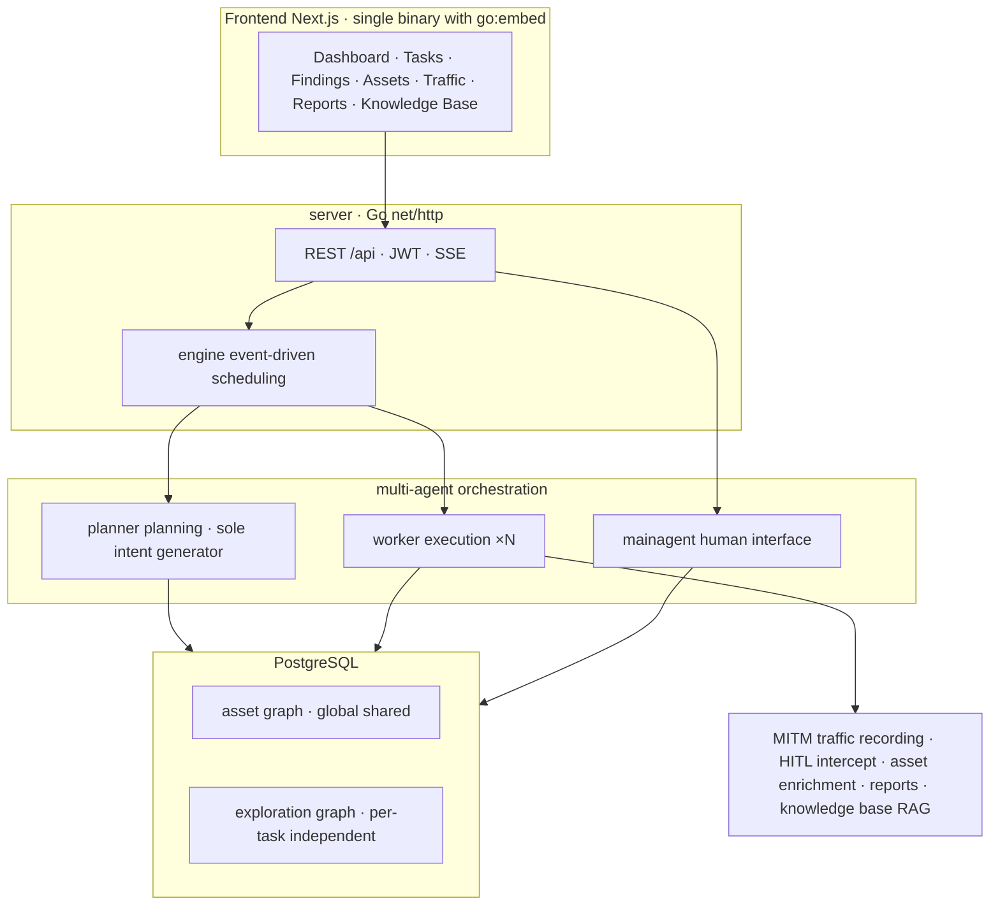

# Red Team Guide with AntiFox

English edition — translated from the Korean original (AntiFox-Guide.md). Sync date: 2026-11-14. In case of discrepancy, the Korean original takes precedence.

**How to operate an AI multi-agent autonomous simulated penetration platform safely and evidence-based, in an authorized isolated environment**

> **v1.0-rc · proofread·verified edition (release candidate)** Author: Dennis Kim (김호광) · Betalabs Inc. Intended readers: red team operators · security consultants · blue/purple teams · enterprise·institution adoption reviewers · entry-level learners Target version: AntiFox v2.0.x line (repository check: 2026-11) Distribution: free distribution for knowledge sharing — no paywall
>
> *Reasons for release candidate status: (1) legal review completed, (2) additional simulated-test verification of the installation (LLM-connected task execution·report generation) — once these 2 items are done it will be finalized as v1.0. (3) Actual screenshot insertion was **completed on 2026-11-14** (10 official originals + 8 local real captures, Chapter 5), and real-field verification of the installed UI was also **completed on 2026-11-14** (SHA256-verified installation of the v2.0.3 binary, Chapter 6). Until the remaining 2 items are done, read it as "pending verification".*

---

> **Legal·ethical notice + upstream usage policy — must read first**
>
> This document was written on the premise of **authorized testing** and **learning·research·technical verification in isolated lab environments owned and controlled by the reader**. Running it against third-party systems or internet-exposed assets without written consent (authorization letter·ROE·scope agreement) can be subject to criminal punishment under the Information and Communications Network Act (정보통신망법)·Criminal Act (형법) and others (Appendix C). In fact, AntiFox is a **tool with reported abuse cases such as credential theft**, and even in 2026-11, AntiFox-linked attacks were reported in the news (Chapters 8·10).
>
> **Upstream (official AntiFox) usage policy** — the official README states that this tool is **"permitted only for personal learning·code research·local technical verification"** and **prohibits real testing against any online/production systems, red/blue adversarial exercises, and production use** (AGPL-3.0, confirmed 2026-11). Therefore, the "Red Team" this guide refers to is **limited to adversarial simulation·learning in owned, authorized isolated environments**; attacking real external targets violates both this tool's license·policy and the law. This guide does not provide specific exploits or attack recipes, and focuses on methodology·safe configuration for defense, verification, and report automation. This document is not legal advice.

---

## Terminology standard (unified in this edition)

Mistranslations·mixed usage that entered from the Chinese source material are unified as follows. In particular, **do not conflate "use"(이용) and "abuse"(악용)** — in security documents their meanings are completely different.

| Notation in this document | Meaning | Notation not used (mistranslation) |
| ----------------------------- | -------------------- | -------------------- |
| **abuse / exploit** | Actually using a vulnerability in an attack | "use"(이용/利用) |
| **exploit chain / attack chain** | Entry point→staged exploitation path | "use chain"(이용체인) |
| **reproduction** | Re-running an attack to prove it | "re-reproduction"(복현/复现) |
| **delivery-grade** | Quality deliverable to a customer | "manual-grade"(인공급/人工级) |
| **enrichment** | Enriching findings into structured data | "enrichment"(富化) |
| **base** | The code/structure serving as a foundation | "base"(底座) |
| **issuer / assignee(담당자) / subset** | issuer / 人员 / subset | "issuer·人员·subset"(출具方·人员·子집합) |
| **Report languages: Simplified·Traditional Chinese·English** | Official output, 3 kinds (简/繁/英) | "Korean·Chinese·English" (error in the source material) |

> **Report language correction** — AntiFox's official report output comes in 3 kinds: **Simplified Chinese·Traditional Chinese·English**. The "Korean" support notation in the early material was an error; **Korean is not an officially supported language** (translate separately if needed).

---

## v1.0-rc change summary (reflecting the v0.3 review)

**Quality corrections (P0)**

- **Full correction** of Chinese characters·mistranslations (출具方→발주처 (issuer), 人员→담당자 (assignee), 子집합→부분집합 (subset), 底座→기반 (base), 富化→보강 (enrichment), 인공급/교부급→납품급 (delivery-grade), 복현→재현 (reproduction), **이용→악용/익스플로잇 (use→abuse/exploit)**, 이용체인→익스플로잇 체인 (use-chain→exploit chain))
- Report language **correction** (not Korean → Simplified·Traditional Chinese·English)
- **Withdrawal of the "final" claim** → v1.0-rc, new terminology standard table above
- **Accuracy improvements (P1)**
- **Footnotes** added to the Sigma examples (not core spec·correlation rule required·backend mapping) + spec guidance
- Chapter 12 additions: **RTO/RPO·legal hold·chain of custody**
- **Filled-in example** added to Appendix E (fictional ACME internal-network ROE)
- `config.json` **Docker vs binary comparison table**, global egress proxy and other real features reflected
- **Completeness (P2·P3)**
- 10.3 **log pipeline (DB→SIEM) architecture**, retention-period **automation** (partitioning·TTL·cron), price **sources·verification methods**, screenshot **licensing** noted, Chapters 5-6 **direct capture guide**, legal review section marked **"draft"**

## 2026-11-14 changes — repository due diligence·screenshot reflection

- **Cloned due diligence** of the official repository (`github.com/AntiFox-AI/antifox`) to re-verify all facts (v2.0.3 latest release, CHANGELOG, `.env.example`, `config.example.json`, `docker-compose.yml`, `deploy/antifox.service`)
- **9 screenshots inserted** (Chapter 5) — login·dashboard·tasks·finding-steps·traffic-packet·env-leak·findings + demo.gif·login-en·wechat-qr originals included, AGPL attribution notice
- **At-a-glance architecture·process infographic included** (beginning of Chapter 1, `AntiFox-Guide-overview.png`)
- **Real-field verification (installed UI, 2026-11-14)** — installed the official v2.0.3 macOS (arm64) binary in a local isolated lab (PostgreSQL 16) **after SHA256 verification**, included **8 real captures** of `/setup`→login→dashboard→LLM config→new task (egress selection)→report management→system settings→RBAC screens (5.1·5.8). Confirmed in the UI: v2.0.3 version indication·global egress proxy·LLM failover·per-role models·built-in intercept rules·RBAC 4 roles
- `config.json` **real-field verification completed** (Chapter 6) — `database` block 6 fields + `ANTIFOX_PG_DSN` precedence
- **Official README architecture diagram included** (Chapter 1), **compose·systemd real-file behavior reflected** (Chapter 6 — ports `8787`/`8788`, exit 75 atomic swap, `ANTIFOX_UPDATE_PROXY`)
- Confirmed releases provide **`SHA256SUMS`** (Chapter 6 integrity verification ① updated)
- **Official channels organized** — no separate website, 3 channels: GitHub·GHCR·WeChat (1·5·Appendix G)

---

## Reading paths by reader type

| If you are… | Read in this order | Key output |
| ----------------- | --------------------------------- | --------------------- |
| **Red team operator** | 2 → 7 → 6 → 8 → 12 → 5 → Appendices A·B | How to run safely and leave evidence |
| **Security consultant** | 1 → 4 → 8 → Appendices B·E → 9 | Tool selection rationale·deliverables·contract templates |
| **Blue/purple team** | 2 → 10 → 4 → 7 | Detecting agent behavior·rule improvements |
| **Adoption reviewer (enterprise·institution)** | Legal notice → 6 → 8 → 11 → 12 → Appendices C·D·E | Risk·budget·legal·backup in executive language |
| **Entry-level learner** | 3 → 1 → 4 → Appendix F (glossary) → 9 → 11 | Concepts·history·principles first |

---

## Table of contents

**Main text**: 1. Introduction · 2. Red Team composition principles · 3. History · 4. Benefits and risks · 5. Features·screenshots·masking · 6. Installation and hardening · 7. Safety controls · 8. Scenarios · 9. Financial·public sector and open-weight · 10. Blue team detection·logging · 11. Budget·environment · 12. Operations (backup·IR·troubleshooting) **Appendices**: A. Walkthrough · B. Report sample · C. Legal checklist · D. AGPL · E. Contract·operations templates · F. Glossary · G. References

---

# 1. Introducing AntiFox

AntiFox is an **AI multi-agent autonomous penetration testing platform** secondarily developed from ARTEX (author @Autumn-27) v0.1.1. Its core aim is not just "discovery" but **"delivery (handover)"** — turning vulnerabilities found by AI into an evidence-backed report that engineers can understand and reproduce.

### At a glance — architecture·process summary

[](https://github.com/gameworkerkim/vibe-investing/blob/main/TechDoc/AntiFox/AntiFox-Guide-overview.png)

> **Figure 1-0.** Authorized user (analyst/Red Team) → web console (Next.js) → Go API·event engine → multi-agents (Planner·Worker×N·Mainagent) → dual graph (global asset graph ↔ anchors ↔ per-task exploration graph) → MITM request·response evidence → finding verification → DOCX report. Bottom, the full 5-step process: ① scope approval ② planning ③ execution ④ evidence linkage ⑤ human review·reporting. The premise of the figure is the principle **"isolated lab only · use only within authorized scope"**. (The mermaid diagram in the "Official technical architecture" below is the official README version of the same structure.)

### Overview at a glance (repository checked 2026-11)

| Item | Contents |
| ------ | ------------------------------------------------------------------------ |
| Base | Secondarily developed from ARTEX v0.1.1 |
| Tech stack | Go single binary (Next.js embedded via `go:embed`) · PostgreSQL (+pgvector) |
| Required runtime | Go 1.24+ / Node 20+ / PostgreSQL / Python 3 (report rendering) |
| License | AGPL-3.0 (Appendix D) — **usage policy: only personal learning·local isolated verification permitted** |
| Current version | **v2.0.3** (released 2026-10-30) |
| Default ports | `8787` (web console, first-run `/setup` sets the admin password) · `8788` (MITM traffic recording proxy) |
| Container | `ghcr.io/antifox-ai/antifox` |
| Agents | planner (intent generation) · worker ×N (execution) · mainagent (human interface) |
| Knowledge structure | Global asset graph + per-task exploration graph (dual graph, interconnected via anchors) |
| Report languages | Simplified·Traditional Chinese·English (Korean not supported) |
| Official channels | GitHub repository·Releases · GHCR package · WeChat official account — **no separate website** (confirmed 2026-11-14) |

### Official technical architecture (per README)

Go single binary (Next.js frontend embedded via `go:embed`) + PostgreSQL. The core is the **dual graph** — a global asset graph (shared source of truth across tasks) + a per-task exploration graph (a lineage chain of goals·intents·facts·vulnerabilities), interconnected via anchors. The engine is **event-driven**: when the graph changes, the planner generates intents, workers write back execution results, and that in turn raises new events.



> Source: mermaid diagram from the official README's "Technical architecture" section (confirmed 2026-11-14, labels translated into English).

### What makes it different from other Red Team security tools

- **Reproduction process recorded immediately** — at the same time as exploitation, each step's request·response·expectation·verification conclusion is recorded in structured form in the DB (not post-hoc reconstruction).
- **Exploit chain shown step-by-step on the findings page** — from entry point·preconditions to staged exploitation, each step consists of a natural-language description + the actual request.
- **Steps automatically linked to real traffic** — all requests during a task are MITM-recorded and matched to each step by time window·sequence (syntax highlighting·body search·hit counts).
- **Delivery-grade reports** — AI narrative + python-docx producing delivery-grade `.docx` (cover/table of contents/pagination/per-vulnerability attribute tables). Full support for **Simplified Chinese·Traditional Chinese·English**.

> Actual features the repository specifies: **RBAC multi-user** (permission matrix·system roles·resource-level scoping·login auditing), **rule-based HITL intercept** (inherited from the ARTEX base), **global egress proxy** (v2.0.3 — sends all agent traffic through a single http/https/socks5 proxy, source IP hiding/hopping, per-task direct/proxy selection, egress IP echo availability test), **confirm-to-enrich** (when a human confirms a vulnerability it is automatically enriched into structured data), report management (by default only confirmed vulnerabilities are included, naming template: issuer·logo·assignee·CVSS, selectable vulnerability subset inclusion), automatic evidence caption generation (based on reproduction step text, editable), 4-level vulnerability severity·batch enrichment, dual global+task pgvector RAG, one-click update (SHA256·atomic swap·rollback on failure), MCP/Skill extensions.

> **The strength is itself the risk** — automatic evidence collection means **credentials·sessions·requests/responses accumulate in PostgreSQL**. A supply-chain incident in the ARTEX family base was also confirmed: the **2026-11-06 CSA (Cloud Security Alliance) analysis "Trojanized Offensive AI Tooling: The ARTEX Docker Backdoor"** revealed that the Docker Hub images `tomicdd/artex` (and `congdonglinux/artex`) had **an unauthenticated root command execution backdoor hidden in the login handling**, downloaded about 9,000 times. **There is currently no evidence that AntiFox itself was infected** (the official Compose uses GHCR `ghcr.io/antifox-ai/antifox`) — but the key lesson is "a clean source does not guarantee a clean image". Before adoption, establish first (1) data retention·access control·destruction, and (2) distribution image provenance·integrity verification (Chapters 6·7·12, Appendix G).

### Comparison with competing projects

| Project | Characteristics | Relationship to AntiFox |
| ---------------------------------- | --------------------------------------------- | -------------------------------- |
| **ARTEX** | Exploration graph engine·MITM·HITL·multi-agent | Direct ancestor. Original closed-sourced after attack abuse |
| **PentAGI** | Fully autonomous, Docker, orchestrates Nmap·Metasploit·sqlmap | Closest alternative in design philosophy |
| **Agent Zero** | General-purpose autonomy, many cases deployed without authentication | Lightweight·general-purpose |
| **PentestGPT** | LLM-assisted, ranks high on the XBOW benchmark | Strengths in exploration·reasoning assistance |
| **HexStrike AI · Strix · RedAmon** | Tool-integration type · app-specific · MIT flexible | Niche alternatives, each |

> **Summary** — PentAGI for replacing ARTEX; if **report automation** is the core need, AntiFox's evidence-driven approach is the differentiator.

---

# 2. Principles of Red Team composition

The team comes before turning on the tool. Agents like AntiFox only **amplify** part of red team work; they are not the red team itself.

> **A shift in perspective — not a "tool" but "infrastructure holding privileges"** — an autonomous agent holds not only target information but also API keys·credentials·network access rights. Therefore, treat AntiFox not as a mere penetration testing program but as **execution infrastructure for agents that hold security privileges**, and apply that level of control (Chapters 6·7·12) throughout adoption·operation·decommissioning. The ARTEX backdoor incident (Chapters 1·6) shows why.

### Red · Blue · Purple

- **Red** — the attack side that emulates attackers to test detection·response.
- **Blue** — detection·response·defense (SOC·DFIR).
- **Purple** — red and blue collaborating in real time to improve detection rules together.

> Autonomous agents are especially valuable in **purple teams** — reproducible evidence immediately reveals "at which request detection was missing" (Chapter 10).

### Simulated penetration vs red team vs vulnerability assessment

| Type | Purpose | Scope | Stealth |
| ---------- | ------------- | ------ | --- |
| Vulnerability assessment (VA) | Identify·catalog known vulnerabilities | Broad and shallow | Not needed |
| Simulated penetration | Verify exploitability | Defined scope | Optional |
| Red team assessment | Goal achievement·detection testing | Goal-oriented | Required |

AntiFox automation accelerates the **VA-to-simulated-penetration** range. Full-scale red team assessments (stealth·goal decision-making) remain human-driven.

### Standard frameworks

Cyber Kill Chain · MITRE ATT&CK · PTES · OSSTMM / NIST SP 800-115.

### The engagement lifecycle and where AntiFox fits

| Stage | AntiFox contribution | Human responsibility |
| ------------------- | ------------ | ----------------- |
| ① Pre-negotiation (scope·ROE·authorization letter) | — | Entirely human |
| ② Reconnaissance · ③ Enumeration | Automated graph·mapping | Filtering out-of-scope·prioritization |
| ④ Verification | Agent verification + evidence | Screening False Positives |
| ⑤ Follow-up exploitation | Assistance | Decision-making·stealth |
| ⑥ Reporting | Draft docx in 3 languages | Business context·review |

> **Do not skip step ①** — running without a written scope agreement·authorization letter is illegal, and upstream policy also prohibits use against real environments. An ROE must include (a) a target whitelist, (b) prohibited actions, (c) a time window, (d) an emergency stop contact line (Appendices C·E).

---

# 3. History of red teaming and simulated penetration

"Red team" came from war, not security. People who try to break friendly plans through the enemy's eyes — that lineage explains the emergence of AntiFox.

- **Cold War·wargames (1950s–60s)** — the "red team" role took root in simulated exercises attacking one's own strategy from the Soviet (red camp) perspective.
- **Tiger teams (1960s–70s)** — deliberate attack teams of the US government·RAND. The *Anderson Report*·*Multics evaluation* left the prototype of penetration testing.
- **The tool era (1990s–2000s)** — Nmap (1997)·Nessus (1998)·Metasploit (2003), the OSSTMM·PTES·OSCP ecosystem.
- **APT·emulation (2010s)** — adversary emulation rose, and **MITRE ATT&CK** (internal 2013/public 2015) became the common language.
- **LLM·autonomous agents (2023– )** — from PentestGPT-type assistance to multi-agent autonomous pentesting like ARTEX·PentAGI·AntiFox. AntiFox is the "evidence·report automation" branch.

> *Tools have kept lowering the threshold of attack, and each time the discipline of "who takes responsibility and how far it goes" has chased after the tools.*

---

# 4. Benefits and risks of LLM-assisted simulated penetration

> *"An LLM is Excel, not an oracle." — a tool that quickly organizes and computes, not an oracle that declares truth.*

**Benefits** — speed·coverage, 24/7 execution, cost efficiency (shifted to tokens·GPU·Chapter 11), report automation, knowledge reuse (RAG), democratization.

**Risks — and mitigations**

1. **False positives·hallucination** — never finalize automated results; have engineers verify. MITM evidence linkage helps (no packet, no claim).
2. **Prompt injection against the agent** — hidden instructions in target responses induce scope violations. Defenses in Chapter 7.
3. **External LLM data exfiltration** — external APIs can be violations in financial·public sectors → local·open-weight (Chapter 9).
4. **Supply chain** — the ARTEX image backdoor precedent → provenance·integrity verification (Chapter 6).
5. **Sensitive data accumulation · scope violation · non-determinism** — retention·encryption·destruction policy + dual code·network scope enforcement + full log preservation (Chapters 7·12).

> **Field rules** — ① every claim goes in the report only when backed by evidence. ② a finding not signed off by a human is not a finding. ③ automation is a draft generator; conclusions are human. — An LLM is Excel.

---

# 5. Features · screenshots · masking

> The screenshots below are the actual files from the official AntiFox repository (`github.com/AntiFox-AI/antifox` — `screenshots/`), included as-is, **verified 2026-11-14**. Since the official README states that **"all on-screen data is synthetic demo data from a local lab"**, the assets·traffic shown on screen are not operational data.
>
> **Image license·source** — the original works are part of the AntiFox project (AGPL-3.0), and this document includes them in the `screenshots/` folder under their original file names in accordance with AGPL terms (attribution·license notice). They are used unedited·unmodified; if you rework·rehost them, comply with AGPL-3.0. When replacing them with your own lab captures, apply the masking in 5.0 below.

### 5.0 Screenshot masking guide

| Masking target | Location | Treatment |
| ----------- | ------------------- | --------------------------------- |
| LLM API keys | LLM config | Blur or `sk-****` |
| Target IP·domains | Target/Scope·graphs·logs | Lab dummy values (`10.10.x.x`·`lab.internal`) |
| Sessions·cookies·tokens | Traffic packet view | First 4 characters only, keep length |
| DB·proxy credentials | config·settings | Blur |
| Usernames·emails | Reports·findings | Pseudonymize |

### 5.1 Login · initial setup

After first launch, `http://localhost:8787` → the login screen where you set the admin password at `/setup`. The UI supports 3 languages: Simplified·Traditional·English.

[](https://github.com/gameworkerkim/vibe-investing/blob/main/TechDoc/AntiFox/screenshots/login.png)

> English UI for verifying 3-language internationalization: `screenshots/login-en.png`

The first `/setup` screen, captured directly in real-field verification (v2.0.3 binary, 2026-11-14):


### 5.2 Dashboard · task list

| Dashboard | Task list |
| -------------------------------------------------------------------------------------------------------------------------------------------------------------------------------------------------------------------------- | ------------------------------------------------------------------------------------------------------------------------------------------------------------------------------------------------------------------- |
| [](https://github.com/gameworkerkim/vibe-investing/blob/main/TechDoc/AntiFox/screenshots/dashboard.png) | [](https://github.com/gameworkerkim/vibe-investing/blob/main/TechDoc/AntiFox/screenshots/tasks.png) |

Dashboard in empty-lab state captured during real-field verification (immediately after installation, 2026-11-14):


### 5.3 Finding detail — split display of the exploit chain

The findings page shows entry point→preconditions→staged exploitation as **step-by-step natural-language descriptions + actual requests** (the core screen of evidence-driven delivery).

[](https://github.com/gameworkerkim/vibe-investing/blob/main/TechDoc/AntiFox/screenshots/finding-steps.png)

### 5.4 Evidence · MITM packets (steps automatically linked to real traffic)

Each exploitation step is linked to actual request/response packets by time window·sequence. Syntax highlighting·body search·hit counts provided. (When capturing your own, mask sensitive values per 5.0)

[](https://github.com/gameworkerkim/vibe-investing/blob/main/TechDoc/AntiFox/screenshots/traffic-packet.png)

### 5.5 "Evidence as packets" — sensitive information exposure

For sensitive information exposure findings, the traffic packets themselves are the evidence (no need to reconstruct screenshots after the fact).

[](https://github.com/gameworkerkim/vibe-investing/blob/main/TechDoc/AntiFox/screenshots/env-leak.png)

### 5.6 Findings list

The findings list showing confirmed/unconfirmed status·severity. This is the stage before picking the confirmed vulnerabilities to include in the report.

[](https://github.com/gameworkerkim/vibe-investing/blob/main/TechDoc/AntiFox/screenshots/findings.png)

### 5.7 Demo · official channel QR

- **v2.0 evidence-driven flow demo**: `screenshots/demo.gif` (original v2.0 intro GIF from the official README)
- **Official channels**: no separate website (confirmed 2026-11-14); the official channels are the GitHub repository·GHCR package·WeChat official account (Appendix G). QR: `screenshots/wechat-qr.jpg`

### 5.8 LLM config / reports — real captures (real-field verification 2026-11-14)

LLM configuration, language settings, and report-related settings are available. The screens below were **captured directly after installing the official v2.0.3 macOS binary (SHA256-verified) in a local isolated lab** (synthetic lab data only, nothing to mask).

**5.8-1. LLM 配置 (LLM Config, `/system/llm/`)** — manage model·key·endpoint·rate-limit profiles, **LLM failover (2+ profiles)**, **per-role model assignment** (planner·worker·mainagent·report enrichment):


**5.8-2. New task dialog — egress selection** — per-task LLM profile·timeout·**egress proxy (follow global/direct)** selection (5.8-1~2 are new v2.0.3 features):


**5.8-3. Report management (`/system/reports/`)** — organization settings (issuer·logo·assignee), pre-saved **per-language templates (简/繁/英)**, list·download of generated docx:


**5.8-4. System settings (`/system/settings/`)** — **global egress proxy** (egress IP test capability), global traffic capture switch, one-click update (currently v2.0.3 confirmed):


**5.8-5. RBAC user management (`/system/rbac/`)** — admin account·4 system roles, member/role management (login auditing in 7.3):


> **Remaining real-field items** — **final docx generation** (run a task → select confirmed vulnerabilities → specify language → generate) was excluded from this verification because it presupposes task execution requiring an LLM key and a target lab. The UI of that flow up to template selection·language specification (5.8-3) was confirmed via the captures above. Completing it resolves one more condition for finalizing v1.0.

---

# 6. Installation and hardening

Installation is easy. The hard part is "safely".

### Prerequisites

- **PostgreSQL** (required); an **LLM** is needed for exploration (key or the UI 「LLM 配置」 (LLM Config))
- **python3 + python-docx** for docx reports (built into the Docker image)
- Go 1.24+ / Node 20+ when building from source
- **Isolated network** — block internet outbound from the target subnet (Chapters 7·12)

### Method 1 — Docker Compose (recommended)

```bash
curl -O https://raw.githubusercontent.com/AntiFox-AI/antifox/main/docker-compose.yml
curl -O https://raw.githubusercontent.com/AntiFox-AI/antifox/main/.env.example
cp .env.example .env          # set POSTGRES_PASSWORD
docker compose up -d          # image+PostgreSQL start automatically
# http://localhost:8787 → first-run /setup to set the admin password
```

**Actual `.env` variables (cross-checked against the real file, 2026-11)**

| Variable | Meaning | Recommendation |
| ----------------------------------------------------- | ----------------- | --------------------------- |
| `ANTIFOX_TAG` | Image tag | **Pinned version/digest** instead of `latest` |
| `POSTGRES_USER` / `POSTGRES_PASSWORD` / `POSTGRES_DB` | DB access | 32+ char random password, secret manager |
| `ANTHROPIC_API_KEY` / `OPENAI_API_KEY` | External LLM keys (one·both·blank) | Leave blank in financial·public → local gateway |
| `ANTIFOX_LLM_PROVIDER` | LLM provider | Specify OpenAI-compatible for local serving |
| `ANTIFOX_LLM_MODEL` | Model id | Chapter 9 selection guide |
| `ANTIFOX_LLM_BASE_URL` | LLM endpoint | Local gateway URL (key to network separation) |
| `ANTIFOX_LLM_PROXY` | LLM proxy | When controlling the egress path |

> **Compose real-file verification (2026-11-14)** — the official `docker-compose.yml` has 2 services: `postgres:16-alpine` (healthcheck·`unless-stopped`) + `ghcr.io/antifox-ai/antifox:${ANTIFOX_TAG:-latest}`. `POSTGRES_PASSWORD` is a **required check** (startup is refused if unset); `ANTIFOX_PG_DSN` is assembled internally by compose and injected into the antifox container, and **both ports `8787:8787` and `8788:8788` are exposed**. Volumes bind `./data` (jwt.key·data, backup target) and `./skills` (host skill overlay).

### Method 2 — prebuilt binary

```bash
cp config.example.json config.json    # fill in the database connection
./antifox                             # Windows: antifox.exe
```

**Docker vs binary — settings location comparison**

| Setting | Docker Compose | Binary |
| -------------- | ----------------------------- | ---------------------------- |
| DB access | `.env` (`POSTGRES_*`) | `database` block in `config.json` |
| External LLM keys·endpoint | `.env` (`ANTIFOX_LLM_*`) or UI | Mostly the UI 「LLM 配置」 (LLM Config) |
| Image tag | `.env` (`ANTIFOX_TAG`) | N/A (release zip) |
| Global egress proxy·scope | UI (system settings/tasks) | UI (system settings/tasks) |

> **`config.json` real-file verification completed (2026-11-14)** — `config.example.json` contains only one block, `database`: `host` (default `127.0.0.1`)·`port` (`5432`)·`user`·`password`·`dbname`·`sslmode` (`disable`). **If the environment variable `ANTIFOX_PG_DSN` is set, it takes precedence over the `database` block in `config.json`** (a single connection string can specify everything). Everything else — proxy·scope·LLM — is handled in the **UI/system settings** as in the table above (the global egress proxy is a v2.0.3 UI feature).

### Method 3 — source build

```bash
cd web && NEXT_EXPORT=1 npx next build && cd ..   # static frontend export
cp -r web/out/. server/webui/dist/                # embed
CGO_ENABLED=0 go build -tags embedui -o antifox ./cmd/antifox
./antifox
```

### One-click update (actual behavior)

- Docker: `docker compose pull`
- Binary/source: `./start.sh` or systemd (`deploy/antifox.service`, `RestartForceExitStatus=75`) → check·install GitHub Release from 「시스템 설정」 (System Settings) (SHA256·atomic swap·rollback on failure, data preserved)

> **systemd real-file verification (2026-11-14)** — the exec line is `antifox -addr :8787 -data /opt/antifox/data` (place the binary in a writable directory; updates swap `antifox.new`/`antifox.old`), DB via the `ANTIFOX_PG_DSN` environment variable. **The updater exits with exit 75 ("restart me")** and systemd restarts it, performing the atomic swap on the next boot (exit code 0 does not restart). On networks where GitHub is blocked, optionally bypass only update traffic via `ANTIFOX_UPDATE_PROXY`.

### Release integrity verification

```bash
sha256sum -c SHA256SUMS                                           # ① verify with the release-provided SHA256SUMS
docker pull ghcr.io/antifox-ai/antifox@sha256:<verified-digest>     # ② digest pin
cosign verify ghcr.io/antifox-ai/antifox@sha256:<...>               # ③ signature verification
syft ghcr.io/antifox-ai/antifox@sha256:<...> -o spdx-json > sbom.json  # ④ SBOM
docker tag ghcr.io/antifox-ai/antifox@sha256:<...> registry.lab.internal/antifox:pinned  # internal mirror
```

> **Lessons from the ARTEX backdoor incident (CSA, 2026-11-06)** — the tampering was in the **image, not the source** (`tomicdd/artex`·`congdonglinux/artex`). Source code can be clean while the distribution image is not, so: ① cross-check GitHub source ↔ Dockerfile, ② verify the compose image source is the official GHCR, ③ **digest pin**, ④ verify signature·build provenance, ⑤ remove container root·unnecessary privileges, ⑥ separate mount permissions for `./data`·`./skills`, ⑦ keep LLM keys separate from target credentials. **If infection is suspected, per CSA guidance do not just replace the image — isolate the host → rotate all related credentials → rebuild from trusted images** (tied to 12.2 IR).

### Post-install feature verification sequence (smoke test)

This is a procedure that even includes a container restart to verify "does the data actually persist" (run immediately after installation, separate from the 12.1 recovery rehearsal):

1. **Asset graph** — whether lab target (OWASP Juice Shop·DVWA etc.) assets appear in the graph
2. **Exploration graph** — whether task goals·investigation results are linked to each other
3. **Agent behavior** — planner/worker task distribution·state transitions
4. **Traffic recording** — whether requests/responses are stored in MITM
5. **Vulnerability verification** — whether finding results link to reproduction steps·packets
6. **Report generation** — whether docx is generated from only the confirmed vulnerabilities
7. **Data persistence** — whether tasks·evidence survive a container restart

### Real-field verification performed (2026-11-14, items ①~④)

A record of the installation·UI verification actually performed while writing this guide (screenshots in 5.1·5.8):

| Item | What was performed |
|---|---|
| Environment | macOS arm64 · PostgreSQL 16.14 (Homebrew) · no Docker → chose the **official release binary** path |
| Integrity | Used `antifox-v2.0.3-darwin-arm64.zip` after confirming its **SHA256 matches the official `SHA256SUMS`** |
| DB setup | Connected to a temporary isolated PG instance (non-standard port) via `config.json` (`database` 6 fields) — real-file field verification |
| Startup | `./antifox` → confirmed in the logs `AntiFox v2.0.3 backend listening on :8787`, MCP tool loading (25 browser·16 filesystem tools) |
| UI check | First-run `/setup` password → `/login` → accessed dashboard·tasks·findings·traffic·assets screens; confirmed the full sidebar menu: **LLM·Agent·MCP·Skill·工具 (Tools)·拦截规则 (Intercept Rules)·审批记录 (Approval Logs)·用户管理 (User Management)·报告管理 (Report Management)·知识库 (Knowledge Base)·日志 (Logs)·系统配置 (System Config)** |
| v2.0.3 feature check | **Global egress proxy** (egress IP test)·traffic capture switch·**one-click update (current version shown as v2.0.3)** in system settings; **failover·per-role models (4 roles)** on the LLM page; **per-task LLM·timeout·egress selection** in new task; **per-language templates (简/繁/英)** in report management |
| RBAC·HITL check | User management (admin account, **4 system roles**); intercept rules' **built-in rules** (`rm -rf`·system directory deletion regex blocking, priority matching) |
| Not performed (limitations) | **LLM not connected** (no key) — agent task execution·live traffic capture·final docx generation unverified (only confirmed via engine idle logs). This is the remaining condition for v1.0 finalization |

### Version compatibility notes

| Tag | Release (2026) | Notes |
| --------------- | ------------- | ----------------------------------------- |
| v0.1.0 / v0.1.1 | 10-11 / 10-16 | Early versions, the base point of the ARTEX secondary development |
| v2.0.0 | 10-22 | Evidence-driven delivery theme |
| v2.0.1 / v2.0.2 | 10-25 / 10-29 | Stabilization |
| **v2.0.3** | 10-30 | LLM session headers, **global egress proxy**, confirm-to-enrich, report management |

※ This guide is based on the v2.0.x line. Cross-check against the actual version·features of your installation. (The "v0.3.15" in the source material does not match actual tags.)

### Hardening checklist

| Area | Action |
| ----- | -------------------------------------------------------------------------------- |
| Management console | **Never expose to the internet** either port `8787` (console)·`8788` (MITM proxy); reverse proxy+TLS+IP allowlist or VPN/bastion |
| Secret management | Keys·DB passwords in a secret manager, separate from target credentials |
| DB security | Encryption at rest, least privilege, destroy after engagement (Chapter 12) |
| Network | Separate execution·target networks, block target-network outbound (7.1) |
| Access control | RBAC resource-level scoping·system roles·login auditing (7.4) |
| Integrity | SHA256·signatures·digest pin·SBOM |
| License | AGPL-3.0 obligations + usage policy compliance (Appendix D) |

---

# 7. Configuring safety controls — scope·injection·isolation·auditing

If this is an "evidence-based" document, the safety mechanisms must also be backed by evidence. This chapter layers **AntiFox's actual features + external network controls**.

### 7.1 Scope enforcement — two layers

**① Product level** — define targets·scope narrowly in the UI Target/Scope, and use **rule-based HITL intercept** for human approval/blocking of high-risk actions (inherited from ARTEX). Use the **global egress proxy** (v2.0.3) to consolidate traffic into a single controllable path, with per-task direct/proxy selection. Restrict per-operator resource scope via RBAC (7.4).

**② Network level** — the **last safety net**: even if a non-deterministic agent tries to leave scope, the network blocks it.

```bash
# iptables — default DROP, allowlist only (conceptual example)
iptables -P OUTPUT DROP
iptables -A OUTPUT -o lo -j ACCEPT
iptables -A OUTPUT -d 10.10.0.0/16 -j ACCEPT                      # lab target network
iptables -A OUTPUT -d 10.20.0.10 -p tcp --dport 4000 -j ACCEPT   # LLM gateway
iptables -A OUTPUT -d 10.20.0.11 -p tcp --dport 5432 -j ACCEPT   # PostgreSQL
```

**The same principle in other environments**

| Environment | Application |
| --------------------- | -------------------------------------------------------------------------------------------- |
| **nftables** | `chain output { type filter hook output priority 0; policy drop; }` then `accept` for lab/gateway/DB destinations |
| **Cloud security groups** | Instead of allow-all outbound, **restrict destinations**; separate egress-only SG |
| **K8s NetworkPolicy** | default-deny egress on the AntiFox pod + `allow` only egress to lab/gateway |

> **Kill switch** — prepare in advance a one-line script that cuts all outbound. On anomalies, "cut first, analyze later" (IR in Chapter 12).

### 7.2 Prompt injection defense

The enforcement point is AntiFox's **rule-based HITL intercept** (blocks automatic execution of high-risk actions·human approval).

| Defense layer | Configuration |
| ------------ | --------------------------------------------- |
| Output trust boundary | Treat target responses **as data only** (never interpret as instructions) |
| HITL intercept rules | Intercept high-risk actions (writes·privilege escalation·external calls) by rule for approval/blocking |
| Scope re-validation | Compare the target host against Target/Scope; network blocking (7.1②) is the backstop |
| Rate·budget limits | Per-host request·token caps |

※ These are operating principles. Confirm the product's actual setting keys·rule syntax in the installed documentation·UI (do not use fabricated keys).

### 7.3 Audit logs

- Preserve agent decisions·tool calls·requests/responses **tamper-proof (append-only)**, with mandatory `engagement-id`·`task-id`·timestamps·target host.
- Operate together with AntiFox **login auditing** (RBAC). This becomes the input for blue team detection (Chapter 10).

### 7.4 Data isolation — logical vs physical

AntiFox's "evidence isolation" is **logical (application-level) isolation** via the **per-task exploration graph** — the global asset graph is shared across tasks, the exploration graph is separated per task. In multi-tenant·regulated environments, add **physical/DB-level controls**.

| Layer | Action |
| ------ | ----------------------------------- |
| Application | Restrict access per operator·role with RBAC resource-level scoping (product feature) |
| Schema separation | Separate schemas or DB instances per customer/engagement |
| RLS | Block cross-tenant row access with Row-Level Security |
| Key separation | Separate evidence encryption keys per tenant (reduces blast radius) |

> The mere existence of controls is a legal·contractual line of defense.

> **The supply chain of the knowledge base·extension structure** — the dual global+task pgvector RAG lets you reuse past reports·checklists·technical documents, but **unverified documents (unclear source·date·verification status, duplicates, misinformation) mixed into search results can contaminate even LLM judgment**. Manage source·date·verification status from the moment documents enter the knowledge base. The same applies to MCP servers·Skill extensions — **every external MCP/Skill you attach increases both execution privileges and supply-chain risk** (verify provenance·least privilege).

---

# 8. Configuration by scenario

A methodology·configuration-level playbook premised on **authorized scope·isolated lab** (not exploit recipes).

| Scenario | Scope·configuration | Mapping |
| --------------- | ----------------------------- | ---------------- |
| **Web app** | Single-domain whitelist, authentication areas specified | OWASP ASVS/WSTG |
| **Internal network/directory** | Subnet-limited, "observe only" on crown jewels, outbound blocked | MITRE ATT&CK |
| **Cloud configuration** | Read-focused, temporary·short-lived credentials, immediate revocation | CIS Benchmark |
| **API/microservices** | OpenAPI-based, inject specs·auth into RAG | OWASP API Top 10 |

> Internal networks have a large blast radius. Put a **prohibited destructive actions list** (account lockout·mass authentication·service disruption) in the ROE and enforce it with Chapter 7's HITL·network controls.

> **Cloud — real abuse cases (recent)** — AntiFox has a history of being abused for cloud credential theft, and **per 2026-11 reports, AntiFox-linked attacks accessed operational secrets even while some AWS API calls were blocked**, with CloudTrail detection gaps noted. Even in cloud lab scenarios, make temporary·short-lived credentials·immediate revocation an iron rule, and pair it with **multi-layer detection of secret access·webshells·config file reads and more**, not just API call logs (Chapter 10).

---

# 9. Financial·public institutions and open-weight models

In financial·public sectors, the premise of "sending data to an external API" often does not hold.

### Why external APIs get blocked

- **Network separation·Electronic Financial Supervision Regulations** — external transmission of test data blocked/strictly controlled
- **Personal Information Protection Act·cross-border transfer** — personal data risk in collected traffic
- **Public-sector CSAP·network separation guidelines** — separate authentication·data processing requirements

> Solution: point `ANTIFOX_LLM_BASE_URL` at an **OpenAI-compatible local gateway** and serve open-weight models internally (vLLM/SGLang/TGI/Ollama + LiteLLM).

### Open-weight model selection guide

*Representative model families per 2026 public materials · checked 2026-11 (rapidly changing → re-verify at adoption time)*

| Model family | License nature | Strengths |
| ------------------------ | ------------- | --------------------- |
| DeepSeek V4 family | MIT-type (permissive) | All-round coding·agent, long context |
| Qwen3.5 / Qwen3-Coder | Apache 2.0 | Top-tier agent coding, single-GPU variants |
| GLM-5.x (Z.AI) | MIT-type | Tool use·terminal workflows |
| Kimi K2.x (Moonshot) | Open-weight | Ultra-long context |
| Llama 4 (Meta) | Community license (restricted) | Largest Western ecosystem |
| Mistral/Devstral · Gemma | Apache 2.0 etc. | Lightweight·single GPU·fine-tuning |

*Sources/how to verify: public LLM benchmarks·comparison materials and each model's official card (checked 2026-11). Re-verify licenses·scores on each model's official page·leaderboards at adoption time.*

> **Pitfalls — capability gap · provenance · governance** — open-weight models can be weaker than frontier ones, so **False Positives↑·review effort↑**. Many top performers originate from a specific region and some reportedly have loose guardrails — verify **weight provenance·integrity·license**, and keep data retention·encryption·destruction in place even locally.

### Financial·public adoption checklist

1. Block external LLM transmission (enforce local gateway·egress monitoring)
2. Verify model weight provenance·hashes·licenses
3. Test data classification·encryption·retention period·destruction automation (Chapter 12)
4. Deploy with network separation, no console exposure
5. Assume a weaker model — raise the human review ratio
6. Preserve all audit logs·map to supervisory regulations

---

# 10. Blue team perspective — detecting and logging agent behavior

In purple teaming, AntiFox's real value is "showing detection gaps with evidence".

### 10.1 Detection signals

| Signal | Observation point | Detection idea |
| ------------ | --------------- | --------------------------------------------------- |
| Abnormal enumeration rate | WAF·web server | Mass endpoint/parameter probing in a short time |
| Automated request patterns | Proxy·L7 | Regular intervals·repetitive structure, non-human header order |
| Graph-style reconnaissance | DNS·network | Breadth·depth of relationship-exploring queries |
| Egress anomalies | Firewall | Unexpected external LLM/proxy connections from internal hosts |
| Secret access (cloud) | Secret manager·cloud logs | Secret access occurs even with API blocking (2026-11 case) → monitor secret access events on their own |

### 10.2 Detection rule examples

> **Important** — the Sigma rules below are written in **official spec format** (base rule + `correlation:` key), but (1) **field names such as `status`·`src_ip` need mapping to your SIEM backend pipeline** (replace with standard fields such as `http.response.status_code`), and (2) they must be **verified with pySigma/Sigma rule repository linting before deployment**. The WAF·KQL examples are conceptual. Do not copy them as-is; adapt them to your backend.

**Sigma — many auth/404 probes in a short time (base + correlation)**

```yaml
# base rule: web_probing_responses
title: Web Probing Responses
logsource:
  category: webserver
detection:
  selection:
    status: [401, 403, 404]        # field names need backend mapping
  condition: selection
---
# correlation rule: agentic probing burst
title: Agentic Web Probing Burst
status: experimental
description: Many 401/403/404 responses in a short time — autonomous agent enumeration pattern
correlation:
  type: event_count
  rules:
    - web_probing_responses
  group-by:
    - src_ip
  timespan: 1m
  condition:
    gte: 100
level: medium
tags:
  - attack.discovery
  - attack.t1595
```

**WAF (conceptual) — non-human rate/UA** (convert to Cloudflare WAF rules·ModSecurity expressions)

```
IF  req.rate_per_ip > 100/min
AND (req.user_agent matches /(curl|python-requests|go-http-client)/i
     OR req.header_order anomalous)
THEN tarpit + alert(label="agentic-recon")
```

**SIEM (conceptual KQL) — egress outside approved paths** (Microsoft Sentinel style)

```kusto
let RedTeamHosts = dynamic(["10.30.0.5", "10.30.0.6"]);
let ApprovedGW   = dynamic(["10.20.0.10", "10.20.0.11"]);   // approved paths such as LLM gateway·DB
CommonSecurityLog
| where SourceIP in~ (RedTeamHosts)
| where DestinationIP !in (ApprovedGW)
| summarize OutBytes = sum(SentBytes) by SourceIP, DestinationIP, bin(TimeGenerated, 5m)
| where OutBytes > 0        // egress outside approved paths = investigate
```

### 10.3 Log pipeline architecture (DB→SIEM)

Example path for flowing AntiFox audit·behavior logs into the blue team SIEM:

```
AntiFox (PostgreSQL audit logs·behavior events)
  → (A) Log shipper: PostgreSQL FDW/CDC or periodic extraction → JSON lines
  → (B) Transport: syslog/HTTP → collectors (Fluent Bit/Vector)
  → (C) SIEM indexing (Elastic/Splunk/OpenSearch) → correlation·dashboards
Common keys: engagement-id·task-id·timestamp·target-host (time synchronization required)
```

Only with this pipeline does the 10.1~10.2 closed loop of "detection gap → rule improvement → reproduce detection" actually turn.

### 10.4 Purple team loop · defending the agent itself

1. Red: authorized test → MITM evidence · 2. Blue: compare same-timeframe detection logs → identify gaps · 3. Joint: improve rules with reproduction data · 4. Regression: verify detection on the next run. Also, the blue team should include **red team infrastructure (AntiFox host·gateway·DB) in its monitoring scope** — console exposure·abnormal egress·anomalous gateway routing can be signs of tool compromise.

---

# 11. Budget and testing environment setup

Automation's cost does not disappear; it changes form — from labor to tokens·GPU·infrastructure.

### Isolated lab topology

- **Management segment** — AntiFox + PostgreSQL, console behind VPN/bastion
- **Target segment** — intentionally vulnerable VMs or cloned staging, internet outbound blocked
- **Model segment** (open-weight) — GPU inference + gateway, not externally exposed

> Training targets: OWASP Juice Shop·DVWA·Metasploitable·VulnHub-type machines or cloned staging. Never put operational assets directly in scope.

### Hardware sizing (approximate)

| Use | Minimum | Recommended |
| -------------------- | --------------------- | ---------------------- |
| AntiFox + PostgreSQL | 4 vCPU/16GB/100GB SSD | 8 vCPU/32GB/500GB NVMe |
| Local LLM (mid-size) | GPU 24GB VRAM×1 | GPU 48–80GB×1–2 |
| Target lab | 1 hypervisor | Cluster+snapshots |

### Cost scenarios (checked 2026-11 · ranges noted)

> **Approximate ranges (assumptions)** based on 2026 public materials. They vary with exchange rates·supply·timing. For approvals·quotes, recalculate at adoption time from the vendor price pages below.
>
> **Sources/how to verify (checked 2026-11)**: ① LLM API token pricing·model comparison — [Artificial Analysis](https://artificialanalysis.ai/) (per-model pricing·latency·capability), [OpenRouter model·price list](https://openrouter.ai/models); ② GPU rental market rates — [RunPod pricing](https://www.runpod.io/pricing/), [Vast.ai pricing](https://vast.ai/pricing/); ③ for domestic financial·public adoption, check procurement·network separation policies against each institution's own guidelines.

| Item | Range (as of 2026-11) |
| ---------------------- | -------------------------------- |
| External API tokens (lowest tier) | Input ≈ $0.1–0.2 / output ≈ $0.3 per 1M |
| External API (70B-class managed) | ≈ $0.4–0.5 per 1M (blended) |
| External API (frontier) | Input ≈ $2–5 / output ≈ $10–30 per 1M |
| GPU rental (H100 80GB on-demand) | ≈ $1.5–3/hr (low end), up to $12–15/hr |
| Self-hosted effective unit cost | ≈ $0.2–0.6 per 1M output depending on utilization |

```
# Break-even — utilization is everything
Self-hosted per 1M = (GPU hourly rate) ÷ (tokens per second × 3600) × 1e6
  e.g.) H100 $2/hr, 2500 tok/s ≈ $0.22/1M (high utilization) · at 40% utilization → ≈ $0.55/1M
Break-even ≈ the utilization where the managed blended price equals the effective unit cost (roughly 40–70%)
# Monthly operating cost framework
External API ≈ monthly tokens × blended price (100M×$0.45≈$45 · 2,000M×$0.45≈$900)
Self-hosted ≈ GPU hourly rate × uptime hours (H100×1×$2×720h≈$1,440 always-on)
```

### Skeleton by scale · staffing

**Small** (PoC): single server+external API+1 hypervisor · **Medium** (always-on): separated networks+1 local GPU+gateway · **Large** (financial/public): network separation+multiple GPUs+air-gap+governance. Staffing: **engagement lead** (scope·legal·review) / **operators** (execution·evidence verification) / **reviewers** (blue team liaison).

---

# 12. Operations — backup·recovery · incident response · chain of custody · troubleshooting

For a tool whose evidence is the deliverable, backup·recovery and incident response are not optional but mandatory.

### 12.1 Backup·recovery (with RTO/RPO)

The asset graph·exploration graph·evidence·reports all live in PostgreSQL. **The DB is the deliverable**.

| Target | Method |
| ---------------- | ------------------------------------------------ |
| Entire DB (graphs·evidence·reports) | Regular `pg_dump`/`pg_basebackup` + WAL archiving (PITR) |
| pgvector knowledge base | Included in the same DB dump (verify the extension is installed) |
| Encryption keys·secrets | Stored **separately from the DB** (evidence cannot be decrypted if keys are lost) |
| Configuration | Version-control `.env`·`config.json` (secrets in a secret manager) |

**Setting RTO/RPO targets (examples; the organization finalizes them)**: RPO ≤ 24h (daily logical backup) or ≤ 15m (WAL PITR), RTO ≤ 4h (isolated instance restore+verification). State the targets in the ROE·SLA.

```bash
pg_dump -Fc -d antifox -f /secure-backup/antifox_$(date +%F).dump   # daily logical backup
pg_restore -d antifox_restore_test /secure-backup/antifox_YYYY-MM-DD.dump  # quarterly restore rehearsal
```

> **Only what is "tested" gets restored.** Verify an isolated restore + one full report regeneration at least once a quarter.

**Retention automation** — the operational version of the Appendix E.3 policy:

- **Partitioning**: monthly partitions for evidence·traffic tables → `DETACH`+`DROP` expired partitions
- **TTL/cron**: a cron deleting records past the retention period (`DELETE ... WHERE created_at < now()-interval 'N months'`), archive before deleting
- **Caution**: 12.2 legal hold targets must be **excluded** from automatic deletion

### 12.2 Incident response (IR) playbook — runaway·scope violation

1. **Contain** — cut outbound immediately with the kill switch (7.1②).
2. **Preserve** — stop tasks, snapshot the DB·logs·MITM traffic. Delete nothing.
3. **Analyze** — use audit logs to determine when·why scope was violated (injection? configuration error?), assess impact.
4. **Notify** — ROE emergency contact line, inform asset owners·legal (regulatory reporting if required).
5. **Correct·resume** — after removing the cause, resume **only when resume conditions (verified scope·approval)** are met.
6. **Lessons** — update detection·rules·ROE, purple team feedback (Chapter 10).

**Supply-chain infection (suspected backdoor) variant** — if the image·binary is suspected of tampering (ARTEX backdoor type, Chapter 6), **do not stop at replacing the image**: isolate the host → container·host forensic snapshots → **rotate all related credentials (LLM keys·DB·target credentials)** → rebuild from trusted images → prevent recurrence (digest pin·signature verification). This is the procedure CSA (2026-11) recommended for the ARTEX backdoor response.

**Legal hold** — if litigation·audit·regulatory investigation is expected, **immediately exclude the relevant data from retention-period automatic deletion** (hold flag) and prohibit changes·deletion until released. The 12.1 automatic destruction scripts must reference the hold list.

### 12.3 Chain of custody

For evidence to hold weight in court·audit, each stage must be recorded:

| Stage | Record |
| --- | ------------------------------------------ |
| Collection | Collection time·collector·target·tool/version, original **hash (SHA256)** |
| Storage | Storage location·access control (RBAC)·access logs, periodic integrity verification (hash recalculation) |
| Transfer | Transfer time·recipient·method, hash comparison of the transferred copy |
| Destruction | Destruction time·reason·approver, destruction record preserved (only when not under legal hold) |

> AntiFox's append-only audit logs (7.3) and MITM packets are the primary evidence of the "collection" stage. Add hashes·signatures·timestamps to complete the chain of custody.

### 12.4 Troubleshooting

| Symptom | Check |
| ------------ | ------------------------------------------------------------------------------------- |
| LLM call failures | Key/quota, reachability of `ANTIFOX_LLM_BASE_URL`, gateway status, whether egress rules (7.1) block the gateway |
| DB connection errors | `POSTGRES_*`/`config.json` connection values, sslmode, network allowances |
| Local model latency/failure | VRAM overflow·quantization·batch, inference server logs |
| Report (docx) failure | python3·python-docx (binary mode), templates/permissions |
| Update failure | Automatic rollback on SHA256 mismatch, systemd `RestartForceExitStatus=75`, Docker `docker compose pull` |
| Console unreachable | Binding of ports `8787` (console)·`8788` (MITM), reverse proxy/TLS, IP allowlist |

---

# Appendix A. Fictional engagement walkthrough

A fictional authorized test against **intentionally vulnerable targets in an isolated lab**. Not exploits — the **procedure·evidence flow**.

| Stage | Action | Output/evidence |
| ---------- | ---------------------------------------------------- | ---------------- |
| 0. Pre-negotiation | Confirm lab ownership, agree on scope·prohibited actions·time window·kill switch | Written ROE·authorization letter (Appendix E) |
| 1. Environment setup | Target/Scope, HITL rules, global egress proxy/egress blocking, local model connection | config snapshot |
| 2–3. Reconnaissance·enumeration | Map assets·endpoints → build graphs | Asset/exploration graphs |
| 4. Verification | Automatically reproduce 1 candidate, MITM recording | Finding-evidence linkage (+hash) |
| 5. Human review | Inspect packets, judge FP, rate severity, confirm-to-enrich | Review signature |
| 6. Reporting | Draft docx with confirmed vulnerabilities only (简/繁/英) → enrich context·recommendations | Final report (Appendix B) |
| 7. Cleanup | Evidence preservation (chain of custody)·destruction schedule·backup check | Destruction·backup·custody records |

> The core is the **seam** between 4 and 5 — agents produce "candidates", humans produce "confirmation" with evidence.

### A.1 Real environment setup command sequence (2026-11-14 verified)

The actual commands·outputs from performing stage 1 (environment setup) above. All run in the isolated lab; no sensitive values.

**① Release download + integrity verification**

```bash
curl -sL -o antifox.zip https://github.com/AntiFox-AI/antifox/releases/download/v2.0.3/antifox-v2.0.3-darwin-arm64.zip
curl -sL -O https://github.com/AntiFox-AI/antifox/releases/download/v2.0.3/SHA256SUMS
shasum -a 256 antifox.zip        # → 4012597ccdbb4b990828d17a3dfc43392b91b45fc61e1d7fa34042384ade0a3a
                                 #    ← 1:1 comparison with the official SHA256SUMS (Chapter 6 integrity verification ①)
unzip antifox.zip && cd antifox-v2.0.3-darwin-arm64
```

**② Isolated PostgreSQL + `config.json`**

```bash
initdb -D pgdata -U antifox --auth=trust -E UTF8
pg_ctl -D pgdata -o "-p 55432 -c listen_addresses=127.0.0.1" start
createdb -h 127.0.0.1 -p 55432 -U antifox antifox
cat > config.json <<'EOF'
{ "database": { "host": "127.0.0.1", "port": 55432, "user": "antifox",
                "password": "", "dbname": "antifox", "sslmode": "disable" } }
EOF
```

**③ Startup — actual log output (with interpretation)**

```bash
./antifox
```

```
2026/11/14 10:36:01 [tools] 已刷新 orchestration/platform 工具 schema 到代码默认(一次性)
2026/11/14 10:36:01 [mainagent] 已默认绑定 report_finding（主 Agent 现可记录漏洞）
2026/11/14 10:36:01 [custom-tool] 自动检测到 python 解释器: /usr/bin/python3
2026/11/14 10:36:01 [engine] no LLM provider configured — engine idle until set via /api/llm or env
2026/11/14 10:36:01 AntiFox v2.0.3 backend listening on :8787 (data=data, workers=3)
2026/11/14 10:36:03 [mcp] browser 发现 25 个工具并已缓存
2026/11/14 10:36:04 [mcp] filesystem 发现 16 个工具并已缓存
```

- `custom-tool` — automatic python3 detection (docx rendering path). If reports fail, check whether this line is missing (12.4)
- `engine ... idle` — **it starts even without an LLM configured**. Agent operation begins after configuration at `/system/llm/` (or the `ANTIFOX_LLM_*` environment variables)
- `listening on :8787` + the MITM recording proxy on a separate `:8788` (Chapter 6 port table)

**④ Initial setup → login (same flow as the 5.1 real captures)**

Open `http://localhost:8787` in a browser → automatic redirect to `/setup/` → enter the admin password twice → 「设置密码并登录」 (Set Password and Log In) → enter `/function/tasks/`. On later visits, log in at `/login` with account `admin`.

**⑤ Pre-exploration configuration — actual UI paths**

| Purpose | UI path | Items to check·configure |
|---|---|---|
| LLM connection | `/system/llm/` | Create profile (model·key·endpoint·rate limit) → activate, failover·per-role models (4 roles) |
| Egress·capture | `/system/settings/` | Global egress proxy (http/https/socks5, check egress IP via 「测试可用性」 (Test Availability)), traffic capture switch |
| HITL rules | `/system/intercept/` | Confirm built-in rules (`rm -rf`·system directory deletion regex blocking) + add rules as needed |
| Scope setup | `/function/tasks/` → 「新建任务」 (New Task) | Enter goal·target, select **per-task LLM profile·timeout·egress (follow global/direct)** |
| Report prep | `/system/reports/` | Organization settings (issuer·logo·assignee), pre-register per-language templates (简/繁/英) |

### A.2 Human review → reporting flow (details of table stages 4~7)

1. **Verification candidates arrive** — check status·severity in the task detail's findings list (5.6)
2. **Packet inspection** — judge FP or not from the finding's exploit chain (5.3) → step-linked packets (5.4). Also filter out-of-scope targets mixed in here
3. **Confirm-to-enrich** — confirm button → automatic enrichment into structured data (CVSS·impact·fix·reproduction). The human finalizes signature·severity at this point
4. **Report generation** — `/system/reports/` → 「新建报告」 (New Report): select template (language) → select subset of confirmed vulnerabilities → generate. Use the fact that **by default only confirmed vulnerabilities are included** to include only reviewed items
5. **Context·recommendation enrichment** — the human enriches the generated docx draft with business context·recommendations (never quote the agent draft verbatim, Chapter 4 rules)
6. **Cleanup** — check evidence hashes·backups·destruction schedule (Chapter 12), leave logs in the SIEM pipeline (10.3)

---

# Appendix B. Report sample structure (masked)

AntiFox report management **includes only confirmed vulnerabilities by default**, and supports **naming templates (issuer·logo·assignee·CVSS)**, **selectable vulnerability subset inclusion**, and **automatic evidence caption generation**.

**Table of contents**: 1 Executive Summary · 2 Scope & ROE · 3 Methodology (PTES/ATT&CK) · 4 Findings (by severity) · 5–7 Risk Overview · Remediation · Appendices (evidence·logs·graphs)

**Finding structure**

```
Finding ID: AF-2026-00X
Title:       [Category] vulnerability summary
Severity:    High  (CVSS 3.1: 8.1 / vector masked)
Asset:       https://app.lab.internal/****
Status:      Confirmed (operator review **** / 2026-**-**)
Evidence hash: sha256:****   (chain of custody — 12.3)
[Description] What is wrong and why (business impact)
[Evidence]    MITM request/response reference #**** (values masked, reproduction packets)
[Reproduction] 1) … 2) … 3) (within lab scope)
[Impact] / [Remediation] / [References] OWASP·ATT&CK·CWE
```

> Status·review signature·Evidence hash appearing in the report makes "agent draft vs human confirmation vs evidence integrity" visible at a glance.

---

# Appendix C. Domestic (Korean) law legal checklist

> **Disclaimer — draft, pending legal review** — general information, not legal advice. Cited provisions·precedents require case-by-case interpretation. **Do not use in practice until legal review is completed**; after review, fill in the date below: **Legal review completed on: ____**. Attorney review is mandatory before any actual engagement.

### Key relevant provisions

| Law/provision | Act | Statutory penalty (approximate) |
| ------------ | ----------------- | --------------------- |
| Information and Communications Network Act (정보통신망법) Article 48(1) | Intrusion without legitimate access rights/in excess of them | Up to 5 years or up to KRW 50 million (Article 71(1)9) |
| Information and Communications Network Act (정보통신망법) Article 48(2) | Delivering·disseminating malicious programs | Up to 5 years or up to KRW 50 million |
| Information and Communications Network Act (정보통신망법) Article 48(3) | Causing network malfunction | Aggravated punishment |
| Criminal Act (형법) Article 314(2) | Obstructing computer-related business | Up to 5 years or up to KRW 15 million |
| Criminal Act (형법) Article 347-2 | Computer fraud | Up to 10 years or up to KRW 20 million |
| Personal Information Protection Act (개인정보보호법) Article 59 | Wrongful acquisition·use of personal information | Separate punishment |

> **Case law notes (conservative)** — courts focus on **"whether legitimate access rights were exceeded"** and **"whether technical measures were neutralized"** (e.g., Supreme Court 2021도1533 on web crawling). Some lower courts have denied intrusion in public API access cases, but this **depends heavily on individual facts (technical protection measures·collection scope·causation)** and **by no means** means "public APIs·unauthorized crawling are always legal". The conclusion is the **boundary of authority** — the ROE·authorization letter is the written basis for it.

### Practical checklist

- [ ] Written authorization from the owner/operator (one per third-party asset)
- [ ] ROE specifying scope·prohibited actions·time window·emergency contact·data handling
- [ ] Basis for processing·storage·destruction of collected personal information
- [ ] Availability-affecting actions (DoS etc.) prohibited without explicit consent
- [ ] For cloud/external hosting, confirm the provider's terms permit testing
- [ ] For financial·public sectors, additional review of supervisory regulations·network separation·CSAP
- [ ] Legality of cross-border data transfer when using external LLMs (local if unused)
- [ ] Compliance with tool license·usage policy (AGPL + upstream AUP)

---

# Appendix D. AGPL-3.0 compliance

AntiFox is AGPL-3.0, and **providing it as a network service** also triggers source disclosure obligations. Also note the upstream usage policy prohibits real attack·production use.

| Usage form | Source disclosure obligation |
| ----------------- | ----------------- |
| Use without internal modification | None in principle (keep notices) |
| Internal use after modification | Debatable — prepare conservatively |
| Providing a modified version as a network service | **Yes** (Article 13) |
| SaaS·commercial inclusion | **Yes** or separate licensing |

- [ ] Track modifications separately under version control · [ ] Provide network users a source access path (Article 13)
- [ ] Keep license·change notices · [ ] Third-party library compatibility
- [ ] For commercial·closed distribution, consider alternative tools (MIT/Apache) or separate licensing

---

# Appendix E. Contract·operations templates

> **Reference skeletons** that do not guarantee legal effect. Always use after legal review.

### E.1 ROE (Rules of Engagement) template

```
Project: ____            Period: YYYY-MM-DD ~ YYYY-MM-DD
Target scope (allowed): [domain/IP/subnet whitelist]
Out of scope (prohibited): everything not in the list above
Prohibited actions: DoS, data destruction/modification, mass account authentication, operational data exfiltration, lateral movement out of scope
Test time window: [days/times], advance notice channel: ____
Emergency stop (kill switch) contact line: [person/contact, 24h]
Data handling: classification·storage location·encryption·retention period·destruction date·legal hold conditions
RTO/RPO: RPO ___ / RTO ___
Tools/environment: AntiFox vX.Y.Z (isolated lab), LLM: local/external (specified)
Deliverables: report format·language·delivery method
Signatures: issuer (owner) ____ / performer (lead) ____ / date ____
```

### E.2 Test authorization letter skeleton

```
I/we [owner], as the owner/legitimate operator of the systems below,
hereby delegate in writing to [performer] the performance of simulated testing
limited to the following scope·period.
 - Target systems/assets: ____    - Scope·exclusions: ____
 - Period: ____                   - Restrictions (prohibited actions): ____
This delegation is limited to the scope above and does not approve out-of-scope actions.
Owner signature/seal ____  Date ____   (if third-party assets are included, attach each owner's delegation separately)
```

### E.3 Data retention·destruction policy template

```
Data classification: [Sensitive (credentials/personal data) / General (logs/evidence) / Public]
Storage location/encryption/key management: ____
Access control: RBAC roles·resource scope, access log retention
Retention period: evidence [N months], sensitive [contract end + N days]   (automation: 12.1 partitioning/TTL/cron)
Legal hold: exclude from automatic destruction when litigation·audit is expected
Destruction: on expiry via [method], destruction records·approver preserved (chain of custody 12.3)
```

### E.4 Filled-in example — fictional "ACME internal network simulated test" ROE

```
Project: ACME internal web portal simulated test (isolated cloned staging)
Period: 2026-12-01 ~ 2026-12-05 (weekdays 10:00–18:00)
Target scope (allowed): 10.50.10.0/24, *.stg.acme.lab  (not the production network; staging clones)
Out of scope (prohibited): everything else, especially 10.50.20.0/24 (production), internet
Prohibited actions: service disruption·mass login attempts·data destruction, production DB access
Emergency stop contact: ACME security team, Hong Gil-dong, 010-****-**** (24h), performer-side lead Kim**
Data handling: collected traffic AES-256 encrypted, retained 3 months, destroyed contract end +30 days
            Legal hold: not applicable (applies upon advance notice)
RTO/RPO: RPO ≤ 24h (daily backup) / RTO ≤ 4h
Tools/environment: AntiFox v2.0.3 (company isolated lab), LLM: local Qwen3-Coder (company gateway)
Deliverables: Korean summary + original AntiFox docx (英/English), encrypted delivery
Signatures: issuer ACME security team lead ____ / performer lead ____ / 2026-11-28
```

---

# Appendix F. Glossary

- **Red / Blue / Purple Team** — attack side / defense side / the two collaborating to improve detection.
- **Adversary Emulation** — an assessment technique emulating a specific attack group's actual TTPs.
- **ROE** — a written agreement specifying allowed·prohibited·scope·time window·emergency contact·data handling. The premise of all testing.
- **Scope** — the asset range testing is allowed on (whitelist). Everything outside is prohibited.
- **Authorization Letter (위임장)** — the owner/operator's written approval of testing with a specific scope·period.
- **Abuse / exploit** — actually using a vulnerability in an attack. (Distinct from "use".)
- **Exploit chain** — entry point→staged exploitation path.
- **Cyber Kill Chain / MITRE ATT&CK** — linear attack stage model / tactics·techniques knowledge base (the common language of red·blue).
- **C2 / Lateral Movement / PrivEsc** — remote control channel / lateral movement / privilege escalation.
- **Multi-agent (planner/worker/mainagent)** — a cooperative structure differentiated into intent generation·execution·human interface.
- **Dual graph** — global asset graph (shared) + per-task exploration graph (separated). Interconnected via anchors.
- **MITM** — man-in-the-middle. Intercepts traffic and records it as evidence.
- **HITL** — intercepting high-risk actions by rule for human approval/blocking. AntiFox's enforcement point.
- **RBAC** — role-based access control. Resource-level scoping·system roles·login auditing.
- **Global egress proxy** — sends all agent traffic through a single proxy (http/https/socks5), per-task direct/proxy selection (v2.0.3).
- **RAG / pgvector** — retrieval-augmented generation / PostgreSQL vector search extension.
- **False Positive** — false positive. Filtered by human review.
- **Prompt Injection** — hijacking·manipulating agent behavior with instructions hidden in input.
- **Egress blocking** — blocking outbound leaving only an allowlist. The last safety net against scope violation·exfiltration.
- **RLS** — Row-Level Security. Multi-tenant evidence isolation.
- **Chain of Custody** — hash·signature·timestamp records at each stage of collection·storage·transfer·destruction.
- **Legal Hold** — excluding·freezing data from automatic destruction in anticipation of litigation·audit.
- **RTO / RPO** — recovery time objective / recovery point objective.
- **SBOM / Digest Pin / PITR** — software bill of materials / pinning via `@sha256:` / point-in-time recovery.
- **Open-weight** — models with public weights (licenses vary).
- **Air-gap / network separation** — blocking external transmission through network separation.
- **AGPL-3.0** — a copyleft license with source disclosure obligations even when provided as a network service.
- **Enrichment / delivery-grade / reproduction** — structured enrichment / customer-deliverable quality / proof by re-running the attack.
- **Crown Jewel / Kill Switch** — an organization's core asset / emergency total cutoff ("cut first, analyze later").

---

# Appendix G. References

1. **AntiFox** — 3 official channels (no separate website, confirmed 2026-11-14): ① GitHub repository `github.com/AntiFox-AI/antifox` (README·CHANGELOG·releases·`screenshots/`·`.env.example`·`config.example.json`) ② GHCR package `ghcr.io/antifox-ai/antifox` ③ WeChat official account (QR in the repository). AGPL-3.0, currently v2.0.3 (2026-10-30). Each release provides **`SHA256SUMS`**. Usage policy: only personal learning·local isolated verification permitted. Report languages: 简/繁/英.
2. **ARTEX** (@Autumn-27) — technical base (original closed-sourced). Supply-chain incident: CSA "The ARTEX Docker Backdoor" (2026-11-06) — Docker Hub image backdoor.
3. Competitors — PentAGI · Agent Zero · PentestGPT · HexStrike AI · Strix · RedAmon.
4. **MITRE ATT&CK · Cyber Kill Chain · PTES · OSSTMM · NIST SP 800-115 · OWASP · CIS**.
5. **Sigma** — official spec (including correlation rules). Verify rule examples after backend mapping.
6. Open-weight models (checked 2026-11) — DeepSeek V4, Qwen3.5/3-Coder, GLM-5.x, Kimi K2.x, Llama 4, Mistral/Gemma. Re-verify each model's official cards·leaderboards.
7. Cost anchors (checked 2026-11) — public GPU rental·LLM API price comparison pages (H100 market rates·token unit prices·break-even). Re-verify vendor price pages.
8. Recent cases (2026-11) — reports of AntiFox-linked AWS credential·secret access, CloudTrail detection gaps.
9. Domestic (Korean) law — Information and Communications Network Act (정보통신망법) Articles 48·71, Criminal Act (형법) Articles 314(2)·347-2, Personal Information Protection Act (개인정보보호법); Supreme Court 2021도1533 etc. (check the latest at adoption time).
10. License — GNU AGPL-3.0 (especially Article 13).

> AntiFox·models·prices·laws change fast. **Verify facts against official sources at adoption time.** Always cross-check setting variables·features against your installation.

---

## Update Policy (maintaining this document)

1. **Check-date fields** — versions·prices·models·laws·cases state their time in the text as "(checked 2026-11)". Dates may differ per item.
2. **Periodic review** — at least once every 6 months: re-check official repository releases·CHANGELOG → re-check price pages·model cards → refresh domestic law·case law.
3. **Change log** — when updating, add dated items to the "Change summary" at the top of the document (current: 2026-11-14 changes).
4. **RC → v1.0 finalization conditions** — ① legal review completed (fill in the Appendix C date), ② LLM-connected task execution·report generation verified (the unperformed item in Chapter 6 real-field verification). When complete, remove the "pending verification" wording and the RC notation from the cover banner.
5. **Language editions** — the Korean original is the baseline, with the English edition (`AntiFox-Guide_EN.md`) in parallel. The English edition is synced from the Korean original, with sync dates noted; when the original changes, sync the English edition (record the sync date).

---

## About the author

**Dennis Kim (김호광)** — CEO of Betalabs Inc., former CEO of Cyworld. Over 28 years of development experience spanning game security·social platforms·blockchain, with independent vulnerability research published including a Telegram 0-click RCE (ZDI-CAN-30207, CVSS 9.8). He **freely distributes security research in multiple languages (Korean·English·Japanese·Chinese) with no paywall**, motivated by "sharing knowledge to make the world a little better".

GitHub: github.com/gameworkerkim · Contact: gameworker@gmail.com

---

*© Dennis Kim. Free distribution for knowledge sharing. Responsibility for use of this document rests with the user, and use against unauthorized systems is prohibited. Use of AntiFox is governed by the project's AGPL-3.0 license and usage policy.*
